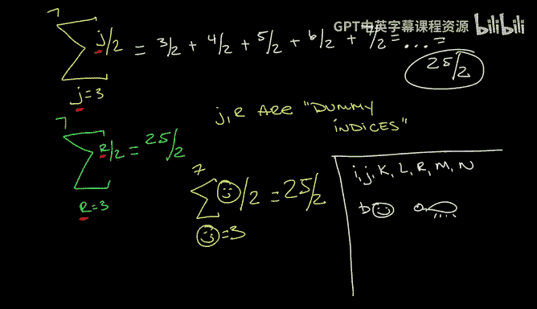

# 课程09：求和符号Σ简介 📊


在本节课中，我们将学习求和符号Σ的含义与用法。求和符号是一种简洁的数学表达方式，用于表示一系列数字的相加。我们将通过三个具体例子，逐步拆解其结构，理解如何将符号转换为实际的加法运算。


---


## 理解求和符号的结构


上一节我们介绍了本节课的目标。本节中，我们来看看求和符号的基本组成部分。


求和符号通常用大写的希腊字母 **Σ** 表示。它的核心作用是提供一种紧凑的方式来表达一连串的加法运算，避免写出冗长的算式。


一个完整的求和表达式包含以下几个部分：
*   **求和符号 (Σ)**: 表示“求和”或“相加”的操作。
*   **索引变量**: 通常使用 `i`, `j`, `k` 等字母，它是一个“哑变量”或计数器。
*   **起始值**: 写在Σ下方，表示索引变量开始的值。
*   **终止值**: 写在Σ上方，表示索引变量结束的值。
*   **通项公式**: 写在Σ后面，定义了对于每个索引值需要进行何种运算。

其通用形式可以表示为：
```
    n
    Σ   f(i)
   i=m
```
这表示将函数 `f(i)` 在 `i` 从 `m` 到 `n` (通常每次增加1) 的所有结果相加。


---


## 示例一：计算平方和


首先，我们通过一个简单例子来实践。计算以下求和式：
```
    4
    Σ   i²
   i=1
```


根据求和符号的定义，我们按以下步骤展开：


1.  **确定索引范围**: 索引 `i` 从1开始，到4结束，按1递增。所以 `i` 会依次取值为 1, 2, 3, 4。
2.  **应用通项公式**: 对每个 `i` 的值，计算 `i²`。
    *   当 `i = 1` 时，`i² = 1²`
    *   当 `i = 2` 时，`i² = 2²`
    *   当 `i = 3` 时，`i² = 3²`
    *   当 `i = 4` 时，`i² = 4²`
3.  **将所有结果相加**: 将第二步得到的所有值用加号连接起来。


因此，原求和式等价于：
```
    4
    Σ   i² = 1² + 2² + 3² + 4²
   i=1
```
最后进行算术计算：
```
1² + 2² + 3² + 4² = 1 + 4 + 9 + 16 = 30
```
所以，`Σ (i=1 to 4) i² = 30`。


---


## 示例二：计算线性表达式之和


理解了第一个例子后，我们来看一个稍复杂的情况。计算：
```
    5
    Σ   (2i + 3)
   i=1
```


我们遵循同样的步骤：


1.  **确定索引范围**: `i` 从1到5，取值为 1, 2, 3, 4, 5。
2.  **应用通项公式**: 对每个 `i`，计算 `(2i + 3)`。
    *   `i = 1`: `2*1 + 3 = 5`
    *   `i = 2`: `2*2 + 3 = 7`
    *   `i = 3`: `2*3 + 3 = 9`
    *   `i = 4`: `2*4 + 3 = 11`
    *   `i = 5`: `2*5 + 3 = 13`
3.  **将所有结果相加**。

因此，原式展开为：
```
    5
    Σ   (2i + 3) = (2*1+3) + (2*2+3) + (2*3+3) + (2*4+3) + (2*5+3)
   i=1
```
计算总和：
```
5 + 7 + 9 + 11 + 13 = 45
```
所以，`Σ (i=1 to 5) (2i + 3) = 45`。


---


## 示例三：索引变量与起始值的变化


前面的例子索引都从1开始并使用 `i`。本节中我们来看看这些规则可以如何变化。计算：
```
    7
    Σ   (j / 2)
   j=3
```


请注意两个变化：索引变量是 `j`，且起始值是3。但解题逻辑不变：


1.  **确定索引范围**: `j` 从3开始，到7结束，取值为 3, 4, 5, 6, 7。
2.  **应用通项公式**: 对每个 `j`，计算 `j / 2`。
3.  **将所有结果相加**。

展开算式：
```
    7
    Σ   (j / 2) = (3/2) + (4/2) + (5/2) + (6/2) + (7/2)
   j=3
```
计算总和：
```
(3/2) + 2 + (5/2) + 3 + (7/2) = (3+5+7)/2 + 5 = (15)/2 + 5 = 7.5 + 5 = 12.5
```
或者用分数表示：
```
(3+4+5+6+7) / 2 = 25 / 2
```
所以，`Σ (j=3 to 7) (j / 2) = 25/2`。


---


## 核心概念：哑变量


通过以上例子，我们可以总结一个关键概念：**哑变量**。


在求和符号 `Σ` 中使用的索引变量（如 `i`, `j`, `r`）被称为“哑变量”。它们就像临时工或计数器，本身没有独立的数值意义。它们的作用仅限于：
*   在指定的范围内（如下标和上标所示）依次取值。
*   将其值代入通项公式中进行计算。


这意味着，只要范围和通项公式相同，使用哪个字母作为索引变量**不影响最终结果**。例如：
```
    7               7               7
    Σ   (j / 2)  =  Σ   (r / 2)  =  Σ   (😊 / 2) = 25/2
   j=3             r=3            😊=3
```
虽然通常约定俗成使用 `i, j, k` 等字母，但从数学上讲，任何符号都可以。


---


## 总结


本节课中我们一起学习了求和符号 `Σ` 的用法。
*   求和符号 `Σ` 提供了一种简洁的方式来表示一系列数值的加法。
*   其结构包括：索引变量（哑变量）、起始值、终止值和通项公式。
*   计算时，只需让索引变量从起始值逐步增加到终止值（通常每次加1），将每个值代入通项公式计算，最后将所有结果相加。
*   理解“哑变量”的概念至关重要，它说明索引变量本身只是一个占位符，不影响求和的本质。




掌握求和符号是理解更复杂数学和统计概念的基础，它能让表达和计算变得更加清晰高效。