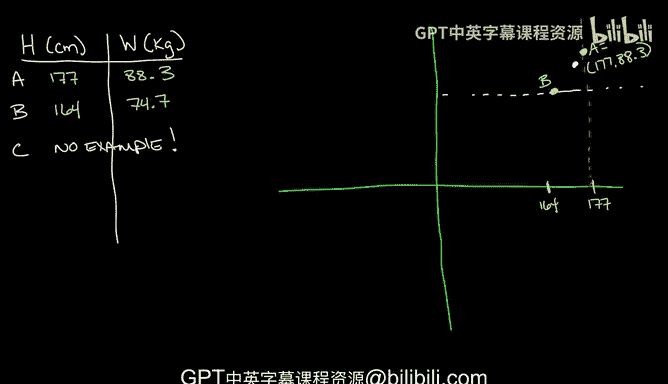

# 课程12：笛卡尔平面与点坐标绘制 📍

在本节课中，我们将学习笛卡尔平面的基本概念，并掌握如何在平面上绘制点。这是将一维数轴扩展到二维空间的关键一步，对于理解数据可视化、函数图像等至关重要。

---

上一节我们介绍了实数轴，它是一种在一条线上表示数字的方法。本节中，我们来看看**笛卡尔平面**。

笛卡尔平面，通常表示为 **R²**，是一种表示两个信息的方式。它由两条垂直的数轴构成：水平的**x轴**和垂直的**y轴**。平面上的每一个点都对应一个**有序数对** `(x, y)`。

一个非常特殊的点是**原点**，即两条轴的交点，其坐标为 `(0, 0)`。

---

现在，我们来看看如何在平面上绘制具体的点。以下是绘制点的基本步骤：

1.  **从原点出发**。
2.  **根据第一个数字（x坐标）移动**：正数向右，负数向左。
3.  **根据第二个数字（y坐标）移动**：从x坐标确定的位置出发，正数向上，负数向下。

让我们通过几个例子来实践一下：

*   **点 A (2, 3)**：从原点向右移动2个单位，再向上移动3个单位。
*   **点 B (-1, 5)**：从原点向左移动1个单位，再向上移动5个单位。
*   **点 C (4, -0.5)**：从原点向右移动4个单位，再向下移动0.5个单位。
*   **点 D (-5, -5)**：从原点向左移动5个单位，再向下移动5个单位。

这就是在平面上绘制点的全部思想。

---

在绘制点时，需要注意一个符号细节：在平面坐标的语境下，`(-5, -5)` 这样的写法表示一个点的x坐标为-5，y坐标为-5。这与表示开区间的符号 `(-5, -5)` 看起来相同，但含义完全不同。为了避免混淆，有时也会写作 `(-5, -5)` 或 `a = (2, 3)`。

---

笛卡尔平面被坐标轴自然地分成了四个区域，我们称之为**象限**。以下是各象限的定义：

*   **第一象限**：包含所有 `x > 0` 且 `y > 0` 的点。
*   **第二象限**：包含所有 `x < 0` 且 `y > 0` 的点。
*   **第三象限**：包含所有 `x < 0` 且 `y < 0` 的点。
*   **第四象限**：包含所有 `x > 0` 且 `y < 0` 的点。

坐标轴本身（x轴和y轴）不属于任何象限。

---

那么，在平面上绘制点有什么用呢？一个非常实际的应用是**可视化数据关系**。

假设我们测量了三个人的身高（厘米）和体重（千克），并得到以下数据：

*   **A**：`(177, 88.3)` （美国男性平均身高体重）
*   **B**：`(164, 74.7)` （美国女性平均身高体重）

当我们把这些点绘制在平面上（以身高为x轴，体重为y轴），可以直观地看到：
*   点B位于点A的左下方，这清晰地表明平均而言，美国女性比男性更矮、更轻。
*   如果我们从点B水平向右移动，意味着体重相同但身高增加。
*   如果我们从点B垂直向上移动，意味着身高相同但体重增加。

这种可视化方法能帮助我们快速理解两个变量之间的关系。需要注意的是，在这个具体例子中，只有第一象限（正身高、正体重）的数据是有实际意义的。

---

本节课中我们一起学习了笛卡尔平面的基本构成、如何在平面上根据坐标 `(x, y)` 绘制点、四个象限的定义，以及通过一个身高体重的例子了解了绘制点在数据可视化中的实际应用。掌握这些是后续学习函数图像、线性关系等更复杂概念的基础。