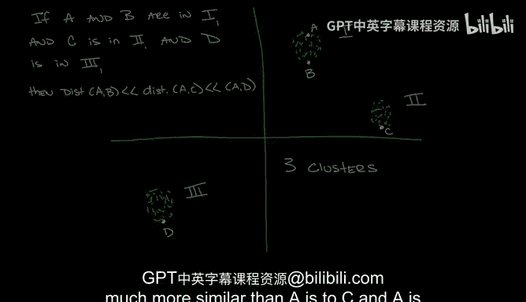

# 📐 课程13：平面中的距离公式与数据科学应用


在本节课中，我们将学习笛卡尔平面中两点间距离的计算公式，并探讨该公式在数据科学中的两个重要应用：最近邻算法和聚类分析。


---

## 📐 回顾：勾股定理

在进入笛卡尔平面之前，我们先回顾一个基础概念：勾股定理。


假设我们有一个直角三角形，其中一个角是直角。设两条直角边的长度分别为 **x** 和 **y**，斜边的长度为 **z**。


勾股定理告诉我们：


**z² = x² + y²**


或者等价地：


**z = √(x² + y²)**


这个定理是理解距离公式的关键。


---


## 📏 笛卡尔平面中的距离公式


上一节我们回顾了勾股定理，本节中我们来看看如何将其应用于笛卡尔平面。


假设平面上有两个点：
- 点 **A**，坐标为 **(a, b)**
- 点 **C**，坐标为 **(c, d)**


我们想知道点 A 和点 C 之间的距离。


**距离公式** 给出了答案：


**距离 AC = √[(c - a)² + (d - b)²]**


这个公式为什么成立？我们可以通过构造一个直角三角形来理解。


连接点 A 和点 C。从点 A 出发，画一条水平虚线到点 **(c, b)**；再从点 **(c, b)** 出发，画一条垂直虚线到点 C。这样就形成了一个直角三角形。
- 水平虚线的长度是 **|c - a|**（x 坐标的差值）。
- 垂直虚线的长度是 **|d - b|**（y 坐标的差值）。
- 点 A 到点 C 的连线就是这个直角三角形的斜边。

根据勾股定理，斜边的长度就是 **√[(c - a)² + (d - b)²]**。这就是距离公式的由来。

---


## 🔢 距离公式计算示例


理解了公式的原理后，我们通过几个例子来练习计算。


假设我们有以下点：
- 点 **A** = (1, 1)
- 点 **B** = (5, 4)
- 原点 **O** = (0, 0)
- 点 **D** = (1.5, 1)


以下是计算过程：


**1. 计算点 A 和点 B 之间的距离：**
距离 AB = √[(5 - 1)² + (4 - 1)²] = √[4² + 3²] = √[16 + 9] = √25 = **5**

**2. 计算点 A 和原点 O 之间的距离：**
距离 AO = √[(1 - 0)² + (1 - 0)²] = √[1² + 1²] = √2 ≈ **1.4**


**3. 计算点 A 和点 D 之间的距离：**
由于它们只有 x 坐标不同，距离 AD = |1.5 - 1| = **0.5**


---


## 👥 数据科学应用一：最近邻


现在，我们来看距离公式在数据科学中的一个直接应用：**最近邻**。


假设我们有一个点集 **S = {O, B, D}**，我们想知道对于点 A 来说，S 中哪个点离它最近。


根据上面的计算结果：
- 距离 AD = 0.5 （最近）
- 距离 AO ≈ 1.4 （第二近）
- 距离 AB = 5 （最远）


因此，我们可以说：
- 点 A 在集合 S 中的 **最近邻** 是点 **D**。
- **第二近邻** 是原点 **O**。
- **第三近邻**（即最远点）是点 **B**。


在数据科学和机器学习中，最近邻算法通过计算距离来判断一个新数据点与已知数据点的相似性，常用于分类和预测。


---


## 🧩 数据科学应用二：聚类分析


距离概念的另一个重要应用是 **聚类分析**。


观察下图中的点分布，我们可以直观地将它们分为三组或三个“簇”。

```
（假设这里有一张图，显示点分成了三个明显的群组）
```


假设点 **A** 和 **B** 属于簇1，点 **C** 属于簇2，点 **D** 属于簇3。


那么，通常会有以下关系：
**距离 AB << 距离 AC** 并且 **距离 AB << 距离 AD**


这意味着，属于同一个簇内的点（如 A 和 B）彼此之间的距离，远小于它们与其他簇中点（如 C 或 D）的距离。通过计算点与点之间的距离，我们可以将数据自动分组到不同的簇中，从而发现数据内在的结构和模式。聚类是无监督学习中的核心方法。


---


## 📝 总结


本节课我们一起学习了以下内容：
1.  **距离公式**：掌握了计算笛卡尔平面中任意两点 **(a, b)** 和 **(c, d)** 之间距离的核心公式：**√[(c - a)² + (d - b)²]**。
2.  **公式原理**：理解了该公式源于勾股定理，通过在两点间构造直角三角形得以证明。
3.  **数据科学应用**：
    *   **最近邻**：利用距离找出数据集中与目标点最相似的点，是监督学习中的重要方法。
    *   **聚类分析**：通过比较点间距离，将数据划分为不同的组或“簇”，是无监督学习中的重要方法。




距离是数据科学中最基本且强大的概念之一，它为许多高级算法奠定了基础。