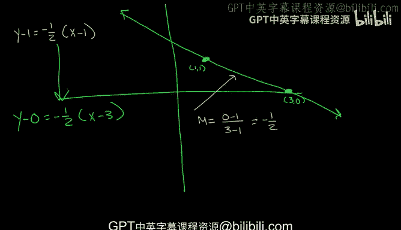

# 📐 课程15：笛卡尔平面斜截式直线方程

在本节课中，我们将学习一种描述直线的更简洁、更常用的公式——**斜截式方程**。我们将从上一节介绍的点斜式方程出发，推导出斜截式方程，并通过具体例子理解其含义和应用。

---

## 🔍 从点斜式到斜截式

上一节我们介绍了点斜式直线方程。现在，我们来看一个具体的例子，并以此为基础引出斜截式方程。

我们有一条直线 **L**。已知它经过点 **(2, 1)**，并且斜率为 **m = 1**。

因此，根据点斜式公式，该直线的方程为：
**y - 1 = 1 * (x - 2)**

这意味着，任何位于直线 **L** 上的点 **(x, y)** 都必须满足这个方程。

---

## 🎯 认识Y轴截距

本节课的重点是介绍一个更简单的公式，称为**斜截式公式**。它应用更广泛。之所以先介绍点斜式，是因为可以很容易地从点斜式推导出斜截式。

首先，这是一个关键概念：直线 **L** 上有无穷多个点，但有一个点特别重要，我们称之为 **y轴截距**。

**y轴截距** 是直线与 **Y轴** 相交的**唯一**点。

我们来思考这个点的坐标。它的 **x坐标** 显然是 **0**，因为Y轴上的所有点都满足 **x = 0**。我们不知道它的 **y坐标** 是多少。在数学中，当我们不知道某个值但想用它进行计算时，通常会用一个符号来表示它。

我们把这个点记为 **(0, b)**。字母 **b** 常用来表示y轴截距。

---

## 🕵️ 求解截距 b

现在，让我们来当一回侦探，找出 **b** 的值。既然我们知道点 **(0, b)** 在直线 **L** 上，并且知道直线的方程，我们就可以求出 **b**。

因为 **(0, b)** 在直线上，所以我们可以将 **x = 0** 和 **y = b** 代入点斜式方程：

**b - 1 = 1 * (0 - 2)**

现在进行简单的代数运算：
**b - 1 = -2**
**b = -1**

结果符合预期，从图中看，截距确实在y轴的负半轴。因此，y轴截距的坐标是 **(0, -1)**。

---

## ✨ 推导斜截式方程

现在，让我们用新找到的截距点 **(0, -1)** 来重写点斜式方程。已知斜率为 **m = 1**，点斜式公式告诉我们：

**y - (-1) = 1 * (x - 0)**

这等价于：
**y + 1 = x**
或者
**y = x - 1**

这就是直线的**斜截式方程**。

---

## 📝 斜截式方程的一般形式

我们可以将其推广到一般情况：

如果一条直线 **L** 的斜率为 **m**，并且与y轴相交于点 **(0, b)**，那么该直线的方程可以写为：

**y = m * x + b**

在这个公式中：
*   **m** 是直线的**斜率**。
*   **b** 是**y轴截距**，即截点的y坐标。

斜截式是一种非常直观的描述直线的方式，因为它几乎能让你“看到”方程就画出直线。

---

## 🎨 斜截式的直观理解

例如，如果给你方程 **y = 2x + 1**，我可以立即画出这条直线的草图：
*   y轴截距是 **1**，所以直线穿过点 **(0, 1)**。
*   斜率是 **2**，这意味着直线比45度角更陡峭。

斜截式公式 **y = m x + b** 的美妙之处在于：
*   **斜率 m** 告诉你直线的**倾斜角度**。
*   **截距 b** 告诉你直线在**y轴上的锚点位置**。

这使得它比点斜式在某些方面更直观、更易用。

---

## 💡 综合应用示例

让我们用一个完整的例子来结束本节课。假设有一条直线 **L**，它经过点 **(1, 1)** 和 **(3, 0)**。请找出它的方程。

**第一步：草图与求斜率**
首先，画出点 **(1, 1)** 和 **(3, 0)**，并连接它们得到直线。

接下来计算斜率 **m**：
**m = (0 - 1) / (3 - 1) = -1 / 2**

所以直线的斜率是 **-1/2**。

**第二步：使用点斜式**
我们可以使用点斜式公式。选择点 **(1, 1)**，得到方程：
**y - 1 = (-1/2) * (x - 1)**

这已经是直线的一个有效方程。

**有趣的一点：** 我们也可以选择另一个点 **(3, 0)** 来写点斜式方程：
**y - 0 = (-1/2) * (x - 3)**

这两个方程看起来不同，但它们描述的是同一条直线。你可以通过代数变换将其中一个转化为另一个，我鼓励你在课后尝试一下，以加深理解。

---

## 📚 本节课总结

在本节课中，我们一起学习了：
1.  **y轴截距**的概念：直线与y轴的交点，坐标为 **(0, b)**。
2.  如何从已知直线方程和截距的x坐标（恒为0）求解截距 **b**。
3.  **斜截式直线方程**的推导和一般形式：**y = m * x + b**。
4.  斜截式方程的直观意义：**斜率m**控制倾斜度，**截距b**控制上下位置。
5.  通过具体例子综合运用了点斜式和斜截式来求解直线方程。

斜截式是描述直线最常用、最便捷的形式之一，熟练掌握它对于后续的数学学习至关重要。