# 课程22：整数指数的运用 📊

在本节课中，我们将要学习整数指数的基本概念和运用。指数是数学中一种强大的工具，用于简化重复乘法的表达方式。我们将从正整数指数开始，逐步探讨零指数和负整数指数，并了解它们在科学记数法中的应用。

---

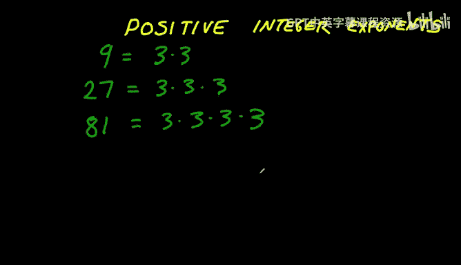

## 正整数指数 🔢

上一节我们介绍了指数的基本概念，本节中我们来看看正整数指数。正整数指数是用于计数的数字，例如1、2、3等。

当我们有一个数字，比如9，它等于3乘以3。3是9的一个因数，并且它重复出现了两次。在数字27中，因数3出现了三次。在数字81中，因数3出现了四次。

我们可以使用正整数指数，即写在因数右上角的数字，来计算同一个因数在一个数字中重复出现的次数。

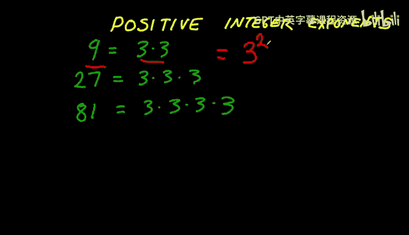

以下是几个例子：

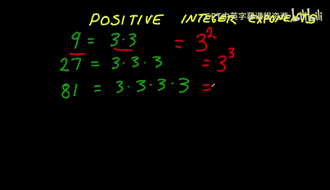

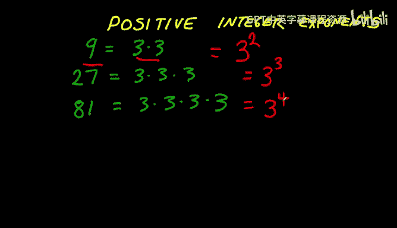

*   **9** = 3 × 3 = **3²**，其中2是指数。
*   **27** = 3 × 3 × 3 = **3³**，其中3是指数。
*   **81** = 3 × 3 × 3 × 3 = **3⁴**，其中4是指数。

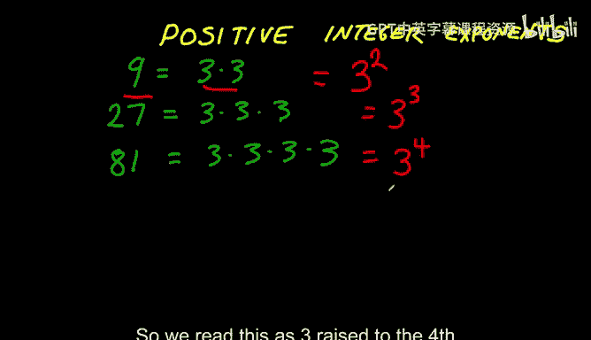

我们将其读作“三的四次方”或简称为“三的四次方”。

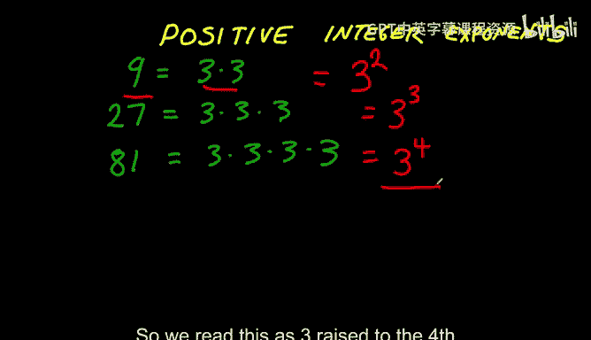

让我们看另一个例子。数字248832等于12 × 12 × 12 × 12 × 12。能够将其写作**12⁵**（其中5是指数）带来了极大的便利，这个数字就是12的五次方。

需要注意的是，由于历史原因，数字的二次方和三次方有特殊的名称。

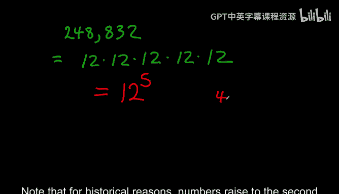

*   **4²** 可以读作“四的二次方”，也可以读作“四的平方”。
*   **4³** 可以读作“四的三次方”，也可以读作“四的立方”。

---

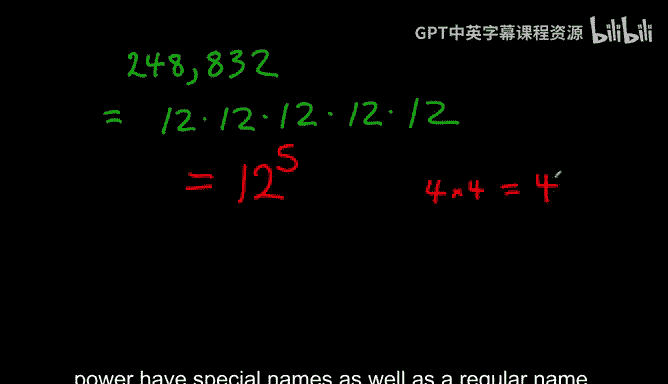

## 零指数 0️⃣

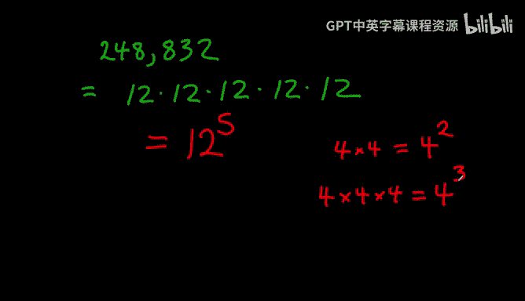

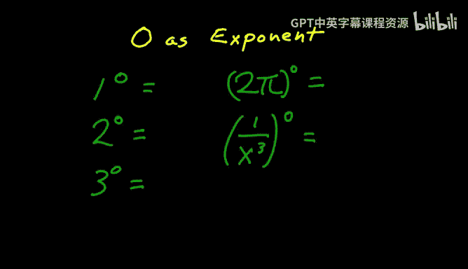

上一节我们讨论了正整数指数，本节中我们来看看零指数。这些问题很简单。

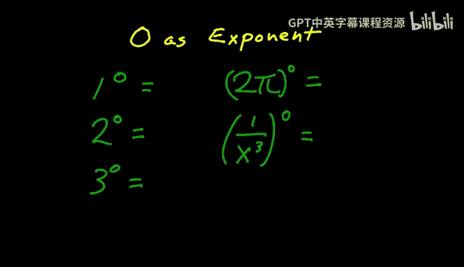

为什么这么说？因为根据指数的定义，**任何非零的数字，其零次方都等于1**。

以下是几个例子：

*   **3⁰ = 1**
*   **2⁰ = 1**
*   **(2π)⁰ = 1**
*   **(1/x³)⁰ = 1** （前提是 x ≠ 0）

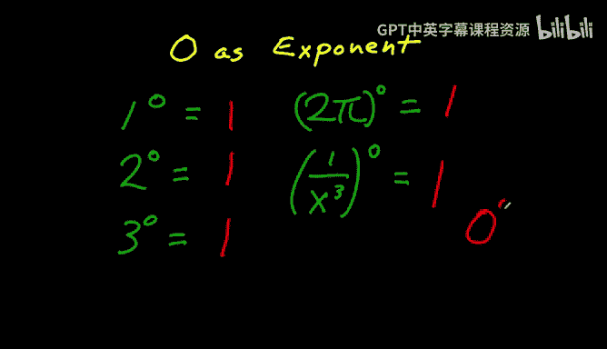

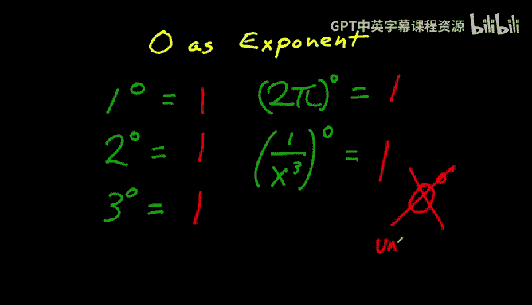

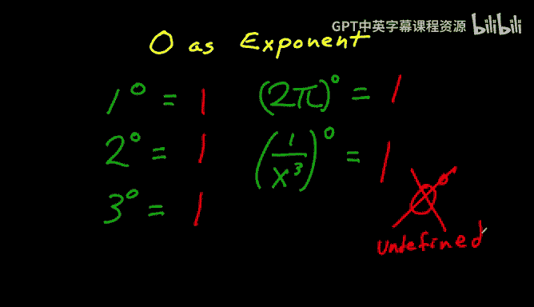

即使对于数学家来说，**0⁰** 也有些过于奇怪，因此它通常被定义为**未定义**。

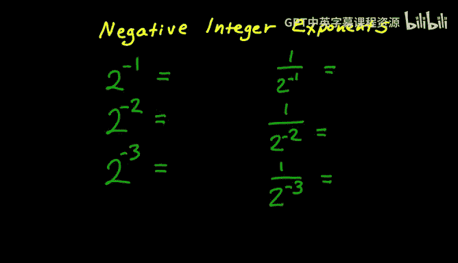

---

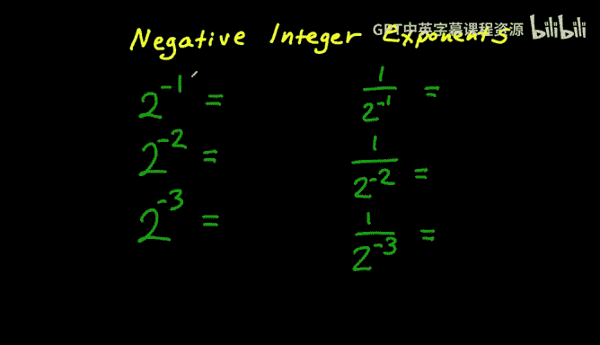

## 负整数指数 🔄

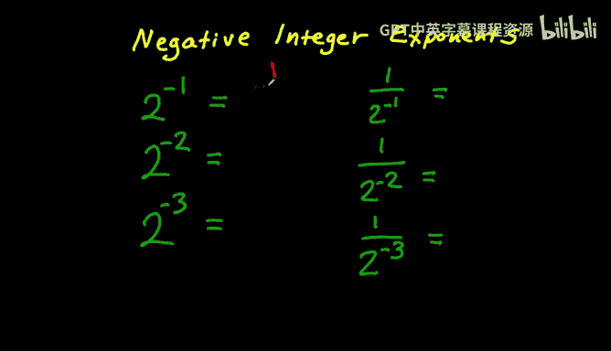

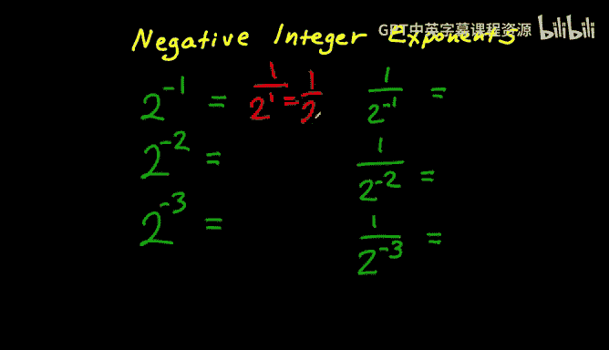

上一节我们介绍了零指数，本节中我们来看看负整数指数。

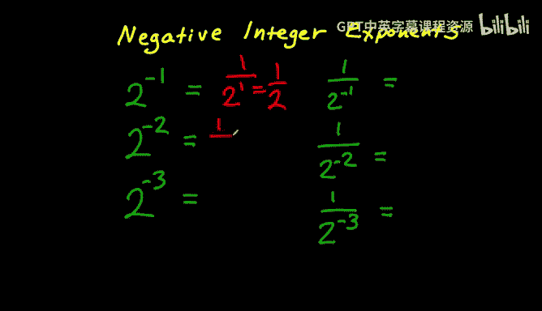

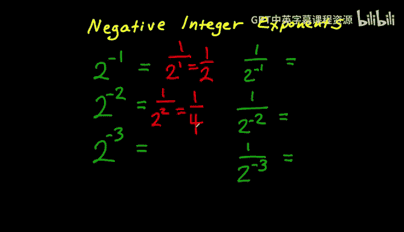

2的负一次方写作 **2⁻¹**，它等于 **1 / 2¹**，也就是 **1/2**。

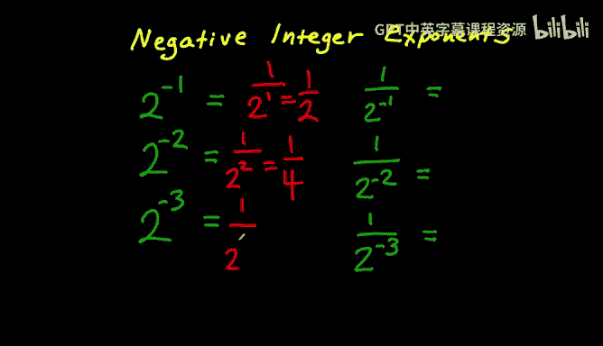

2的负二次方写作 **2⁻²**，它等于 **1 / 2²**，也就是 **1/4**。

2的负三次方写作 **2⁻³**，它等于 **1 / 2³**，也就是 **1/8**。

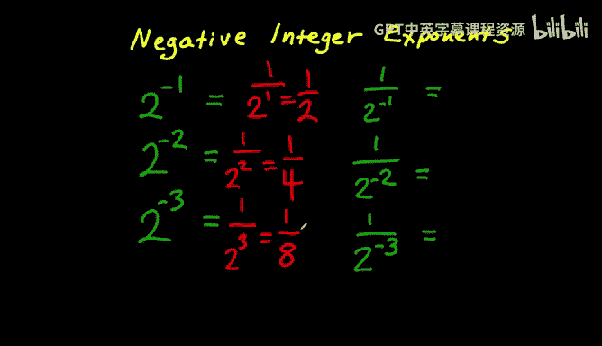

你应该能看出这里的规律：**将一个数字进行负指数运算，等同于用1除以该数字的正指数形式**。

现在，让我们考虑除以一个负指数的情况。

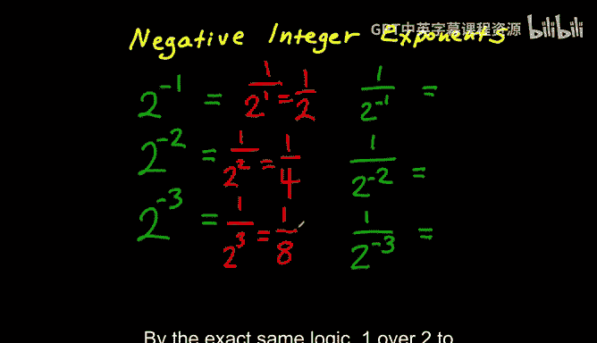

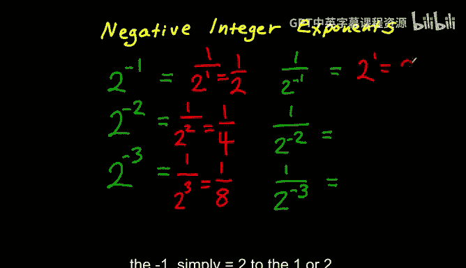

根据完全相同的逻辑：

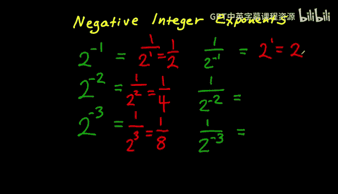

*   **1 / 2⁻¹** 简单地等于 **2¹** 或 **2**。
*   **1 / 2⁻²** 简单地等于 **2²** 或 **4**。
*   **1 / 2⁻³** 简单地等于 **2³** 或 **8**。

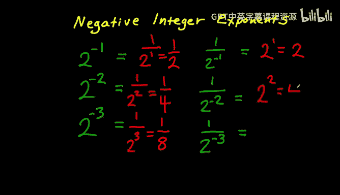

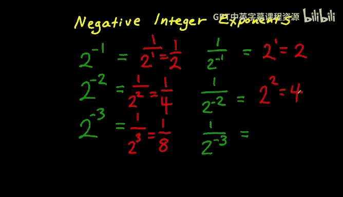

我们可以用字母来代表几乎任何数字，从而表达负指数的一般规则。

以下是负指数的一般规则：

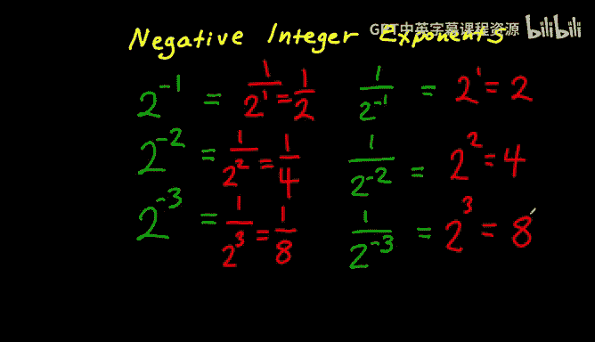

*   **x⁻ⁿ = 1 / xⁿ**
*   **1 / x⁻ⁿ = xⁿ**

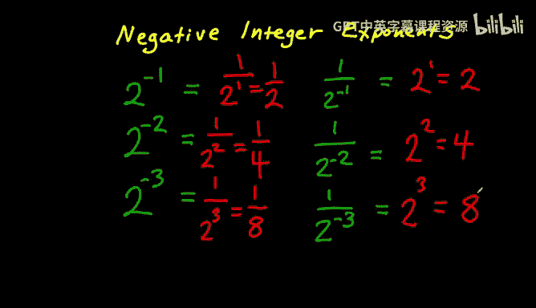

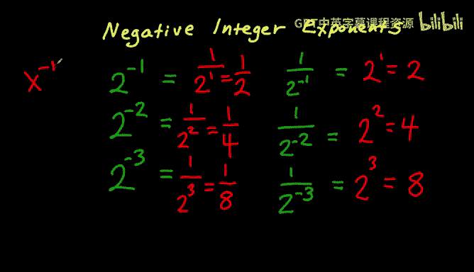

---

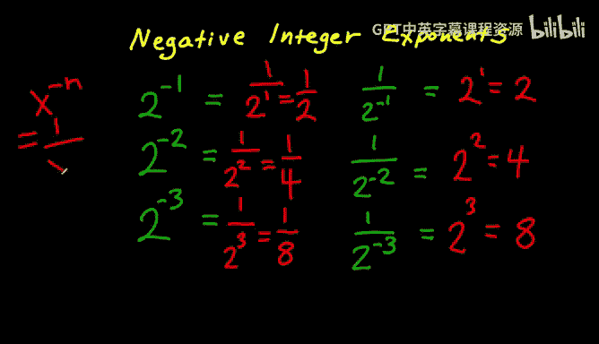

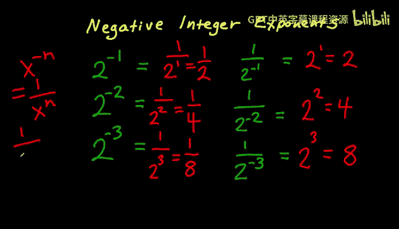

## 科学记数法 🧪

指数最常见的用途之一是我们所说的**科学记数法**。科学记数法是一种书写数字的方式，可以避免写出大量零。

我们的做法是：取数字中具有有效数字的部分，将小数点放在第一个有效数字之后，然后乘以10的适当次方。

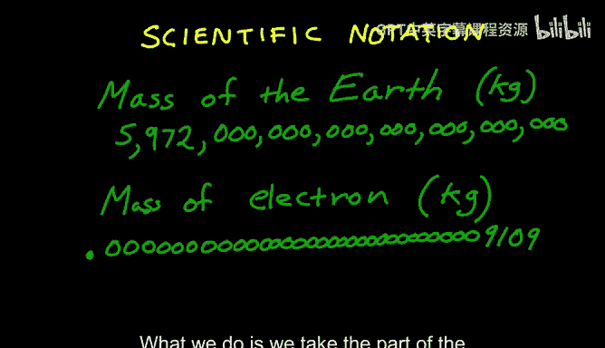

例如，太阳的质量是 5,972,000,000,000,000,000,000,000 千克。在科学记数法中，我们取有效数字部分 **5, 9, 7, 2**，并将小数点放在第一个数字之后，得到 **5.972**。然后我们乘以 **10²⁴**。**10²⁴** 意味着你需要将小数点向右移动24位。

让我们再试一个。如果我们有一个小于1的数字，我们需要将小数点向左移动，并且指数为负。

例如，电子的质量是 0.0000000000000000000000000000009109 千克。在科学记数法中，我们写作 **9.109 × 10⁻³¹**，因为我们需要将小数点向左移动31位。

需要记住的关键点是：我们只需要保留有效的非零数字，并且**小数点左边始终有一位数字**。

---

## 总结 📝

本节课中我们一起学习了整数指数的运用。我们从正整数指数开始，了解了它如何简化重复乘法的表达。接着，我们探讨了零指数（任何非零数的零次方等于1）和负整数指数（负指数表示倒数）。最后，我们学习了如何利用指数，通过科学记数法来简洁地表示非常大或非常小的数字。掌握这些基本概念是理解更复杂数学运算的重要基础。