# 课程25：对数换底公式 📐

在本节课中，我们将要学习对数运算中一个非常实用的工具——**换底公式**。这个公式允许我们在不同的对数底数之间进行转换，例如将底数为2的对数转换为底数为10的对数，这在数据科学中处理不同来源的数据时尤其有用。

---

上一节我们介绍了对数的基本概念，本节中我们来看看如何在不同底数的对数之间进行转换。

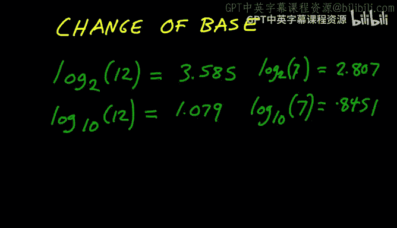

在数据科学中，我们通常使用以10为底的对数，有时也使用以2为底的对数。此外，我们还会用到一种称为**自然对数**（记作 Ln）的对数，它以常数 **e** 为底，我们将在后续课程中讨论。但无论如何，无论底数是什么，我们都可以使用一个简单的公式将对数从一个底数转换到另一个底数。

一个重要的核心概念是：**使用不同的底数计算同一个数的对数，得到的结果是不同的**。

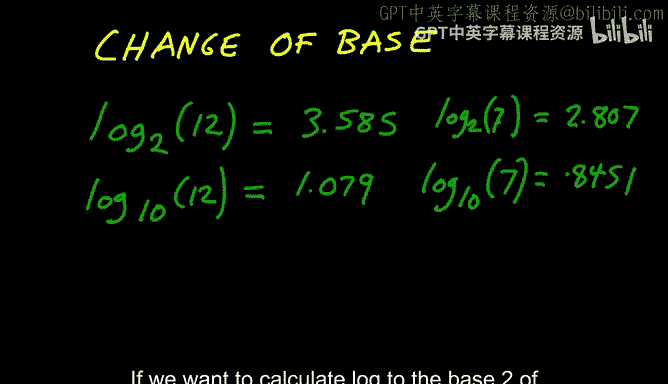

例如：
*   计算以2为底12的对数，我们得到：`log₂(12) ≈ 3.585`
*   计算以10为底12的对数，我们得到：`log₁₀(12) ≈ 1.079`

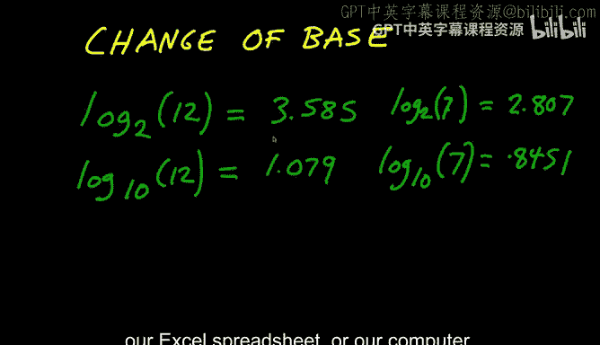

你可以验证：`2^3.585 ≈ 12` 且 `10^1.079 ≈ 12`。虽然结果不同，但它们都正确地描述了12与各自底数的指数关系。同样地：
*   `log₂(7) ≈ 2.807` （因为 `2^2.807 ≈ 7`）
*   `log₁₀(7) ≈ 0.8451` （因为 `10^0.8451 ≈ 7`）

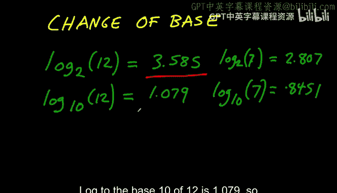

---

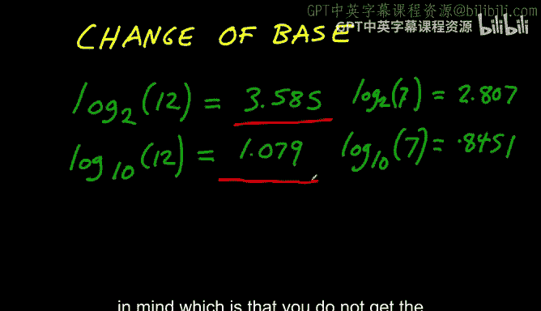

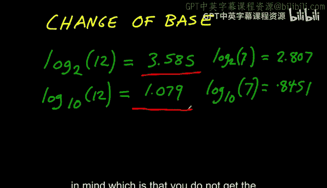

## 换底公式 🧮

现在，我们来学习通用的换底公式。

假设我们有一个以 `x` 为底的对数 `logₓ(b)`，我们想将它转换为以 `a` 为底的新对数。

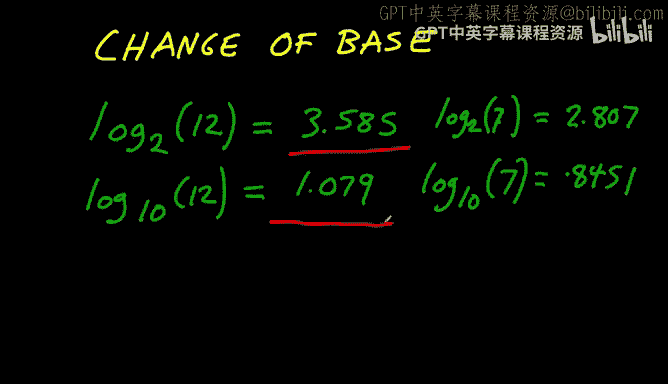

**换底公式**如下：

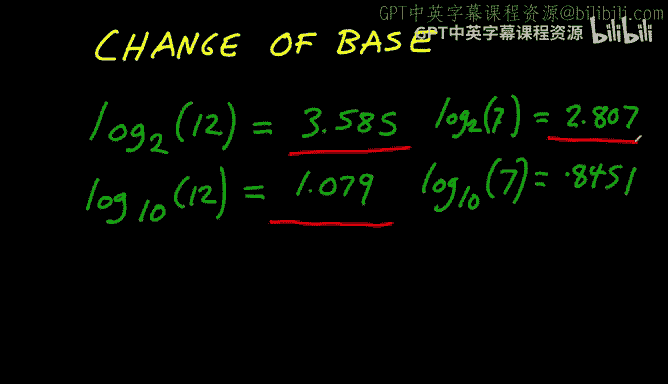

`logₐ(b) = logₓ(b) / logₓ(a)`

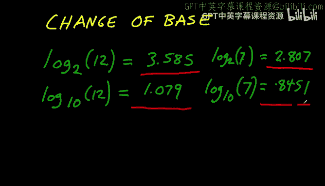

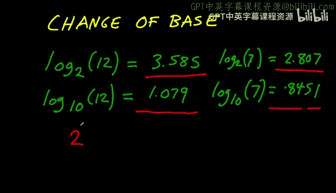

这个公式的含义是：**要得到以新底数 `a` 为底、真数为 `b` 的对数值，可以用以旧底数 `x` 为底、真数为 `b` 的对数值，除以以旧底数 `x` 为底、真数为新底数 `a` 的对数值。**

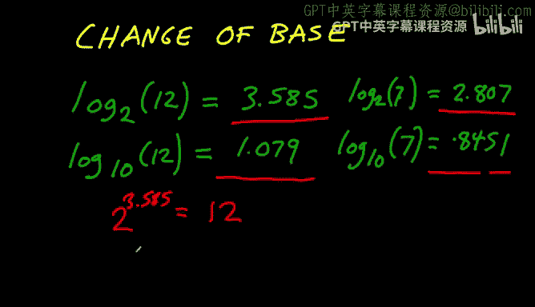

---

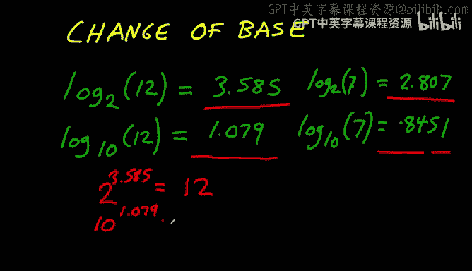

## 公式应用示例 💡

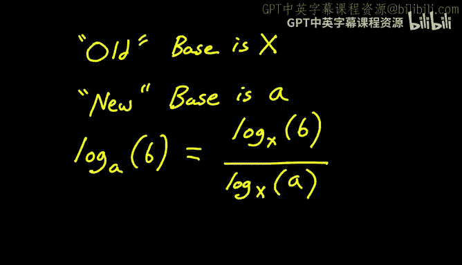

让我们通过具体例子来理解这个公式是如何工作的。

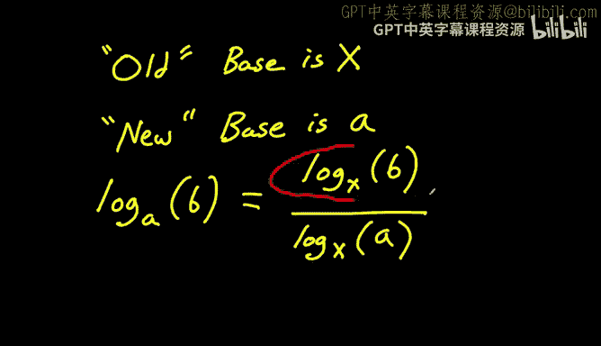

**示例1：将 `log₁₀(12)` 转换为以2为底的对数。**

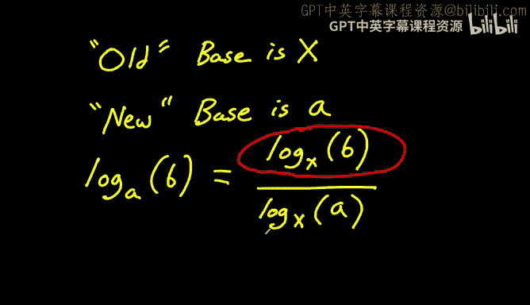

根据公式，我们想求 `log₂(12)`。这里旧底数 `x = 10`，新底数 `a = 2`，真数 `b = 12`。

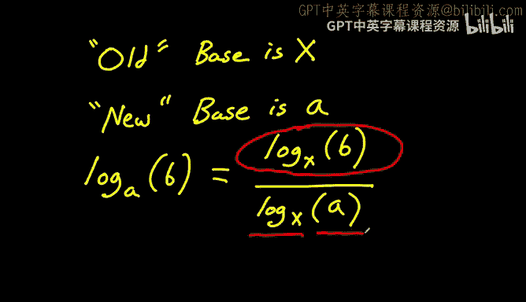

所以：
`log₂(12) = log₁₀(12) / log₁₀(2)`

我们已知：
*   `log₁₀(12) ≈ 1.079`
*   `log₁₀(2) ≈ 0.30103`

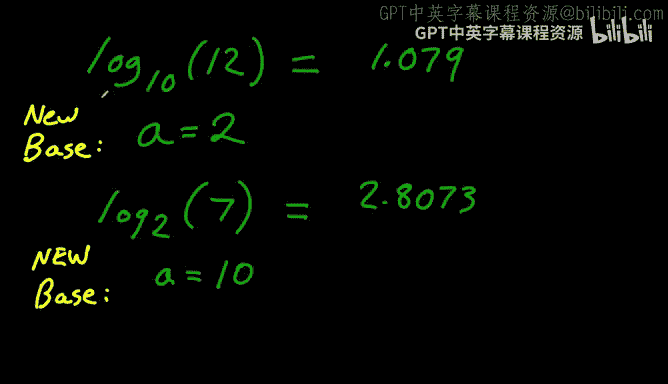

计算：
`log₂(12) ≈ 1.079 / 0.30103 ≈ 3.585`

结果与我们直接计算 `log₂(12)` 得到的一致。

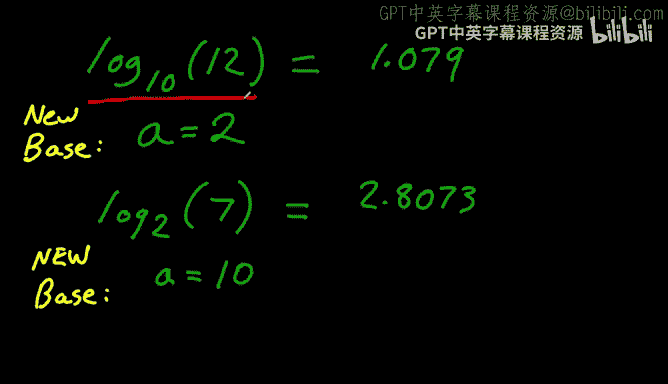

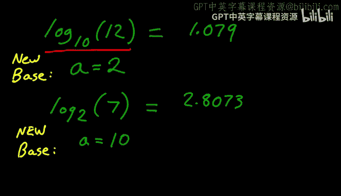

**示例2：将 `log₂(7)` 转换为以10为底的对数。**

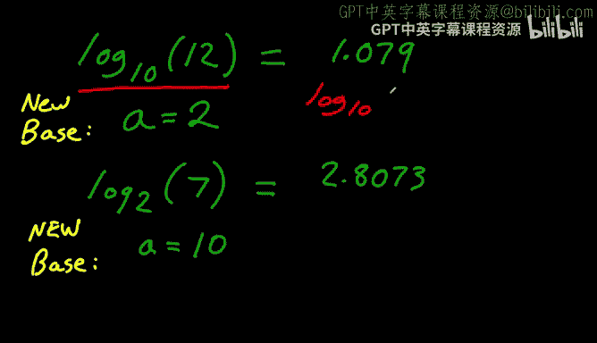

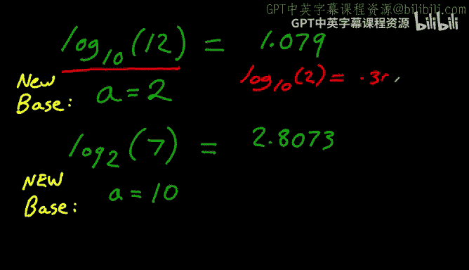

这里，我们想求 `log₁₀(7)`。旧底数 `x = 2`，新底数 `a = 10`，真数 `b = 7`。

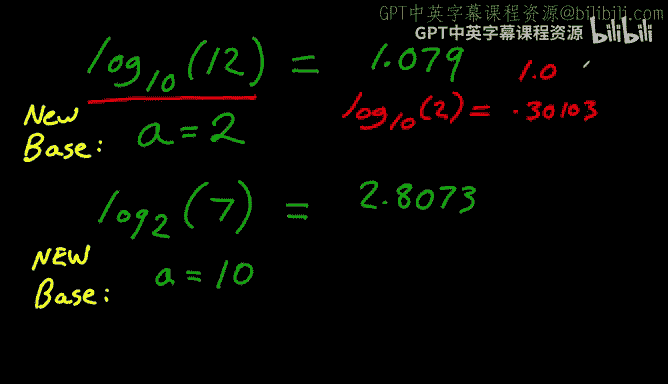

所以：
`log₁₀(7) = log₂(7) / log₂(10)`

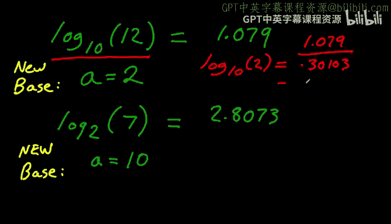

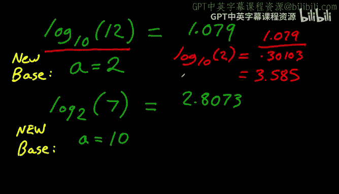

我们已知：
*   `log₂(7) ≈ 2.807`
*   `log₂(10) ≈ 3.3219`

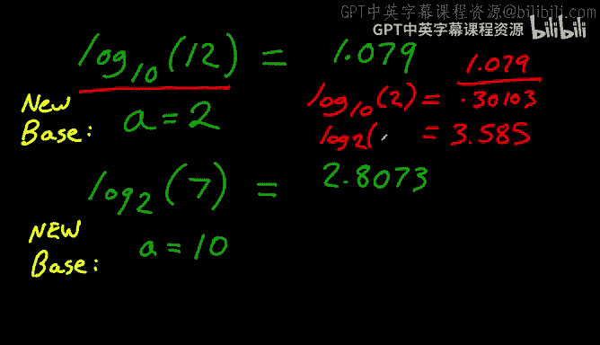

计算：
`log₁₀(7) ≈ 2.807 / 3.3219 ≈ 0.845`

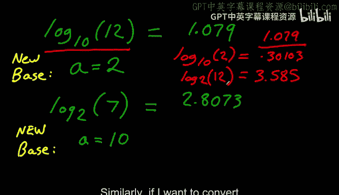

结果也与我们已知的 `log₁₀(7)` 值相符。

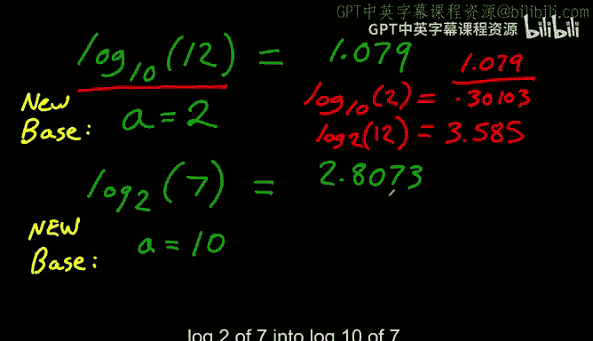

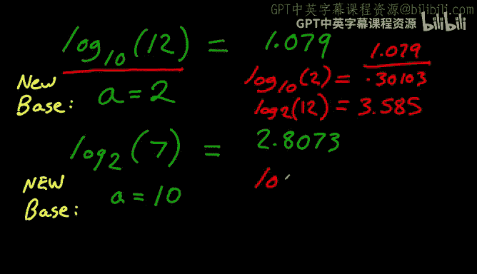

---

## 核心要点总结 ✨

本节课中我们一起学习了对数运算的换底公式。

以下是本课的核心要点：
*   **公式**：要将对数 `logₓ(b)` 转换为以 `a` 为底，使用公式 **`logₐ(b) = logₓ(b) / logₓ(a)`**。
*   **操作**：用**原对数值**除以**以原底数为底、新底数为真数的对数值**，即可得到新底数下的对数值。
*   **练习**：掌握这个公式的最佳方式就是进行练习。通过计算一些例子，你会对这个转换过程变得更加熟悉和直观。

记住这个强大的工具，它可以帮助你在不同场景下灵活地运用对数进行计算和分析。