# 课程27：概率的定义与表示法 📊

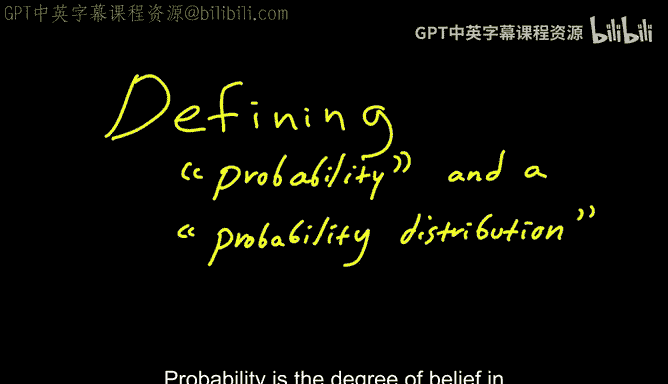

在本节课中，我们将要学习概率的基本定义、核心表示法以及概率分布的概念。我们会从最基础的概念出发，解释概率如何量化我们对一个陈述的相信程度，并介绍如何用数学符号来表示和计算概率。

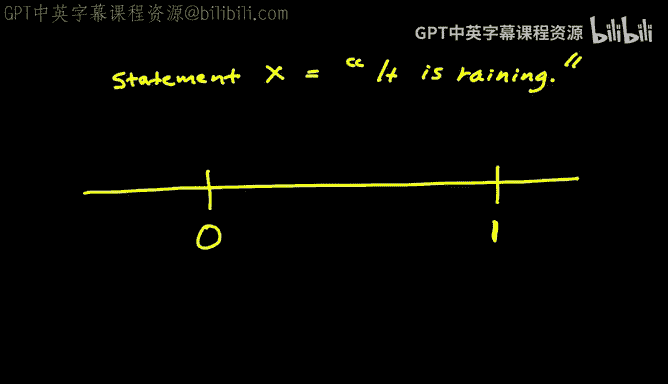

## 概率的定义

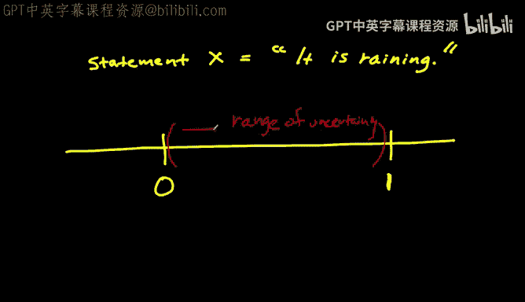

概率是对一个陈述（或事件）真实性或虚假性的相信程度。

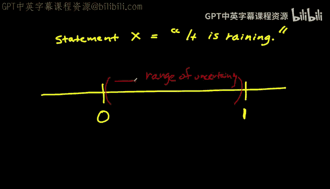

当存在不确定性时，我们会给一个陈述赋予一个介于0和1之间的值。这个范围代表了不确定性的程度。

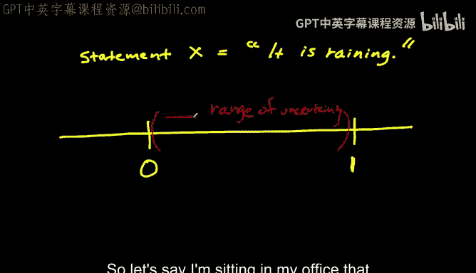

*   当我们**确定**一个陈述为真时，其概率为 **1**。
*   当我们**确定**一个陈述为假时，其概率为 **0**。

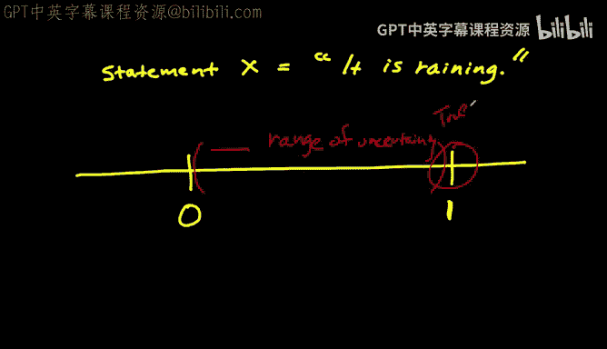

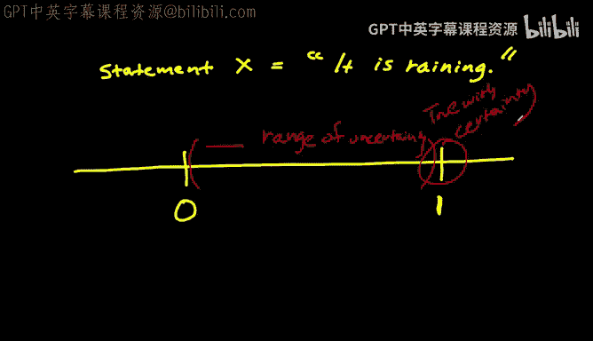

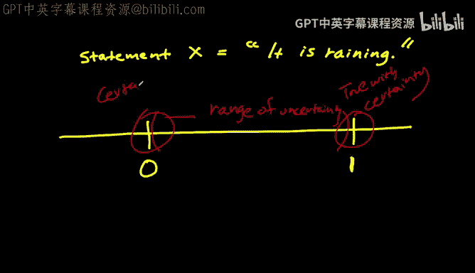

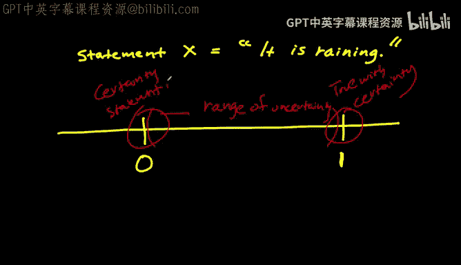

例如，假设你坐在一间没有窗户的办公室里，不知道外面是否在下雨。此时，你对“正在下雨”这个陈述的相信程度（概率）就会是0到1之间的某个值。当你了解到外面的真实天气状况后，这个概率就会更新为1（确定下雨）或0（确定没下雨）。

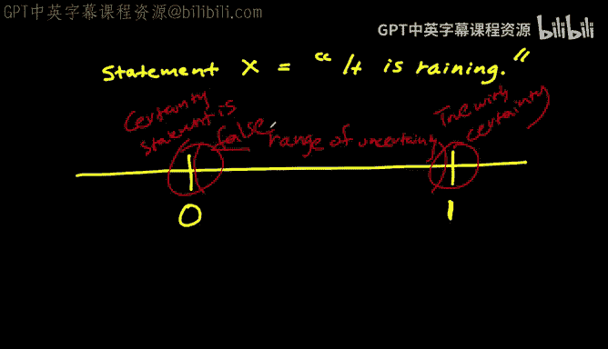

## 概率的表示法

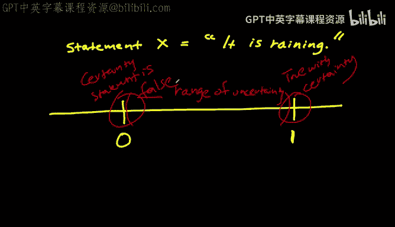

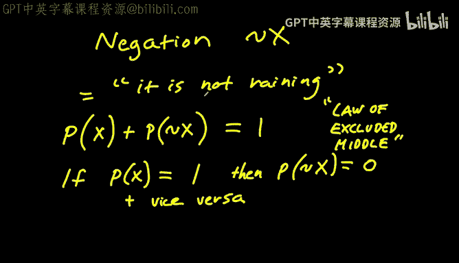

我们使用特定的数学符号来表示概率。

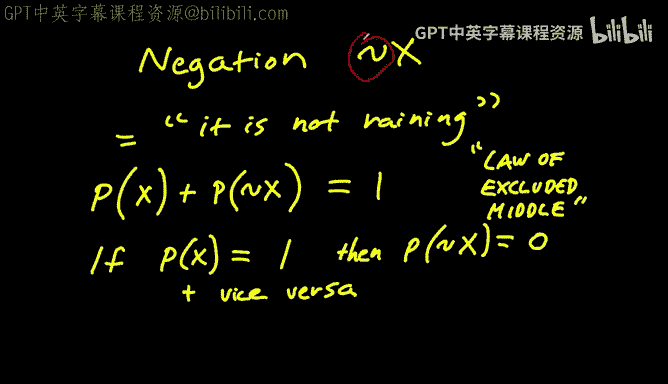

*   我们写作 **`P(X)`**，表示陈述X的概率，或由陈述X所代表的结果的概率。
*   我们使用波浪号 **`~`** 来表示一个陈述的否定（非）。

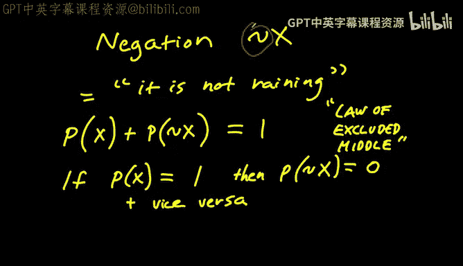

例如，`P(下雨)` 表示“正在下雨”的概率，而 `P(~下雨)` 则表示“没有下雨”的概率。

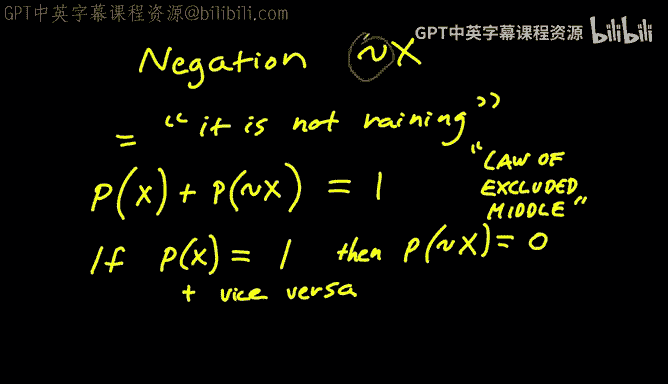

## 概率分布

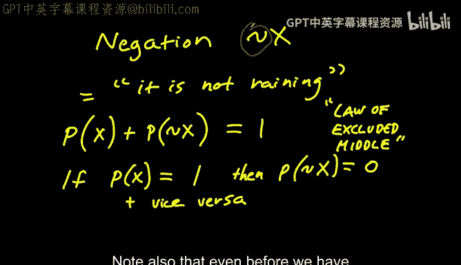

每当有一个陈述及其否定时，我们就构成了一个简单的二元概率分布。

换句话说，像“正在下雨”和“没有下雨”这样一对陈述，共同形成了一个概率分布。当我们掌握了关于情况的完整信息时，这两个陈述中**必须有一个为真**。

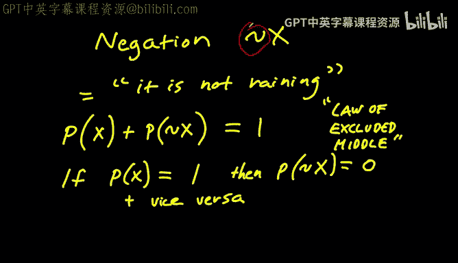

需要注意的是，即使在我们掌握完整信息之前，这两个陈述的概率之和也必须等于1。例如，如果你认为现在有75%（即3/4）的概率在下雨，那么你就必须认为有25%（即1/4）的概率没有下雨。

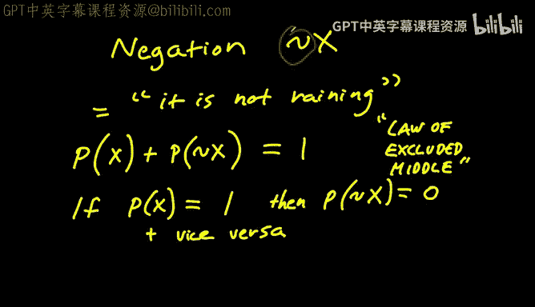

这个原则被称为**排中律**，它阐明了概率分布的基本规则：构成一个分布的所有结果的概率之和必须为1。

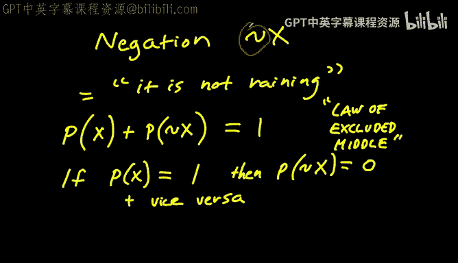

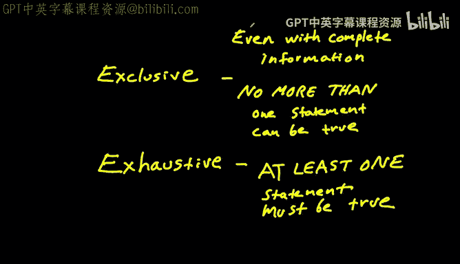

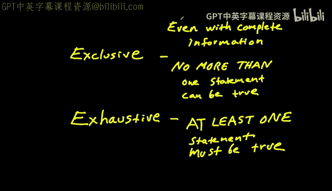

**公式表示：**
对于一个二元分布，有：`P(X) + P(~X) = 1`

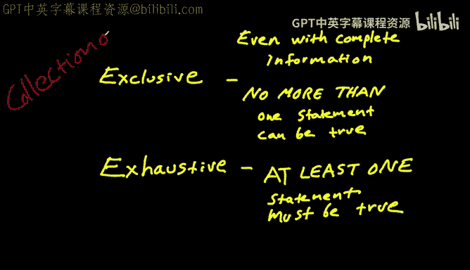

## 概率分布的精确定义

那么，什么精确定义了一个概率分布呢？它是一个由**两个或更多**陈述组成的集合，这些陈述必须满足**互斥**且**完备**的条件。

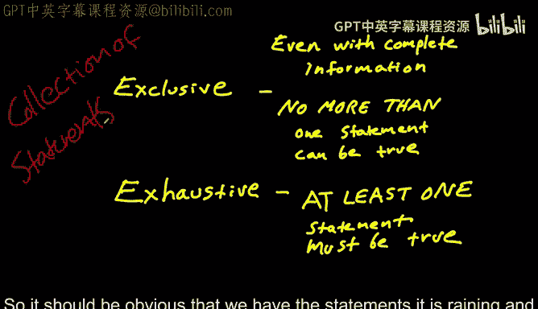

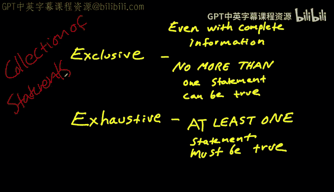

以下是这两个条件的详细解释：

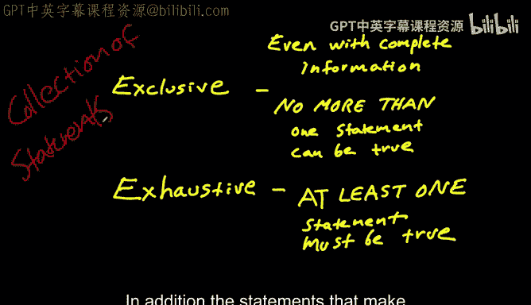

*   **互斥**：在给定完整信息的情况下，这些陈述中**最多只有一个**可以为真。例如，“正在下雨”和“没有下雨”显然不可能同时为真。
*   **完备**：在给定完整信息的情况下，这些陈述中**至少有一个**必须为真。例如，关于天气，要么下雨，要么不下雨，没有第三种“既下雨又不下雨”的状态。

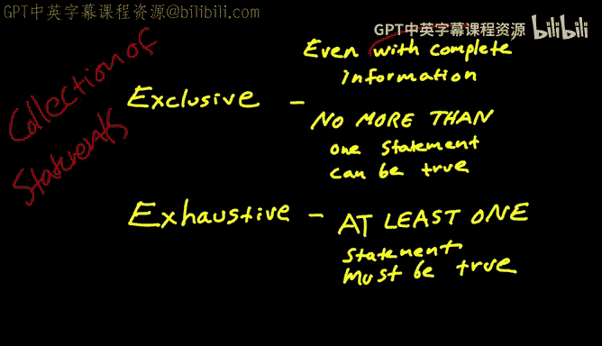

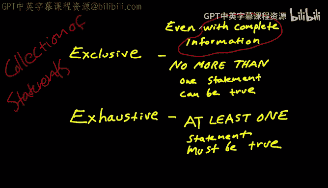

因此，当你坐在室内不确定天气时，你可以为“下雨”和“不下雨”这两个陈述分配反映不确定性的概率值。但一旦信息完备，这两个陈述中**恰好有一个**必须为真。

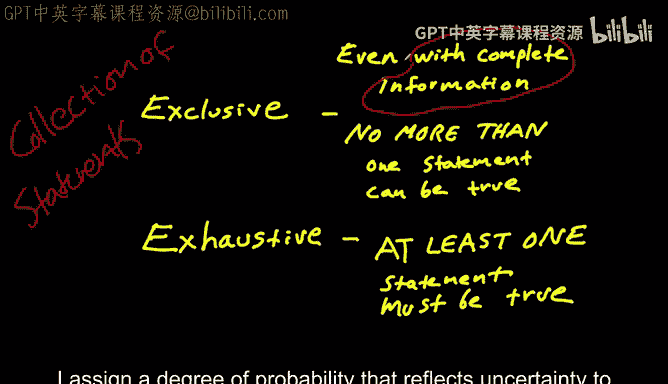

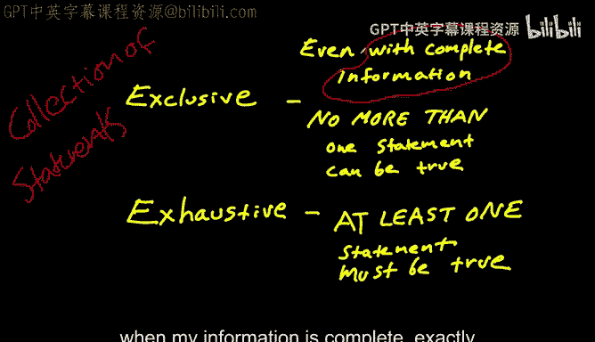

## 更复杂的分布与无差别原则

通常，我们会遇到由多于两个陈述构成的概率分布，这些陈述同样是互斥且完备的。在许多情况下，我们可能面对大量结果，并且没有特别的理由认为某个结果比其他结果更可能出现。

例如，考虑一副标准的52张扑克牌。此时，可能的结果数量 `n = 52`。假设我们想知道从一副洗匀的牌中抽到黑桃A的概率。就我所知，黑桃A并没有什么特别之处，并且牌是洗匀的。根据**无差别原则**，我会分配给这个结果的概率是 `1/52`。

根据无差别原则，我们可以按以下方式计算许多概率：

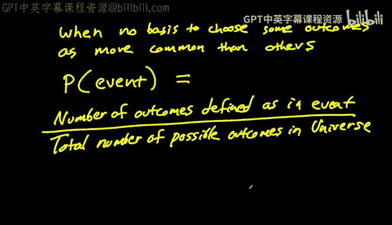

**一个特定事件（事件是单个结果的集合）的概率，定义为属于该事件的结果数量除以所有可能结果的总数。**

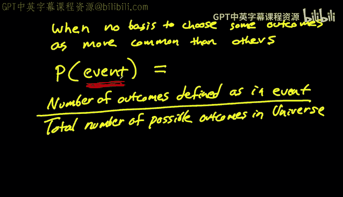

**公式表示：**
`P(事件) = (属于该事件的结果数) / (所有可能结果的总数)`

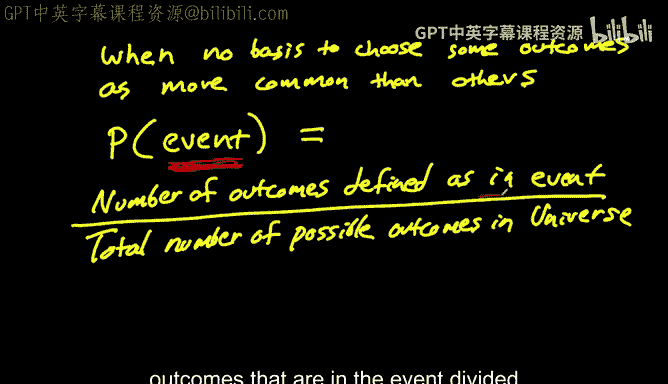

让我们用两个例子来说明：

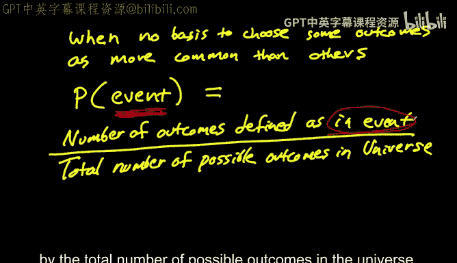

**例子1：抽到一张Q**
*   **事件**：抽到一张Q。
*   **属于事件的结果**：红桃Q、方块Q、黑桃Q、梅花Q。共4个结果。
*   **所有可能结果总数**：52张牌。
*   **概率**：`P(抽到Q) = 4 / 52 = 1/13`

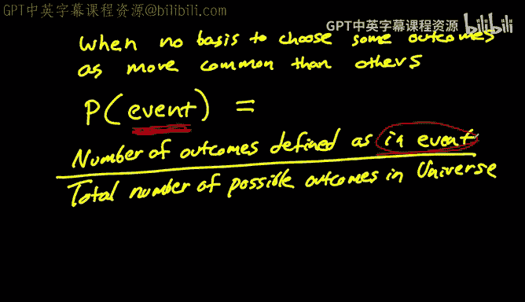

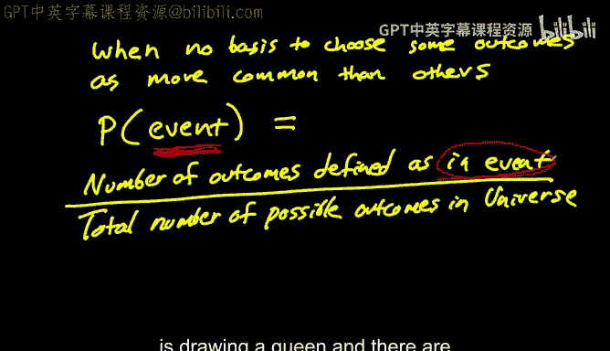

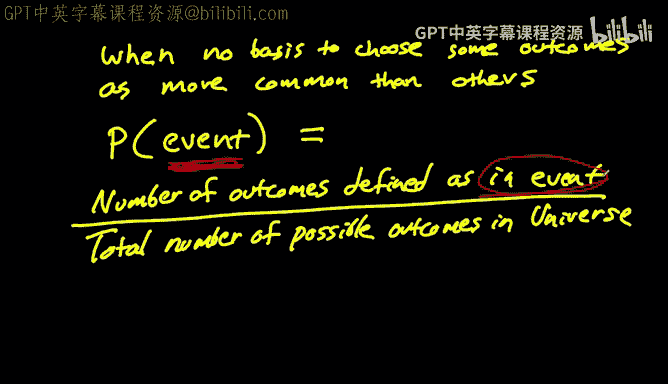

**例子2：掷一个六面骰子得到偶数**
*   **事件**：点数为偶数。
*   **属于事件的结果**：2， 4， 6。共3个结果。
*   **所有可能结果总数**：6个面。
*   **概率**：`P(点数为偶数) = 3 / 6 = 1/2`

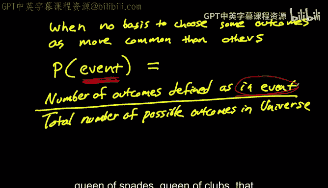

这个简单的概念使我们能够解决大量的概率问题。

---

**总结**
本节课中，我们一起学习了概率的核心概念。我们首先将概率定义为对陈述真实性的相信程度，其值介于0（假）和1（真）之间。接着，我们学习了概率的表示法 `P(X)` 和否定符号 `~`。然后，我们探讨了概率分布，它由一组互斥且完备的陈述构成，且所有陈述的概率之和必须为1。最后，我们介绍了在无差别原则下，通过计算“有利结果数”与“所有可能结果数”的比值来求解概率的基本方法。这些是理解更复杂概率论主题的基石。