# 课程28：联合概率 🎲

在本节课中，我们将要学习**联合概率**的概念。联合概率描述的是两个独立事件同时发生的可能性。我们将探讨其定义、表示方法、与独立性的关系，并学习如何使用维恩图来直观理解。

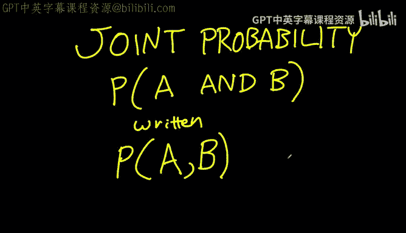

---

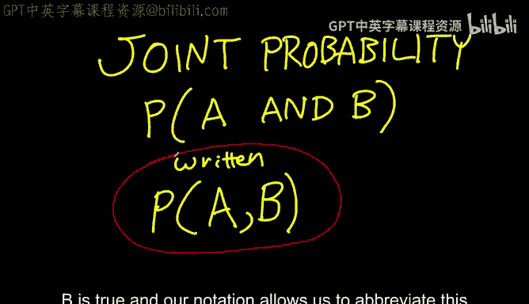

## 联合概率的定义与表示

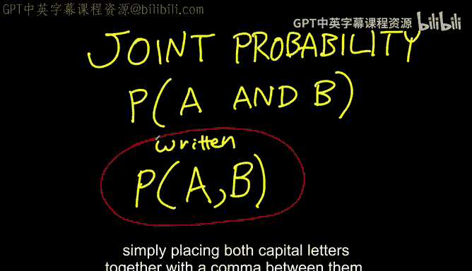

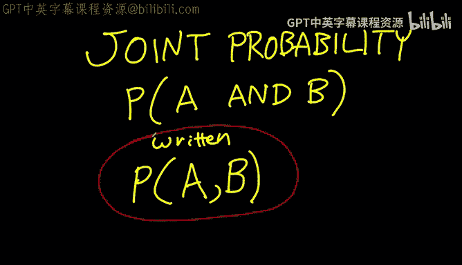

上一节我们介绍了概率的基本概念，本节中我们来看看如何描述两个事件同时发生的情况。

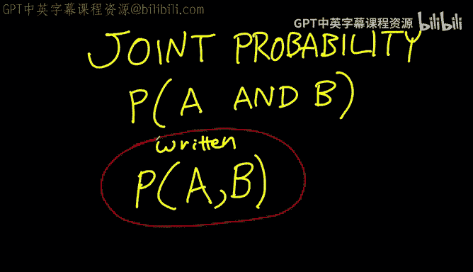

联合概率是指来自两个独立概率分布的两个事件同时为真的概率。我们关注的是事件A为真**且**事件B为真的概率。

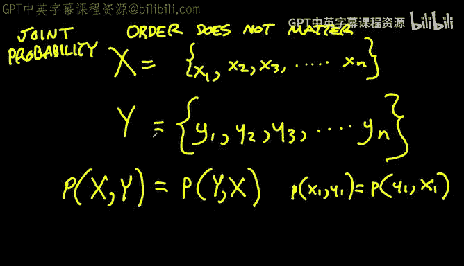

其数学表示如下：

**P(A, B)**

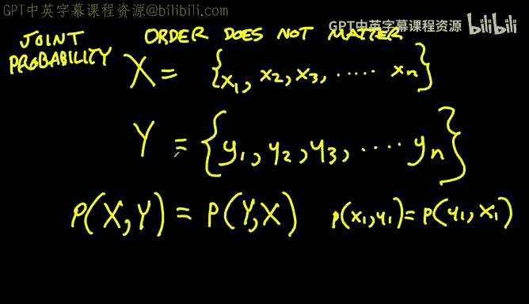

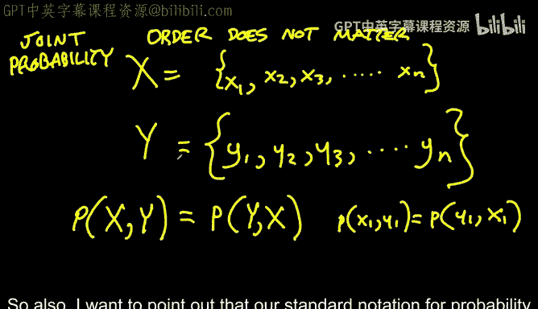

这个符号读作“A和B的联合概率”，或者“A为真且B为真的概率”。

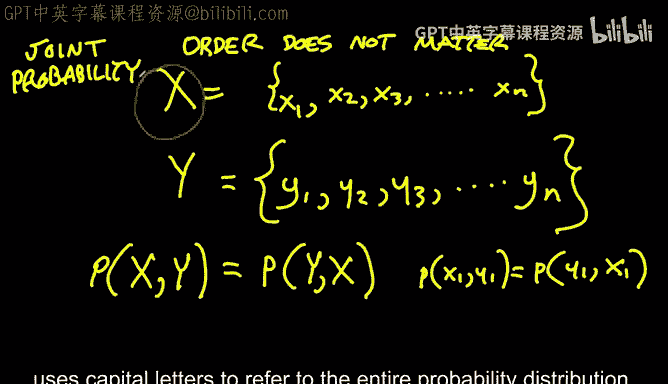

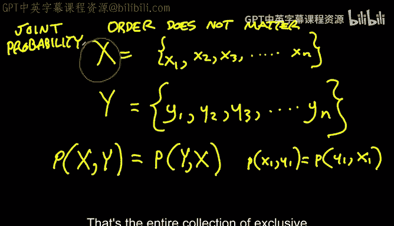

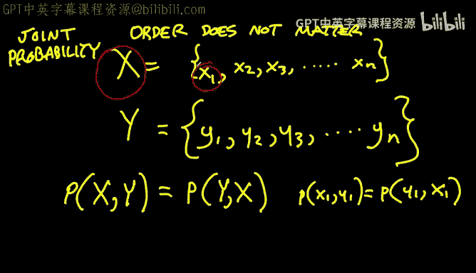

一个重要的点是，在联合概率中，事件的顺序无关紧要。**P(A, B)** 与 **P(B, A)** 是相等的。

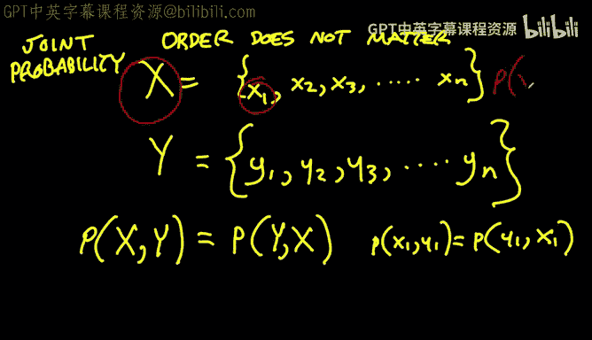

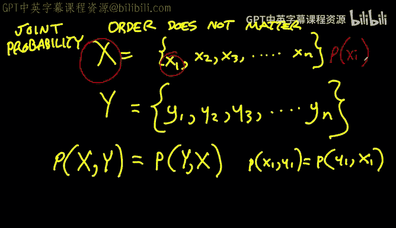

以下是关于概率符号的说明：
*   我们使用大写字母（如A, B）来指代整个概率分布，即一组互斥且完备的陈述集合。
*   我们使用小写字母（如a1, b2）来指代分布中的单个陈述。
*   单个事件的概率可以表示为 **P(a1)** 或 **P(b2)**。

因此，联合概率 **P(x1, y1)** 与 **P(y1, x1)** 是相等的。这个看似显而易见的原理，在实际应用中非常有用。

---

## 概率分布的独立性

现在，我们来定义两个概率分布的独立性。

如果两个概率分布是独立的，那么知道其中一个事件的结果，并不会影响我们对另一个事件为真的信念。也就是说，知道一个事件的结果不会改变另一个事件的概率。

你可以将独立的概率视为互不关联、没有联系的事件。例如，抛一枚硬币和掷一个骰子就是独立的。

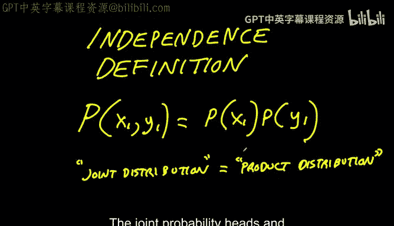

当两个概率独立时，计算它们同时发生的联合概率有一个简单的公式。

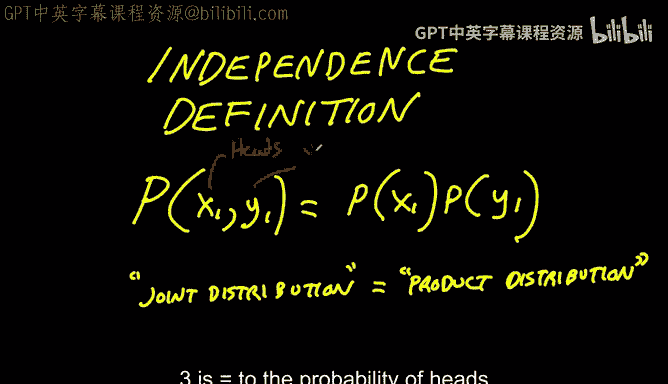

以下是计算独立事件联合概率的公式：

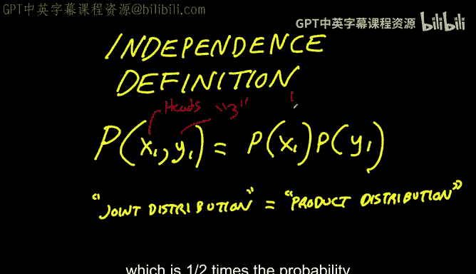

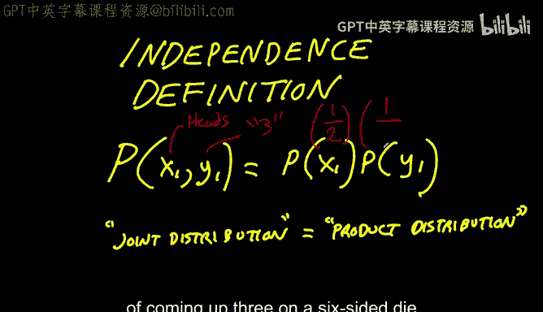

**P(A, B) = P(A) × P(B)**

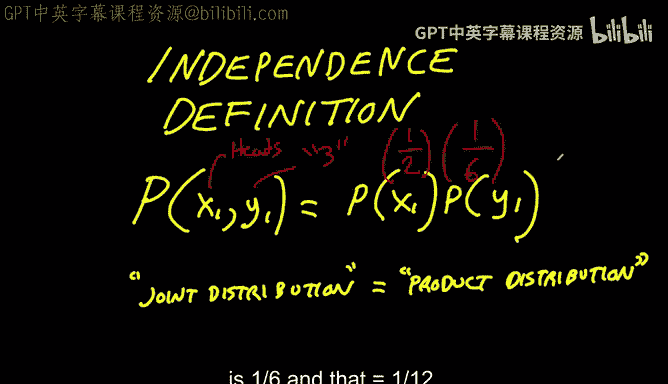

我们为两个概率的乘积起了一个特殊的名字，称为**乘积分布**。

**因此，当联合分布等于乘积分布时，根据定义，这两个概率分布就是独立的。**

---

## 使用维恩图理解概率

我们经常使用**维恩图**来帮助理解。维恩图可以展示集合的交集和并集，从而直观地表示两个事件同时发生（交集）或至少一个发生（并集）的概率。

例如，考虑事件“抛硬币得到正面”（概率为1/2）和“掷骰子得到3点”（概率为1/6）。我们可以用两个圆圈来表示这两个事件的概率空间。

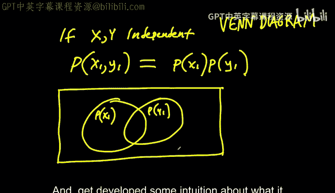

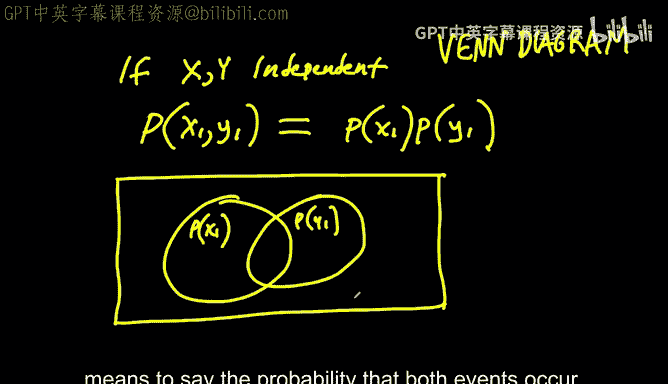

*   整个图形外围区域代表了所有可能结果的全集。
*   两个圆圈的**重叠区域（交集）** 就代表了“硬币正面**且**骰子为3点”的联合概率。根据独立事件的公式，这个面积等于 (1/2) × (1/6) = 1/12。

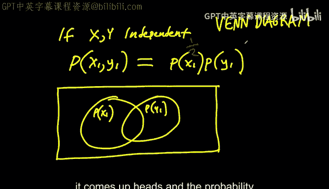

维恩图对于理解“或”概率的概念可能更加有用。

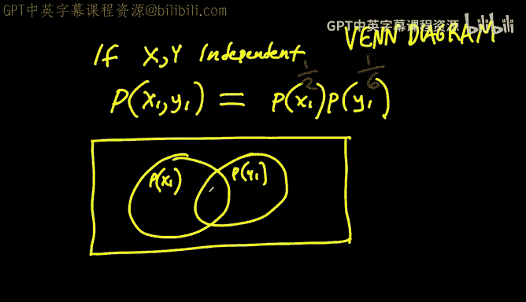

我们想知道事件“硬币正面**或**骰子为3点”发生的概率，记作 **P(A or B)**。在概率论中，“或”意味着事件A发生，或事件B发生，或两者同时发生。

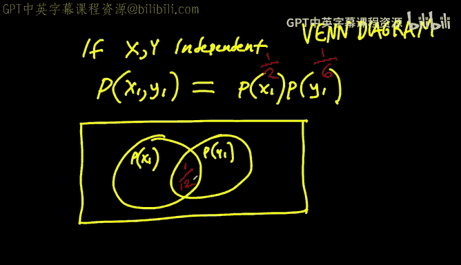

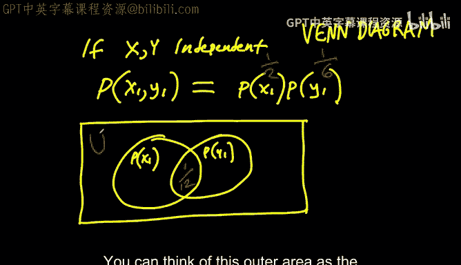

如果我们简单地将两个圆圈的面积（概率）相加，那么中间的重叠区域就会被计算两次。

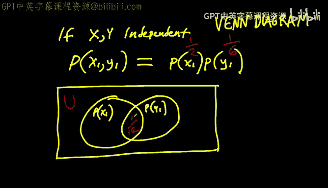

为了避免重复计算，我们需要从两个概率之和中减去一次重叠区域的概率（即联合概率）。

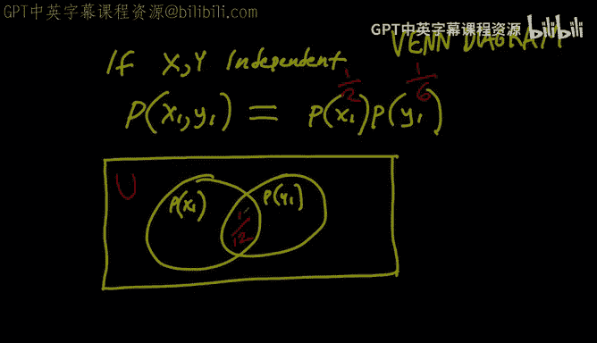

以下是计算“或”概率的公式：

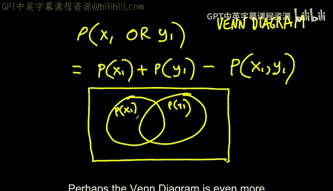

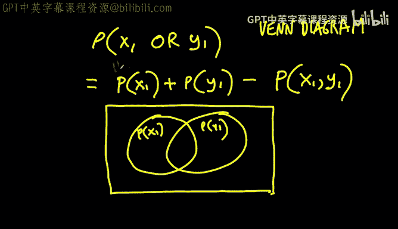

**P(A or B) = P(A) + P(B) - P(A, B)**

在我们的例子中：
*   P(正面) = 1/2 = 6/12
*   P(骰子为3) = 1/6 = 2/12
*   P(正面, 骰子为3) = 1/12

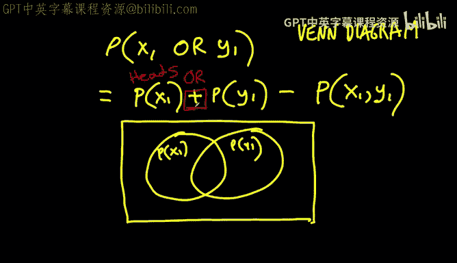

因此，“硬币正面或骰子为3点”的概率为：
**P(正面 or 3点) = 6/12 + 2/12 - 1/12 = 7/12**

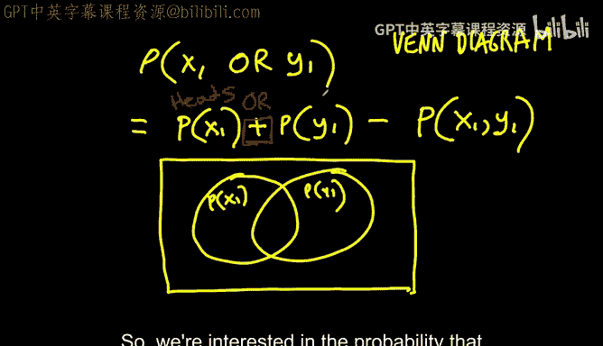

---

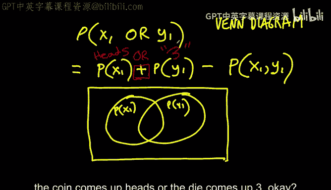

## 总结

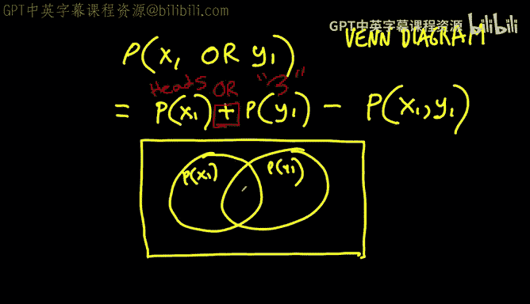

本节课中我们一起学习了**联合概率**的核心内容。

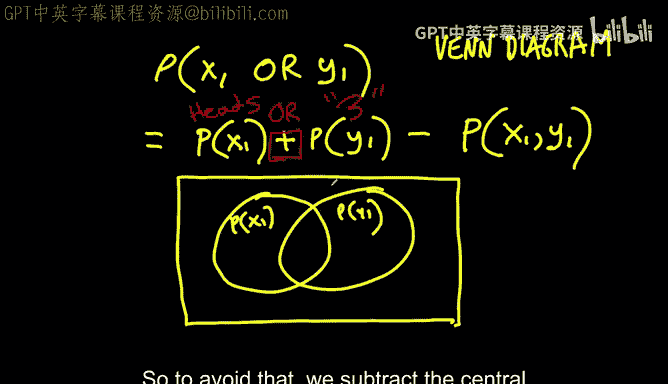

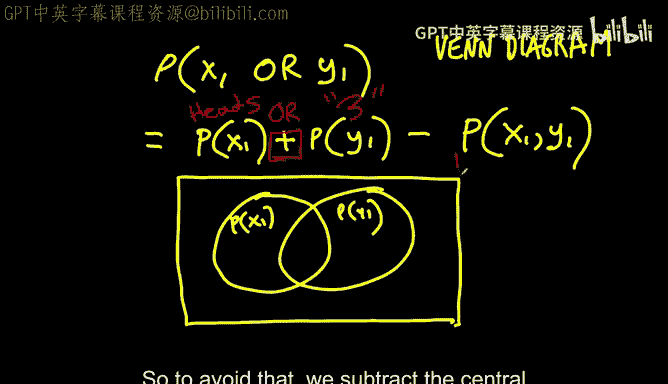

我们首先明确了联合概率是描述两个事件同时发生的概率，其符号表示为 **P(A, B)**，且顺序不影响结果。

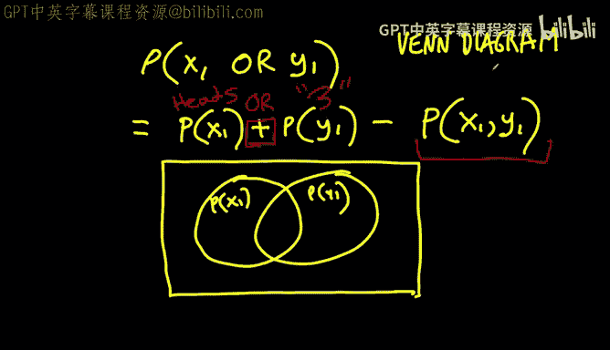

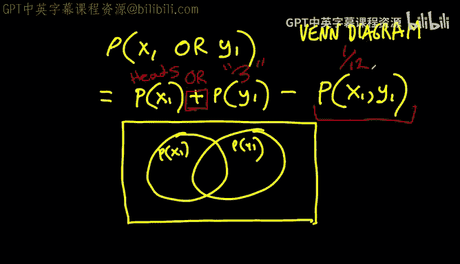

接着，我们探讨了概率分布的**独立性**：当两个事件独立时，知道一个事件的结果不影响另一个。此时，联合概率等于各自概率的乘积，即 **P(A, B) = P(A) × P(B)**。

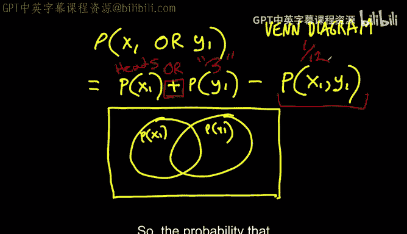

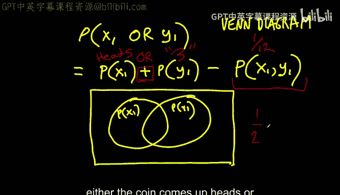

最后，我们借助**维恩图**直观地展示了事件“与”（交集）和“或”（并集）的概率关系，并推导出了计算“或”概率的公式：**P(A or B) = P(A) + P(B) - P(A, B)**。

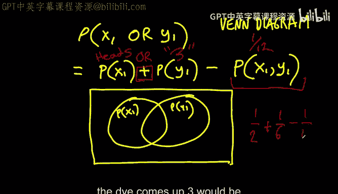

理解这些概念是处理更复杂概率问题的基础。