# 📊 课程29：排列与组合

在本节课中，我们将要学习概率论中的两个核心概念：**排列**与**组合**。我们将探讨如何计算事件按特定顺序发生的概率，以及不考虑顺序时，一组事件发生的概率。理解这两个概念对于解决许多实际问题至关重要。

---

## 🧩 排列：顺序很重要

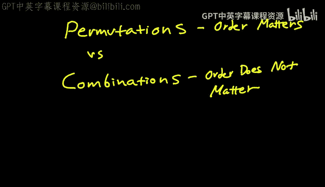

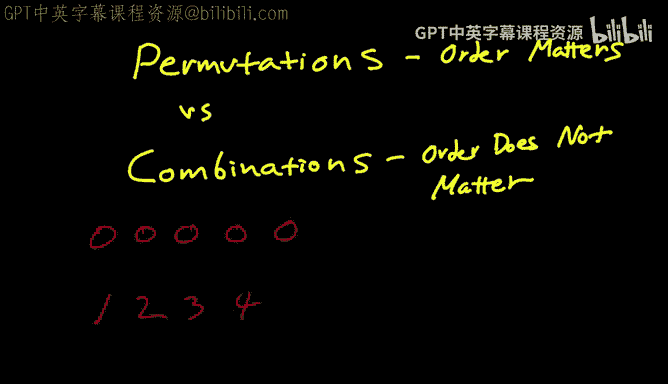

上一节我们介绍了概率的基本概念，本节中我们来看看当事件的**顺序**很重要时，如何计算可能性。这种情况被称为**排列**。

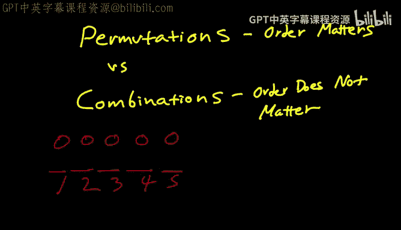

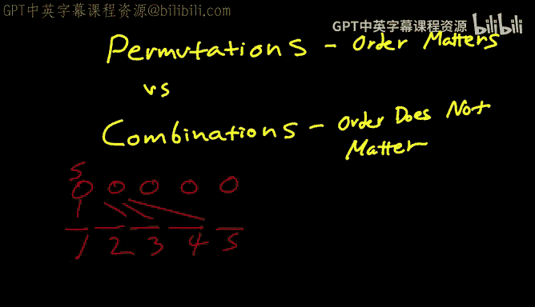

例如，假设我有5名员工和5项不同的任务。我需要将这5个人分配到5个不同的岗位上。我可以将第一个人分配到5个岗位中的任何一个。

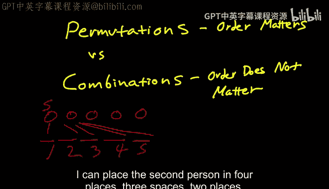

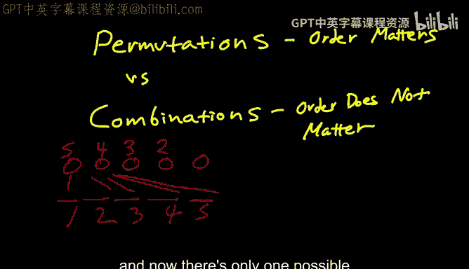

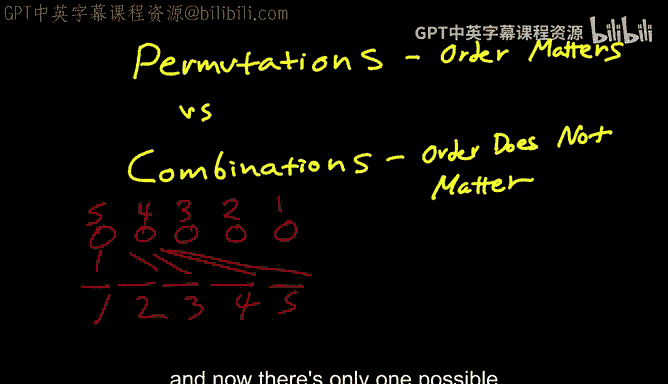

现在，一个岗位已被占据，因此我可以将第二个人分配到剩下的4个岗位中的任何一个。

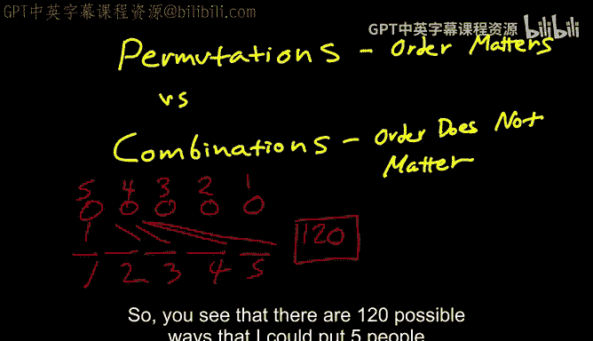

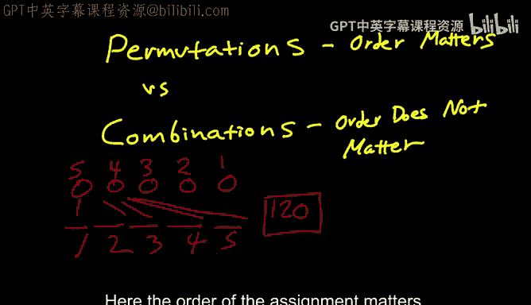

以此类推，第三个人有3个选择，第四个人有2个选择，最后一个人只剩下1个选择。

因此，将5个人分配到5个不同岗位的总方法数为：
**5 × 4 × 3 × 2 × 1 = 120**

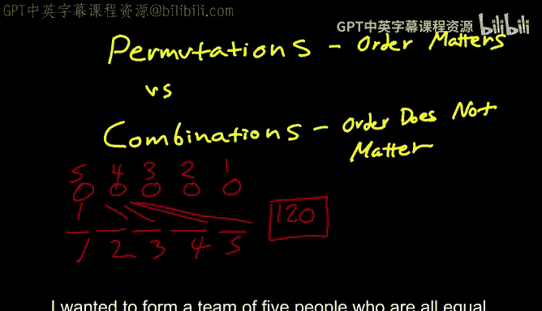

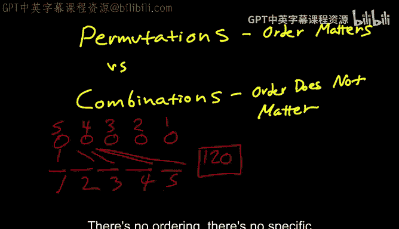

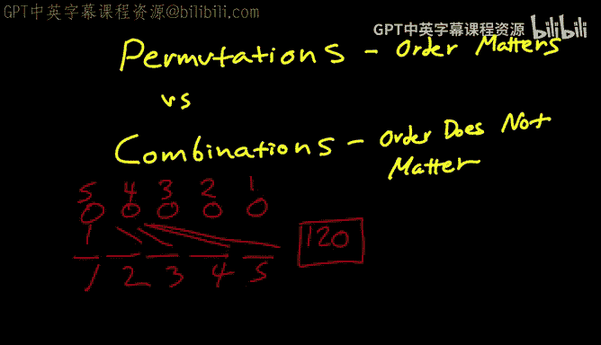

在这个例子中，分配的顺序是重要的，所以这被称为**排列**。

---

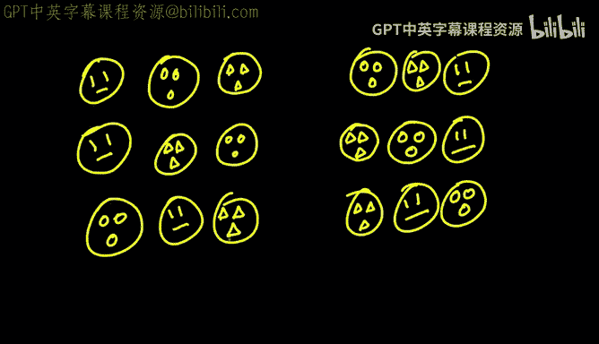

## 🤝 组合：顺序不重要

现在，让我们考虑另一种情况。假设我有5个人，我想组建一个由5人组成的团队，团队中所有成员地位平等，没有特定的角色分配，也没有顺序要求。

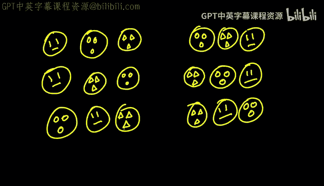

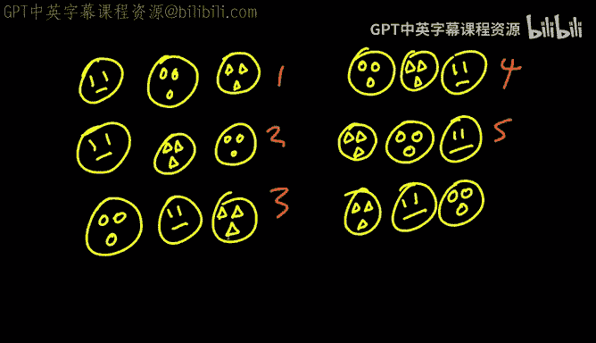

在这种情况下，实际上只有**一种**可能的组合：我只需要将这5个人全部选入团队即可。

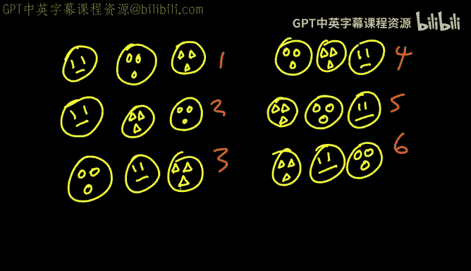

当**顺序不重要**时，可能的组合数量总是**少于**排列的数量。这是因为同一个团队的多种排列顺序，在组合中只被算作一种。

例如，这里有3个不同物体的6种排列顺序。

这对应着6种排列。但团队的成员是固定的，所以只有**一种**组合。

---

## 🎱 彩票例子：排列与组合的对比

为了更好地理解，让我们想象一个彩票游戏。一个碗里有6个不同的球，分别标有数字1到6。我们将一次抽出一个球，共抽4次，以确定彩票的中奖号码。

这个彩票的规则可以有两种理解方式：数字的**顺序重要**或**不重要**。

### 情况一：顺序重要（排列）

如果顺序重要，我们讨论的就是**排列**的数量。我们需要计算从6个独特物体中抽取4个来填充4个位置的方法数。

*   第一个球可以是1到6中的任何一个（6种选择）。
*   抽走一个后，剩下5个球可选第二个位置（5种选择）。
*   剩下4个球可选第三个位置（4种选择）。
*   剩下3个球可选最后一个位置（3种选择）。

因此，排列的总数为：
**6 × 5 × 4 × 3 = 360**

如果你需要预测中奖号码的**顺序**才能赢，那么一场公平的赌注赔率应该是360比1，即下注1美元可能赢得360美元。

排列数有一个通用公式：
**P(n, m) = n! / (n - m)!**

其中 `n!` 表示n的阶乘，`n` 是独特物体的总数（本例中为6），`m` 是选取的数量（本例中为4）。所以：
**P(6, 4) = 6! / (6-4)! = 6! / 2! = 6×5×4×3 = 360**

### 情况二：顺序不重要（组合）

另一方面，如果赢彩票只需要猜中正确的4个数字，而**不考虑顺序**，那么我们现在讨论的就是**组合**。

假设我抽出了数字2、3、4、5。我只需要猜中这四个数字即可。

在这种情况下，我需要将排列数360除以24，得到**15**种可能的四球组合。

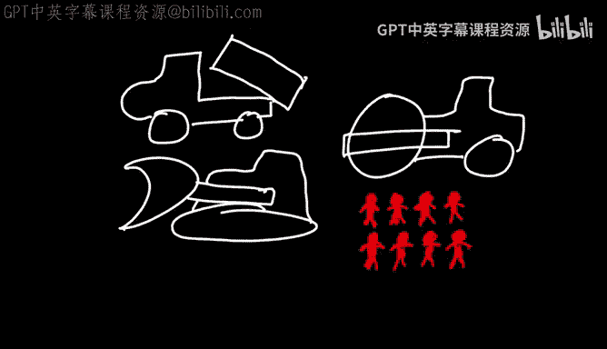

因此，在一个基于组合的公平彩票中，下注1美元如果中奖只能赢得15美元，因为现在猜中四个数字的几率是15分之一。

为什么除以24？因为4个球可以有24种不同的排列顺序。第一个位置有4种选择，第二个位置有3种选择，第三个位置有2种选择，最后一个位置有1种选择，即 **4 × 3 × 2 × 1 = 24**。

组合数的通用公式是：
**C(n, m) = n! / [(n - m)! × m!]**

这个公式有一个特殊的名称，叫做 **“n选m”**。在本例中，6选4的计算是：
**C(6, 4) = 6! / [(6-4)! × 4!] = 360 / 24 = 15**

---

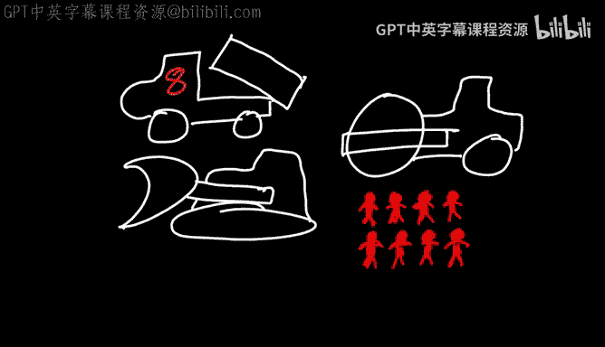

## 🚜 另一个例子：司机与机器

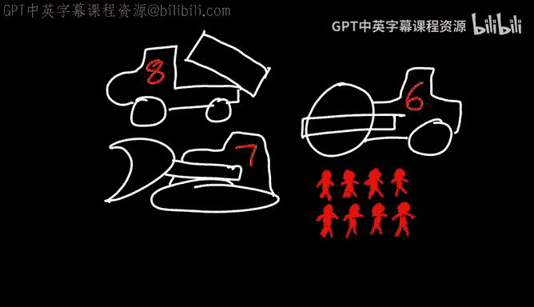

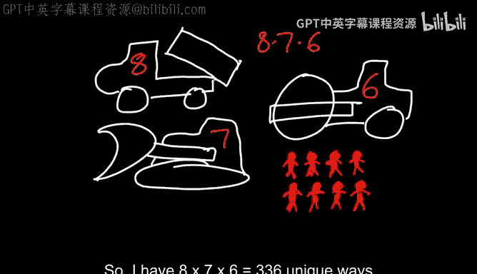

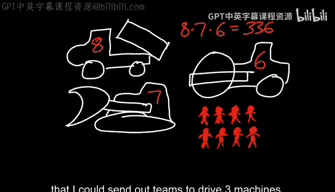

让我们考虑另一个例子。我需要派遣一辆自卸卡车、一辆推土机和一辆压路机去一个建筑工地。我有8名合格的司机，每人都能驾驶所有三种机器。

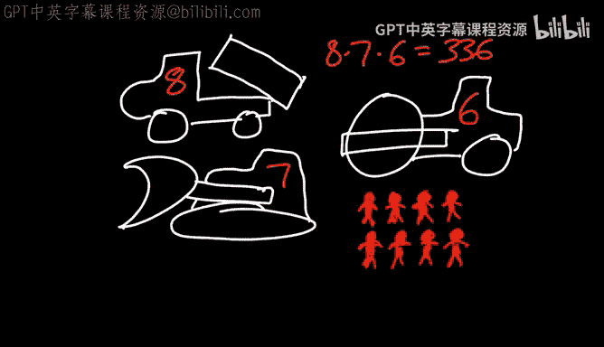

### 情况一：关心司机与机器的匹配（排列）

如果我关心**具体哪位司机操作哪台机器**，那么：
*   第一台机器可以由8名司机中的任何一位驾驶（8种选择）。
*   第二台机器由剩下的7位司机驾驶（7种选择）。
*   第三台机器由剩下的6位司机驾驶（6种选择）。

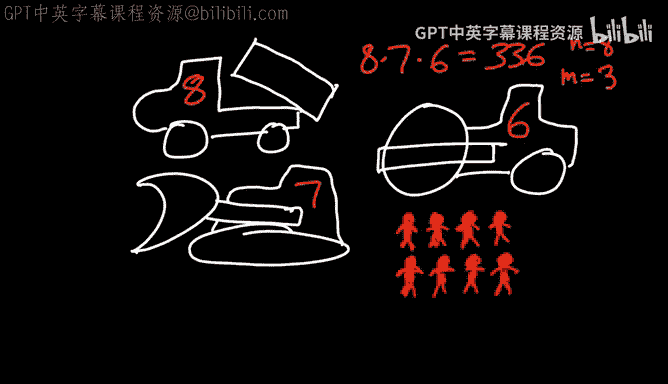

因此，派遣团队的不同方式总数为：
**8 × 7 × 6 = 336**

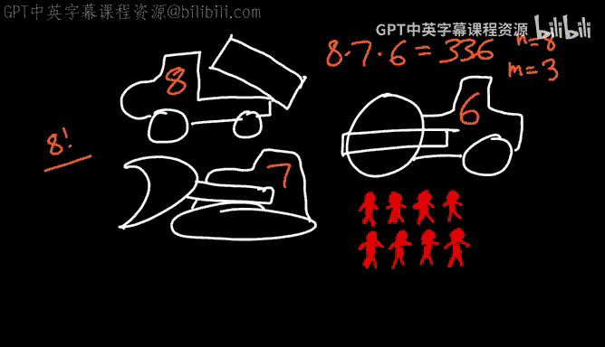

这使用的是排列公式，其中 n=8, m=3：
**P(8, 3) = 8! / (8-3)! = 8! / 5! = 8×7×6 = 336**

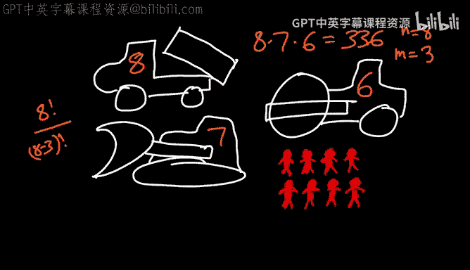

### 情况二：只关心派遣哪三位司机（组合）

如果**不关心哪位司机开哪台车**，我只想知道可以派出多少支不同的3人司机团队随车辆前往工地。

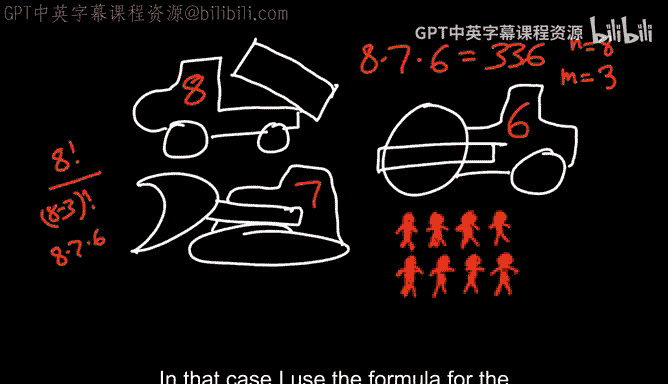

那么，我使用组合公式：
**C(8, 3) = 8! / [(8-3)! × 3!] = 8! / (5! × 3!)**

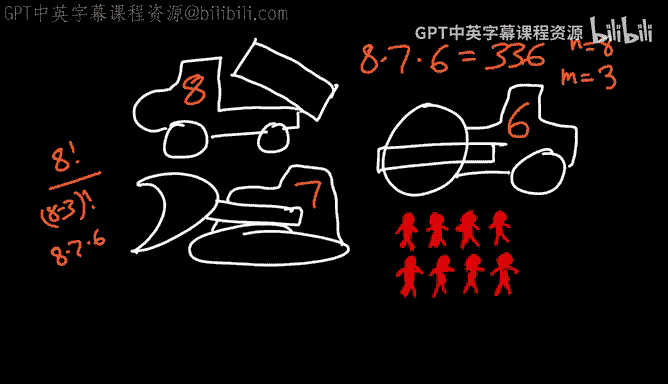

这相当于将之前的排列答案336除以6（因为3个司机有3! = 6种排列方式）：
**336 / 6 = 56**

因此，我可以派出 **56** 支不同的司机团队。这就是**组合**与**排列**的区别。

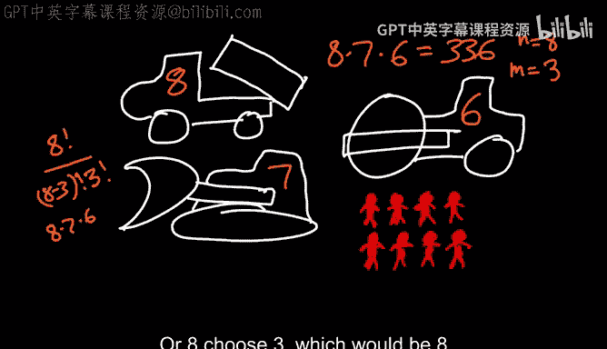

---

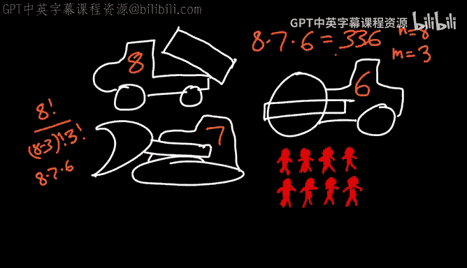

## 🔄 有放回 vs 无放回

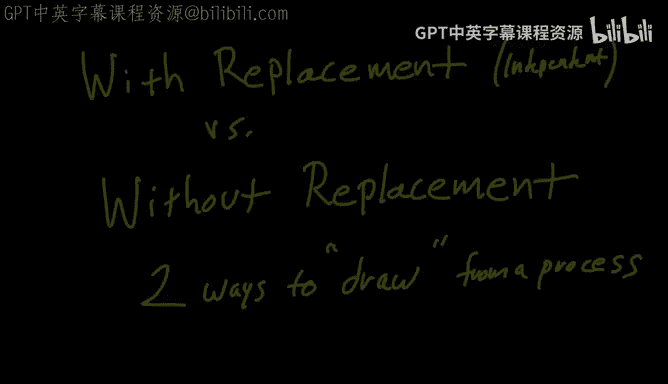

接下来，在定义某种情况的概率时，我们需要考虑**有放回**和**无放回**的概念。

### 无放回

当我们从一副牌中抽牌时（例如扑克手牌），抽出的牌会从牌堆中移除，在本次抽牌过程中不再有可能再次抽到那张牌。

例如，如果我第一张牌抽到A的概率是1/13。那么我第二张牌再抽到A的概率就不同了：现在牌堆里剩下3张A和51张牌，所以第二张抽到A的概率是 **3/51**。

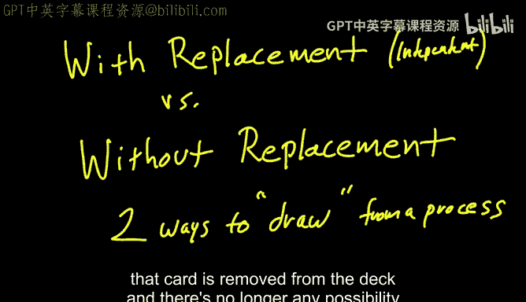

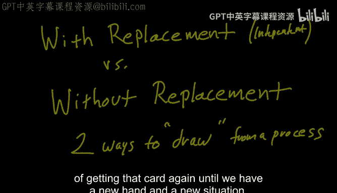

任何将事物从可能性领域中移除的情况都属于**无放回**。

### 有放回

另一方面，如果我试图预测或猜一个000到999之间的数字，当然允许使用0到9的每个数字超过一次，你可以重复使用每个数字两次或三次。这里我们是在生成一个数字，并且数字是被**有放回**地使用。

---

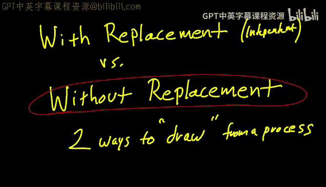

## 📝 总结

本节课中我们一起学习了概率论中的关键工具：**排列**与**组合**。

*   **排列**用于计算当**顺序重要**时，从一组物体中选取特定数量物体的方法数，公式为 **P(n, m) = n! / (n - m)!**。
*   **组合**用于计算当**顺序不重要**时，从一组物体中选取特定数量物体的方法数，公式为 **C(n, m) = n! / [(n - m)! × m!]**，也记作 **“n选m”**。
*   我们还区分了**有放回**和**无放回**抽样对概率计算的影响。

结合排列与组合的概念，以及有放回与无放回的概念，我们几乎可以处理基础概率课程中可能出现的所有概率情况。