# 课程30：阶乘与组合数C(m,n)的应用 🧮

在本节课中，我们将学习概率论中两个核心的计数工具：**阶乘** 和 **组合数**。我们将通过经典的“抽球”问题来理解这些概念，并学习如何计算从一组物品中选出特定数量物品的不同方式。

---

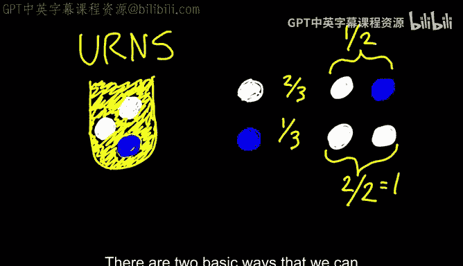

## 抽球问题：有放回与无放回

概率论教学常常会讨论“抽球”问题。一个“瓮”是一个容器，你看不到里面。通常里面有两种不同颜色的弹珠，有时颜色更多。核心思想是从容器中抽取弹珠。

从容器中抽取弹珠有两种基本方式：**有放回** 和 **无放回**。

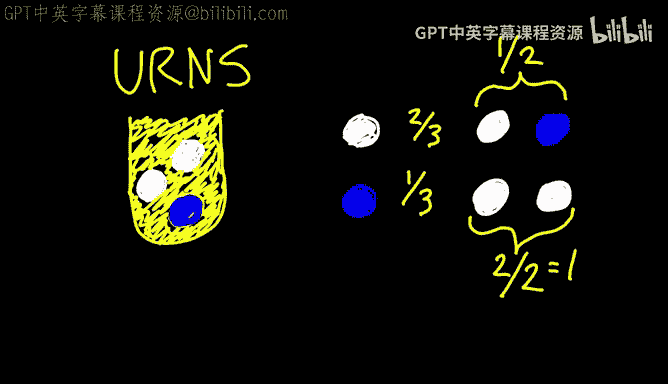

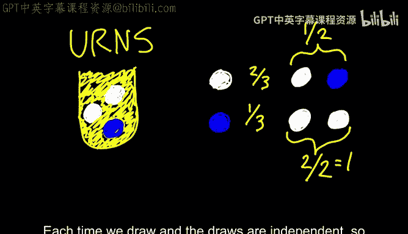

### 有放回抽取

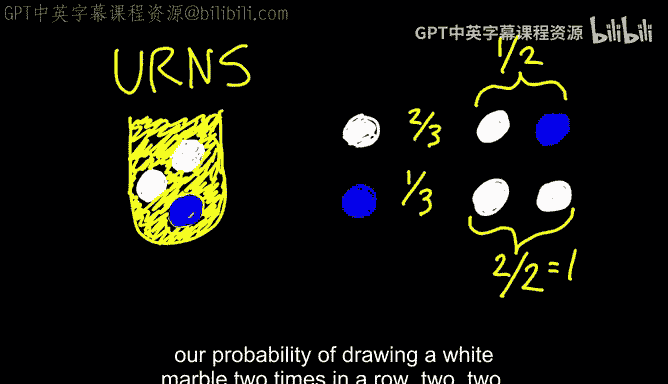

在有放回抽取中，每次抽取后，我们会将弹珠放回瓮中。这意味着每次抽取的概率是独立的，不会改变。

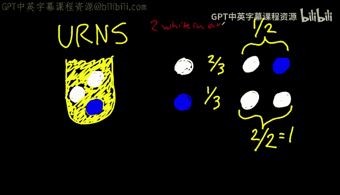

例如，假设一个瓮里有2个白球和1个蓝球。那么：
*   每次抽到白球的概率是 **2/3**。
*   每次抽到蓝球的概率是 **1/3**。

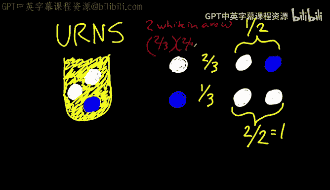

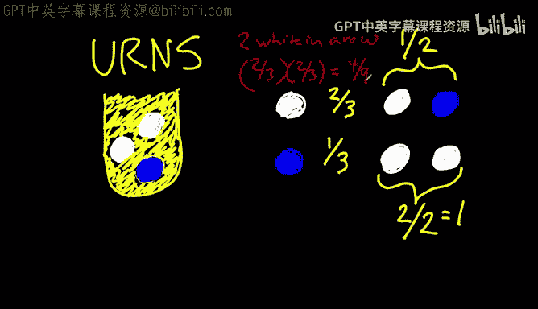

因此，连续两次抽到白球的概率是：
`P(两次白球) = (2/3) * (2/3) = 4/9`

### 无放回抽取

在无放回抽取中，我们抽出的弹珠不再放回。这意味着每次抽取后，瓮中的弹珠总数和颜色构成都会改变，因此概率会发生变化。

继续使用上面的例子：
*   第一次抽到白球的概率是 **2/3**。
*   如果第一次抽到了白球（概率2/3），那么瓮里剩下1个白球和1个蓝球。此时第二次抽到白球的概率变为 **1/2**。
*   如果第一次抽到了蓝球（概率1/3），那么就不可能连续抽到两个白球。

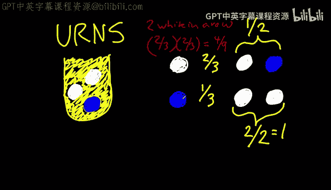

因此，无放回情况下连续两次抽到白球的概率是：
`P(两次白球) = (2/3) * (1/2) = 2/6 = 1/3`

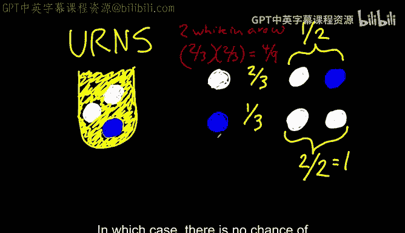

---

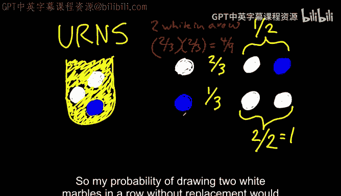

## 阶乘的概念

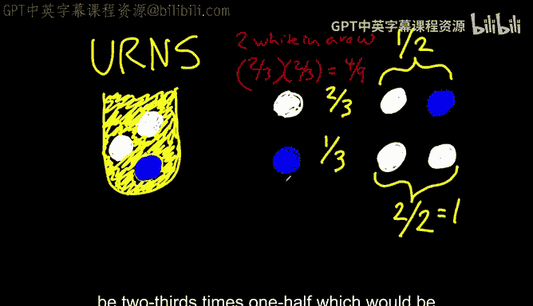

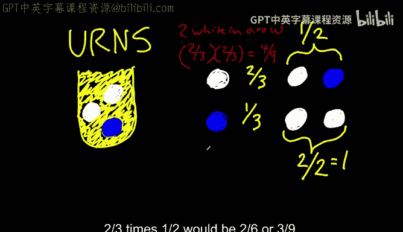

上一节我们通过抽球问题看到了概率如何随抽取方式变化。现在，我们来看一种在排列计数中非常重要的运算。

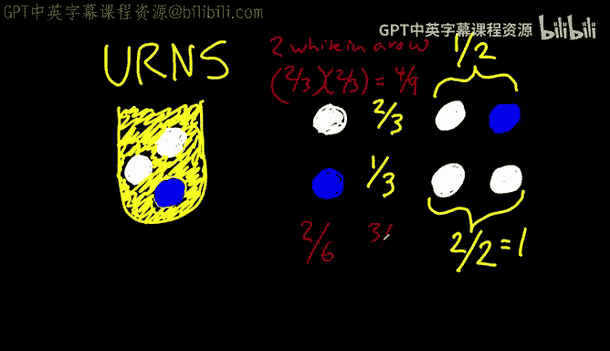

当我们计算将不同的人安排到不同的职位时，会用到一种乘法模式：开始时可选位置多，结束时可选位置少。

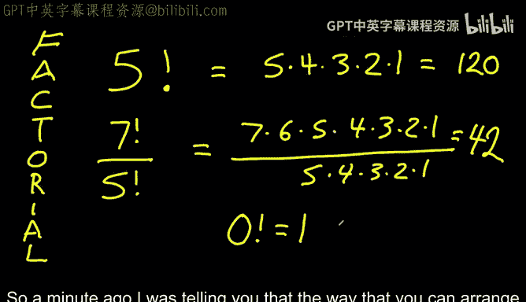

这种运算有一个通用名称，叫做 **阶乘**。它是指将一个数乘以比它小1的整数，再乘以比那个数小1的整数，依此类推，直到乘以1。

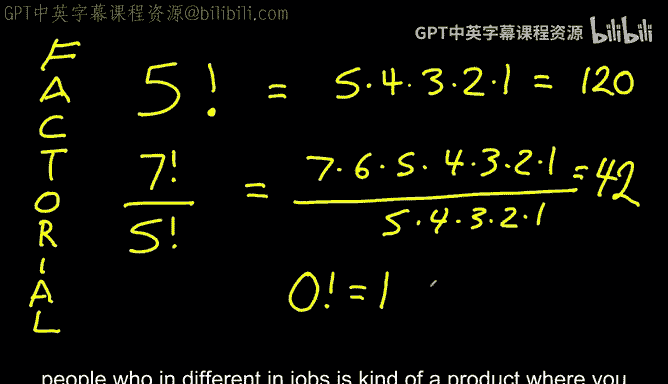

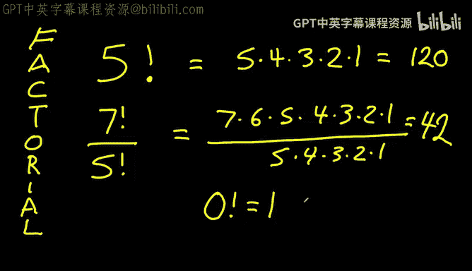

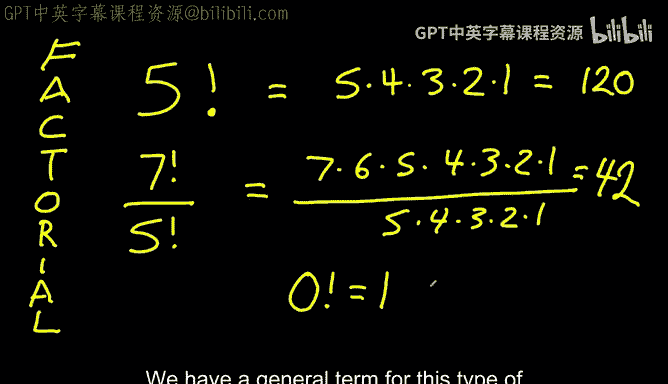

**阶乘** 的表示法是在数字后面加一个感叹号 `!`。

例如：
`5!` 读作“5的阶乘”。
`5! = 5 × 4 × 3 × 2 × 1 = 120`

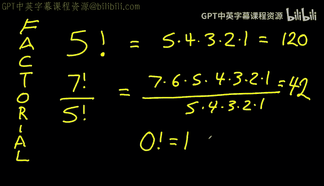

当我们计算一个阶除以另一个阶时，许多数字会相互抵消。
例如：
`7! / 5! = (7 × 6 × 5 × 4 × 3 × 2 × 1) / (5 × 4 × 3 × 2 × 1) = 7 × 6 = 42`

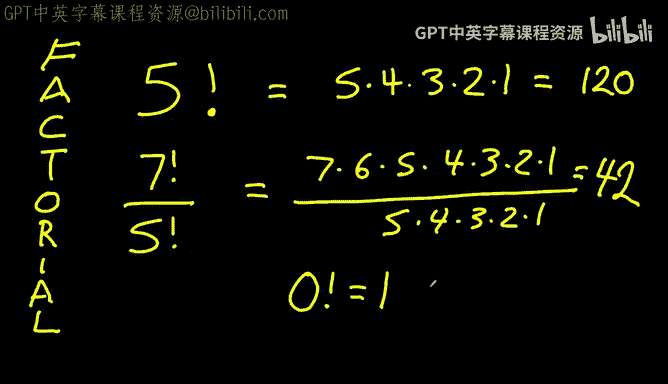

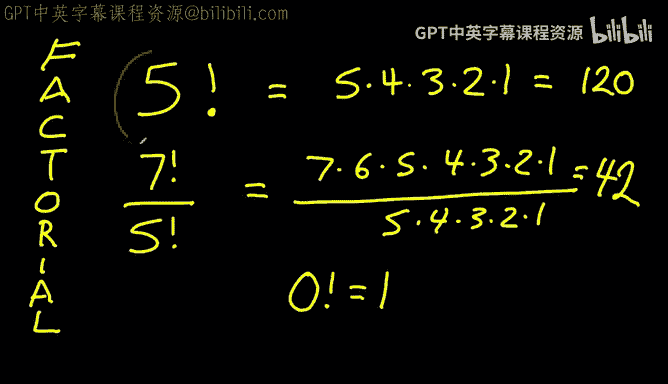

关于阶乘还有一个重要约定：**0的阶乘定义为1**，即 `0! = 1`。

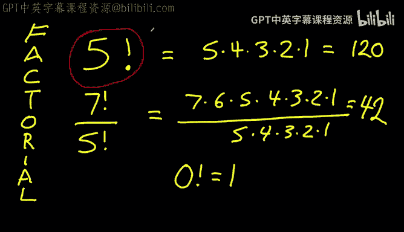

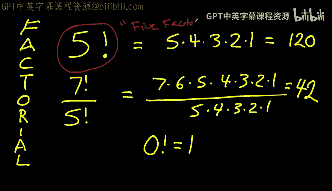

---

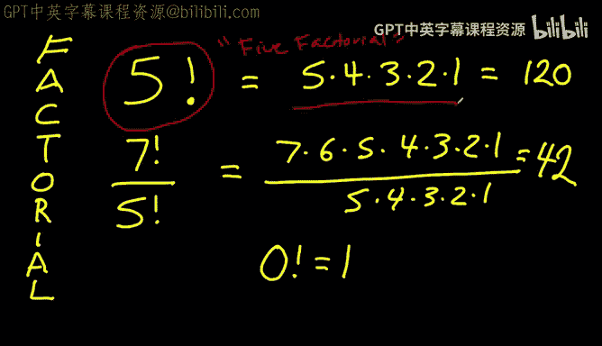

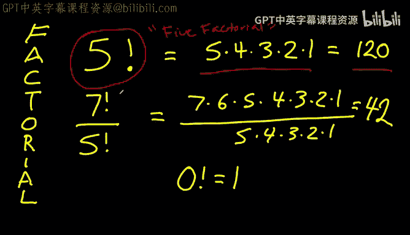

## 组合数 C(m, n)

理解了阶乘后，我们可以用它来解决一个更常见的问题：从一组物品中选出特定数量的物品，有多少种不同的选法？

当我们从M个物品中无放回地抽取N个物品时，可以形成的**独特组合**的数量有一个专门的名称和记号。

这种问题在概率论中非常常见，因此它有自己的名称和符号。

它被称为 **“M选N”**，记作 `C(m, n)` 或 `(M N)`。

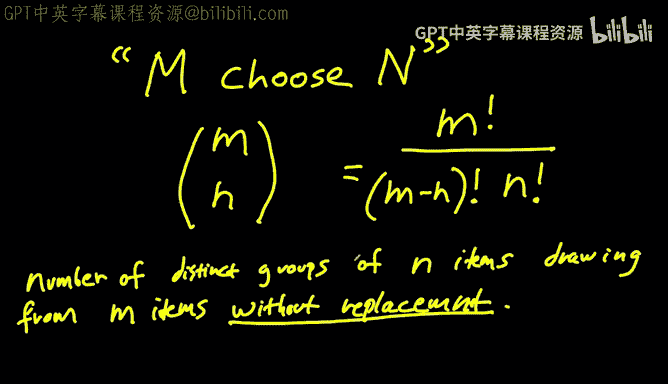

例如，如果我们想知道从10个人中选出5个人，可以组成多少个不同的委员会（或团队，假设所有角色相同）。

这里，`M = 10`， `N = 5`。
这可以描述为 **10选5**。

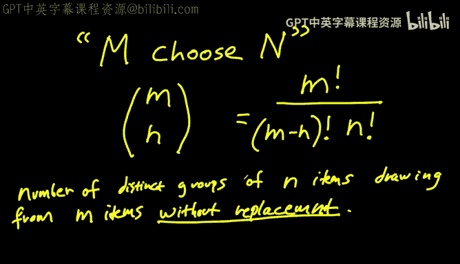

它的计算公式是：
`C(10, 5) = 10! / [ (10-5)! × 5! ] = 10! / (5! × 5!)`

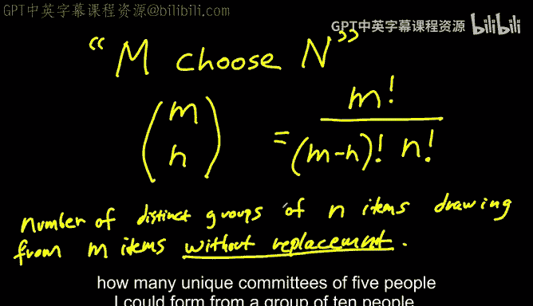

---

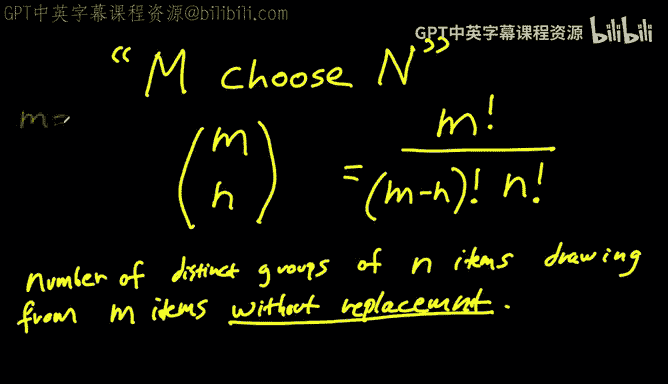

## 组合数的计算技巧

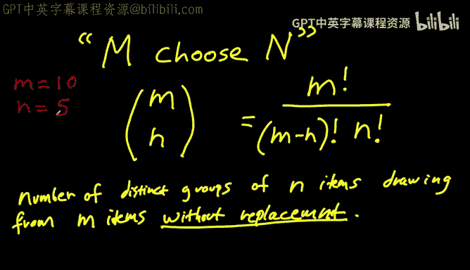

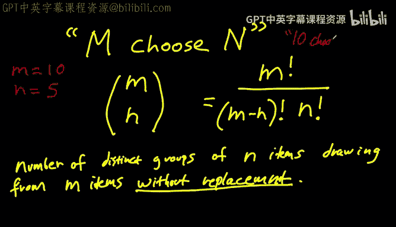

现在，我们来看一个在没有计算器时估算答案的小技巧。

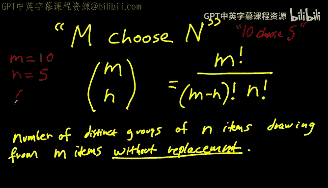

以 `C(10, 5)` 为例：
`C(10, 5) = 10! / (5! × 5!)`

我们可以展开并约分：
`= (10 × 9 × 8 × 7 × 6 × 5 × 4 × 3 × 2 × 1) / [ (5 × 4 × 3 × 2 × 1) × (5 × 4 × 3 × 2 × 1) ]`

分子中的一个 `5!`（即 `5×4×3×2×1`）会与分母中的一个 `5!` 抵消。

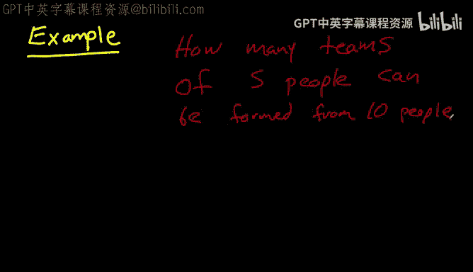

剩下：
`= (10 × 9 × 8 × 7 × 6) / (5 × 4 × 3 × 2 × 1)`

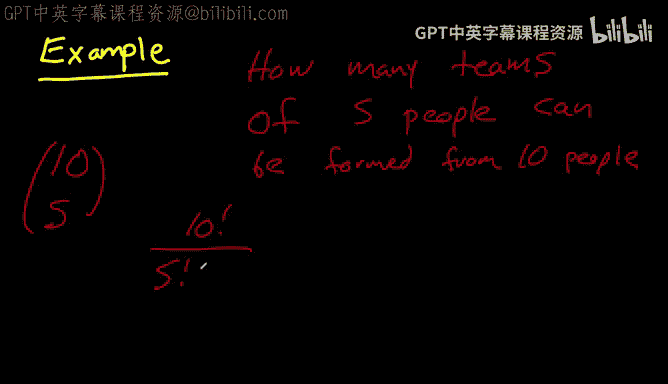

然后我们可以进行约分：
*   10 ÷ 5 = 2
*   9 ÷ 3 = 3
*   8 ÷ 4 = 2
*   6 ÷ 2 = 3
*   7 保持不变

所以结果是：
`= 2 × 3 × 2 × 7 × 3 = 252`

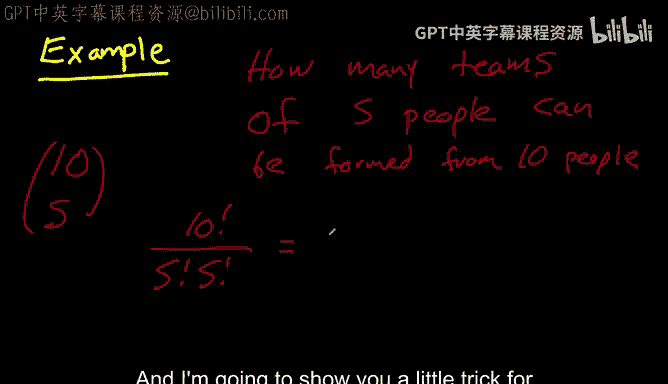

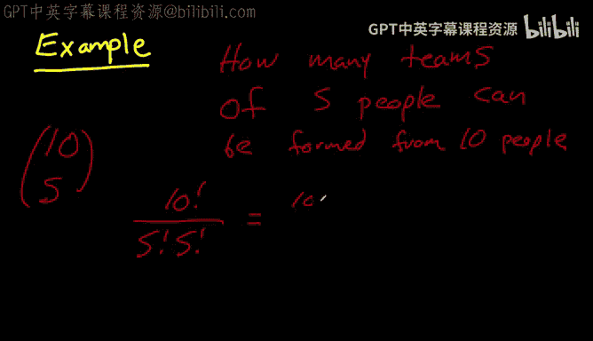

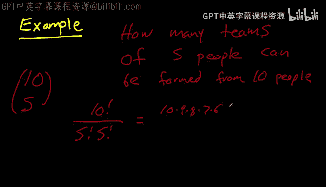

因此，从10个人中选出5个人组成一个团队，共有 **252** 种不同的组合方式。

---

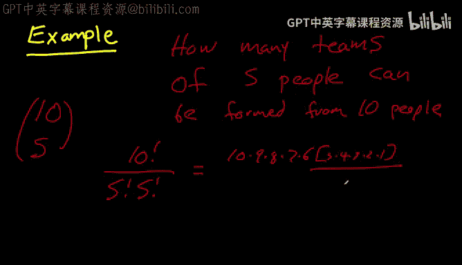

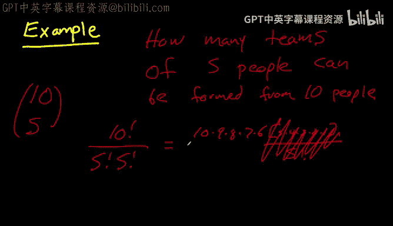

## 总结

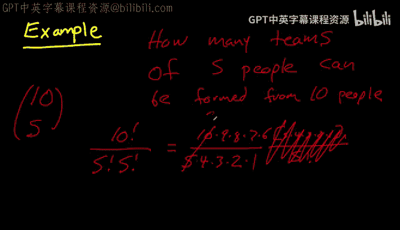

本节课我们一起学习了概率论中的两个基础计数工具。
*   我们首先通过**抽球模型**区分了**有放回**与**无放回**抽取对概率的影响。
*   接着，我们学习了**阶乘**的概念及其符号 `!`，它用于计算连续递减整数的乘积。
*   最后，我们引入了**组合数** `C(m, n)`，它用于计算从M个不同元素中无顺序地选取N个元素的所有可能组合的数量，其核心公式为 `M! / [N! × (M-N)!]`。

掌握阶乘和组合数是理解更复杂概率问题的重要基石。