# 课程31：加法法则、条件概率与乘法法则 📊

在本节课中，我们将要学习概率论中的三个核心概念：边际概率与加法法则、条件概率，以及乘法法则。我们将了解如何从联合概率推导出单个事件的概率，如何计算在已知某些信息条件下的概率，以及如何将这些概念联系起来。

## 边际概率与加法法则

上一节我们介绍了联合概率。在概率问题中，我们常常知道两个事件同时发生的联合概率，但需要求出其中单个事件发生的概率，而不考虑另一个事件。

边际概率就是指单个事件发生的概率。例如，如果我们想知道事件 **X1** 发生的概率，并且已知 **X1** 与 **Y1**、**Y2**、**Y3** 同时发生的联合概率，那么 **X1** 的概率就是它的边际概率。

加法法则告诉我们，边际概率等于所有相关联合概率的总和。假设 **Y** 是一个完备的概率分布（即其事件互斥且穷尽），那么 **X1** 的边际概率计算公式如下：

**P(X1) = P(X1, Y1) + P(X1, Y2) + P(X1, Y3) + ...**

例如，如果 **P(X1, Y1)=1%**， **P(X1, Y2)=10%**， **P(X1, Y3)=4%**，那么 **P(X1) = 1% + 10% + 4% = 15%**。

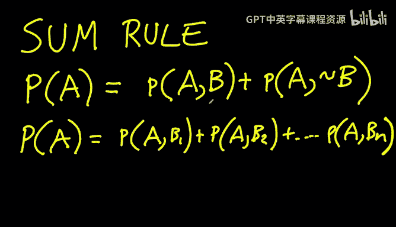

同样地，**Y2** 的边际概率 **P(Y2)** 等于 **P(X1, Y2) + P(X2, Y2) + P(X3, Y2)** 的总和。

以下是加法法则的两种表述形式：

*   **二元分布**：对于事件 **A** 和 **B**，有 **P(A) = P(A, B) + P(A, ¬B)**。
*   **多元分布**：对于事件 **A** 和一系列互斥且穷尽的事件 **B1, B2, ..., Bn**，有 **P(A) = Σ P(A, Bi)**，其中 **i** 从 **1** 到 **n**。

## 条件概率

在理解了如何从整体中提取单个事件的概率后，本节我们来看看条件概率。条件概率衡量的是在已知某个其他事件确定发生的情况下，目标事件发生的概率。

条件概率的定义是：在事件 **B** 确定成立的前提下，事件 **A** 发生的概率。其记号为 **P(A | B)**，竖线右侧的事件被视为已知为真。

计算条件概率的通用方法是：将满足 **A** 定义的相关结果数量，除以在我们当前“缩小的宇宙”（即 **B** 必须为真的所有可能结果）中的总结果数量。

例如，投掷一个六面骰子。如果已知掷出的点数是奇数（事件 **B**），那么掷出点数为3（事件 **A**）的条件概率是多少？在奇数结果 **{1, 3, 5}** 这个缩小的样本空间中，满足 **A** 的结果只有 **{3}**。因此，**P(点数为3 | 点数为奇数) = 1/3**。

反之，如果已知掷出的点数是3（事件 **B**），那么点数为奇数（事件 **A**）的条件概率是 **1**，因为3本身就是奇数。

## 乘法法则

现在，我们希望将联合概率、边际概率和条件概率这三个概念联系起来。这通过一个非常重要的规则——乘法法则来实现。

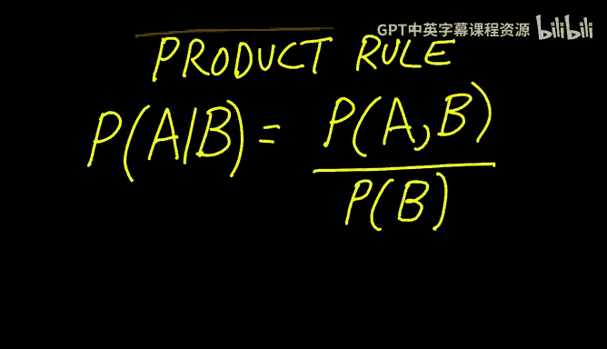

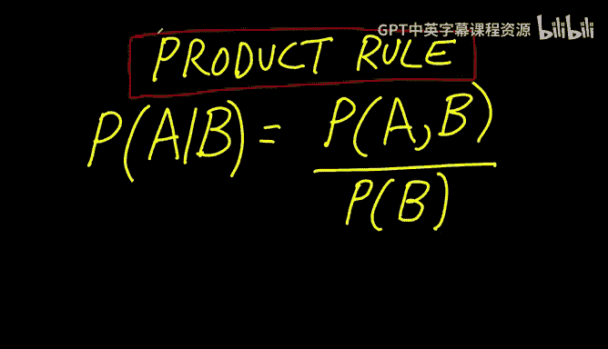

乘法法则的公式如下：

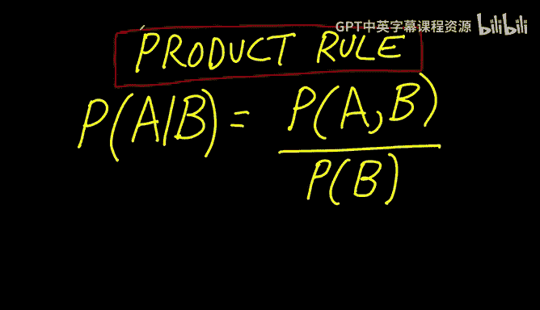

**P(A | B) = P(A, B) / P(B)**，其中 **P(B) ≠ 0**。

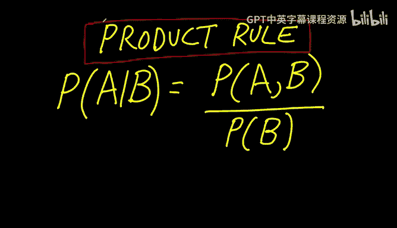

这个公式表明，事件 **A** 在事件 **B** 发生条件下的概率，等于 **A** 和 **B** 同时发生的联合概率，除以 **B** 自身发生的边际概率。

请注意，在条件概率 **P(A | B)** 中，我们假设 **B** 为真。但在公式右边的 **P(B)** 中，**B** 不一定为真，它的概率可以是0以外的任何值。

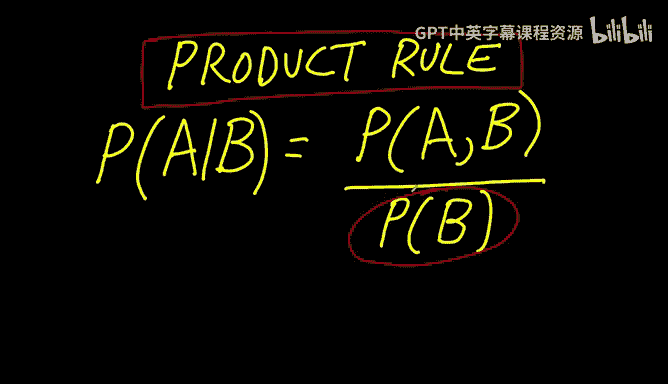

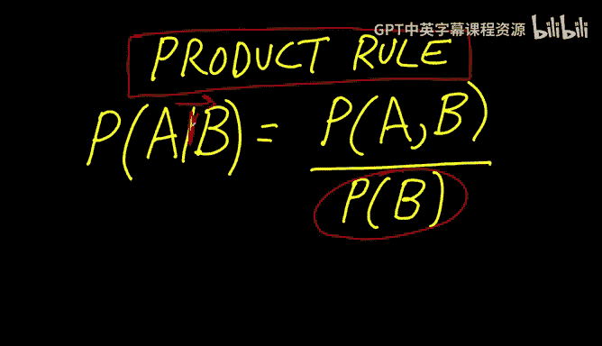

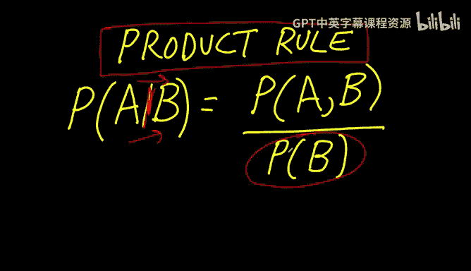

## 独立性的新视角

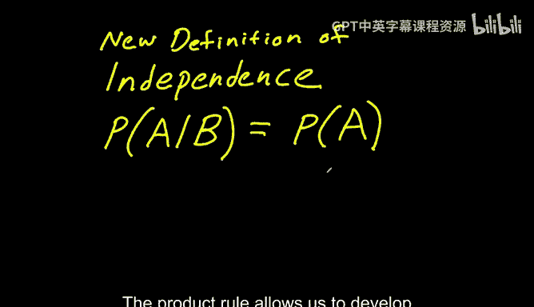

乘法法则允许我们从另一个角度来定义事件的独立性。

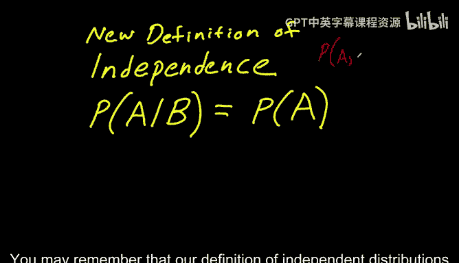

你可能还记得，两个事件 **A** 和 **B** 独立的定义是它们的联合概率等于各自边际概率的乘积：**P(A, B) = P(A) * P(B)**。

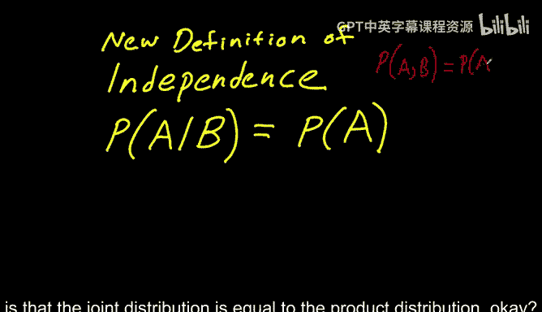

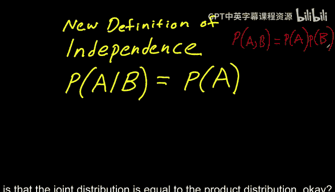

我们可以利用乘法法则从这个旧定义推导出一个等价的新定义。将等式两边同时除以 **P(B)**（假设 **P(B) ≠ 0**）：

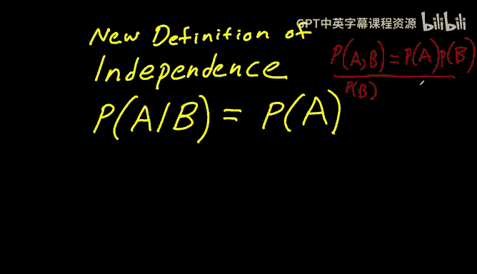

**P(A, B) / P(B) = P(A) * P(B) / P(B)**

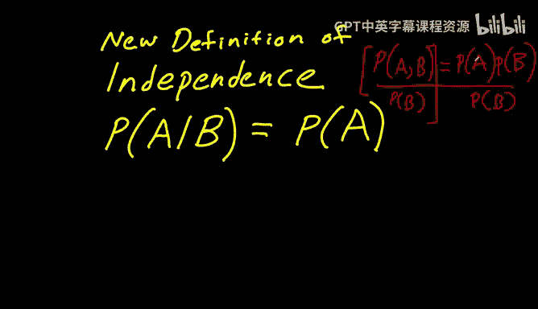

根据乘法法则，左边等于 **P(A | B)**。右边约分后等于 **P(A)**。因此我们得到：

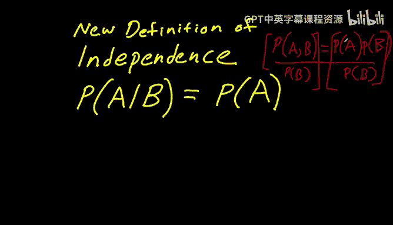

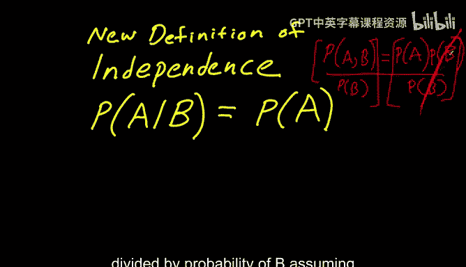

**P(A | B) = P(A)**

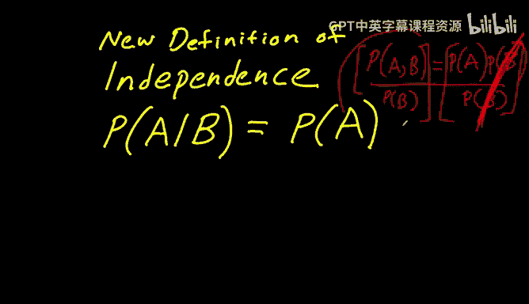

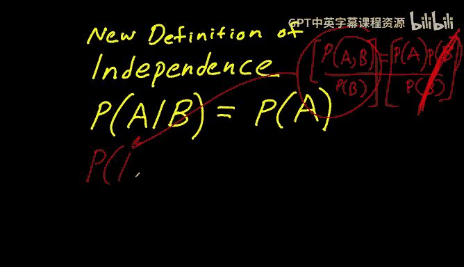

这个新定义的直观含义是：知道事件 **B** 发生，并不会改变事件 **A** 发生的概率。事件 **B** 的结果对事件 **A** 的概率没有影响，因此它们是独立的。

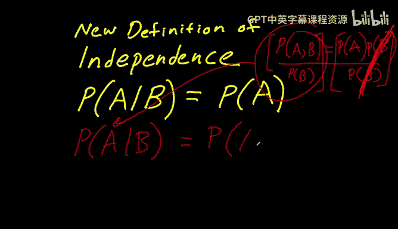

反之亦然，如果 **P(A | B) ≠ P(A)**，那么事件 **A** 和 **B** 就是相依的。任何两个概率分布的关系，非独立即相依，没有中间状态。

---

本节课中我们一起学习了概率论的三个基础法则。我们首先通过**加法法则**从联合概率求得边际概率。然后引入了**条件概率**的概念，它描述了在已知信息下事件发生的可能性。最后，我们通过**乘法法则**将联合概率、边际概率和条件概率联系起来，并由此得到了事件**独立性**的一个等价且直观的新定义：**P(A | B) = P(A)**。掌握这些法则对于理解和构建更复杂的概率模型至关重要。