# 课程32：贝叶斯定理第一部分 🧮

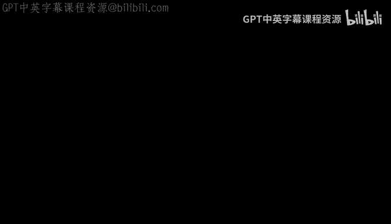

在本节课中，我们将学习概率论中最著名且最强大的定理之一——贝叶斯定理。我们将从熟悉的乘积法则出发，推导出贝叶斯定理的公式，并探讨其在解决“逆概率问题”中的应用。通过一个具体的例子，我们将理解如何利用贝叶斯定理，在已知观测数据的情况下，推断出最可能产生这些数据的未知过程或参数。

---

现在，我们来到概率论中最著名且最强大的定理之一：贝叶斯定理。

我们从熟悉的乘积法则开始。你会注意到，如果我们在这个等式的两边同时乘以事件B的概率，我们仍然会得到一个基于乘积法则的等价形式，它看起来像这样：

**P(A|B) * P(B) = P(A, B)**

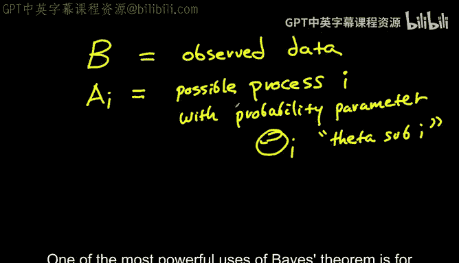

现在，我们可以进行替换。我们可以用 **P(B, A)** 替换 **P(A, B)**，因为我们知道它们是完全等价的。然后，我们可以再次应用乘积法则到 **P(B, A)** 上，其等价形式如下：

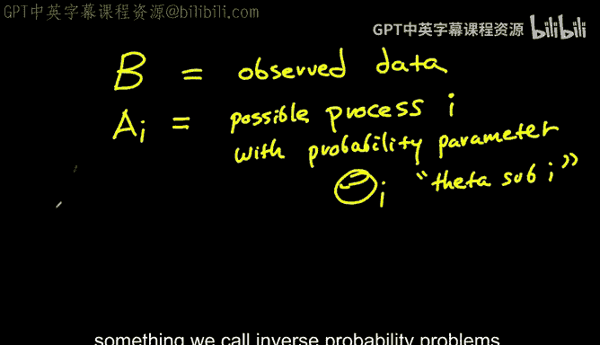

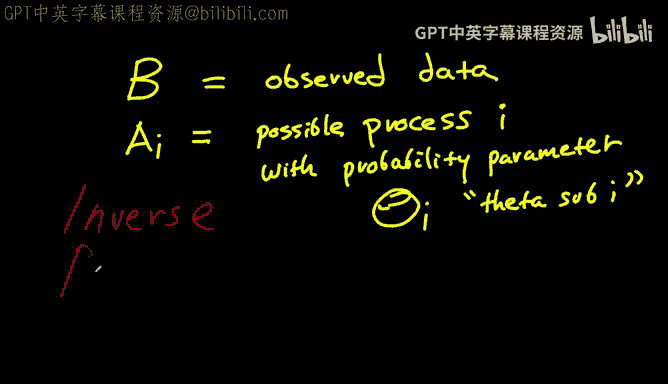

**P(B|A) * P(A) = P(B, A)**

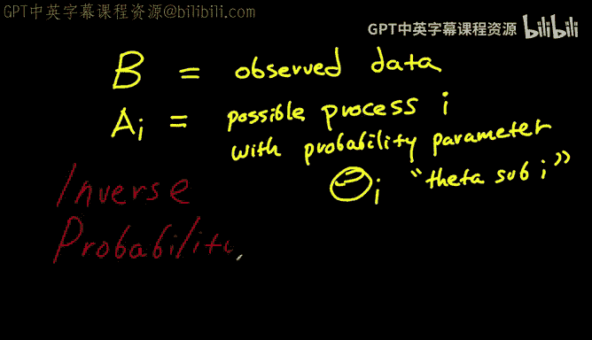

于是，我们得到了这个等价关系，这就是贝叶斯定理：

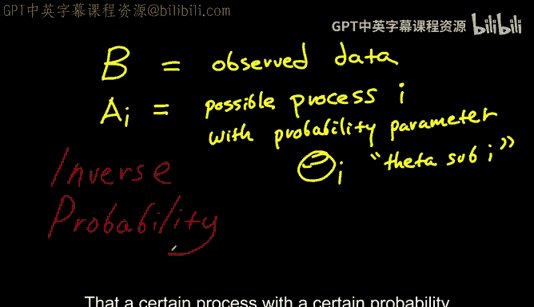

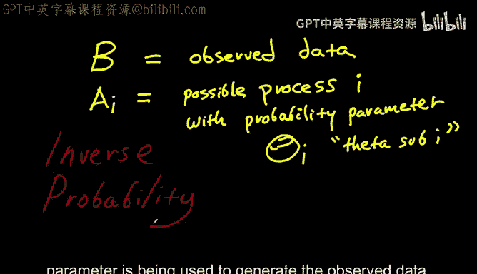

**P(A|B) = [P(B|A) * P(A)] / P(B)**

贝叶斯定理最强大的用途之一是解决我们所谓的“逆概率问题”。

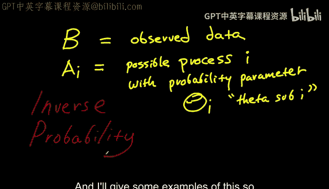

---

## 什么是逆概率问题？ 🔄

逆概率问题是指那些答案形式为“某个具有特定概率参数的过程，正在被用来生成观测数据”的概率是多少的问题。

我将给出一些例子，这会让概念更清晰。我们有时会用希腊字母 **θ** 来表示可能导致或生成我们所观测数据的不同参数。有时，我们也直接用下标 **i** 来表示可能生成观测数据的众多过程中的某一个。就我们的目的而言，它们本质上是等价的。

我们来看一个例子。假设我们有两个瓮。一个瓮里有20%的白球，另一个瓮里有10%的白球。我们观察到从一个瓮中（有放回地）连续抽出了三个白球，但我们不知道我们观察的是哪个瓮。那么，我们正在观察瓮1的概率是多少？我们正在观察瓮2的概率又是多少？

这些概率就是“过程”的概率。瓮1代表过程1，或者说参数“白球概率=0.2”。瓮2代表过程2，或者说参数“每次抽取得到白球的概率=0.1”。

在一个更常规的“正向概率问题”中，我们感兴趣的是在已知过程的情况下，观察到某个特定结果的概率。例如，如果我们知道是瓮1（已知过程），那么连续观察到三个白球的概率就是 **0.2 * 0.2 * 0.2 = 0.008**。这是一个常规的概率问题。

而在这个问题中，我们是从已知的结果出发，感兴趣的是我们观察到瓮1或瓮2的可能性有多大。这是一个关于未知过程的问题。

用条件概率的术语来表述，我们感兴趣的是：在给定“连续观察到三个白球”这一观测数据（B）的条件下，过程参数（A_i，即瓮1或瓮2，或者说白球概率等于0.2或0.1）的概率是多少。

贝叶斯定理告诉我们，这等于：

**P(A_i | B) = [P(B | A_i) * P(A_i)] / P(B)**

在这里，我们利用求和法则将 **P(B)** 分解为一系列联合概率之和：

**P(B) = P(B, A_1) + P(B, A_2) = [P(B|A_1) * P(A_1)] + [P(B|A_2) * P(A_2)]**

---

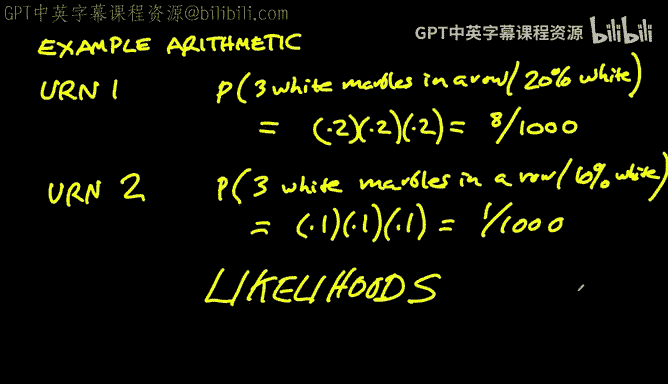

## 似然与先验概率 📊

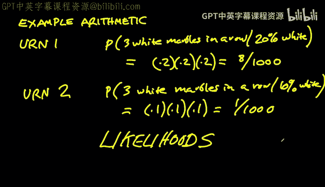

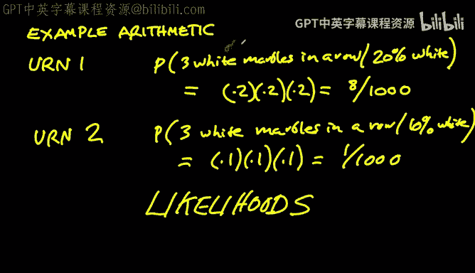

贝叶斯定理公式中的 **P(B | A_i)** 部分被称为“似然”。它解决的是一个简单的正向概率问题：在给定参数（过程）的条件下，观测到数据的概率是多少。

所以，如果我们知道观察的是瓮1，那么连续观察到三个白球的似然是 **0.2^3 = 0.008**。类似地，如果每次抽到白球的概率是10%，那么连续三个白球的似然是 **0.1^3 = 0.001**。

那么我们的解是什么呢？我们将从“无差别原则”开始。无差别原则告诉我们，在没有其他信息的情况下，我们没有理由在两个瓮之间做出选择，因此：

**P(A_1) = 0.5**
**P(A_2) = 0.5**

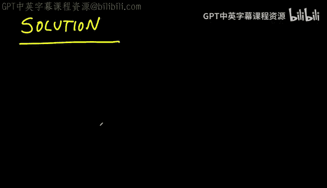

换句话说，在我们观察到任何数据之前，我们对正在观察哪个瓮持中立态度，它们具有相等的概率。因为这发生在观测任何数据之前，我们称之为参数的“先验概率”。

---

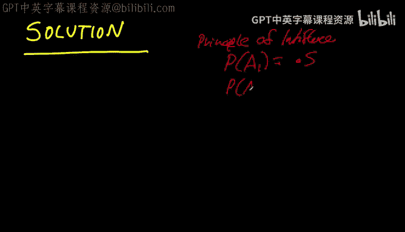

## 应用贝叶斯定理进行计算 🧮

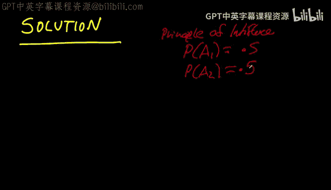

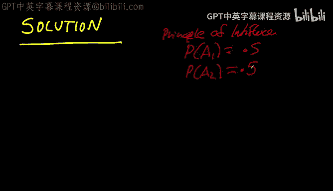

现在，我们来看具体的计算。对于瓮1（A_1），根据贝叶斯定理：

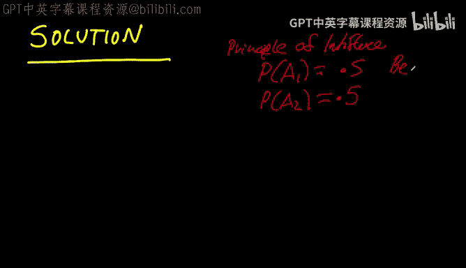

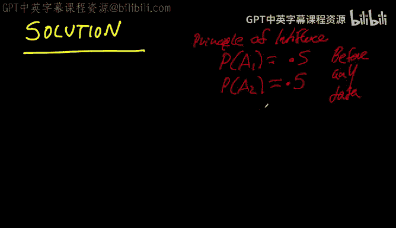

**P(A_1 | B) = [P(B | A_1) * P(A_1)] / P(B)**

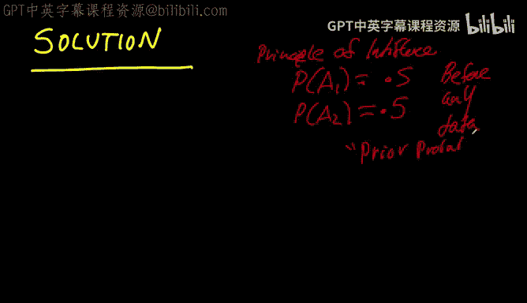

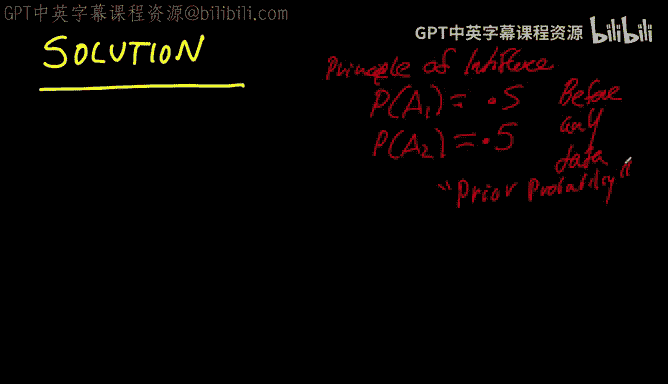

其中，分母 **P(B)** 为：

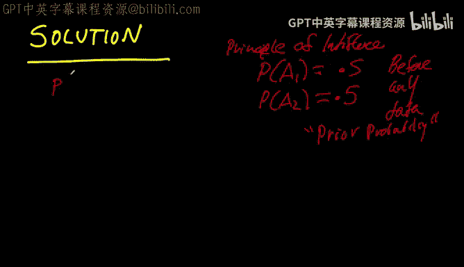

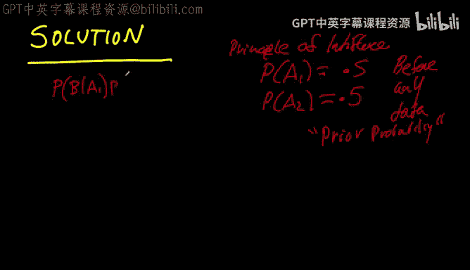

**P(B) = [P(B|A_1) * P(A_1)] + [P(B|A_2) * P(A_2)]**

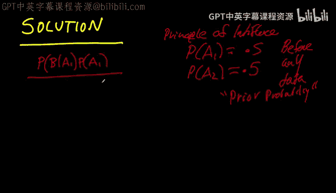

代入数值：
*   **P(B|A_1) = 0.008**
*   **P(A_1) = 0.5**
*   **P(B|A_2) = 0.001**
*   **P(A_2) = 0.5**

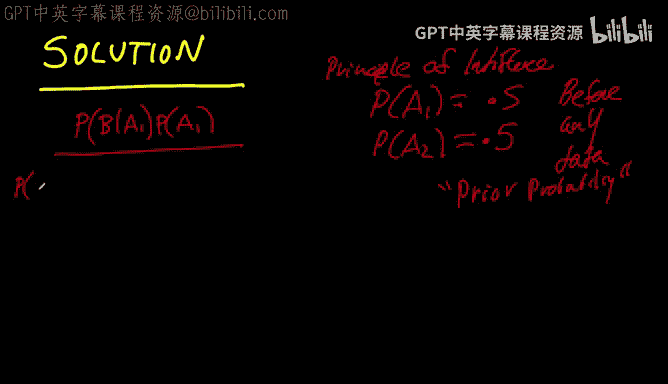

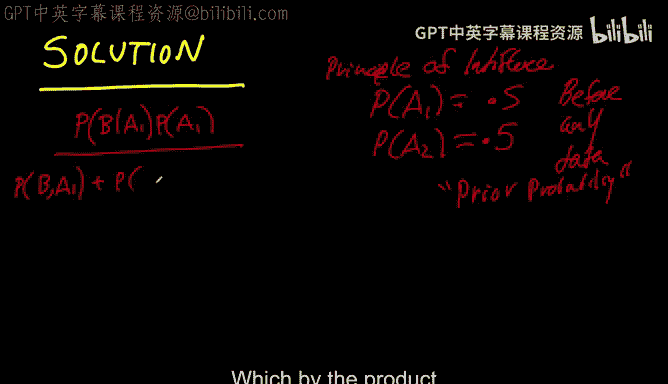

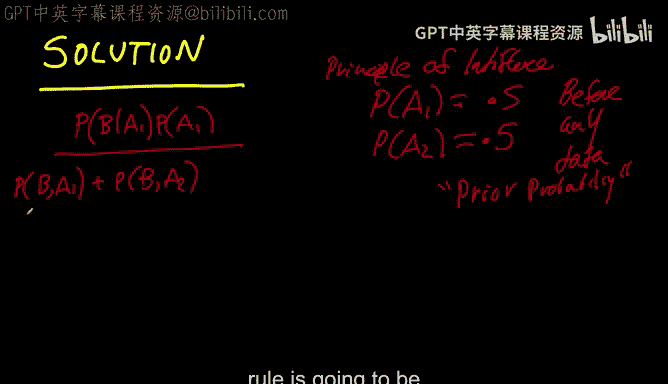

计算如下：

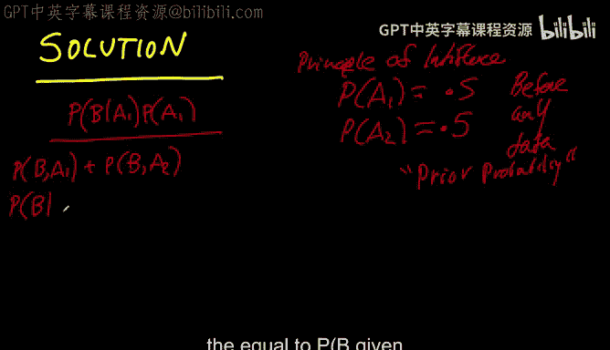

**P(A_1 | B) = (0.008 * 0.5) / [(0.008 * 0.5) + (0.001 * 0.5)]**

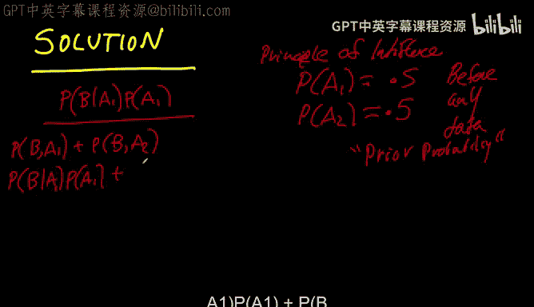

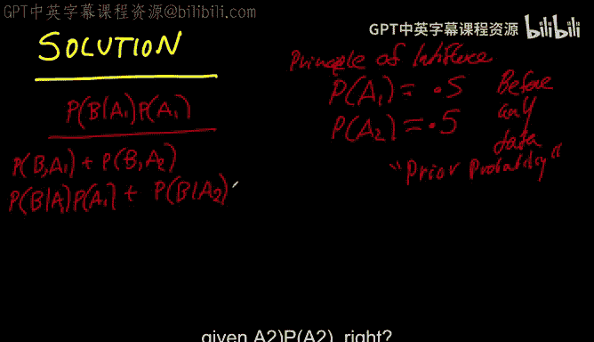

分子和分母中的 0.5 可以约去：

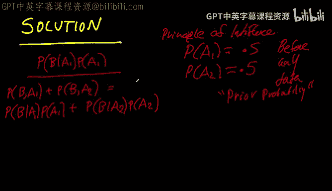

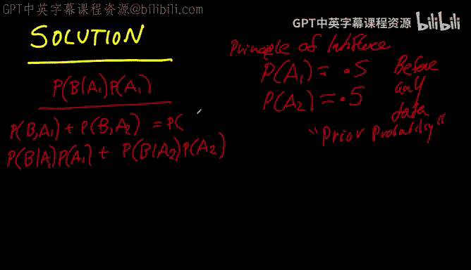

**P(A_1 | B) = 0.008 / (0.008 + 0.001) = 0.008 / 0.009 = 8/9**

因此，我们观察到的是瓮1的概率是 **8/9**。显然，我们观察到瓮2的概率就是 **1 - 8/9 = 1/9**。

---

## 总结 📝

本节课中，我们一起学习了贝叶斯定理的推导及其在逆概率问题中的应用。我们从一个具体的“抽球”例子出发，理解了如何利用贝叶斯公式，在已知观测结果（连续三个白球）后，更新我们对潜在未知过程（是哪个瓮）的信念。我们引入了几个关键概念：
*   **贝叶斯定理公式**：**P(A|B) = [P(B|A) * P(A)] / P(B)**
*   **似然**：在给定假设下，观测到数据的概率 **P(B|A)**
*   **先验概率**：在观测数据之前，对假设的初始信念 **P(A)**
*   **后验概率**：在观测数据之后，对假设更新后的信念 **P(A|B)**

通过计算，我们看到，尽管最初两个瓮被选中的先验概率相等（各为0.5），但在观察到“连续三个白球”这个强证据后，后验概率强烈倾向于白球比例更高的瓮1（8/9）。这就是贝叶斯推断的核心思想：用数据更新认知。