# 课程33：贝叶斯定理第二部分 🔄

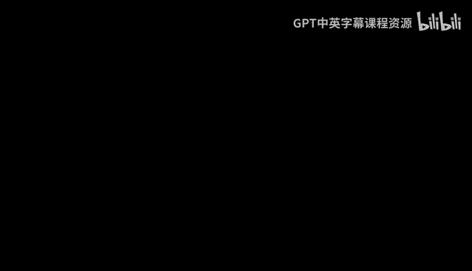

在本节课中，我们将学习贝叶斯定理的一个强大应用：如何根据新获得的数据来更新我们的概率估计。我们将通过一个具体的例子，演示如何将先验概率更新为后验概率。

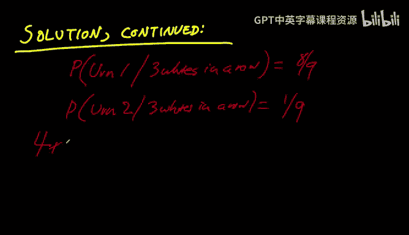

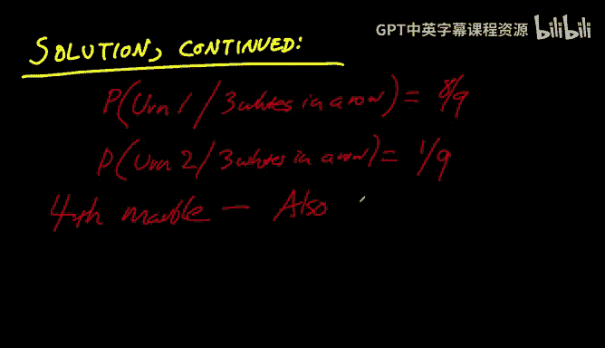

---

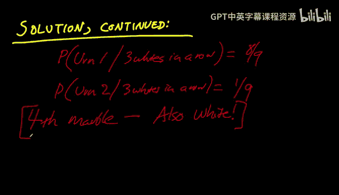

贝叶斯定理真正强大的地方在于，它允许我们根据新的数据来更新概率。

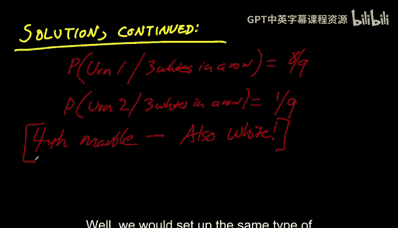

假设我们之前从一个瓮中抽取了三颗弹珠，并计算了该瓮是“瓮1”（白球概率0.2）还是“瓮2”（白球概率0.1）的概率。现在，我们抽取了第四颗弹珠。

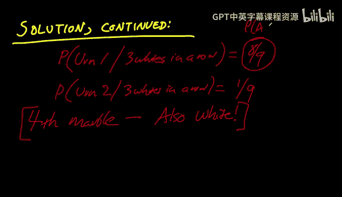

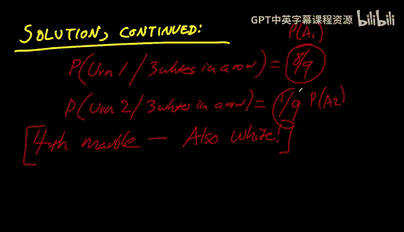

这颗弹珠也是白色的。

那么，我们该如何更新我们的概率呢？

我们会建立与之前相同类型的贝叶斯定理公式。但是，公式中的先验概率 `P(A1)` 和 `P(A2)` 将不再是初始的1/2，而是我们根据前三颗弹珠计算出的后验概率（八分之九和九分之一）。这些新的概率成为了我们计算中的“新先验概率”。

让我具体说明一下。在观察到三颗白球后，再观察到第四颗白球的条件下，瓮1的概率计算如下：

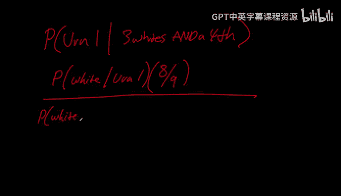

**公式：**
`P(瓮1 | 第四颗白球) = [P(第四颗白球 | 瓮1) * P(瓮1 | 前三颗白球)] / P(第四颗白球)`

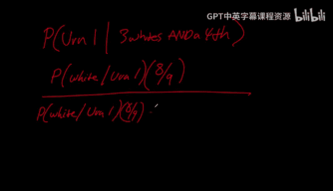

其中，分母 `P(第四颗白球)` 是观察到第四颗白球的总概率，需要通过全概率公式计算：

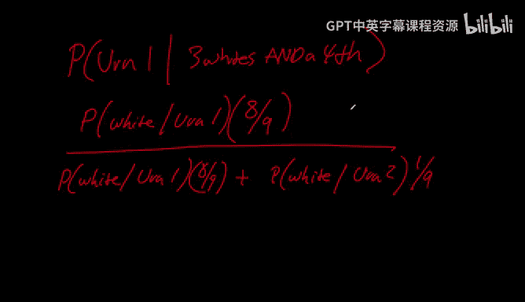

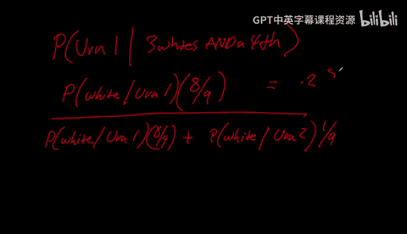

**公式：**
`P(第四颗白球) = [P(第四颗白球 | 瓮1) * P(瓮1 | 前三颗白球)] + [P(第四颗白球 | 瓮2) * P(瓮2 | 前三颗白球)]`

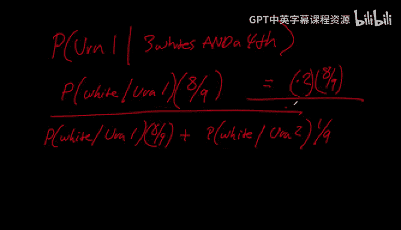

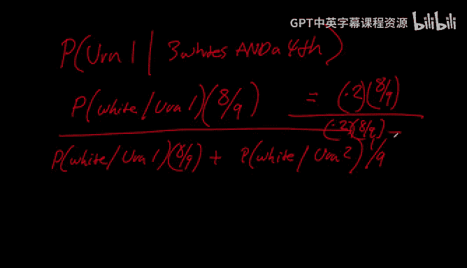

代入具体数值进行计算：
*   分子：`0.2 * (8/9)`
*   分母：`[0.2 * (8/9)] + [0.1 * (1/9)]`

计算结果如下：
*   `P(瓮1 | 新数据) ≈ 94.12%`
*   `P(瓮2 | 新数据) ≈ 5.88%`

与更新前的概率（瓮1为88.9%，瓮2为11.1%）相比，在得到第四颗白球这一新证据后，瓮1的概率进一步上升，而瓮2的概率则下降了。

---

贝叶斯公式中的各个部分有专门的名称。为了更具一般性，我们用参数 `θ` 来表示不同的可能性（例如，`θ1` 代表瓮1的0.2白球概率，`θ2` 代表瓮2的0.1白球概率）。

以下是贝叶斯定理各组成部分的名称：

**公式：**
`P(θ_i | 数据) = [P(数据 | θ_i) * P(θ_i)] / P(数据)`

*   **后验概率**：公式左边的 `P(θ_i | 数据)`。表示在观察到新数据**之后**，我们对参数 `θ_i` 为真的概率的最佳估计。
*   **先验概率**：公式中的 `P(θ_i)`。表示在观察到新数据**之前**，我们对参数 `θ_i` 为真的初始信念。它可以是基于无差别原则的初始猜测（如1/2），也可以是上一轮计算得到的后验概率。
*   **似然**：公式中的 `P(数据 | θ_i)`。这是在给定某个参数 `θ_i` 为真的条件下，观察到当前数据的“标准”正向概率。
*   **边际概率/证据**：公式分母的 `P(数据)`。这是观察到当前数据的总概率，通过对所有可能参数的似然与先验的乘积求和得到（即全概率公式）。

---

本节课中，我们一起学习了贝叶斯定理的核心应用——概率更新。我们通过一个连续抽取弹珠的例子，演示了如何将新证据（第四颗白球）融入计算，从而把“先验概率”更新为“后验概率”。我们还明确了贝叶斯公式中“后验概率”、“先验概率”、“似然”和“边际概率”这四个关键术语的定义。理解这个过程是掌握贝叶斯推理的基础。