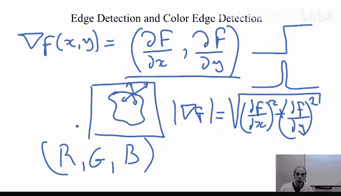

# 028：标量与向量图像的梯度 📈

在本节课中，我们将要学习图像处理中的一个核心概念——梯度。我们将探讨梯度如何帮助我们检测图像中的边缘，并理解其在标量图像（如灰度图）和向量图像（如彩色RGB图）中的含义与应用。

---

## 概述

梯度是微积分中的一个基本概念，它描述了函数在某一点处变化最快的方向与速率。在图像处理中，图像的梯度向量指向像素值变化最剧烈的方向，其大小（模长）表示变化的剧烈程度。这对于边缘检测、图像增强等任务至关重要。

上一节我们介绍了图像处理中的基本操作，本节中我们来看看梯度的具体定义及其在图像分析中的作用。

---

## 标量图像的梯度

一幅灰度图像可以看作是一个二维标量函数 **F(x, y)**，其中每个点 **(x, y)** 对应一个像素强度值。

该图像的梯度 **∇F** 是一个向量，其分量是图像在 **x** 方向和 **y** 方向上的偏导数：

**∇F = ( ∂F/∂x, ∂F/∂y )**

这个向量指向图像在该点处**变化率最大**的方向。其大小（模长）表示变化的幅度，计算公式为：

**|∇F| = √[ (∂F/∂x)² + (∂F/∂y)² ]**

以下是关于梯度方向与大小的一些关键点：
*   **最大变化方向**：梯度向量的方向指示了从当前像素点出发，像素值增加最快的方向。
*   **变化幅度**：梯度向量的模长 **|∇F|** 量化了变化的剧烈程度。模长越大，说明边缘越明显。
*   **零变化方向**：与梯度方向垂直的方向上，像素值的变化为零。这对应于图像的“等高线”。

在边缘检测中，一个阶跃变化（sharp change）的导数近似为一个脉冲函数（delta function）。因此，计算图像的梯度（即导数）能有效帮助我们定位这些发生剧烈变化的边缘区域。

---

## 向量图像的梯度

对于彩色图像（如RGB图像），每个像素点不再是一个标量值，而是一个包含红、绿、蓝三个通道的向量 **V(x, y) = [ R(x, y), G(x, y), B(x, y) ]**。

此时，我们可以提出类似的问题：在哪个方向上，这个颜色向量的整体变化最大？

处理向量图像梯度的一种方法是分别计算每个颜色通道的梯度：
*   计算红色通道的梯度 **∇R**
*   计算绿色通道的梯度 **∇G**
*   计算蓝色通道的梯度 **∇B**

这样会得到三个可能不同的梯度方向。然而，更综合的方法是寻求一个单一的方向，使得红、绿、蓝三个通道的**联合变化**最大化。这个概念被称为向量值图像的梯度，它扩展了标量梯度的思想，用于描述整个颜色向量的变化情况。

虽然其具体计算公式比标量情况更复杂，但其核心思想是一致的：它给出了颜色变化最剧烈的方向，并有一个对应的模长来衡量变化的总体幅度。

---

## 总结

本节课中我们一起学习了图像梯度的核心概念。
*   对于**标量图像（灰度图）**，梯度是一个向量，指向像素强度变化最快的方向，其模长表示变化的强度。这是边缘检测的基础。
*   对于**向量图像（彩色图）**，梯度的概念可以推广到描述整个颜色向量的变化，同样包含一个指示最大变化方向和一个表示变化幅度的量。

理解梯度是进行高级图像处理（如边缘增强、特征提取）的关键一步。在接下来的课程中，我们将基于这些概念继续探索。