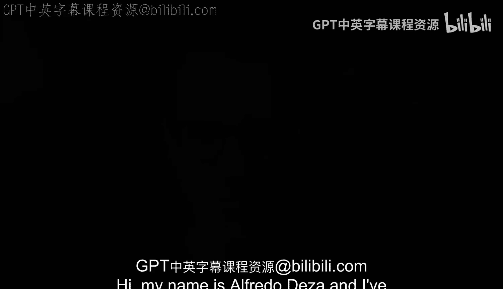

# 2：02_01_02：认识课程讲师-阿尔弗雷多·德萨

## 概述

在本节课中，我们将认识本课程的讲师阿尔弗雷多·德萨，并了解他的专业背景以及本课程将要探讨的核心内容。

## 讲师介绍

大家好，我是阿尔弗雷多·德萨。我从事机器学习和编程课程教学已有很长时间。

我的专业背景和经验主要集中在软件工程、自动化、DevOps以及系统管理领域。

## 课程内容简介

在本课程中，我们将深入探讨如何使用和利用本地大语言模型。

我们将分析这些模型在哪些情况下具有实用价值，以及为何你可能需要考虑使用它们。

我们还将学习如何在本地应用特定技术，以便你能够开始与这些大语言模型进行交互，并充分利用其全部功能。

我们将探讨实现这一切的可能性，以及如何最有效地利用这些模型。

## 总结

本节课我们一起认识了讲师阿尔弗雷多·德萨，并初步了解了本课程的核心方向：深入学习和应用本地大语言模型。下一节我们将开始进入具体的技术学习阶段。