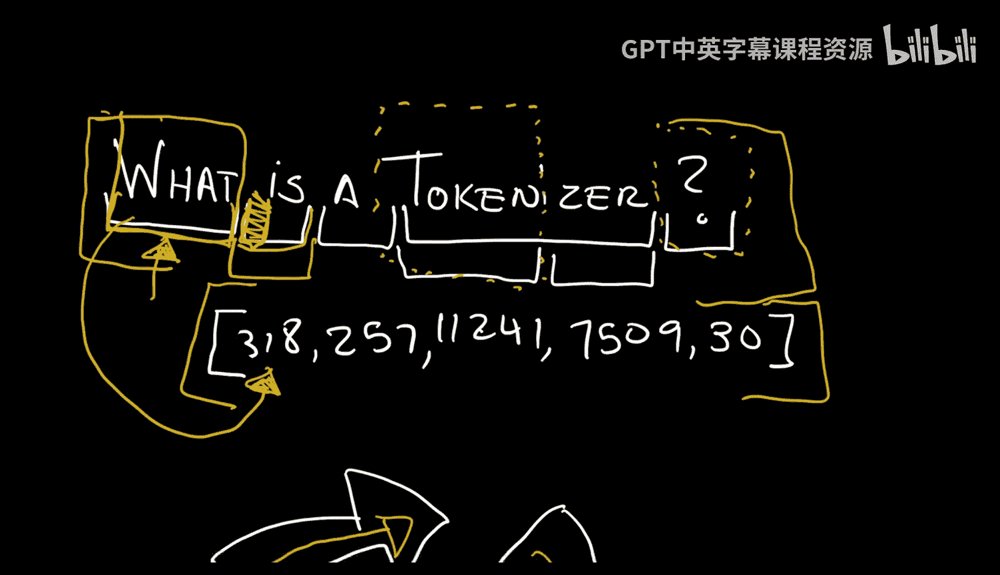
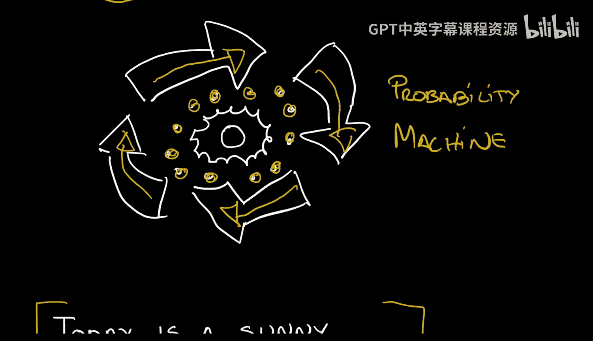
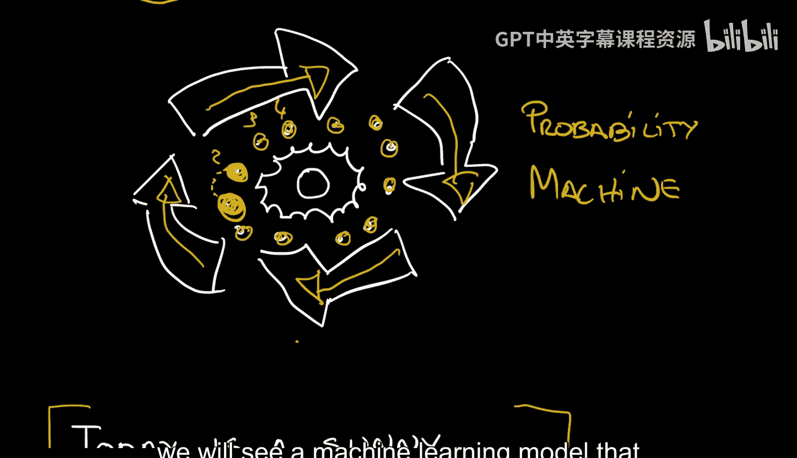
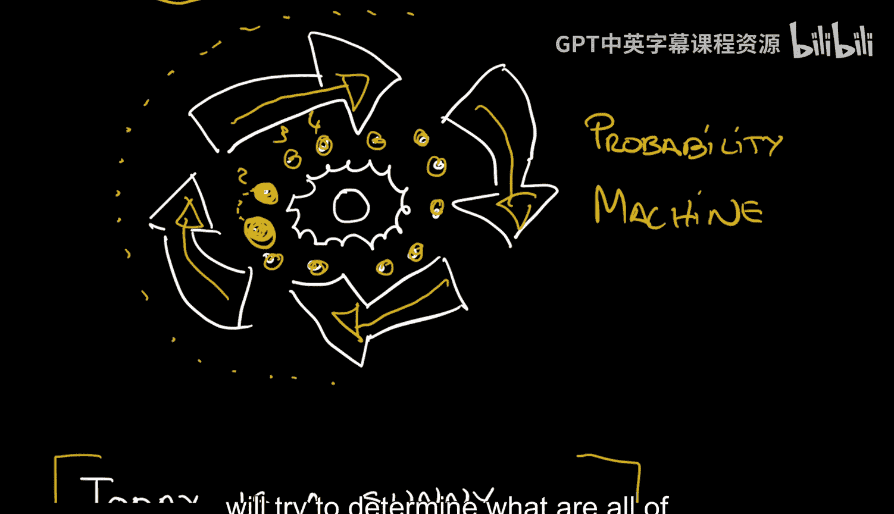
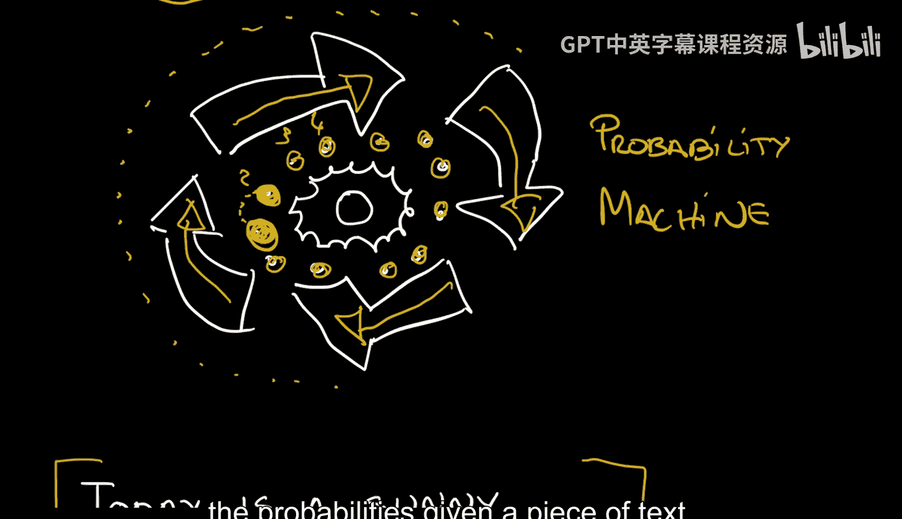
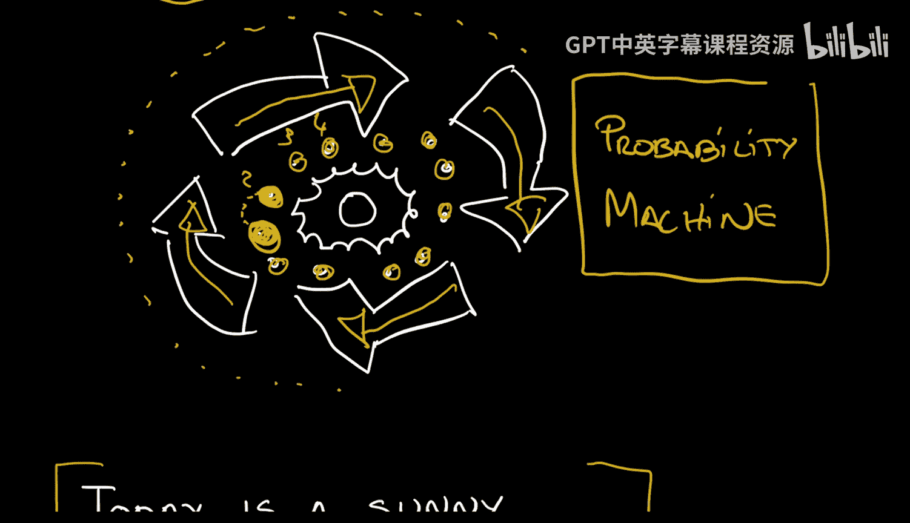
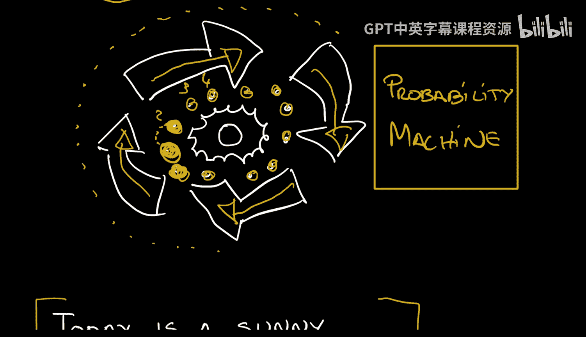

# 4：什么是LLM及其工作原理 🧠

在本节课中，我们将要学习大语言模型（LLM）的基本概念及其核心工作原理。我们将从理解文本如何被模型处理开始，逐步揭示LLM如何通过概率计算来生成文本。

---

要理解大语言模型及其确切的工作原理，我们首先需要从“词元”开始，并理解什么是“词元化器”。

我们有一段文本，提出了一个问题：“什么是词元化器？” 其确切含义是，词元化器是一个将文本（例如这里的这个短语）转换为数字的过程。

大语言模型以文本作为输入，并生成文本作为输出。

但这个过程具体是如何发生的呢？它的发生方式是处理一个像这样的短语，并将其分割成更小的块。

例如，其中一个块可能是什么？其中一块会被转换成一个数值。在这种情况下，这个数值可能是什么？

一个数值，比如318。所有这些块最终都会被转换成数字，并被放入一种数组中。

这是机器随后能够处理这些信息并尝试更好地识别它们的方式。通过使用数值来表示这些块，我们正在构建一种索引。这个索引是对原始文本块的编码。

我们称之为“块”或“片段”，是因为它不一定按单词划分。例如，这里“what is a”可能是一个块，但“a”后面可能也包含一点空格，这也可能被整体表示为一个块。有时，词元化器甚至会将一个单词拆分成两部分，像这里的问号也可能构成一个单独的块。

所有这些表示方式都将使机器学习模型更容易理解文本。否则，对于机器理解文本来说，这是我们目前拥有的最佳方法。

以上是分析部分，或者说，是将这些文本块分割并转换为数值的过程。

---

上一节我们介绍了文本如何被转换为机器可处理的数值。那么，我们这里处理的究竟是什么？我喜欢称之为“概率机器”。

为什么是概率机器？它试图理解所有这些较小的文本块（即词元），从一个词元到下一个词元，并尝试预测从一个词元到第二个词元，再到第三个、第四个词元等等的确切概率。

因此，以一种过度简化的方式解释，它本质上只是一个概率问题。基于海量的文本，我们将看到一个机器学习模型试图确定，给定一段文本后，所有后续词元出现的概率。

这就是为什么我想强调，这本质上就是一台概率机器。这样思考这些模型也很容易，因为有时它们表现得非常出色，像一台能输出事实的机器。

即使某些生成的文本看起来准确、正确且符合现实，我们也不应将其视为事实输出机。因为它的全部本质只是基于特定输入的概率计算。

基于训练文本的数量，下一个输入、下一个块、下一个片段、下一个词元出现的概率是多少？

---

理解了概率计算的核心后，我们来看一个具体例子。以“今天是个晴天并且……”这样的短语为例，这个短语是理解“……”部分可能是哪个特定词的完美方式。

在这种情况下，“今天是个晴天并且”后面很可能跟着“天”这个词。

这意味着什么？基于训练文本的数量、文本本身、将文本分解为词元并生成所有索引的过程，机器理解到你很可能想要的是“天”这个词，甚至可能前面还有一些空格，以便在生成时文本能被正确表示。

---

所以，本质上，具有大语言生成能力的机器学习模型、大语言模型以及文本生成的工作方式，首先是**通过分解文本来创建索引**，然后**作为一台概率机器运行**。

---

**总结**

本节课中，我们一起学习了大语言模型（LLM）的核心工作原理。我们了解到，LLM首先通过**词元化器**将输入文本分割并编码为数值索引，使其能够被机器处理。随后，模型本质上作为一台**概率机器**，基于从海量文本中学到的模式，计算并预测给定上下文后最可能出现的下一个词元，从而逐步生成连贯的文本。理解这两个核心步骤——**文本到索引的转换**与**基于概率的序列生成**——是掌握LLM如何工作的关键。