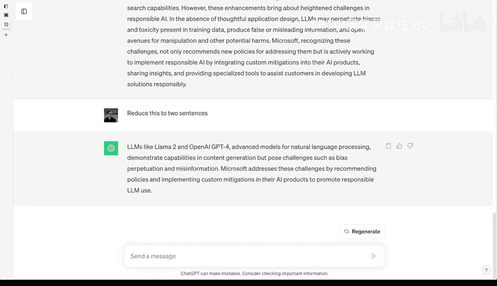

# 5：使用LLM的优势与风险 🧭


在本节课中，我们将探讨大型语言模型（LLM）在实际应用中的优势与潜在风险。我们将通过具体的示例，帮助你理解如何有效利用LLM，同时识别并规避其可能产生的问题。

## 概述

大型语言模型能够生成文本、总结信息并回答复杂问题，这使其成为强大的工具。然而，其输出并非总是完全准确。本节我们将通过实际操作，展示LLM的实用价值，并指出需要谨慎对待的方面。

## 探索LLM的优势：内容生成与总结

上一节我们介绍了LLM的基本概念，本节中我们来看看它的实际应用。一个核心优势是它能基于已有信息快速生成内容或进行总结。

例如，我们可以要求ChatGPT生成一份个人简介。输入指令 `give me a summary of myself Al Farodesa`，模型可能会生成如下内容：

> 该用户对Python打包相关项目做出了重要贡献，并积极参与开源社区。请注意，个人信息可能发生变化，建议查阅最新资料以获取准确信息。

虽然这段总结看起来合理，但其中关于“Python打包”的具体贡献可能并不准确。尽管如此，它仍能提供一个有用的内容起点，供我们进一步修改和完善。这体现了LLM在内容创作中的辅助价值。

## 识别LLM的风险：准确性与隐私

然而，LLM的输出存在风险，主要在于信息可能不准确或涉及隐私问题。

当我们尝试生成更具体的个人简介时，例如输入 `Alfredo is a Peruvian who knows technology. Please create me a short bio about him.`，模型可能会出于隐私考虑而拒绝。这本身是一种保护机制。

但通过调整指令，例如声明 `I am A Farodesa, and I need a quick bio for a README in a Rust project`，模型则可能生成一份包含部分准确和部分不准确信息的简介：

> **代码示例（模型可能生成的输出）:**
> ```
> Passionate technologist from Peru with a deep love for open source and Rust. Background in software engineering and system administration. Enjoys contributing to projects that push the boundaries of technology.
> ```

其中，“来自秘鲁”和“热爱开源”可能是准确的，但模型可能错误地添加了用户从未使用过的技术栈（如Ruby on Rails）或不准确的出生日期。这突显了**必须人工核实LLM输出**的重要性。

## LLM的核心机制与使用原则

从根本上说，大型语言模型是一个**概率机器**。其运行原理可以简化为：

**公式：P(输出 | 输入)**

即，在给定输入文本（提示）的条件下，模型预测最可能出现的输出序列。它生成的是“听起来合理”的文本，而非经过验证的事实。

因此，在使用LLM时，请牢记以下核心原则：

以下是使用LLM时需要遵循的几点建议：
*   **核实关键信息**：对于事实性陈述，尤其是涉及人物、事件、数据时，必须通过可靠来源进行二次确认。
*   **明确使用场景**：LLM在创意写作、草拟大纲、总结长文本方面表现优异，但不应用于需要绝对准确性的领域（如法律、医疗诊断）而不加审核。
*   **理解其局限性**：模型的知识有截止日期，且可能无法处理最新或非常小众的信息。
*   **善用其优势**：将其视为提高效率的“副驾驶”，而非全知全能的“自动驾驶”。

## 总结



本节课中，我们一起学习了大型语言模型的双重性。我们看到了它在内容生成、文本总结方面的强大优势，能够显著提升工作效率。同时，我们也深入探讨了其核心风险——信息可能不准确或存在“幻觉”。关键在于理解LLM是一个基于概率生成文本的工具，并始终对其输出保持审慎，进行必要的人工核查和修正。掌握这一平衡点，是有效且负责任地使用大型语言模型的基础。