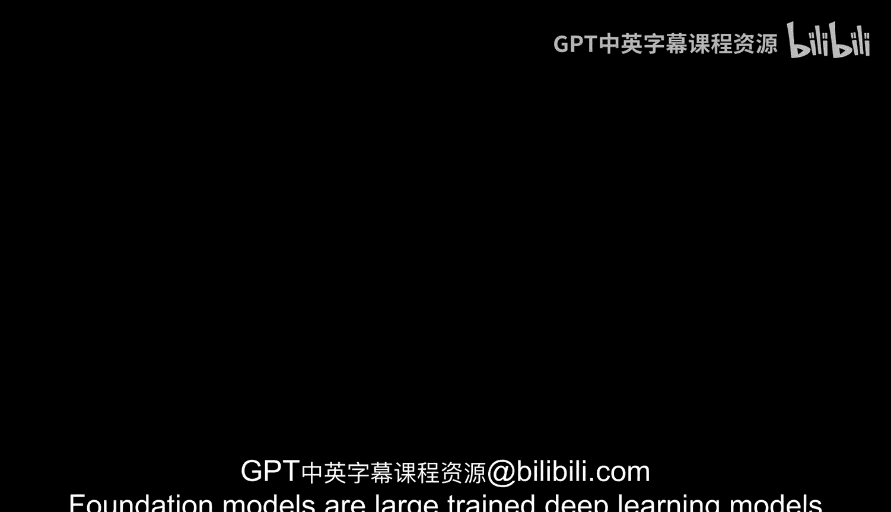
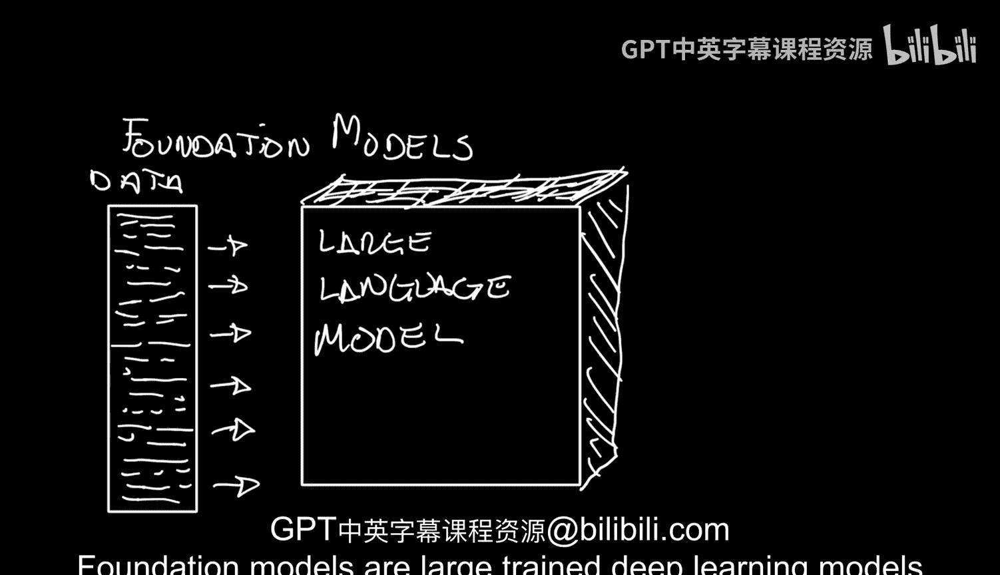
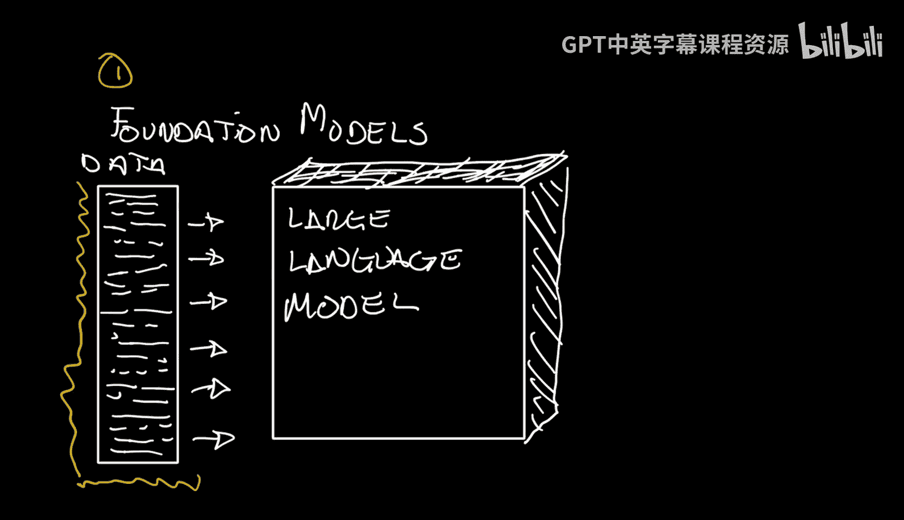
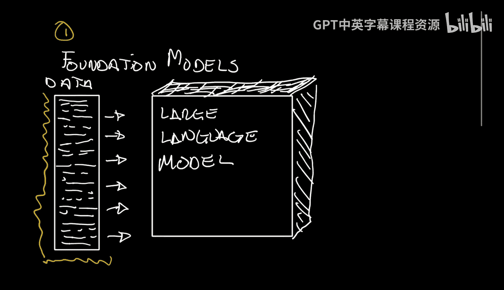
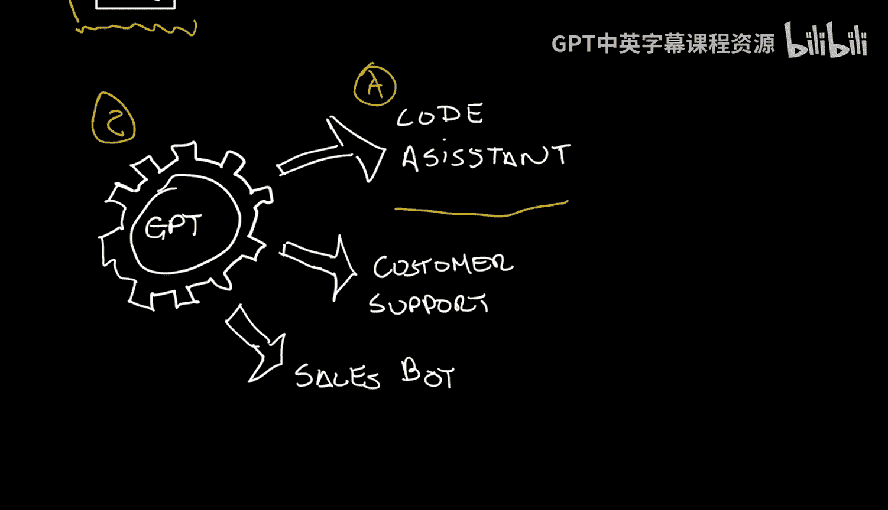
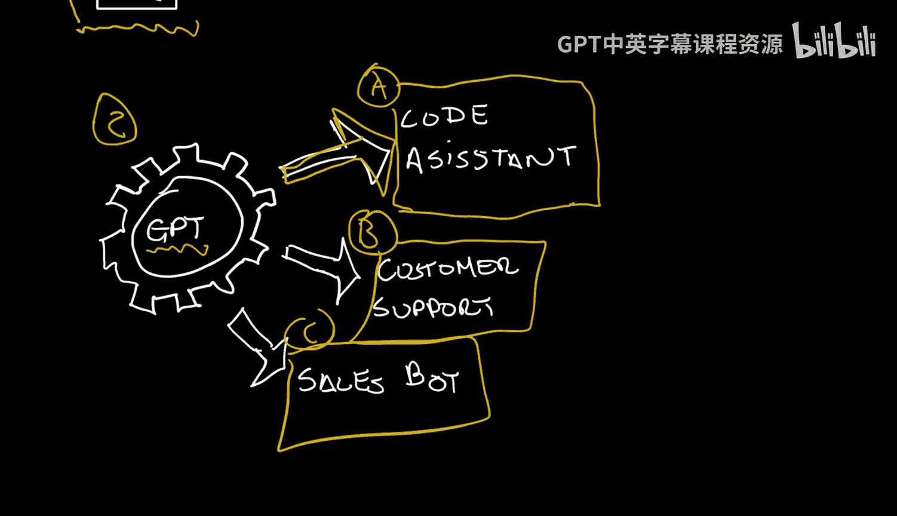
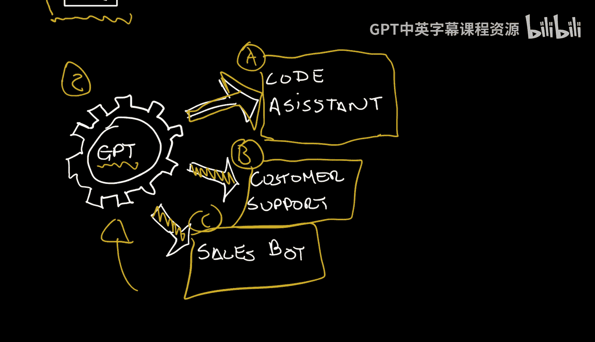
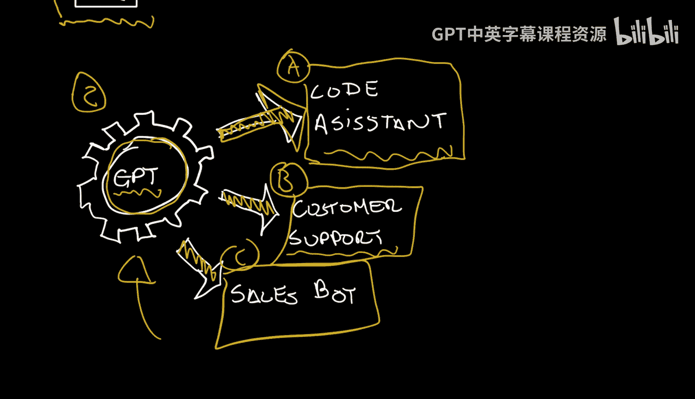
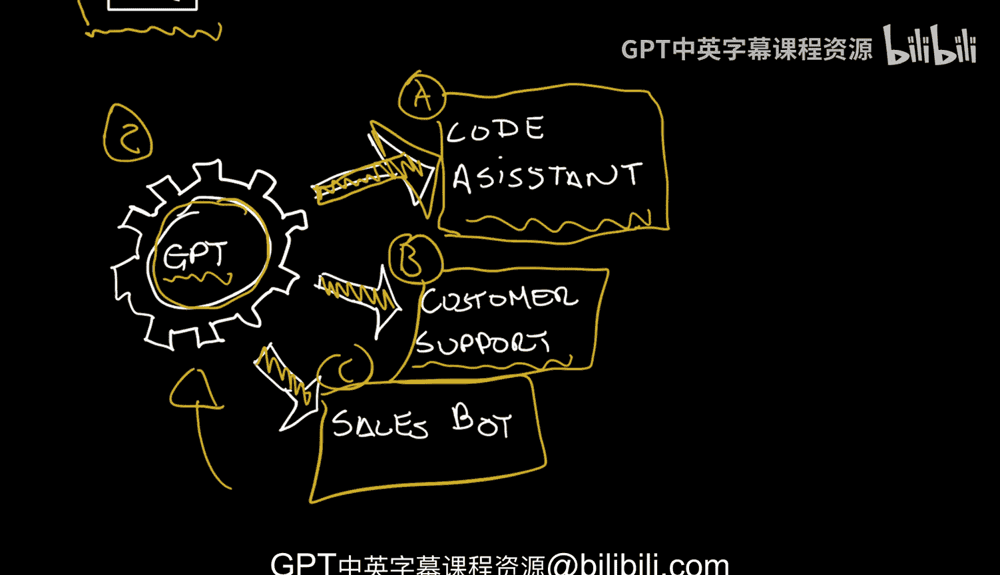

# 本地大语言模型的基础：07：什么是基础模型 🧠

在本节课中，我们将要学习**基础模型**的核心概念。基础模型是构建各种人工智能应用的起点，理解它们是什么以及如何工作，是掌握大语言模型技术的关键。

---

## 概述

基础模型是经过大规模训练的大型深度学习模型，它们可以被调整并应用于多种不同类型的任务。这些模型最初是为自然语言处理而创建的，为构建基于人工智能的应用程序提供了一个坚实而强大的起点。

## 基础模型的核心特征

基础模型的关键在于，它们建立在海量数据之上。这些数据主要是文本，正是这些海量文本数据使得大型语言模型的创建和存在成为可能。

**公式表示：**
`基础模型 = 海量文本数据 + 深度学习架构 + 大规模预训练`

数据量至关重要，因为数据越多、质量越高，最终得到的模型性能就越好。一个非常庞大的语言模型正是这一切的起点。

## 基础模型如何作为起点？

上一节我们介绍了基础模型的特征，本节中我们来看看它如何成为特定任务的起点。

一旦基础模型具备了处理自然语言多个方面的能力，就有可能将其重新调整用途，应用于其他类型的任务。

以下是基础模型可以衍生出的几种具体应用：

*   **代码助手**：开发者、软件工程师、机器学习工程师和数据科学家正在开发环境中使用代码助手。这些助手基于大语言模型的文本生成能力，帮助他们更轻松、更快速地编写代码。
    *   **代码示例**：`# 用户输入：“写一个Python函数来计算斐波那契数列”`
*   **客户支持聊天机器人**：当你访问一个网站并遇到问题时，与你对话的智能客服可能就是基于基础模型构建的。它可以理解你的问题，并引导你创建服务工单。
*   **销售机器人**：与客户支持类似，销售机器人可以用于初步的客户咨询和产品推荐。

需要明确的是，这些具体的应用并非直接、不加修饰地使用基础模型。直接与未经任何处理的基础模型对话的应用，可能会产生不准确或不安全的输出，这不是最佳实践。

## 从基础模型到具体应用

那么，如何将一个通用的基础模型转变为专业的代码助手或客服呢？这中间需要经过一系列处理。

为了使上述三种用例成为可能，在基础模型和手头的具体任务之间，必须存在一种**过滤和处理**机制。

这个过程可能包括：
1.  **指令微调**：基于特定指令对模型进行微调，使其行为更符合预期。
2.  **领域适应**：在特定领域的数据（例如海量的现有代码）上对模型进行额外的训练或微调。
3.  **输出过滤与处理**：对模型的生成结果进行安全检查、格式化和优化。

**核心流程可以概括为：**
`基础模型 (理解通用语言) -> [指令微调 + 领域数据训练 + 输出处理] -> 专用模型 (如代码助手)`

因此，基础模型之所以独特，就在于它作为“基座”，使得其他更具体的任务得以实现。

---

## 总结

本节课中我们一起学习了**基础模型**。我们了解到，基础模型是经过海量文本数据预训练的大型语言模型，为AI应用提供了通用起点。通过**指令微调**、**领域特定数据训练**和**输出处理**，我们可以将通用的基础模型适配到代码助手、客户支持等具体任务中，从而构建出强大且专业的AI应用。