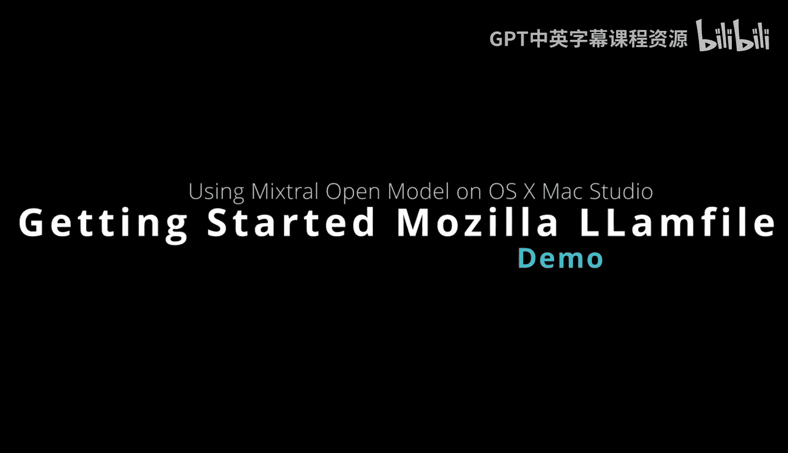
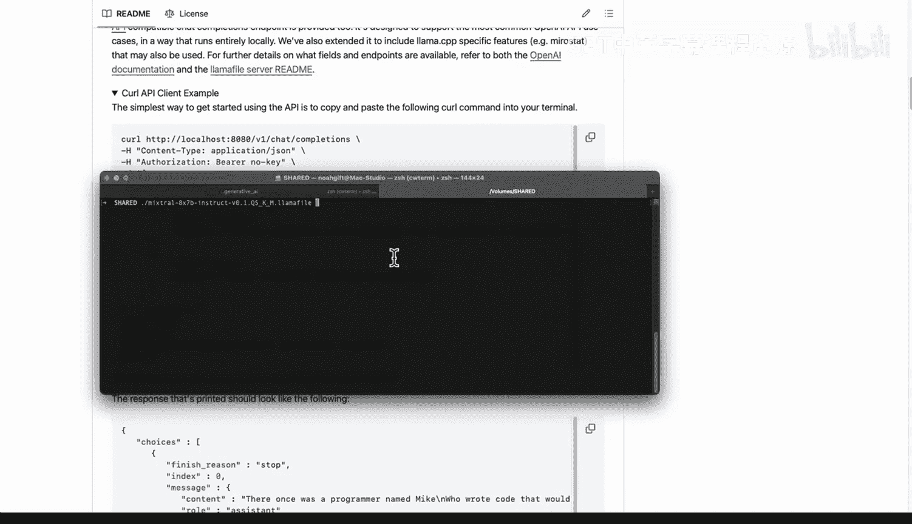
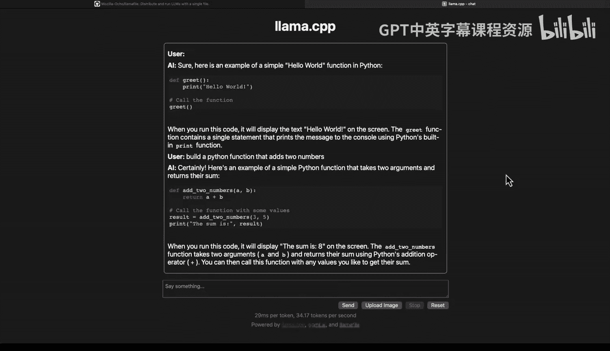
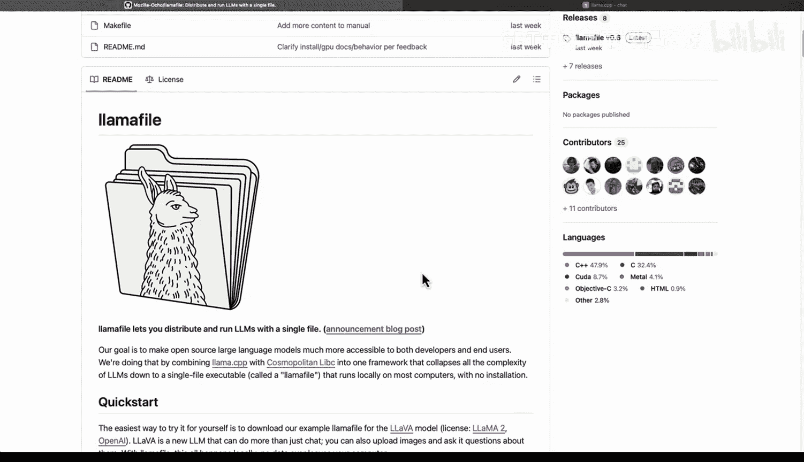

# 9：开始使用Llamafile 🚀



在本节课中，我们将学习如何使用Mozilla的Llamafile项目，这是运行本地大语言模型最简单的方法之一。我们将了解其结构、优势以及如何实际操作。

---

## 项目概述与结构

上一节我们介绍了本地运行大语言模型的概念，本节中我们来看看一个具体的实现工具——Llamafile。

Llamafile项目由Mozilla开发，它可能是运行本地大语言模型最简单的方式。许多人对此感兴趣，主要是出于隐私考虑，同时因为它免费——只要你能使用自己的机器。

你可以直接深入探索Llamafile。让我们先来看看这个项目的结构。

Llamafile允许你通过单个文件分发和运行大语言模型。其真正迷人之处在于，它使用了名为**Cosmopolitan Libc**的库，能够将所有内容压缩成一个名为`llamafile`的单一可执行文件。

尽管它叫Llamafile，但它实际上并不局限于任何特定的大语言模型。项目页面上有一个示例，你可以下载**Lava**模型，它能够读取图像，这是一个相当酷的项目。

## 模型选择与下载

如果你想要尝试，我认为其中一个更有趣的模型是**Mixtral**。Mixtral是性能较好的开源模型之一，采用Apache 2许可证，文件大小约为30GB。这是一个相当大的下载，但你只需要下载它，然后运行`./run`命令即可。

以下是关于Llamafile的一些关键特性：
*   **统一的单文件分发**：模型和运行环境被封装在一个可执行文件中。
*   **模型无关性**：支持多种开源大语言模型，如Mixtral、Lava等。
*   **便捷的API**：提供了模仿OpenAI API的Python接口，便于从商业闭源模型迁移。
*   **命令行交互**：支持通过`-c`参数进行快速的命令行交互。

## 实际操作演示

现在，让我们看看它是如何工作的。我将打开我的终端，可以看到我已经下载好了文件。运行它非常简单，只需执行：



```bash
./llamafile -m mixtral-8x7b-instruct-v0.1.Q4_K_M.gguf
```

运行后，Llamacpp会在本地启动。如果我想要重置到某种默认状态，可以执行重置操作。接下来，我将把聊天机器人名称改为“AI”，然后让它执行一个任务。

让我们要求它写一个Python的“Hello, World”函数。我会输入：“Show me a Python hello world function.” 然后点击发送。

模型将利用我Mac的GPU来快速生成响应。关于Mixtral的一些指标显示，它的性能堪比闭源的专有模型。从生成的代码来看，效果很好。如果需要，我可以继续让它创建更多函数，比如编写一个将两个数字相加的Python函数。

## 核心优势总结

本节课中我们一起学习了Llamafile的基本使用。真正的收获在于，运行你自己的本地模型实际上非常直接简单。使用Llamafile的主要优势包括：





1.  **隐私保护**：你的数据不会被发送到你不了解其数据使用政策的公司。
2.  **性能更佳**：由于延迟更低，调用本地API的性能通常优于调用外部API。
3.  **完全免费**：无需为API调用付费。


这些是探索Llamafile项目的一些显著优势。建议你亲自查看这个项目，并尝试运行它。