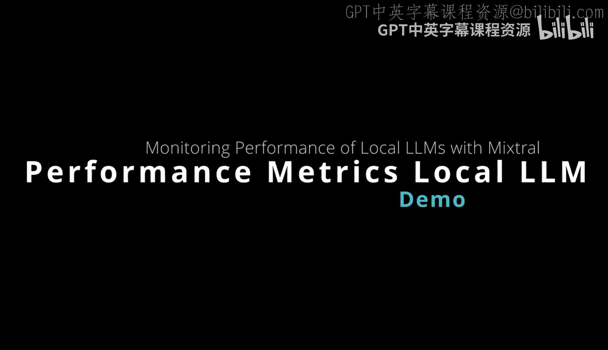
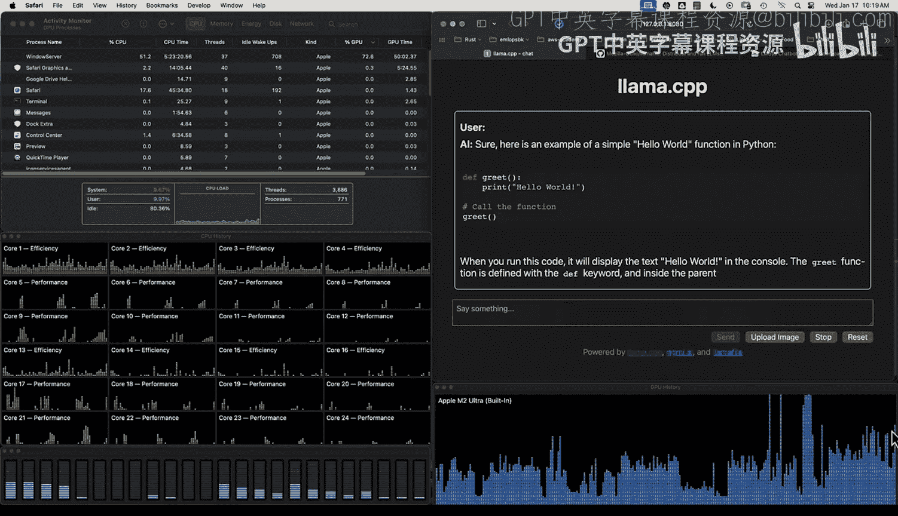

# 10：本地系统指标与Llamafile 🖥️📊

在本节课中，我们将学习如何在使用Llamafile运行本地大语言模型时，监控系统的各项性能指标。我们将通过实际操作，观察GPU、CPU等硬件的使用情况，并评估本地模型的性能表现。

---

## 模型性能评估：Elo评分

上一节我们探讨了本地模型的基本运行。本节中，我们来看看如何客观评估一个模型的性能。一个常用的参考是模型的Elo评分，它反映了用户群体对该模型能力的普遍认知。

观察下图中的Elo评分对比，可以发现这个混合模型的表现与一些商业模型非常接近，差距微乎其微。这表明，只要本地模型的性能足够好，就会有大量用户对在本地运行它产生兴趣。

那么，本地模型的性能究竟如何呢？让我们通过Llamafile项目来实际查看。

---

## 监控Llamafile的系统指标

现在，我已经在网页浏览器窗口中运行了这个Llamafile项目。界面右侧提供了丰富的系统监控指标，让我们能够清晰地看到运行时的硬件状态。

在监控时，需要重点关注以下几项指标：
*   **GPU时间**：模型推理任务在GPU上运行所花费的时间。
*   **所有CPU核心**：观察CPU各核心的利用率。
*   **GPU核心利用率**：例如，我所使用的M2 Ultra芯片拥有60个GPU核心。得益于Llamafile和Llama.cpp开发者的出色工作，在Mac操作系统上可以充分利用所有这些GPU核心。

接下来，让我们通过一个具体的操作来观察指标变化。

---

## 实战观察：运行Python代码生成

我们将通过让模型生成一个Python函数，来观察GPU等指标的反应。以下是操作步骤：

1.  在Llamafile的聊天界面中输入请求：“给我一个Python递归函数的例子。”
2.  观察系统监控面板的变化。

当模型开始生成代码时，我们会看到GPU使用率出现明显的峰值。同时，我们也能观察到相应的GPU时间消耗。

模型成功地生成了一个Python递归函数示例。在整个生成过程中，可以清晰地看到GPU被有效调用和利用。其性能表现令人印象深刻，历史GPU利用率图表也证明了硬件资源得到了充分使用。

---

## 本地模型与商业模型的思考

对于正在使用商业模型的用户来说，商业模型当然有其价值。但本地模型如此出色的性能表现，引发了一个值得深思的问题：从长远来看，如果你可以下载一个性能足够好、完全免费且运行效率惊人的模型，为什么还要使用商业模型呢？

因此，在你开始深入研究MamMmaophil等本地工具，或者考虑为大型语言模型签订商业协议之前，建议首先切实考察一下本地模型的真实性能。仔细查看它的运行指标，你很可能会对其表现感到惊叹。

---

本节课中，我们一起学习了如何利用Llamafile监控本地大语言模型的系统运行指标，并通过实际案例观察了GPU的调用情况。我们还将本地模型的性能与商业模型进行了对比，认识到了本地部署的潜力和优势。理解这些指标有助于我们更好地评估和优化本地模型的运行效率。