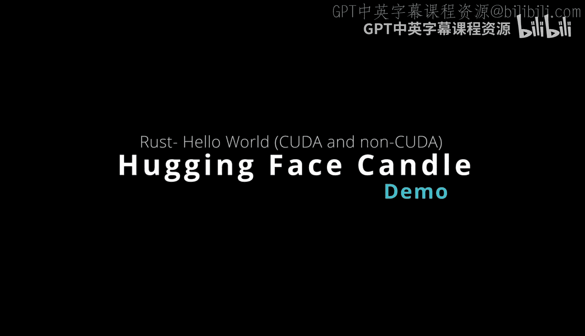
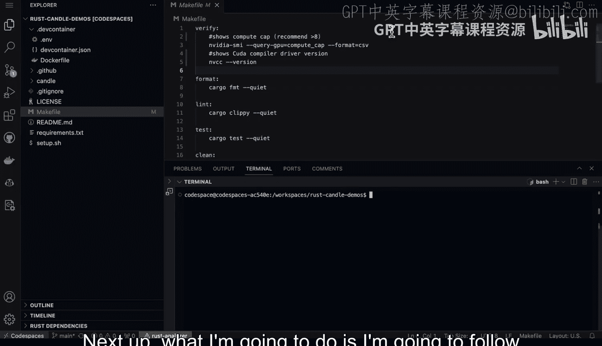
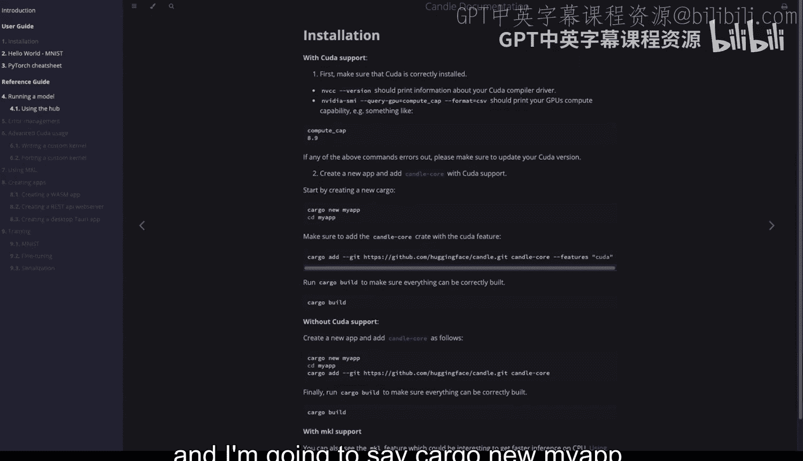
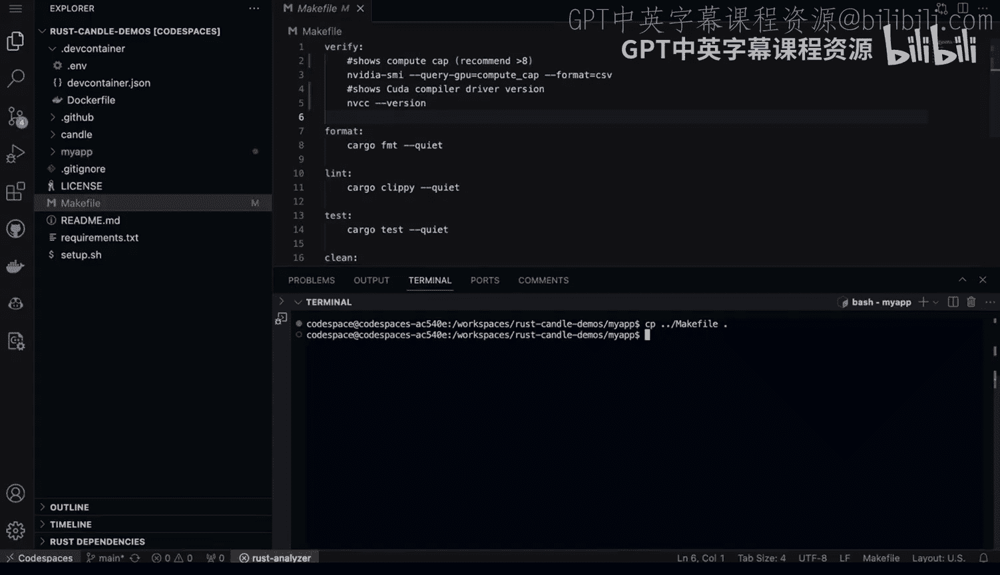
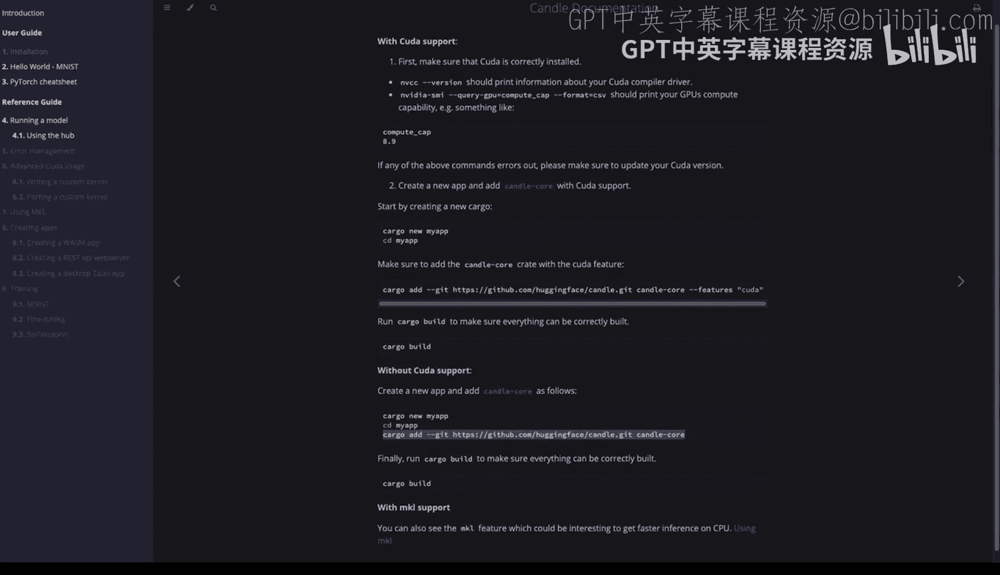
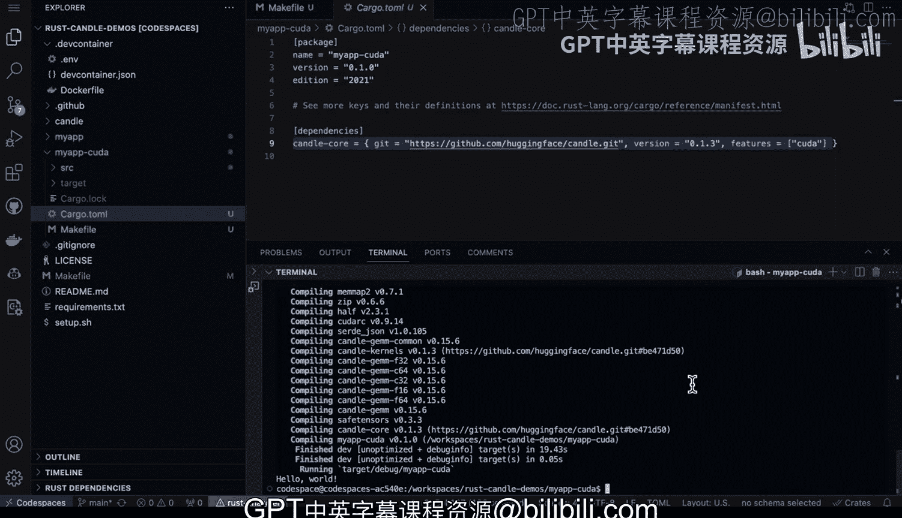

# 本地大语言模型的基础：P11：Candle框架的Hello World示例 🚀



在本节课中，我们将学习如何设置一个基于Rust和Candle框架的开发环境，并运行一个简单的“Hello World”程序。我们将涵盖从环境验证到项目创建，以及如何为项目添加GPU（CUDA）支持的全过程。

---

## 环境准备与验证

首先，我们需要确保开发环境已正确配置。这里使用了一个已设置好GPU开发和Rust环境的Github Codespace。

我们可以通过输入以下命令来验证Rust是否已安装：
```bash
rustc --version
```

接下来，运行 `make verify` 命令。该命令会显示计算能力（compute cap）并确认CUDA编译器驱动是否存在。

---

## 创建基础Rust项目

环境验证无误后，我们将按照Hugging Face Rust Candle的文档创建一个新的Rust项目。

使用 `cargo new` 命令创建一个名为 `my_app` 的项目：
```bash
cargo new my_app
```

创建完成后，进入项目目录：
```bash
cd my_app
```



为了便于使用各种命令和快捷方式，我们可以将一个现成的 `Makefile` 复制到当前项目中。这样，我们就可以使用 `make build` 等命令来构建项目。



此时，我们可以先在不启用GPU支持的情况下构建项目：
```bash
cargo build
```



---

## 添加Candle依赖

项目创建后，下一步是添加Candle框架作为依赖。这可以通过 `cargo add` 命令轻松完成。



运行以下命令来添加 `candle-core`：
```bash
cargo add candle-core
```

命令执行后，Candle接口就被添加到了项目的 `Cargo.toml` 配置文件中。

现在，查看项目源代码，可以看到一个 `main.rs` 文件，其中包含一个简单的“Hello, world!”输出。这个步骤主要是为了确认安装和基础项目结构是否正常。

为了构建项目，我们可以使用之前复制过来的 `Makefile` 中的命令：
```bash
make build
```
或者直接运行：
```bash
cargo build
```

构建成功后，运行程序以验证一切工作正常：
```bash
cargo run
```
程序成功输出“Hello, world!”，表明基础安装和配置是成功的。

---

## 创建支持CUDA的项目

接下来，我们将创建一个支持GPU加速的新项目。步骤与之前类似，但需要额外启用Candle的CUDA功能。

首先，创建另一个新项目：
```bash
cargo new my_cuda_app
```

进入新项目目录并复制相同的 `Makefile` 作为项目脚手架：
```bash
cd my_cuda_app
cp ../my_app/Makefile .
```

关键的区别在于添加依赖时需要指定 `cuda` 特性。使用以下命令添加支持CUDA的 `candle-core`：
```bash
cargo add candle-core --features cuda
```

添加完成后，查看项目的 `Cargo.toml` 文件，可以看到依赖项已变为 `candle-core` 并启用了 `cuda` 特性。

现在，我们可以构建并运行这个支持CUDA的项目。为了快速验证，可以直接使用 `cargo` 命令：
```bash
cargo build
cargo run
```

如果程序成功运行，则证明CUDA支持已正确配置并生效。

---

## 总结



本节课中，我们一起学习了Candle框架的入门步骤。我们从验证Rust和CUDA开发环境开始，然后创建了一个基础的Rust项目并添加了Candle依赖。通过构建和运行一个“Hello World”程序，我们确认了基础环境配置正确。最后，我们创建了另一个项目，并通过添加 `cuda` 特性为其启用了GPU加速支持，并成功验证了CUDA功能。这些步骤为后续使用Candle框架进行更复杂的本地大语言模型开发奠定了基础。