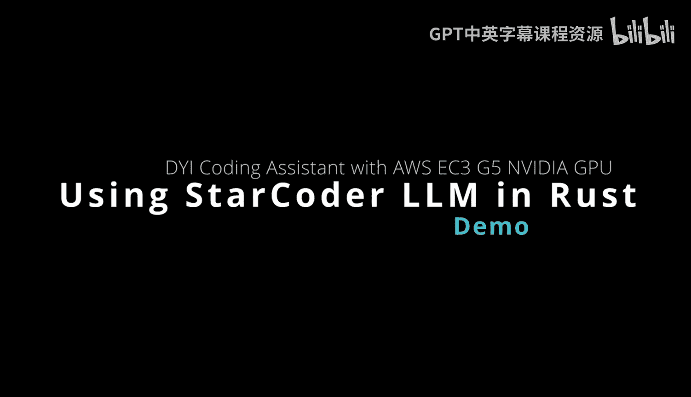
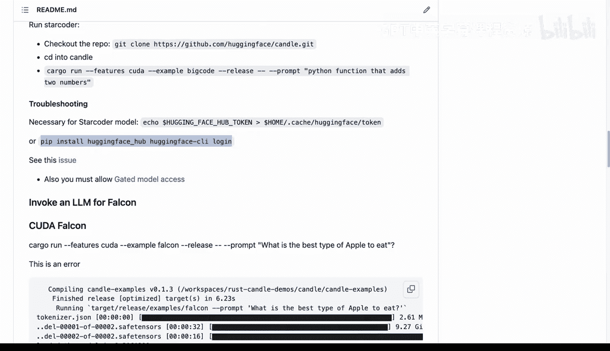
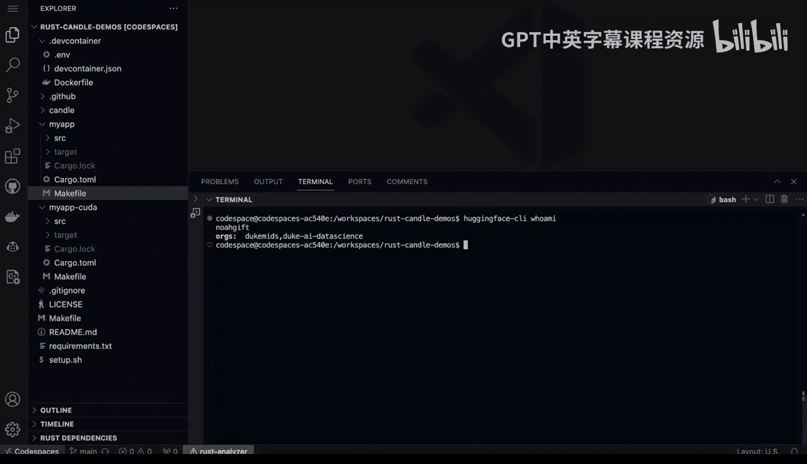
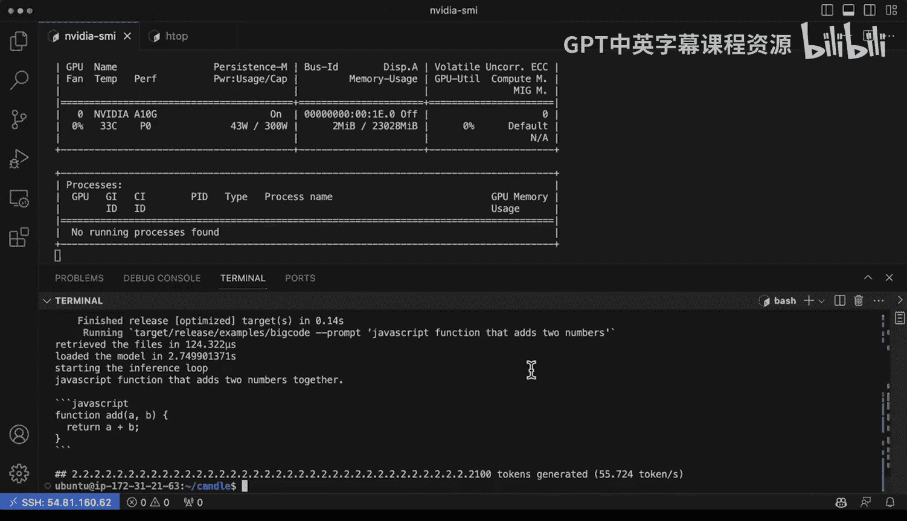

# 12：探索StarCoder的Rust实现 🚀

## 概述
在本节课中，我们将要学习如何探索并使用一个名为StarCoder的开源代码生成大语言模型。我们将重点关注其Rust实现，并演示如何在一个配备了GPU的强大环境中运行它，体验其作为编程助手的潜力。

## StarCoder模型简介
这里展示的是Hugging Face上的StarCoder模型。它比最初想象的更有趣，也让我非常感兴趣。

首先，我将引导你了解它的功能。它是一个与其他用于代码生成的生成式AI模型（例如Copilot）相似的模型。但它完全开源。你可以看到，它拥有**155亿**个参数，并基于来自“The Stack”数据集的**80种**编程语言进行训练。这非常令人兴奋。

如果你再看一下它的使命宣言，它是一个针对代码大语言模型的开放科学合作项目。作为一名AI研究员，你可以参与其中。例如，如果你在大学体系工作，这会是一件有趣的事情。他们的目标是发布数据、模型和实验，从而民主化生成式AI革命，而不仅仅是将其掌握在风险投资家手中。

## 运行StarCoder的Rust实现
如果我们继续查看这里的`star-coder-base-1b`，这是它的一个较小版本，但它与Hugging Face的Candle项目配合得非常好。

在这里你可以看到，Hugging Face Candle是一个基于Rust的极简机器学习推理项目，它可以运行StarCoder。这是一个专门用于代码生成的LLM。一旦你安装了初始的Hugging Face工具，进行身份验证就相当简单。

再次强调，如果我们转到我的一个演示项目，信息就在这里。你需要执行 `pip install huggingface-hub`，然后登录。

## 环境设置与验证
如果我转到我的Codespaces环境，我可以实际看到这个过程。输入 `huggingface-cli whoami`，它会显示我实际上已经通过身份验证，并且可以使用这个项目。

但是，因为我要在计算密集型的GPU上做一些事情，所以需要更强大的环境。我将转移到一个运行着AWS新一代GPU G5的远程Visual Studio Code环境中。

如果我们转到这个环境，你可以看到我正在这里进行远程会话。然后我们可以再次验证情况。我可以输入 `huggingface-cli whoami`。

好了。我们看到我已经登录了。

## 监控与运行
现在，为了运行这个程序，它的一个好处是，如果我愿意，我可以打开第二个窗口，并将监控命令粘贴在上面。我可以看到GPU的实际利用率。事实上，我甚至可以在这里打开另一个shell运行 `htop`。看这里，哇。我们有64个核心。这是一台大型机器。然后，如果我愿意，我还可以运行 `nvidia-smi -l 1` 来循环检查GPU状态。

现在准备工作已经就绪，我可以运行命令来实际测试它了。

## 逐步执行代码生成
让我们一步步看看实际发生了什么。我执行 `cargo run`。这是在项目中执行某些操作的典型命令。

请注意，我指定了 `--features cuda`。我稍后会解释这一点。这意味着我正在使用这个AWS深度学习基础AMI上已经安装的CUDA驱动程序。我传入了 `bigcode` 示例。这就是之前提到的Hugging Face项目。然后我还传入了提示词。在这个例子中，提示是“一个将两个数字相加的Rust函数”。

现在，我要向你展示的是，事实上，如果我们想获得优化的性能，因为CUDA驱动已经安装，这是一个为神经网络工作优化的CUDA版本。所以我们实际上想用它来进一步加速。

如果我打算一直将它用作编码助手，为什么不使用尽可能优化的方法呢？

所以，我输入：查找一个将两个数字相加的Rust函数。好的，让我们开始吧。你可以看到这个东西在运行，注意看，你会看到GPU在这里被触发，然后我们会得到一个结果，告诉我们如何在Rust中构建一个将两个数字相加的函数。

好了，我们看到GPU在这里被充分利用了。

## 测试不同编程语言
现在，让我们切换一下，输入“一个将两个数字相加的Python函数”。你可以看到，它将再次运行，在这里给我们另一个建议。

我们甚至可以说“一个将两个数字相加的Ruby函数”。如果我们想计时，你可以看到它在微秒级别检索了文件，然后在大约两秒内加载了模型，接着开始了推理循环。

实际上，加载模型所花费的时间似乎是这里的瓶颈，但这仍然不算太糟。它能够基于此给我们相当合理的建议。我们可以继续尝试，例如Java。

## 总结
我认为，对于那些真正想做自己的开源编码助手的人来说，这很有前景。你可以看到，由于Rust的力量和Hugging Face生态系统，这实际上相当简单直接。