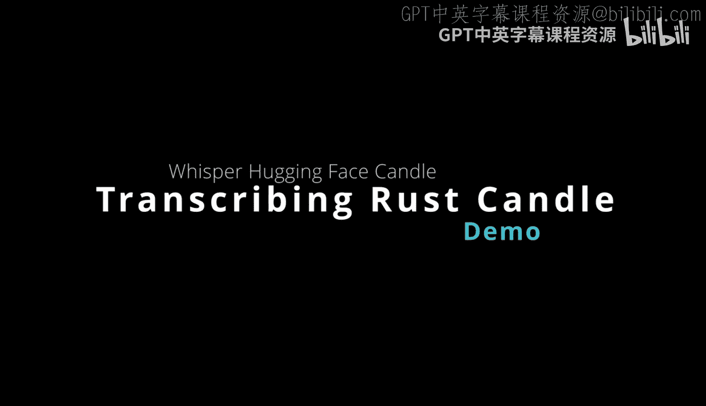
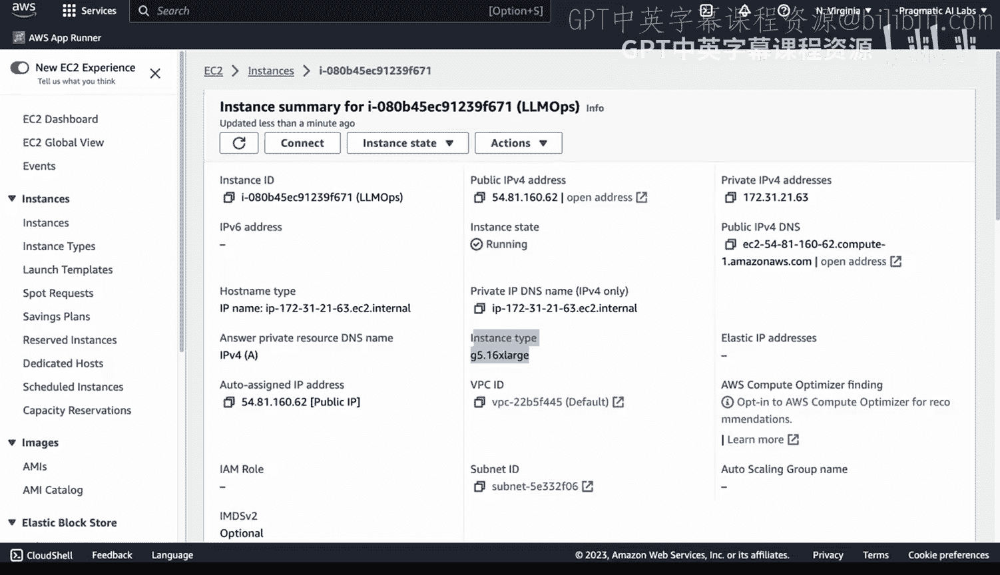
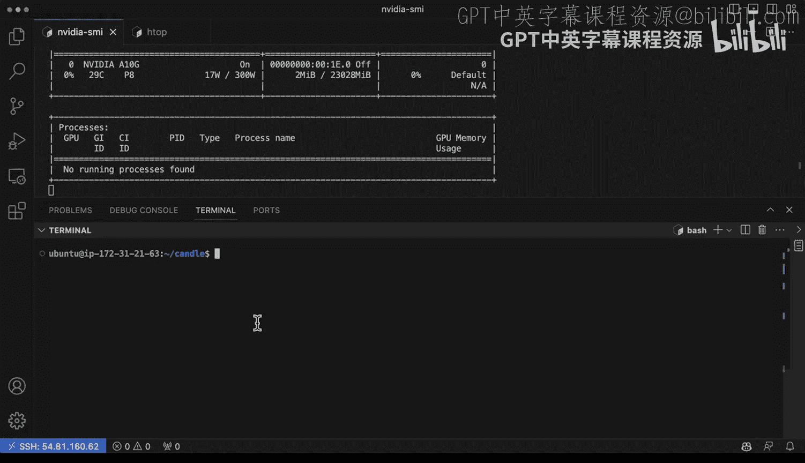
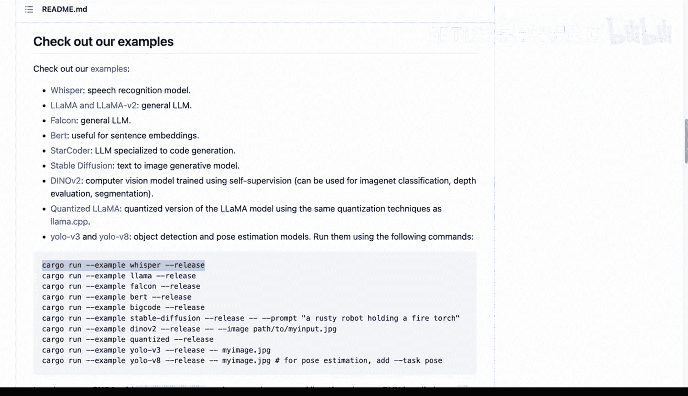
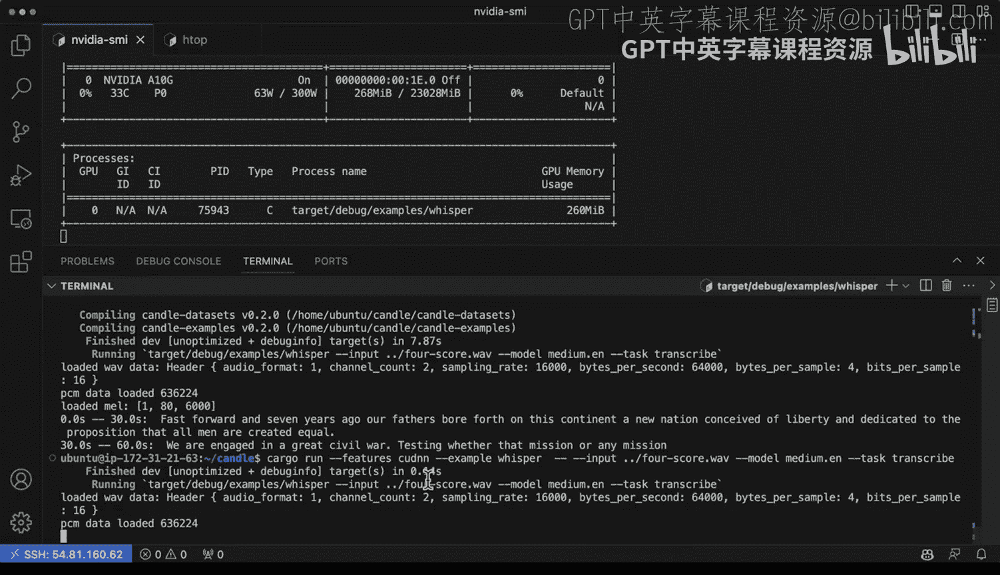

# 本地大语言模型的基础：P13：使用Whisper与Candle进行转录 🎙️➡️📝



在本节课中，我们将要学习如何使用Whisper模型与Candle框架进行自动语音识别（ASR）。我们将从了解相关工具开始，逐步深入到如何配置环境、运行示例代码，并最终使用自定义音频文件进行转录。

## 概述

自动语音识别是当前新兴的研究方向之一。人们正在探索使用预训练模型来完成这项任务。Whisper是一个无需微调即可使用的优秀示例。你可以查看其不同规模的参数配置，例如中等模型可能拥有7.69亿参数，而大型模型参数更多。使用此类工具时，关键问题在于如何运行它。

幸运的是，借助Hugging Face的Candle框架，我们可以轻松运行Whisper。Candle是一个极简、高性能的框架，支持GPU加速。其代码库中已经包含了使用Whisper的示例。为了深入了解，让我们一同查看其源代码。

## 探索源代码与参数

上一节我们介绍了Whisper和Candle的基本概念，本节中我们来看看如何通过源代码启动一个转录任务。



查看`main.rs`文件，可以注意到程序使用了`clap`库进行命令行参数解析。我们可以查看其中定义的常量参数和可传入的动态参数。通过研究代码，我们可以开始尝试使用这个新兴工具。

## 配置运行环境

那么，我们具体该如何操作呢？建议使用配备G5实例类型的EC2服务器，这类实例搭载了较新的NVIDIA GPU。例如，可以选择一个拥有64个核心和高速GPU的强大实例。接下来，我将通过Visual Studio Code的远程连接功能进入该环境进行操作。





以下是连接并检查环境的步骤：
1.  通过VS Code Remote连接到EC2实例。
2.  在终端中，运行命令 `nvidia-smi` 来确认GPU状态是否就绪。

环境准备就绪后，如果想初步测试Candle与Whisper的接口如何工作，可以查看并运行其中一个示例。

## 运行基础示例

首先，我们可以运行基础的示例命令：
```bash
cargo run --example whisper
```
运行后，程序提示在CPU上运行仍然很快，并自动下载了一个示例音频文件。这个过程是顺利的。

## 启用GPU加速

但如果我们想使用GPU来加速计算，该如何操作呢？我们可以在命令中添加相应的特性标志。

以下是启用不同级别加速的步骤：
1.  在命令开头添加 `--features cuda` 以启用基础的CUDA支持。
2.  编译并运行后，可以看到GPU利用率达到了48%，效果显著。
3.  为了进一步优化，可以启用 `cudnn` 特性，这是针对神经网络操作的CUDA深度优化库。
4.  启用 `cudnn` 后，推理速度更快，效率更高，能更充分地利用GPU资源。

## 处理自定义音频文件

以上测试使用的是内置示例，但如果我们想处理自己的音频文件，例如不同格式和风格的音频，该怎么办呢？

我们可以准备一个较长的命令，传入自定义参数来进行尝试。例如，我提前准备了一些音频文件放在上一级目录中，包括一个WAV文件。我们可以通过指定自定义标志来让程序处理这些文件。

以下是处理自定义文件的步骤：
1.  回到Candle项目目录。
2.  运行一个包含自定义参数的复杂命令，例如：
    ```bash
    cargo run --example whisper --profile release --features cuda,cudnn -- --input ../four_score.wav --model medium --language en --task transcribe
    ```
3.  这个命令会为指定的标志优化编译，然后运行转录任务。
4.  最初在CPU上运行可能有些缓慢。
5.  切换到我们强大的GPU机器上，并启用 `cuda` 和 `cudnn` 特性，同时可以去掉调试信息以进一步提升速度。
6.  再次运行命令，可以看到GPU利用率最高达到了70%，推理速度非常快。

这种高效的方式非常适合需要处理大量转录任务的场景，例如用户可能通过AWS Batch启动机器，为其他数据处理系统转录海量音频数据。

## 总结



本节课中我们一起学习了使用Whisper模型和Candle框架进行自动语音识别的完整流程。我们从环境配置开始，学习了如何运行基础示例，接着探索了通过启用CUDA和cuDNN特性来利用GPU加速计算，最后实践了如何使用自定义音频文件和参数进行转录。这套工具组合为高效、本地化的语音转文字任务提供了强大的解决方案。