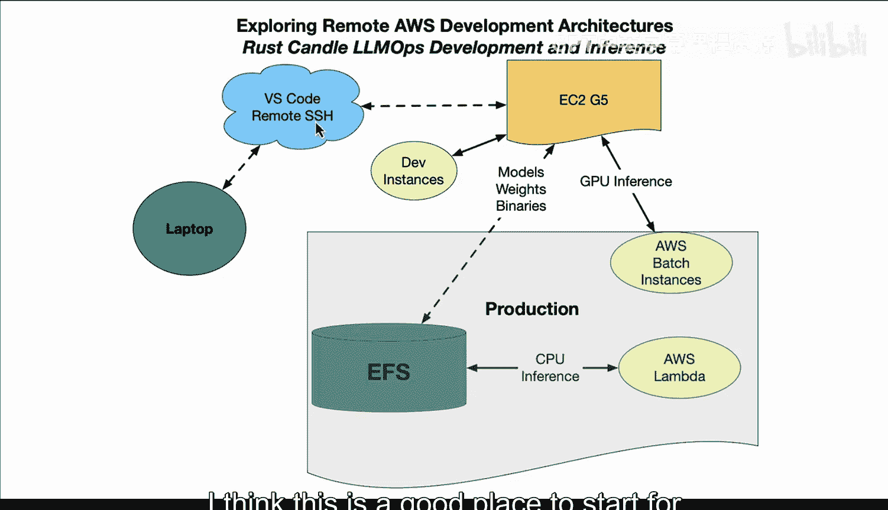

# 本地大语言模型的基础：P14：探索AWS远程开发 🚀

在本节课中，我们将学习如何利用AWS云服务构建一个基于Rust和Hugging Face Candle库的异步开发与生产工作流。我们将重点探讨如何通过远程开发环境高效、低成本地进行大语言模型的推理部署。

## 开发环境配置 💻

上一节我们介绍了大语言模型的基础概念，本节中我们来看看如何搭建一个强大的远程开发环境。

首先，你需要一个EC2 G5实例。该实例的优势在于它具备执行现代GPU推理任务的能力。此外，你还可以使用Spot实例来节省成本。

在开发阶段，你可以使用一个可以随时停止和启动的实例。你可以通过Visual Studio Code的远程开发功能连接到这个实例，这是一种非常高效的开发方式。

以下是配置远程开发环境的步骤：
*   在VS Code中安装远程开发插件。
*   配置插件以连接到你的EC2 G5实例。
*   连接成功后，你的本地笔记本电脑即可访问并使用云端强大的计算资源。

这意味着你可以在一个功能强大、基于云的环境中开始开发代码，并且只需按使用量付费，而无需购买例如价值4万美元的GPU硬件。

## 生产部署架构 ⚙️

在配置好开发环境后，我们来看看如何将其扩展到生产部署，这里的设计会非常有趣。

你可以结合EFS进行协同开发。EFS的挂载点可以设置在开发机器上，但同一个挂载点也可以用于生产环境。

以下是利用EFS管理模型数据的工作流程：
*   将庞大的模型和权重文件下载到EFS中，这些数据可能达到数十GB。
*   将此EFS挂载点作为向生产环境提供数据的暂存位置。
*   当你部署到AWS Batch时，Batch服务可以自动配置EC2 G5实例。
*   这些实例能以高效、优雅且低成本的方式，使用强大的GPU执行基于Rust的现代推理任务。

因此，你不需要使用Notebook，也不需要Python，可以纯粹使用Rust来完成所有工作。

## 扩展与成本优化 💡

另一个需要考虑的方向是，如果你将代码编译成同时兼容CPU的目标。

那么你的AWS Lambda函数可以直接从EFS中读取该二进制文件，并同样将其作为生产实例提供服务。这为LLM运维和ML运维开辟了一条我认为非常惊人的、新兴的Rust技术路径。

这实质上意味着你可以自由地尝试新事物、新想法，并不断追求效率。对于许多希望部署大语言模型的公司而言，本节所探讨的这种特定架构是一个很好的起点。

## 总结 📝

本节课中我们一起学习了基于AWS的远程开发与生产工作流。我们了解了如何利用EC2 G5实例和VS Code远程开发进行高效编码，如何通过EFS共享模型数据，以及如何借助AWS Batch和Lambda实现低成本、高性能的Rust推理服务部署。这套架构为高效、灵活地部署大语言模型提供了强大的解决方案。