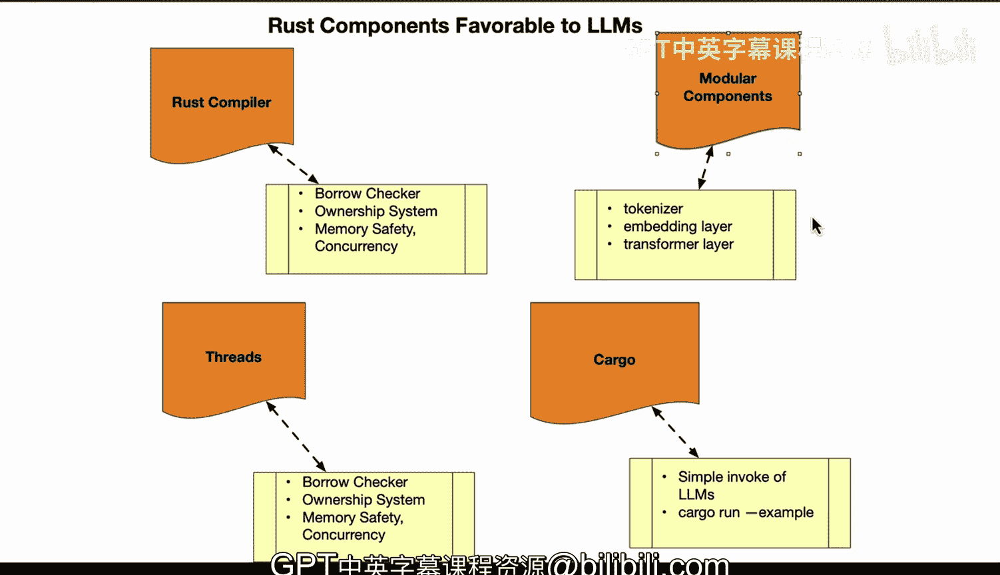

# 本地大语言模型的基础：P15：Rust在LLM中的应用 🦀


在本节课中，我们将探讨Rust编程语言在构建和部署大型语言模型（LLM）中的关键作用。我们将了解Rust如何通过其独特的设计特性，为LLM系统带来安全性、高性能和可维护性。

---

## Rust编译器：安全与内存管理的基石

上一节我们介绍了LLM的基本架构，本节中我们来看看Rust编译器如何为LLM提供底层保障。Rust编译器通过其核心机制，确保了代码在运行前的安全性。

以下是Rust编译器提供的几个关键保障：

*   **借用检查器**：防止数据竞争和不安全的内存访问错误。
*   **所有权系统**：当对象超出作用域时，自动释放内存，无需手动管理。
*   **编译时检查**：在代码部署前发现错误，确保LLM部署的健壮性。

## 模块化组件：构建LLM的积木

了解了底层安全机制后，我们来看看如何用Rust构建LLM的具体功能模块。Rust的模块化设计允许开发者像搭积木一样组合不同的组件。

以下是LLM中常见的几个Rust组件及其功能：

*   **分词器**：将文本转换为用于词嵌入的数值ID。
*   **嵌入层**：将词语映射到高维稠密向量。
*   **变换层**：使用神经网络模型处理文本。

这种模块化设计允许通过Rust的**trait**特性来灵活地混合与匹配特定组件。

## 并发与并行：充分利用硬件性能

在构建了核心组件之后，性能优化是关键。Rust为并发和并行执行提供了强大的原生支持，能充分利用多核CPU。

以下是Rust实现高效并发的几个工具：

*   **轻量级线程**：允许并发和并行执行。
*   **通道**：安全地在线程间传递数据，无数据竞争风险。
*   **性能与可扩展性**：使得LLM能够利用多核CPU提升性能与可扩展性。

## Cargo包管理器：生态与依赖管理

要实现复杂的LLM应用，离不开丰富的库和工具链。Rust内置的包管理器Cargo在此扮演了核心角色。

以下是Cargo包管理器的主要优势：

*   **管理依赖**：简化应用程序依赖管理。
*   **丰富生态**：庞大的软件包生态系统可扩展功能，例如构建命令行工具或Web框架。
*   **代码共享**：可以轻松在项目和团队之间共享代码。
*   **版本稳定**：强制语义化版本控制以确保稳定性。

因此，调用大型语言模型变得非常简单。以**Rust Candle**（一个机器学习框架）为例，你通常只需要执行类似以下的命令：
```bash
cargo run --example
```

---



本节课中我们一起学习了Rust在大型语言模型中的应用。我们从保障安全的编译器特性开始，探讨了如何用模块化组件构建模型核心，利用并发机制提升性能，并最终借助强大的Cargo生态系统来管理和部署应用。Rust通过这些特性，为构建高效、安全且易于维护的LLM系统提供了坚实的基础。