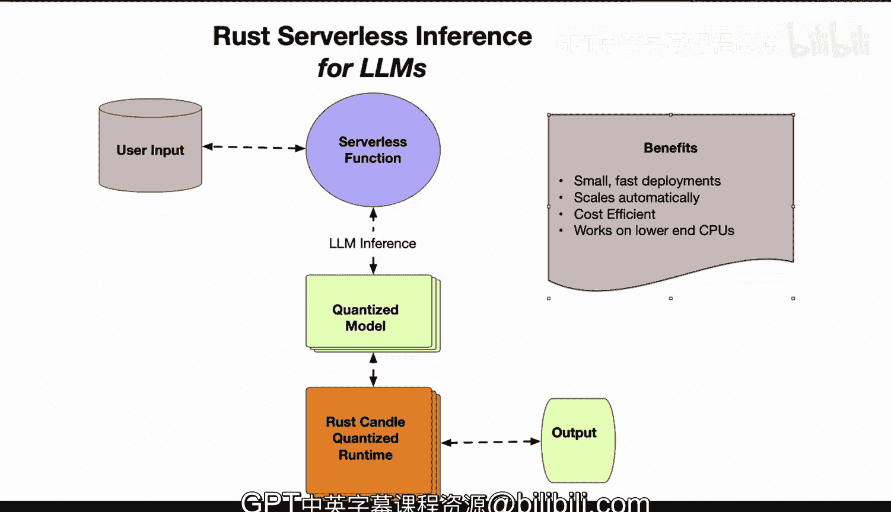

# 16：无服务器推理 🚀

在本节课中，我们将学习如何利用无服务器架构进行大语言模型的推理。这种新兴方法结合了Rust编程语言、量化技术和无服务器计算，旨在实现高可扩展性、成本效益和快速响应。

上一节我们介绍了模型部署的不同环境，本节中我们来看看一种创新的部署方式：无服务器推理。

## 架构概述

无服务器推理架构允许我们以高可扩展性和成本效益的方式部署机器学习模型。用户输入（如文本、图像）被传递到无服务器函数（例如AWS Lambda）。该函数包含模型本身以及用于运行量化模型的Rust Candle运行时。

## 核心优势与工作原理

以下是该架构的几个关键特点：

*   **量化模型**：模型使用降低精度的整数数据类型（例如`int8`）而非32位浮点数（`fp32`）。这可以使模型大小**缩小高达4倍**。在代码中，量化操作可能类似于将 `fp32` 张量转换为 `int8`。
*   **高效运行时**：像Candle这样的运行时（类似于Llama.cpp）提供了专门优化以高效运行量化模型的操作。
*   **自动扩展**：无服务器函数可以自动扩展以处理任意流量，确保快速响应，并在无流量时缩放到零。
*   **成本效益**：小型化的模型、无闲置资源以及按调用次数（而非昂贵的、持续运行的GPU）计费的模式，使得这种方案非常经济。
*   **广泛硬件支持**：量化后的整数模型运行速度更快，甚至在低端和移动CPU上也能良好运行，这为许多模型开启了许多新兴用例，降低了对昂贵GPU的依赖。
*   **低延迟**：输出能快速返回给用户，自动扩展机制将延迟降至最低。

这种架构使你能够将先进的模型高效、经济且大规模地部署到生产环境中。

本节课中，我们一起学习了无服务器推理架构的核心概念。我们了解到，通过结合模型量化、Rust高效运行时和无服务器计算，可以在不依赖昂贵GPU的情况下，实现大语言模型的高性能、低成本、可扩展部署。这为AI应用的普及打开了新的大门。