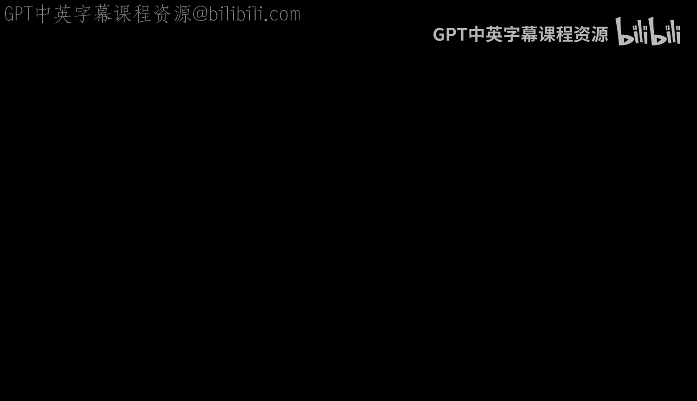
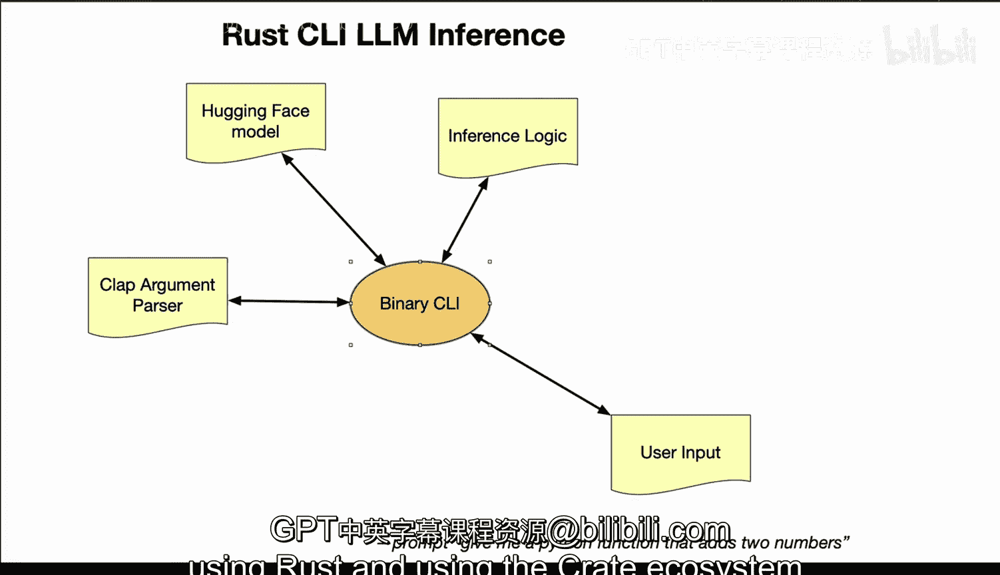

# 本地大语言模型的基础：P17：17_01_03_Rust命令行推理

## 概述
在本节课中，我们将学习如何使用Rust编程语言构建一个命令行界面（CLI）工具，该工具能够加载Hugging Face上的预训练大语言模型，并执行文本推理任务。我们将从模型下载开始，逐步介绍模型加载、CLI构建、推理逻辑实现以及最终运行的全过程。

## 构建与运行流程总览
下图展示了构建和运行一个Rust命令行推理工具的完整流程。

## 第一步：下载预训练模型
流程始于从Hugging Face Hub下载模型。你需要获取一个预训练的Transformer模型，例如BERT或GPT-2。

## 第二步：在Rust中加载模型
下载模型后，下一步是在Rust代码中加载它。你可以使用`rust-bert`或`transformers`这类crate，它们为Hugging Face模型提供了Rust绑定。

另一种选择是使用`rust-candle`接口。这些工具允许你在Rust代码中使用模型进行推理。

## 第三步：构建命令行界面
接下来是构建命令行界面。你可以使用`clap`这个crate来轻松解析命令行参数。

`clap`允许你设计灵活的用户输入方式。你甚至可以定制提示词。例如，如果你想为每个提示词添加一个固定的前言以获得更好的结果，你可以将这个逻辑加入到代码中。

## 第四步：实现推理逻辑
CLI构建完成后，你需要实现核心的推理逻辑。这部分代码负责接收用户的输入，将其传递给之前加载的Hugging Face模型，并返回推理结果。

`rust-bert`这类crate会简化这个过程，它负责处理数据转换和推理流程。

## 第五步：运行与交互
最后，用户可以通过运行CLI工具并提供文本输入来使用它。用户的输入会通过CLI传递给Hugging Face模型。

推理过程在Rust中执行，最终结果会打印回给用户。

## 流程总结
总而言之，整个流程可以概括为以下几个核心步骤：
1.  从Hugging Face下载模型。
2.  使用模型crate在Rust中加载模型。
3.  使用`clap`构建命令行界面。
4.  实现推理逻辑并将其与模型集成。
5.  运行CLI，对用户输入执行推理。

## 总结
本节课我们一起学习了使用Rust构建大语言模型推理命令行工具的完整流程。这种方法，利用Rust及其丰富的crate生态系统，在许多情况下是实现大语言模型推理最高效的方式之一。我们从模型获取开始，经历了加载、界面构建、逻辑实现，最终完成了可交互的推理工具。