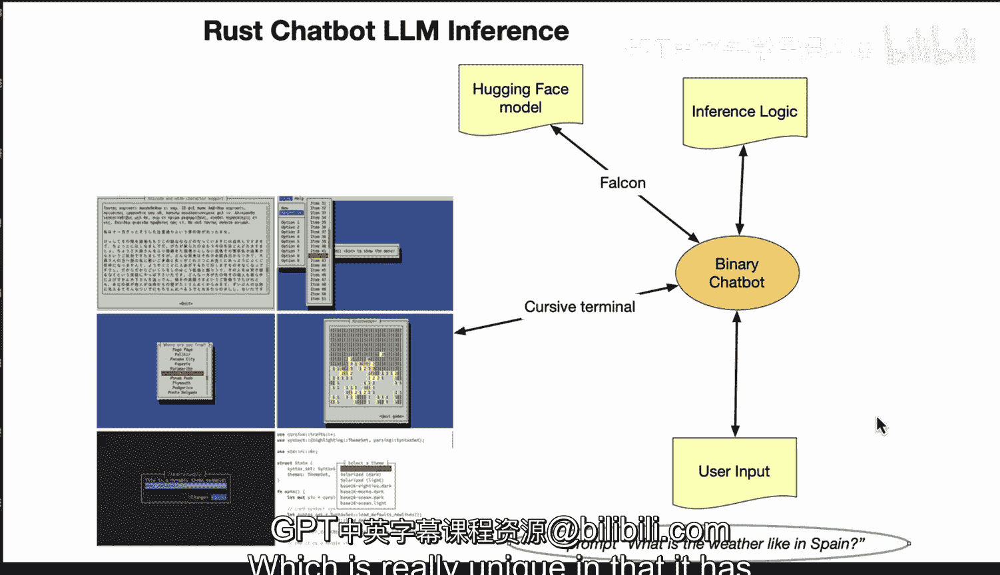

# 18：18_01_04_Rust聊天推理

## 🎯 概述
在本节课中，我们将学习如何使用Rust生态系统中一些即插即用的组件，来构建一个用于大语言模型推理的聊天机器人。

## 🚀 构建Rust聊天机器人的步骤
上一节我们介绍了大语言模型的基础概念，本节中我们来看看如何用Rust实现一个具体的聊天推理应用。

我们将通过几个核心步骤来完成这个任务。

以下是构建Rust聊天机器人的主要步骤：

1.  **选择模型**：你可以考虑使用**Falcon模型**，这是一个非常适合入门的起点。该模型擅长处理自然语言对话。
2.  **加载模型**：然后，你可以使用像**Candle**这样的库将模型加载到Rust程序中。Candle是一个Rust库，可以访问Hugging Face上的模型。
3.  **集成模型**：接着，将这个对话模型集成到一个Rust聊天机器人中。

## 💻 如何实现聊天机器人
那么具体该如何实现呢？

我们可以使用像**Cursive**这样的库来构建一个聊天机器人用户界面。Cursive是一个基于终端的Rust界面库。这个界面可以接收用户输入并打印机器人的回复。

以下是聊天机器人的核心逻辑循环：

1.  持续提示用户输入。
2.  接收用户的输入文本。
3.  将文本传递给之前加载的Hugging Face模型。
4.  打印模型的回复。

这个Hugging Face模型将处理所有的自然语言处理工作，包括分析用户输入、生成连贯的回复，甚至考虑对话的上下文。而Rust代码则负责促进这种交互。

## 🔧 功能扩展与展望
你可以添加额外的逻辑来增强功能，例如进行**情感分析**，以使回复更加自然。

在你完成这个原型之后，这个界面甚至可以适配成一个Web应用程序。

总而言之，你想要做的是：
1.  从Hugging Face选择合适的模型（本例中可能选择最新的Falcon模型）。
2.  将其加载到Rust中。
3.  构建聊天界面。
4.  使用Hugging Face模型实现聊天逻辑。
5.  持续提示用户并生成回复。

## 📝 总结
本节课中我们一起学习了如何利用Rust生态系统的组件构建大语言模型聊天机器人。对于开发者来说，这是一个激动人心的时代，因为我们可以将所有工具直接集成到像Rust这样对命令行友好的语言中。Rust的独特之处在于，它在构建二进制文件方面拥有强大的能力。