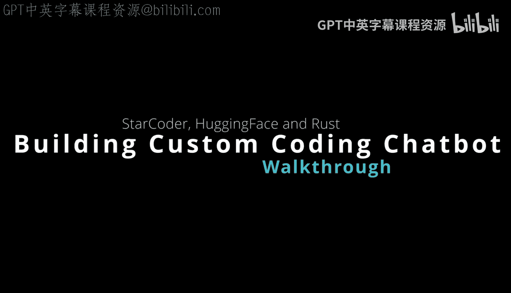
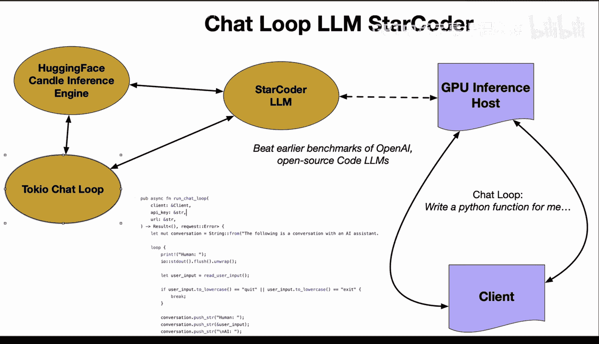

# 本地大语言模型的基础：P19：19_01_05_StarCoder聊天循环



## 概述
在本节课中，我们将学习如何利用大型语言模型构建一个聊天循环，具体来说，是使用Hugging Face的StarCoder模型来创建你自己的代码助手。我们将了解其核心组件和工作流程。

---

## 构建自定义对话式AI
上一节我们介绍了聊天循环的概念，本节中我们来看看如何具体实现一个用于编码的对话式AI。

使用大型语言模型构建聊天循环时，一件令人兴奋的事情是能够利用Hugging Face的StarCoder创建你自己的代码助手。该模型的表现甚至超越了OpenAI早期的模型或其他竞争方案。

观察这个具体示例，你可以了解如何深入并构建自己的自定义对话式AI。

## 核心组件与流程
以下是构建此聊天循环所涉及的关键步骤和组件。

**1. 设计提示词**
观察这里的提示词，我们需要构思一个经过深思熟虑的响应。

**2. 调用StarCoder模型**
你可以调用StarCoder模型。该模型可以部署在GPU实例上，例如AWS的G5实例。

**3. 处理异步请求**
来自客户端的异步请求允许非阻塞的异步调用。这使得聊天机器人能够轻松地快速响应。

**4. 维护对话历史**
你需要将每条消息对附加到对话历史中，以便为AI提供上下文信息。

**5. 序列化与类型安全**
使用`JSON`格式可以方便地进行序列化。同时，利用Rust强大的类型系统和内存安全性，我们可以确保聊天机器人既健壮又安全。

**6. 集成推理引擎**
我们可以使用Hugging Face的Candle推理引擎，轻松集成StarCoder大型语言模型。

**7. 构建Tokio聊天循环**
我们可以构建自定义的Tokio聊天循环。如下代码所示，我们有一个公共的异步函数来运行聊天循环，能够遍历并响应用户输入的评论。

```rust
pub async fn chat_loop() {
    // 循环处理并响应用户输入
}
```



## 总结
本节课中，我们一起学习了如何构建一个基于StarCoder的代码助手聊天循环。简而言之，这个过程非常直接：利用从StarCoder模型、Hugging Face推理引擎、Tokio异步运行时，到诸如JavaScript等开源客户端这些构建模块，你就可以创建属于自己的、无需付费的编码聊天循环。