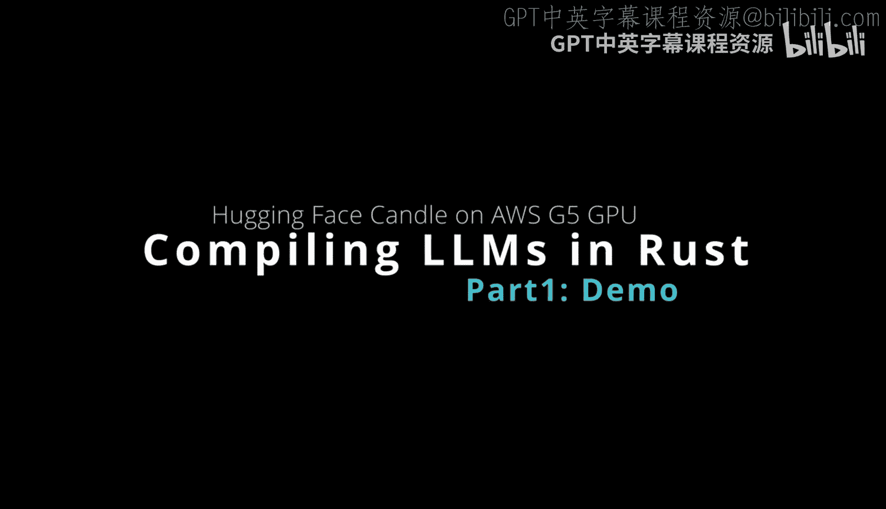
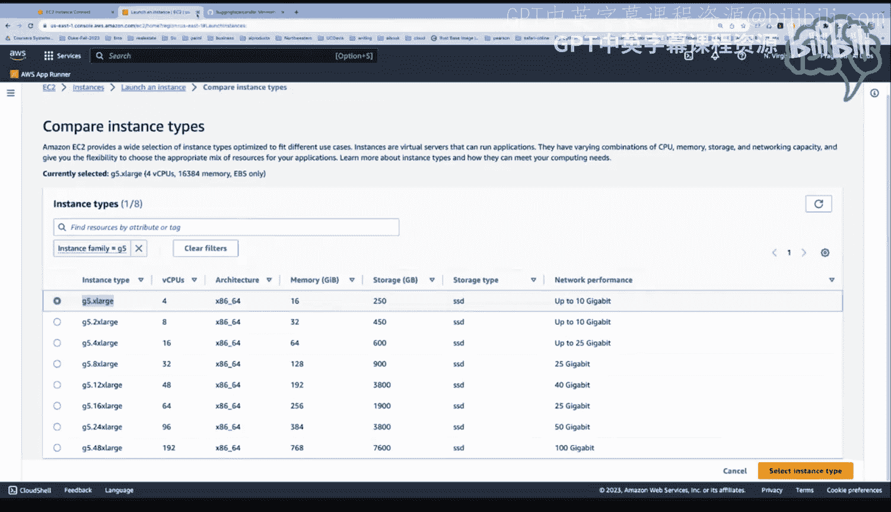
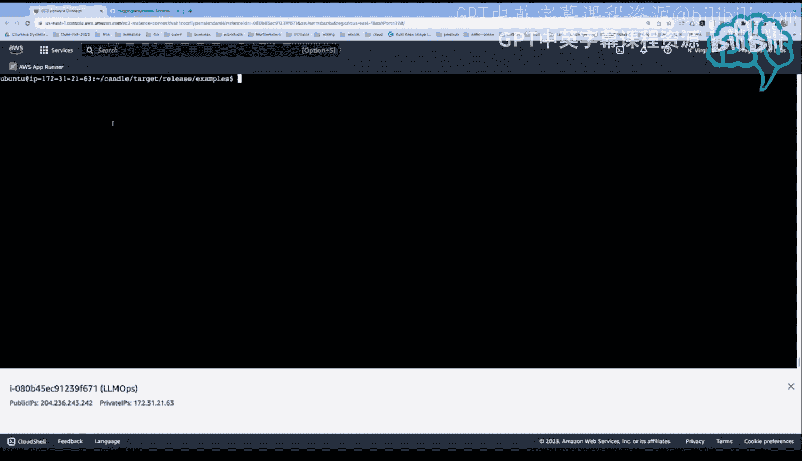
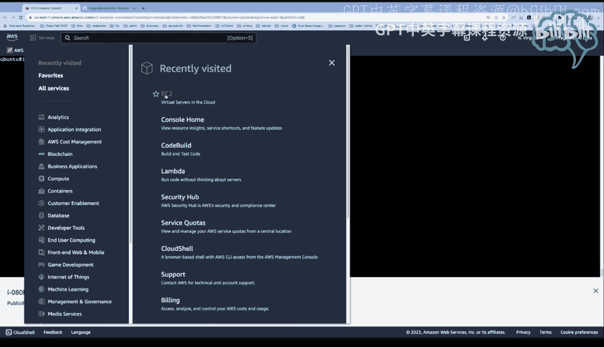
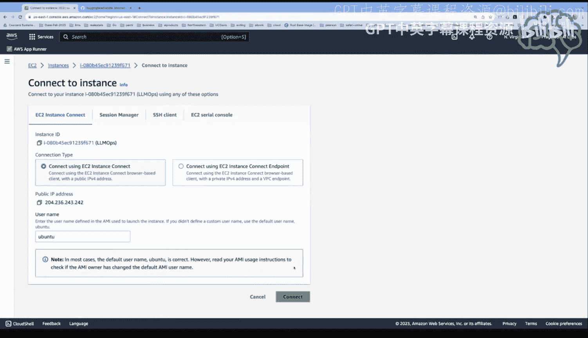
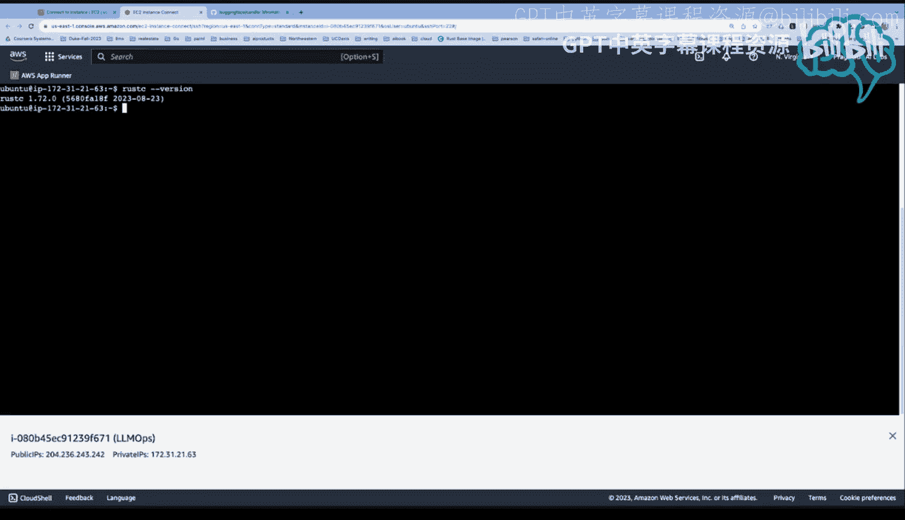
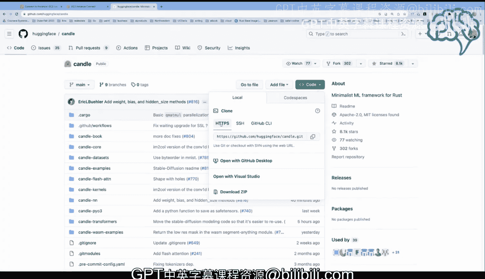

# 本地大语言模型的基础：P20：在AWS GPU上调用Rust Candle（第一部分）

## 概述

在本节课中，我们将学习一个有趣的场景：如何利用Rust的包管理系统来调用大语言模型。我们将使用Hugging Face的Candle框架，并在AWS的GPU实例上运行它。整个过程旨在展示其简洁性，你无需复杂的设置或依赖外部API服务。

## 使用Rust包管理系统调用大语言模型

当前，大语言模型及其应用是热门话题。人们通常会构建复杂的工作流和应用来运行这些模型。然而，得益于Rust语言及其Cargo包管理系统的优势，你无需进行复杂操作。实际上，你可以直接通过Cargo系统来调用模型。本节课，我将使用Hugging Face Candle框架，并在AWS的GPU上演示这一过程。AWS GPU性能强大，让我们开始了解具体步骤。

## 了解Hugging Face Candle

首先，我们来认识一下Hugging Face Candle。这是一个为Rust设计的极简机器学习框架。其代码非常简洁。但最令人兴奋的一点，也是我认为在整个LLM运维领域最激动人心的事情之一是：你只需运行一行命令，就能运行所有这些大语言模型。我不明白为什么没有更多人使用它，这确实非常令人兴奋。接下来，我们将学习如何自己运行它，这样你就不必付费让他人运行大语言模型，也无需注册某些API服务。一切已准备就绪，你可以直接开始。

## 在AWS上配置GPU实例

那么，我们具体该如何操作呢？

第一步，让我们查看AWS控制台。根据我的建议，你需要前往“实例”页面，然后点击“启动实例”。

此时，你需要选择基础AMI。例如，“深度学习基础AMI”是一个很好的起点，因为它没有预装你不需要的额外软件。很多时候，人们会选择“深度学习AI”镜像，但它预装了许多你不需要的“垃圾”软件。例如，如果我们使用Rust，就不需要像Hugging Face Hub这样的Python包管理工具。我只需要CUDA驱动程序和cuDNN（一个为神经网络优化的CUDA库）被安装。

因此，我真正需要做的就是选择“Ubuntu深度学习基础AMI”。选择之后，实例类型就变得至关重要。

以下是选择实例类型的步骤：

1.  在这个场景中，你需要选择基于NVIDIA的选项。
2.  我们可以查看不同的选择，例如筛选“NVIDIA”或“加速计算”家族。
3.  以v5系列为例，你可以看到这里有不同的选择。基本上，我推荐G5系列，它们已经预置了NVIDIA环境。

完成上述选择后，我转到EC2控制台，可以看到一台正在运行的机器。这台机器已经包含了我们所需的一切。实际上，让我快速演示一下如何连接它：我进入“实例”页面，找到一台名为“LLM ops”的正在运行的实例。你可以看到它是一台`g5.16xlarge`实例。我只需点击“连接”，然后选择“使用EC2 Instance Connect连接”即可。我甚至不需要设置SSH密钥或任何其他配置，就能直接访问它。

## 安装必要软件

连接实例后，你唯一需要做的另一件事就是安装Rust。这真的只需要一条命令：`rustup`。

我已经安装好了Rust，我们可以通过运行`rustc --version`来验证。

另一件需要做的事情是克隆Hugging Face的代码仓库。你需要前往代码页面，通过HTTPS方式克隆到本地。

## 总结

本节课中，我们一起学习了如何在AWS GPU实例上配置环境，以使用Rust和Hugging Face Candle框架来运行大语言模型。我们了解了Candle框架的简洁性，掌握了在AWS上选择合适的基础AMI和GPU实例类型的方法，并完成了Rust的安装。这为后续实际运行模型打下了基础。