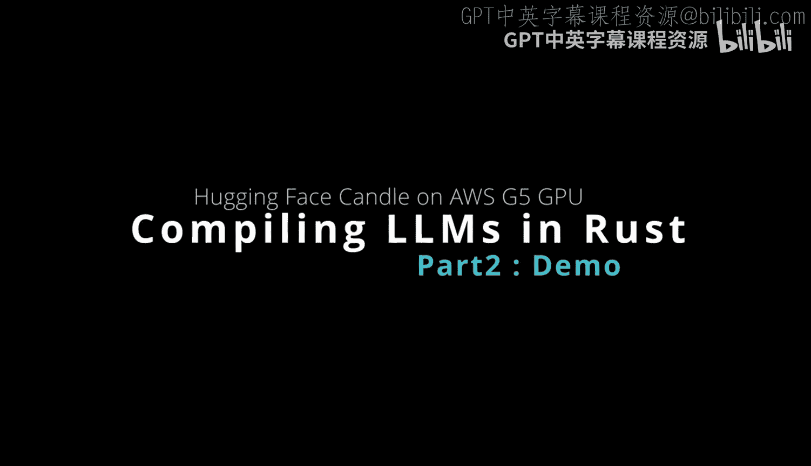
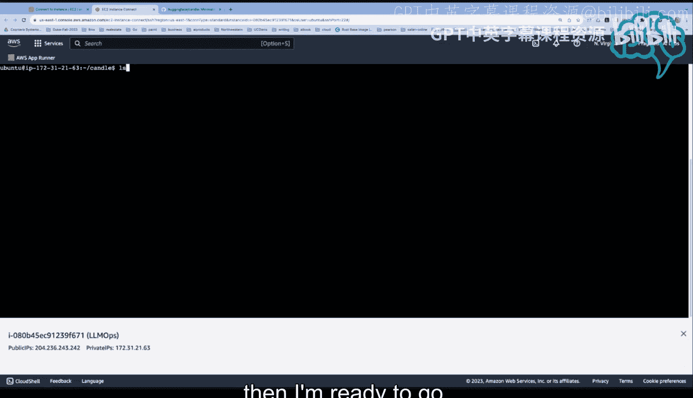
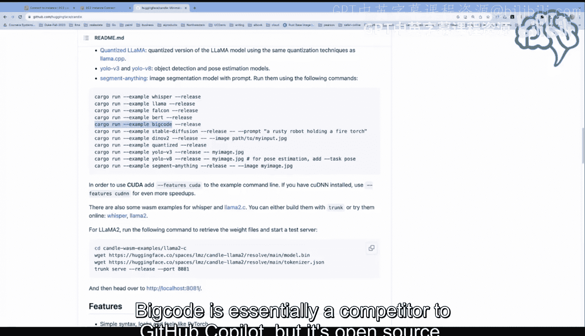
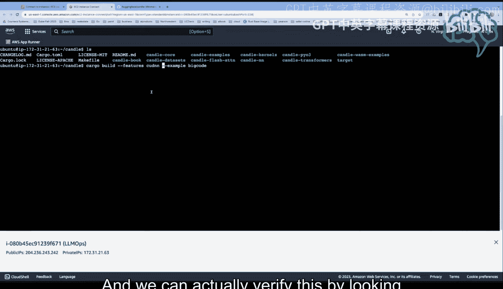
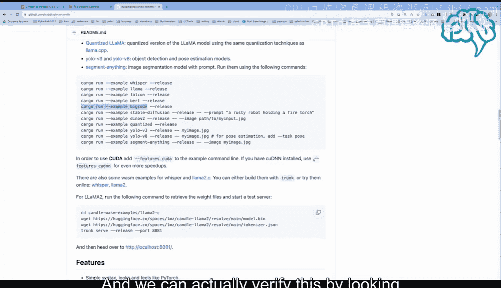
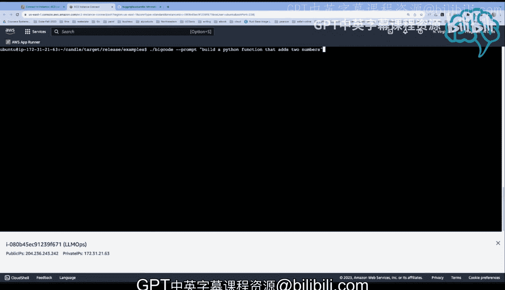

# 21：在AWS GPU上调用Rust Candle（第二部分）

在本节课中，我们将继续学习如何在AWS GPU实例上使用Rust Candle框架。我们将具体介绍如何克隆项目仓库、构建模型，并最终运行一个开源的大型语言模型。

上一节我们介绍了如何设置AWS环境并启动GPU实例，本节中我们来看看如何获取和构建具体的模型代码。

## 获取项目代码

首先，你需要访问项目仓库并克隆代码。我已经完成了这一步，所以可以直接使用 `git pull` 命令来获取最新的更新，因为这个项目正在被积极开发。

以下是获取和更新代码的步骤：
1.  访问项目仓库地址。
2.  使用 `git clone` 命令克隆仓库。
3.  进入项目目录后，使用 `git pull` 确保代码是最新版本。

## 构建与运行模型

完成代码更新后，就可以开始运行大型语言模型了。通常有两种调用方式：直接运行，或者先构建再运行。我认为更好的方式是先构建，然后进入目标目录与模型进行交互。

以 **Big Code** 模型为例，它是GitHub Copilot的一个开源竞争对手。如果我们想运行它，可以按照以下步骤操作。

我们需要执行一个构建命令，但需要稍作调整。我们将使用 `cargo build` 来构建一个可供我们使用的二进制文件。同时，我们需要指定 `--features cuda` 参数，这样构建过程会针对NVIDIA CUDA驱动进行优化，以加速神经网络运算。

我们可以通过查看项目的 `Cargo.toml` 文件来确认 `cuda` 特性已被启用。使用 `--features cuda` 参数将为我们构建出优化后的版本。

我认为目前使用这种方法的人还不够多。许多人仍在注册每月20美元的昂贵服务，但实际上，你可以轻松启动自己的实例来运行大型语言模型，并且在很多情况下性能更好。

构建完成后，进入 `target` 目录。你会看到一个名为 `bigcode` 的可执行文件。只需输入 `./bigcode` 即可启动整个大型语言模型，它就像一个完整的结对编程助手。

现在，我可以直接使用 `bigcode` 并给出提示，例如：“构建一个将两个数字相加的Python函数”。这非常强大，令人难以置信的是没有更多人讨论这种方法。

这再次展示了Rust的强大之处——你可以轻松实现这样的功能。我们可以看到它的运行速度非常快。如果我想要更快的运行速度，或者将其封装到bash脚本中，我完全可以做到，因为我拥有了自己的结对编程助手。我们还可以根据需要对它进行各种调整。

本节课中我们一起学习了如何克隆Rust Candle项目、构建支持CUDA的模型二进制文件，并最终运行Big Code模型来执行代码生成任务。你掌握了在自有硬件上部署和使用开源大语言模型的基本流程。