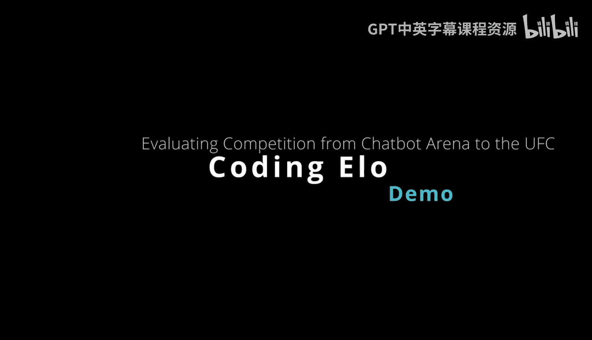
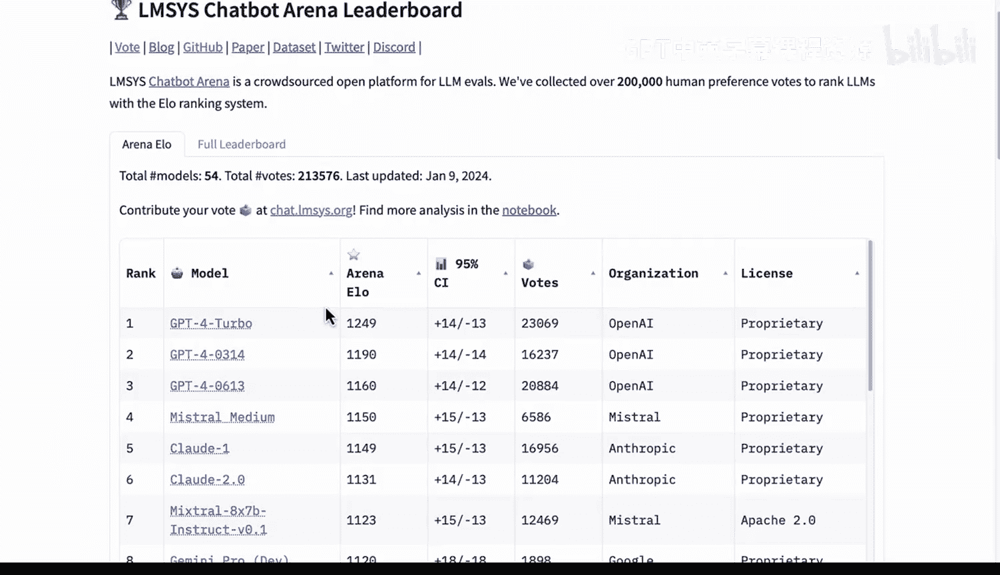

# 本地大语言模型的基础：P22：用Python实现ELO评分系统 🏆



在本节课中，我们将要学习什么是ELO评分系统，以及如何用Python代码来实现它。ELO系统广泛应用于评估竞赛对手的相对实力，例如在国际象棋或大型语言模型的对比评测中。

## 概述

许多人关注聊天机器人竞技场，因为它是进行大型语言模型一对一对比测试的好方法。我们可以观察商业模型、开源模型和专有模型之间的较量。其真正酷炫之处在于，我们可以从数值角度深入分析谁更优秀。

我们能够进行这种分析，原因在于ELO评分系统。ELO是一种“赛程强度”指标。它真正评估的是你相对于对手的表现，而不仅仅是你的得分。例如，如果你取得了20胜0负的战绩，但所有对手都是业余选手，那么这不如一个可能有一些失利，但曾与更强大对手较量过的人有说服力。这就是ELO真正告诉我们的信息：赛程强度。

## 用Python实现ELO

接下来，我们来看看如何在Python中实现这个系统。我们将创建一个简单的类来模拟这个过程。

首先，我们定义一个`Fighter`类，它用名字和初始评分进行初始化。

```python
class Fighter:
    def __init__(self, name, rating=1500):
        self.name = name
        self.rating = rating

    def update_rating(self, opponent_rating, result, K=32):
        """
        根据比赛结果更新评分。
        result: 1 表示胜利，0 表示失败。
        K: 评分调整幅度因子。
        """
        expected_score = 1 / (1 + 10 ** ((opponent_rating - self.rating) / 400))
        self.rating = self.rating + K * (result - expected_score)
```

在上面的代码中，`K`因子默认为32。这个值可以根据比赛数量进行调整。例如，国际象棋比赛场次多，32是一个常用值；而UFC比赛场次少，`K`值可能需要设得更大一些。你可以根据数据集的经验来调整这个参数。

本质上，这个公式说明：你的得分变化取决于对手的评分。如果你赢了，你会获得基于对手评分的加权分数；如果你输了，同样会根据对手评分进行扣分。

## 模拟比赛

现在，让我们创建两名选手并模拟一场比赛。



以下是创建选手和模拟比赛的步骤：

1.  创建两名初始评分相同的选手。
2.  打印比赛前的评分。
3.  模拟比赛结果并更新评分。
4.  打印比赛后的评分。

```python
# 创建两名选手
conor = Fighter("Conor McGregor", 1500)
khabib = Fighter("Khabib Nurmagomedov", 1500)

# 打印赛前评分
print(f"Before match: {conor.name}: {conor.rating}, {khabib.name}: {khabib.rating}")

# 假设Khabib获胜，更新评分
# Conor 输，result=0; Khabib 赢，result=1
conor.update_rating(khabib.rating, result=0, K=32)
khabib.update_rating(conor.rating, result=1, K=32) # 注意：这里使用更新前的对手评分更精确，实际应用中需注意顺序

print(f"Winner: {khabib.name}")
print(f"After match: {conor.name}: {conor.rating:.0f}, {khabib.name}: {khabib.rating:.0f}")
```

运行这段代码，你会看到类似这样的输出：Connor初始评分为1500，Khabib也为1500。比赛结束后，Connor的评分下降到约1475，而Khabib的评分上升到约1525。通过多次迭代，你可以得到一系列指标，这些指标基于对手的实力而非简单的胜负记录，来数值化地展示谁是最强的。

## 交互式探索

ELO系统的优势之一是便于交互式探索。我们可以使用IPython或Jupyter Notebook来把玩这些对象。

例如，在交互式环境中导入`Fighter`类后，我们可以创建实例并进行实验：

```python
from elo import Fighter

conor = Fighter("Conor", 1500)
khabib = Fighter("Khabib", 1500)

# 模拟比赛并更新评分
# ... 进行多轮模拟

# 查看对象内部状态
print(conor.__dict__)  # 输出: {'name': 'Conor', 'rating': 1475.0}
```

通过`__dict__`，我们可以看到对象内部只是一个包含名字和评分的字典。这说明ELO并非神秘的指标，自己动手实现起来相当简单。它是一个非常直观的评分系统，是评判大型语言模型（无论是开源还是专有模型）在真实场景中竞争表现的优秀指标。

## 总结


本节课中，我们一起学习了ELO评分系统的基本原理。我们了解到ELO通过考虑对手的强度来评估参赛者的真实水平，而不仅仅是胜负场次。接着，我们用Python实现了一个简单的`Fighter`类来演示ELO评分的计算和更新过程。最后，我们看到了如何交互式地使用这个系统，并认识到ELO是一个强大而直观的工具，非常适合用于评估像大型语言模型这类竞争性实体的相对性能。