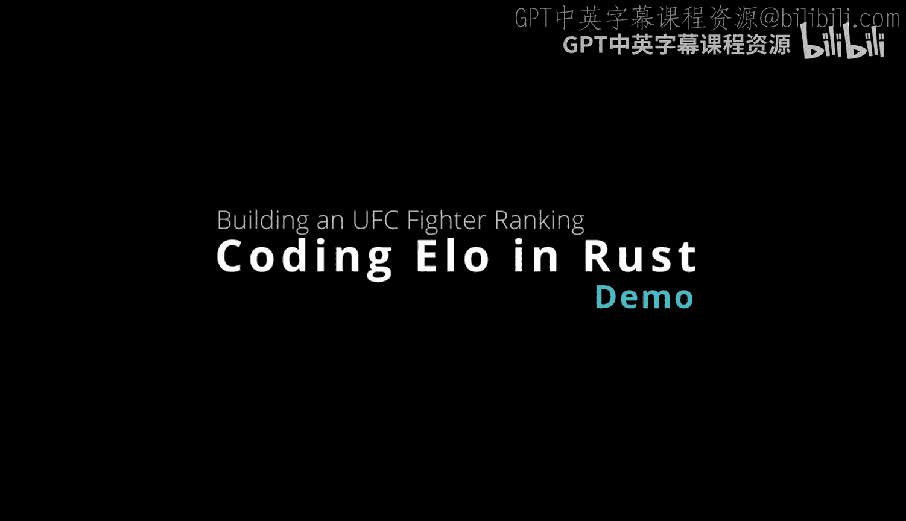
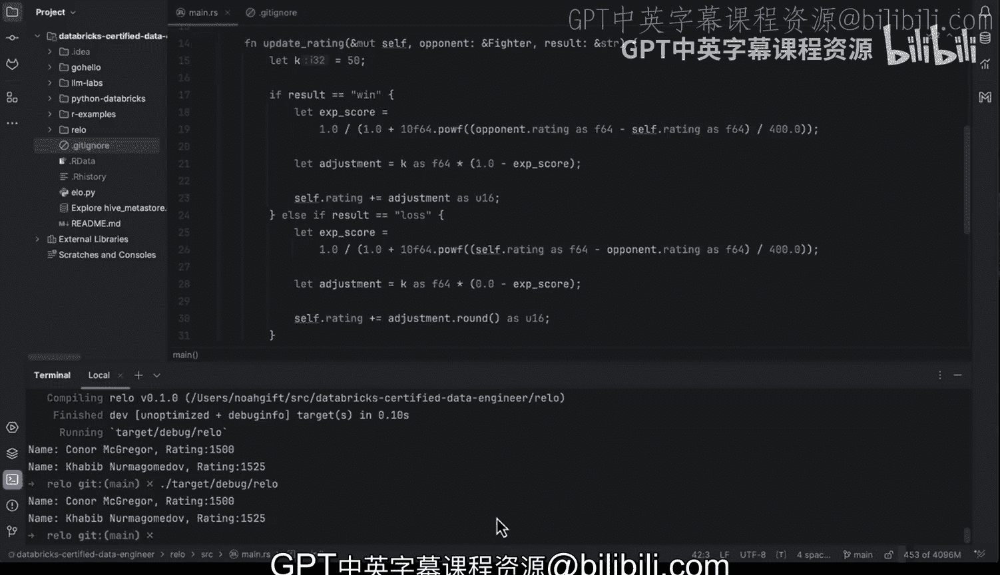

# 本地大语言模型的基础：P23：用Rust实现ELO评分系统 🦀



在本节课中，我们将学习如何使用Rust编程语言实现一个ELO评分系统。ELO系统是一种用于比较两个竞争者相对水平的方法，它根据赛程强度来动态更新评分。我们将从定义数据结构开始，逐步实现核心的评分更新逻辑，并最终运行一个简单的对战模拟。

## 概述

ELO评分系统广泛应用于棋类、电子竞技等对弈场景，用于量化选手的实力。其核心思想是：根据比赛结果（胜、负）和双方赛前评分，计算赛后评分的变化。我们将用Rust构建一个简洁的实现，展示其类型安全和高效的特点。

## 实现步骤

### 1. 定义数据结构

首先，我们需要定义一个表示“选手”的结构体。这个结构体将包含选手的名字和当前的ELO评分。

以下是`Fighter`结构体的定义：

```rust
struct Fighter {
    name: String,
    rating: u16,
}
```

### 2. 为结构体实现方法

上一节我们定义了`Fighter`结构体，本节中我们来看看如何为其添加功能。我们将为`Fighter`实现几个方法，包括创建新选手和更新评分。

以下是`Fighter`结构体实现的方法：

*   **`new`**: 用于创建一个新的`Fighter`实例。
*   **`update_rating`**: 这是核心方法，用于根据比赛结果更新选手的评分。

### 3. 实现评分更新逻辑

现在，让我们深入核心的`update_rating`方法。这里包含了ELO系统的计算逻辑。

以下是`update_rating`方法的关键步骤：

1.  **定义K因子**：`K`值决定了评分变化的幅度。对于比赛频率不高的项目（如拳击），我们使用较大的`K`值（例如32），使得单场比赛能引起较大的评分变动。对于比赛频繁的项目，则应使用较小的`K`值。
2.  **计算预期胜率**：根据双方选手的当前评分，计算每位选手的预期胜率。公式为：`预期胜率 = 1 / (1 + 10^((对手评分 - 己方评分)/400))`。
3.  **更新实际评分**：
    *   如果获胜，新评分 = 旧评分 + `K` * (1 - 预期胜率)。
    *   如果落败，新评分 = 旧评分 + `K` * (0 - 预期胜率)。

在Rust中，如果需要修改一个变量的值，必须使用`mut`关键字将其显式声明为可变的。在调用`update_rating`方法时，我们还需要使用`&mut`来获取对选手实例的可变引用（即“借用”），以便修改其内部的`rating`字段。

### 4. 模拟对战并运行程序

最后，我们在`main`函数中模拟一场对战。我们创建两名初始评分均为1500的选手，然后模拟其中一人获胜，另一人落败的情况。

以下是模拟对战的步骤：

1.  初始化两名选手，评分均为1500。
2.  调用`update_rating`方法，为胜者记录胜利，为败者记录失败。
3.  打印比赛后两名选手的姓名和新评分。

要运行这个Rust项目，首先可以使用`cargo fmt`命令来格式化代码，确保风格一致。然后使用`cargo run`命令来编译并运行程序。程序输出将显示两名选手的姓名以及赛后更新过的评分。胜者的评分会略微上升，而败者的评分会相应下降。

编译后生成的可执行文件位于`target/debug/`目录下。你可以直接运行这个二进制文件，效果与`cargo run`相同。这体现了Rust作为系统级语言的优势：它可以编译成高效、独立的可执行文件。如果你需要构建一个大规模、高性能的模拟器（例如，用ELO系统评估公司内部不同大语言模型的性能），Rust将是一个极佳的选择。

## 总结



本节课中我们一起学习了如何使用Rust实现一个基础的ELO评分系统。我们定义了`Fighter`结构体，实现了创建选手和更新评分的核心方法，并模拟了一次对战来验证逻辑。通过这个例子，我们看到了Rust在类型安全、内存安全以及生成高性能原生代码方面的优势。这个简单的框架可以作为构建更复杂竞赛评分系统或模型评估工具的基础。