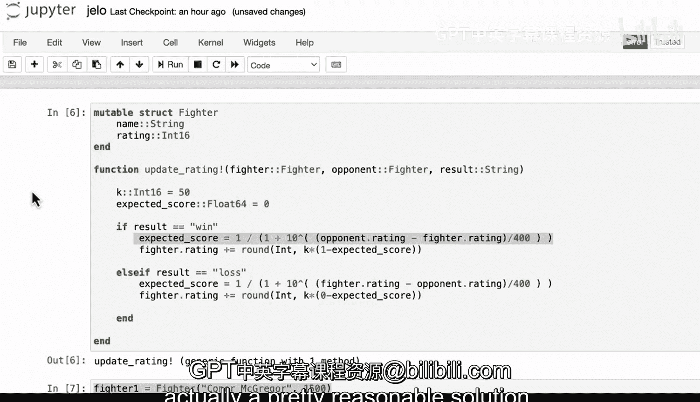

# 25：用Julia实现ELO评分系统 🏆


## 概述
在本节课程中，我们将学习如何使用Julia编程语言来实现一个ELO评分系统。我们将通过模拟两位UFC（终极格斗冠军赛）选手的比赛来演示如何计算和更新他们的评分。您将看到Julia语言在数据科学应用中的一些高级特性，例如可变结构体和类型系统。

## 代码结构与定义
首先，我们定义了一个数据结构来表示一名格斗选手。以下是相关的Julia代码：

```julia
mutable struct Fighter
    name::String
    rating::Float64
end
```

这里我们使用了一个`mutable struct`。`mutable`关键字允许我们在后续更新选手的评分。这是Julia语言一项精密的安全特性，也是许多现代编程语言共有的特点。尽管Julia是一种脚本语言，但它同样能提供这种安全保障。

## 评分更新函数
上一节我们定义了选手的数据结构，本节中我们来看看如何更新他们的评分。

我们定义了一个名为`update_rating`的函数。从函数定义可以看出，它接收一个`Fighter`类型的选手、一个对手以及比赛结果作为参数。指定参数类型的好处是我们可以清楚地知道输入数据的格式。函数还指定了返回类型为字符串。

```julia
function update_rating(fighter::Fighter, opponent::Fighter, result::String)::String
    # ... 函数内部逻辑
end
```

在查看这个`update_rating`方法时，我们需要注意到它会改变（mutate）选手的评分。接下来我们运行这段代码，可以看到函数内部使用了一些计算指标。

## ELO计算核心
以下是ELO评分计算中使用的核心公式和参数：

*   **K因子**：`K = 50`。这个值决定了单场比赛对评分影响的大小。
*   **期望得分**：这是基于两位选手当前评分差计算出的获胜概率。
*   **更新公式**：根据实际比赛结果与期望得分的差异，使用特定公式来更新选手的评分。

## 模拟比赛与评分变化
现在，我们来看看如何将这些概念应用于一次模拟比赛。

在比赛开始前，我们为每位选手分配一个默认的初始评分。这样做是为了让我们能够基于这次初始交锋来衡量胜利或失败的权重。

```julia
# 假设初始评分
fighter1 = Fighter("Conor McGregor", 1500.0)
fighter2 = Fighter("Khabib Nurmagomedov", 1500.0)
```

我们可以看到，在比赛前，康纳·麦格雷戈和哈比布·努马戈梅多夫的评分是相等的。但当我们进行ELO计算后——ELO是一种基于对手竞争力来衡量选手能力的方法——评分发生了变化。

比赛结束后，选手康纳·麦格雷戈的ELO评分降低了，而选手哈比布·努马戈梅多夫的ELO评分升高了。

## Julia语言的优势总结
通过这个例子，我们可以看到Julia作为一种数据科学语言实际上非常精密。其精妙之处在于它包含了许多更新的、更现代的特性。

*   **可变结构体**：默认情况下，Julia中的对象是不可变的，这提供了内置的安全机制。但通过`mutable`关键字，我们可以创建可变的结构体，在需要时安全地修改数据。
*   **类型系统**：Julia支持类型注解，这使代码更清晰、更易于理解和调试。
*   **简洁的语法**：观察这个函数，其逻辑相当直观，易于理解。

因此，当您构建解决方案时，在Jupyter笔记本中使用Julia是一个非常合理的选择。



## 总结
本节课中，我们一起学习了如何使用Julia实现一个ELO评分系统。我们从定义表示选手的`mutable struct`开始，然后创建了用于更新评分的函数，并了解了ELO计算的核心公式。最后，我们模拟了一场比赛，观察了评分如何根据结果动态变化，并总结了Julia语言在数据科学任务中体现出的现代语言特性。