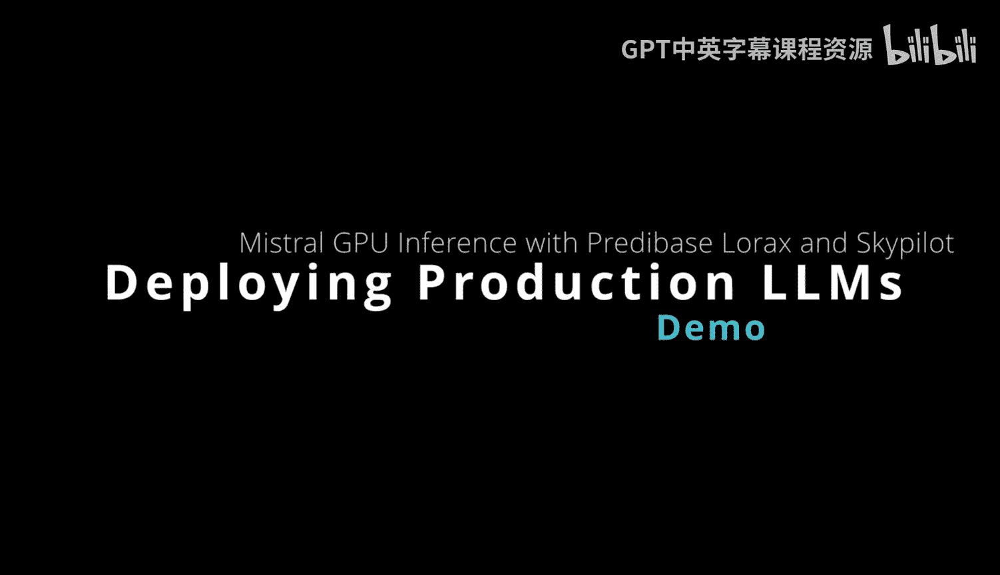
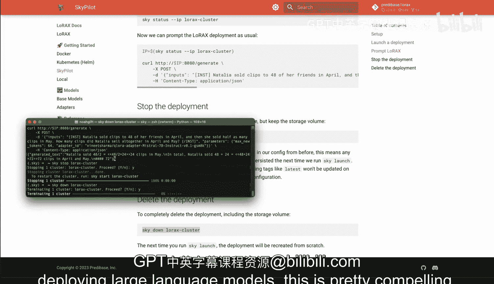

# 26：开始使用Lorax与SkyPilot 🚀

在本节课中，我们将学习如何部署大型语言模型，并重点介绍使用 Lorax 和 SkyPilot 这一高效、便捷的解决方案。

## 概述

部署大型语言模型时面临的一大挑战是如何高效地将其投入实际使用。Lorax 是解决此问题的一个方案。通过结合 SkyPilot 云服务，我们可以实现快速、低成本且高性能的模型部署。

## 开始部署

上一节我们介绍了部署的挑战，本节中我们来看看具体的解决方案。查看 Pretabase 提供的 Lorax 文档，会发现其过程出奇地简单。

文档显示，你可以运行一个包含基础大语言模型的容器。在本例中，我们将使用 `myel` 模型，并选择所需的 GPU 配置。完成这些步骤后，部署就准备就绪了。文档中还提供了一些如何向模型发送提示词的示例。

这种方法非常吸引人，另一个优点是 Lorax 使用 Rust 语言构建，具有出色的推理性能。

## 使用云GPU进行部署

我认为部署 Lorax 更简单的方法是使用基于云的 GPU 服务。接下来，我们转向 SkyPilot。

访问 SkyPilot 后，我们只需执行 `pip install` 安装并确保环境就绪。接下来的步骤非常简单，因为你只需要粘贴一个 YAML 配置文件。这是我喜欢 Pretabase 的原因之一，他们在 YAML 文件方面做了大量出色的工作。

例如，在微调时，你可以使用 YAML 文件。但请看这个部署配置，它非常清晰明了。你可以看到 AWS 配置、加速器类型、端口等信息，以及我指定的模型。在我看来，这已经做到了极致。

如果你已经设置好了 AWS 密钥，接下来要做的就是启动 Lorax 任务。

## 实际操作演示

现在，我将切换到我的已配置好的环境中，让我们看看实际运行起来是什么样子。

当服务启动后，你可以在这里看到各种信息在滚动输出，甚至能看到 HTTP 请求日志。接下来，我将运行官方文档中的示例代码。

让我们看看具体操作。向下滚动文档，找到检查状态的命令。我们将在另一个窗口中执行。

我将运行 `sky status --ip lrex-cluster`。可以看到，我已经获取到了 IP 地址。

接下来，我们看看如何发送提示词，这非常简单。实际上，只需要使用 `curl` 命令，但我们需要将上面获取的 IP 地址填入命令中。

我们可以并排运行这两个窗口：一边查看服务器输出，另一边在下方运行客户端代码。我只需要复制文档中的 `curl` 命令。

让我们粘贴并运行它。好了，我们可以看到发生了什么。

我们正在使用 `mystrel` 模型进行查询。可以看到，它已经成功生成了代码示例。

## 方案优势与总结

本节课中我们一起学习了 Lorax 与 SkyPilot 的部署流程。这个方案的真正优势在于，我们获得了一个使用开源模型的高性能推理服务器，而完成这一切只需要一个基于 YAML 的配置文件。

更酷的是，当我们运行完毕后，可以随时停止部署，从而避免持续产生费用。我们只需确认停止即可。

我认为，这是目前部署大型语言模型，特别是开源大语言模型，最引人注目的解决方案之一。因此，我要向 Pretabase 及其团队致敬，这真是一个令人印象深刻的工作流程。如果我是一家公司的 CTO，并考虑部署大型语言模型，这个方案极具吸引力。