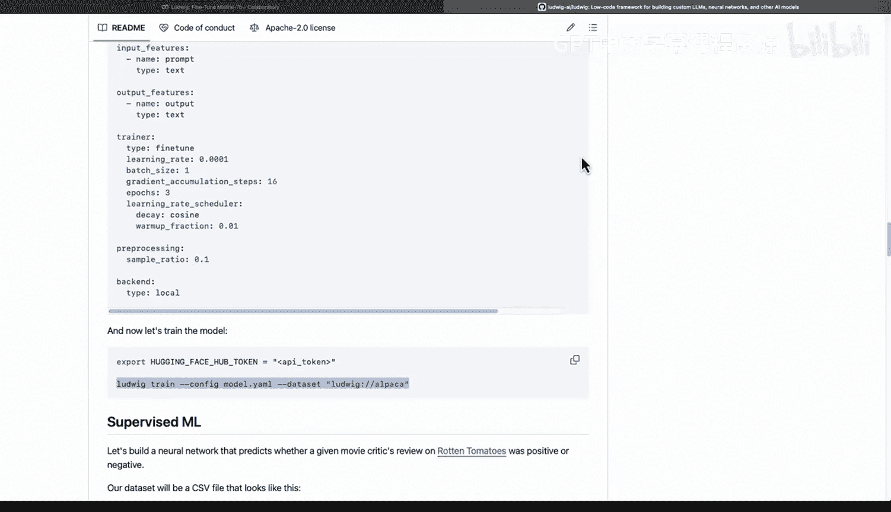
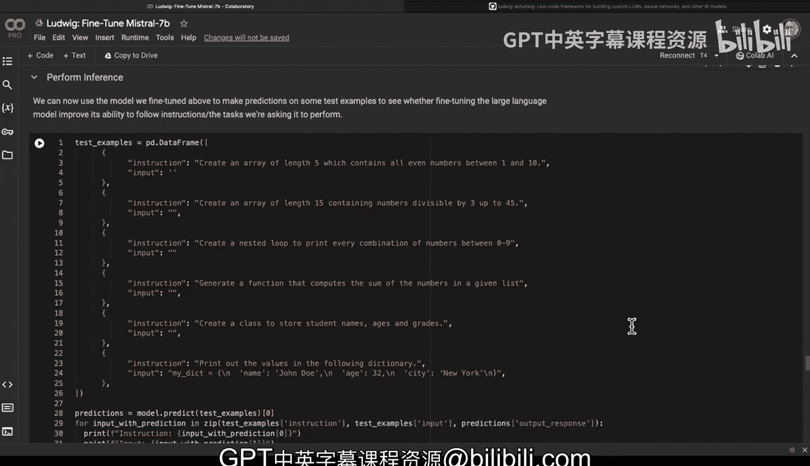

# 本地大语言模型的基础：P27：使用Ludwig微调Mistral-7B模型 🚀

在本节课中，我们将要学习如何使用一个名为Ludwig的低代码框架来微调Mistral-7B大语言模型。我们将了解其基于配置文件的工作流程，并演示如何在Colab Pro环境中执行微调任务。

---

## 认识Ludwig：一个低代码微调工具 🛠️

上一节我们介绍了微调的基本概念，本节中我们来看看一个具体的工具——Ludwig。Ludwig是一个用于大语言模型的微调工具，其特点是“低代码”。这意味着它简化了复杂的模型训练过程，让更多人能够参与进来。

Ludwig的核心工作方式是使用配置文件。用户通过编写YAML格式的配置文件来定义任务，而不是编写大量代码。这种模式类似于DevOps的工作流，能够显著简化操作。

以下是Ludwig的一个关键特性：
*   **基于YAML配置**：所有训练参数和模型定义都在一个配置文件中完成。
*   **命令行训练**：配置完成后，可以直接通过命令行启动训练过程。
*   **提供入门指南**：其官方文档提供了针对热门模型（如Mistral）的详细微调指南。

---

## 在Colab Pro中设置环境 💻

了解了Ludwig的基本特点后，我们需要一个强大的环境来运行它。本节我们来看看如何在Colab Pro中配置运行时环境。Colab Pro提供了GPU资源，这对于大语言模型的微调至关重要。

在Colab中，我们可以选择并切换不同的GPU类型以适应任务需求。这为实验提供了灵活性。一个典型的用于微调的运行时环境需要具备足够的内存（RAM）和磁盘空间。

---

## 实战：为代码生成任务微调模型 📝

环境准备就绪后，现在进入实战环节。本节我们将通过一个具体的笔记本（Notebook）示例，学习如何使用Ludwig微调模型来完成代码生成任务。

微调的核心思想是：从一个已经表现不错的预训练模型（基础模型）开始，然后使用我们自己的特定数据（例如代码片段）对其进行额外训练，从而使模型在我们关心的任务上表现得更好。

这个示例笔记本的目标是让模型学会根据英文指令生成对应的代码。

### 数据准备与配置

以下是微调流程的第一步：准备数据和配置文件。

1.  **加载数据集**：数据集中包含“指令”（instruction）、“输入”（input）和期望的“输出”（output）代码。
2.  **创建YAML配置文件**：在这个文件中，我们需要定义：
    *   `input_features`：指定模型的输入是什么（例如，文本指令）。
    *   `output_features`：指定模型需要生成什么（例如，代码）。
    *   `model_type`：指定要使用的基础模型（例如，`mistral7b`）。

### 执行训练与监控

配置完成后，就可以启动微调过程了。

1.  **数据预处理**：Ludwig会自动对输入的数据进行必要的清洗和格式化处理。
2.  **加载配置并训练**：运行训练命令，Ludwig会加载配置和数据集，开始微调过程。
3.  **监控训练过程**：在训练过程中，我们可以实时看到损失（loss）等关键指标的变化，以及正在使用的GPU类型。这有助于我们了解训练是否正常进行。

---

## 总结 📚

本节课中我们一起学习了使用Ludwig框架微调Mistral-7B大语言模型的全过程。

我们首先认识了Ludwig作为一个低代码、基于YAML配置的微调工具的优势。接着，我们在Colab Pro中设置了包含GPU的运行时环境。最后，我们通过一个代码生成的实战案例，逐步演练了从数据准备、配置文件编写到执行训练和监控的完整流程。

使用Ludwig可能是微调新式大语言模型最简单的方法之一，其提供的示例笔记本极大地降低了入门门槛。如果你希望快速开始自己的微调项目，Ludwig是一个非常值得尝试的选择。