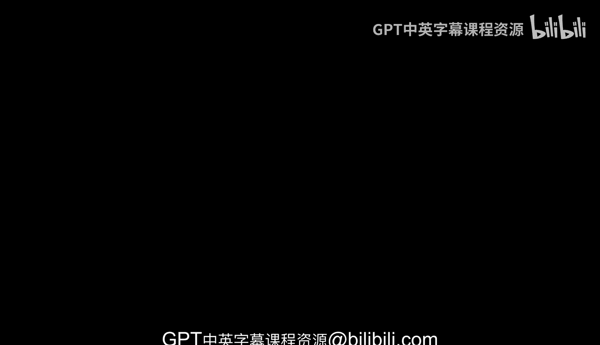

# 本地大语言模型的基础：P28：检索增强生成（RAG）简介

在本节课中，我们将要学习一个名为“检索增强生成”的重要概念。这是一种让大语言模型能够访问其训练数据之外的新信息或近期信息的技术，从而提供更准确、更相关的答案。

## 核心概念：检索增强生成（RAG）

检索增强生成，简称RAG，是一个初听起来可能难以理解的概念。但一旦你理解了它的有趣之处，你就会立刻想要实现它。虽然实现起来有些技巧，但我们将一起探索如何使其工作，并让你能在自己的系统中进行尝试。

简单来说，RAG是一种方法。我们将看到如何通过这种方法，让大语言模型能够访问其训练数据中**不包含**的新数据或近期数据。这使得模型能够提供更好的答案。

## 技术实现路径

上一节我们介绍了RAG的基本概念，本节中我们来看看实现它的具体步骤。我们将深入探讨如何管理我们想要用于RAG的数据。

以下是实现RAG的三个主要步骤：

1.  **数据管理**：首先，我们需要准备和组织想要提供给模型的外部数据。
2.  **创建嵌入向量**：接着，我们将这些数据转换成一种称为“嵌入向量”的数学表示形式，以便进行高效的搜索。
3.  **使用向量数据库**：然后，我们将这些嵌入向量存储在一个专门的搜索数据库（如向量数据库）中。

在完成以上步骤后，我们最终可以将这个检索系统与大语言模型结合使用。当用户提出问题时，系统会先从外部数据库中检索最相关的信息片段，然后将这些信息与问题一起交给大语言模型，让它生成最终答案。

## 总结

本节课中我们一起学习了检索增强生成（RAG）。我们了解到，RAG通过让大语言模型访问外部知识源来弥补其训练数据的局限性，从而提升回答的质量和时效性。其核心流程包括管理数据、创建嵌入向量、利用向量数据库进行检索，最后与大语言模型协同生成答案。