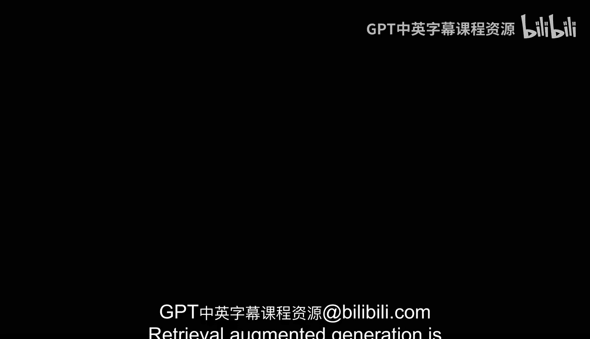
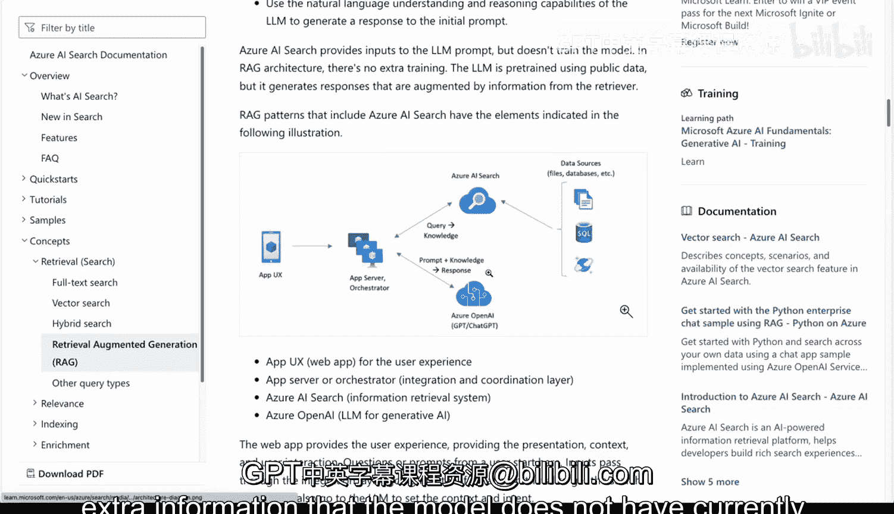

# 本地大语言模型的基础：P29：什么是RAG 🧠

在本节课中，我们将学习检索增强生成（RAG）技术。这是一种通过整合外部知识源来增强、锚定和改进大语言模型输出的方法。

## 概述

检索增强生成是一种技术，它通过使用搜索数据库或搜索引擎（有时也称为向量数据库）来扩展、锚定和改进大语言模型的结果。接下来，我们将通过一个基本实现示例来理解RAG的含义。

## RAG的基本流程

以下是RAG的一个基础实现图示。它展示了用户输入如何与外部文档结合，最终生成更准确的输出。

流程始于用户的输入。与通常大语言模型一对一的处理方式不同，RAG并行地处理一组文档。这些文档会被向量化并分割成大语言模型能够理解的块。随后，我们可以利用这些处理后的文档来增强模型的回答能力。

## RAG如何工作

上一节我们看到了RAG的基本流程，本节中我们来看看它的具体工作原理。大语言模型的能力受限于其训练数据。例如，如果你询问关于美国当前的政治事件，模型可能无法准确回答，因为它可能没有包含这些最新数据的训练。

这时，数据库、搜索引擎或向量数据库就派上了用场。它们可以提供最新的信息来弥补模型的不足。处理用户请求时，系统会首先查询这些文档，获取相关信息，然后将问题和这些相关的文档结果一并发送给大语言模型。

## 一个具体的应用架构

除了基础概念，RAG在具体平台上的实现也值得了解。另一个图示来自Microsoft Learn，展示了在Azure AI搜索中的检索增强生成架构。

请注意，Azure AI搜索最近从“Azure认知服务搜索”更名而来。这是一个更完整的应用程序架构示例。

以下是该架构的核心步骤：
1.  用户请求首先发送到应用程序（可能包含API或Python代码的容器）。
2.  应用程序将请求提交给Azure AI搜索服务。
3.  Azure AI搜索利用预先加载的信息生成必要的响应来增强请求。
4.  增强后的请求被发送到Azure OpenAI或其他模型。
5.  模型生成的响应经协调器返回给用户。

## RAG的核心价值

本质上，当人们谈论搜索、向量数据库或检索增强生成时，他们指的是类似的实现方式。其核心目标都是通过预先加载的文档来增强模型的行为，为模型提供其当前所不具备的额外信息。

## 总结

本节课中，我们一起学习了检索增强生成技术。我们了解到，RAG通过整合外部知识源（如搜索数据库或向量数据库）来扩展大语言模型的能力，使其能够提供更准确、更及时的答案。无论是基础流程还是像Azure AI这样的云平台实现，其核心思想都是利用外部文档信息来弥补模型自身知识的局限性。