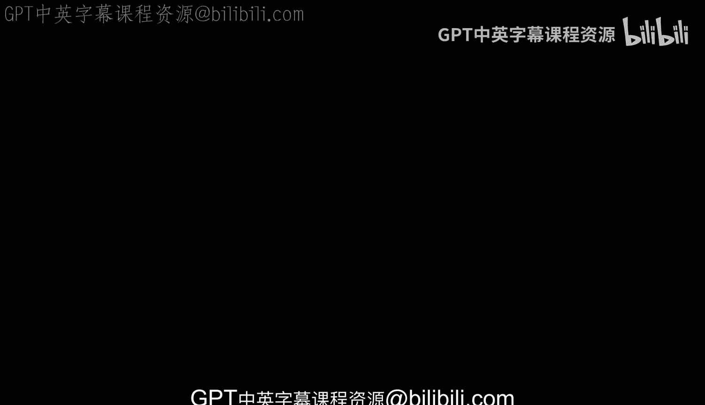
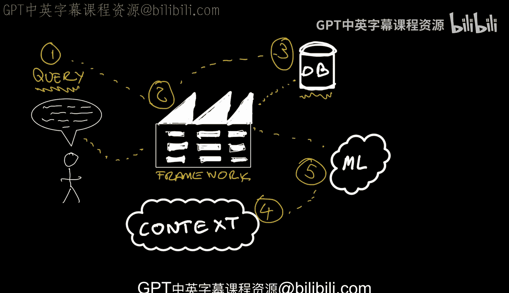

# 30：30_02_04_RAG应用概述 🧠

在本节课中，我们将学习检索增强生成（RAG）的基本工作原理。RAG是一种将外部知识库与大语言模型结合的技术，旨在为模型提供更准确、更实时的信息，以生成更好的回答。

---

## 工作流程概述

首先，我们从用户的一个查询开始。通常，这个查询会直接发送给应用框架，然后由框架传递给大语言模型处理并返回答案。但在RAG架构中，流程有所不同。

## 核心流程分步解析

以下是RAG应用处理查询的核心步骤：

1.  **用户发起查询**
    用户提出一个问题，例如：“昨天的天气怎么样？”

2.  **框架接收查询**
    查询首先到达应用框架。这个框架可以是像LangChain或Semantic Kernel这样的专用框架，也可以是一个直接调用API的普通应用程序。

3.  **查询转向向量数据库**
    框架收到查询后，并不会直接将其发送给大语言模型。相反，它会先将查询发送到**向量数据库**。

    

4.  **向量数据库执行搜索**
    向量数据库会根据查询（例如“yesterday's weather”）执行相似性搜索，从已存储的文档中查找最相关的信息。这些信息可能是大语言模型在训练时未曾见过的。

5.  **返回检索到的上下文**
    数据库找到的相关信息（即“上下文”）会返回给应用框架，而不是直接给用户。

6.  **框架组合提示**
    框架将原始的**用户查询**和从数据库获取的**额外上下文**组合在一起，形成一个更丰富的提示（Prompt）。

7.  **发送增强提示给大语言模型**
    这个组合后的提示被发送给大语言模型。此时，模型就像一名在考试中拿到了“小抄”的学生——它已经掌握了问题的事实答案。

8.  **模型生成最终回答**
    大语言模型的核心任务不再是“编造”答案，而是根据已有的准确上下文，**组织语言、润色表述**，形成一个通顺、完整的回答。

9.  **返回最终结果**
    模型生成的良好回答被发送回框架，最终由框架呈现给用户。

    

## 流程比喻与优势

我们可以这样理解：大语言模型如同一个聪明的“转述者”或“包装者”。它的主要价值在于理解和组织语言，而事实性信息则由专门的向量数据库提供。

这种架构的优势在于：
*   **成本效益**：更新知识（向向量数据库添加文档）的成本远低于重新训练整个大语言模型。
*   **准确性**：能提供模型训练数据之外的最新、最相关的事实。
*   **可追溯性**：回答的来源（检索到的文档）可以被追踪和验证。

---

## 总结

本节课我们一起学习了检索增强生成（RAG）的基本应用流程。我们了解到，RAG通过引入向量数据库作为外部知识源，在用户查询和大语言模型之间增加了一个检索步骤。这使得模型能够基于检索到的、可靠的上下文信息来生成回答，从而提高了回答的准确性和时效性。在后续课程中，我们将深入探讨如何构建向量数据库以及如何具体实现这一流程。