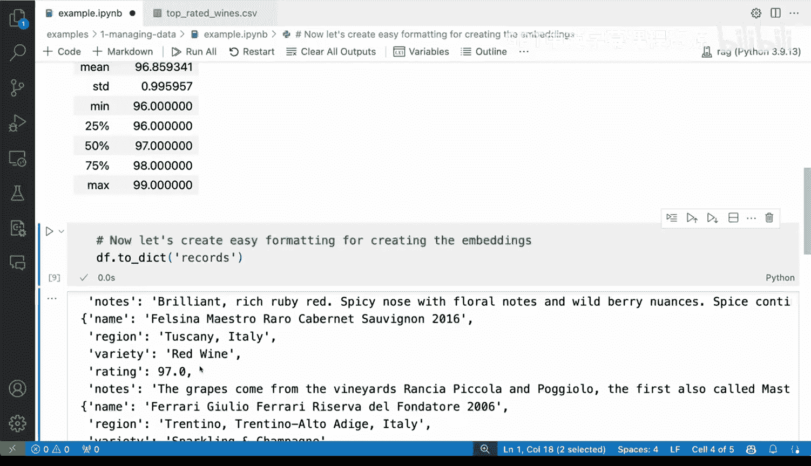

# 31：RAG的数据管理 📊


在本节课中，我们将学习如何为检索增强生成应用准备和管理数据。我们将从一个包含全球葡萄酒信息的CSV文件开始，逐步将其处理成适合向量数据库使用的格式。

## 概述

我们将使用Python的pandas库来加载和处理一个结构化的CSV文件。该文件包含了葡萄酒的名称、产区、品种、评分和品酒笔记等信息。我们的目标是将这些数据转换为字典列表格式，以便后续高效地存入向量数据库并创建嵌入。

## 数据加载与查看

首先，我们需要加载数据。我们使用pandas库来读取CSV文件。

```python
import pandas as pd
df = pd.read_csv('./wine_data.csv')
```

运行上述代码后，我们得到了一个包含1365条葡萄酒记录的数据框。每条记录包含以下列：`name`（名称）、`region`（产区）、`variety`（品种）、`rating`（评分）和`notes`（品酒笔记）。评分范围主要集中在96分及以上，因为这是从一个更大的数据集中筛选出的子集。

## 数据格式转换

上一节我们加载了原始数据，本节中我们来看看如何将其转换为向量数据库所需的格式。为了后续创建嵌入和进行高效检索，我们需要将数据框转换为一个字典列表，其中每个字典代表一条完整的葡萄酒记录。

以下是转换步骤：

```python
wine_records = df.to_dict('records')
```

执行这段代码会将数据转换为一个列表，列表中的每个元素都是一个字典。字典的键是列名（如`name`、`region`），值是对应行的具体数据。这种格式明确地定义了数据的结构和内容，便于向量数据库理解和处理。

## 格式选择的重要性

我们选择`to_dict('records')`方法而非其他格式，有特定原因。如果使用默认或其他参数（如`‘dict’`），生成的字典结构会不同，其键可能是行索引，值则是另一层字典。这不符合我们的需求。

我们需要的格式是：一个列表，其中每个元素都是一个代表单条记录的扁平字典。`‘records’`参数正好能生成这种结构，确保数据能够被后续的嵌入模型和向量数据库正确消费。

## 总结



本节课中我们一起学习了RAG应用数据管理的基础步骤。我们从加载一个结构化的CSV文件开始，使用pandas进行初步查看，最后将数据转换为字典列表的格式。这个格式是后续将数据存入向量数据库、创建嵌入并实现高效检索的必要准备。整个过程涉及数据加载、查看和格式转换，为构建检索增强生成应用打下了坚实的数据基础。