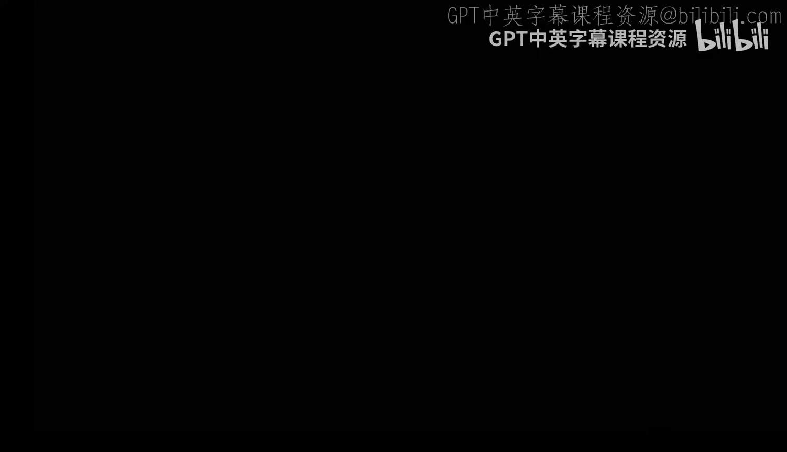
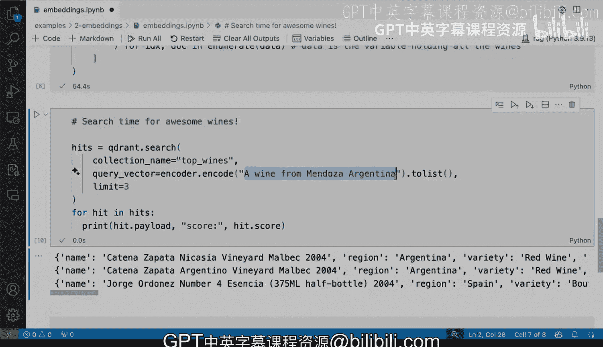

# 32：验证嵌入与搜索



## 概述
在本节课中，我们将学习如何验证嵌入向量并执行向量数据库搜索。我们将使用一个葡萄酒数据集，通过句子转换器（Sentence Transformers）生成文本嵌入，并将其存储到Qdrant向量数据库中。随后，我们将执行语义搜索查询，以验证整个流程的有效性。

---

## 数据加载与预处理
首先，我们需要加载并准备数据集。我们将使用pandas库来读取一个CSV文件，并对数据进行清理，以确保没有缺失值（NaN）。这一步很重要，因为缺失值可能会在后续的序列化或嵌入过程中引发问题。

以下是数据加载与预处理的步骤：

1.  使用pandas读取CSV文件。
2.  删除包含任何缺失值的行，以净化数据集。
3.  将处理后的数据转换为字典格式，便于后续操作。

运行这些步骤后，我们将得到一个包含约1300行数据的数据集，其中包含名称、产区等信息。

---

## 导入必要的库
为了构建向量数据库并执行搜索，我们需要导入几个关键的库。理解每个库的作用对于掌握整个流程至关重要。

以下是需要导入的库及其作用：

*   **sentence_transformers**：这个库为我们提供了编码能力。我们将使用特定的预训练模型（如 `all-MiniLM-L6-v2`）来将文本转换为数值向量（即嵌入）。这个模型会自动下载到本地。
*   **qdrant_client** 和 **models**：Qdrant客户端库允许我们与向量数据库进行交互。我们将创建一个内存中的数据库实例，这对于示例和演示非常方便，无需设置基于文件或网络的数据库。

```python
from sentence_transformers import SentenceTransformer
from qdrant_client import QdrantClient
from qdrant_client.http import models
```

---

## 创建向量数据库与集合
上一节我们导入了必要的工具，本节中我们来看看如何初始化向量数据库并创建集合（Collection）。集合是数据库中存储相似向量的容器。

我们需要配置集合的参数，其中最重要的是距离度量方式。这里我们选择使用**余弦距离**，它用于比较向量之间的相似性。我们还需要指定向量的维度，这个维度必须与我们使用的嵌入模型（`all-MiniLM-L6-v2`）的输出维度一致。

```python
# 初始化编码器和客户端
encoder = SentenceTransformer('all-MiniLM-L6-v2')
client = QdrantClient(":memory:") # 使用内存数据库

# 创建集合配置
vector_config = models.VectorParams(
    size=encoder.get_sentence_embedding_dimension(), # 动态获取模型维度
    distance=models.Distance.COSINE
)

client.create_collection(
    collection_name="fine_wines",
    vectors_config=vector_config
)
```

---

## 生成嵌入并上传数据
集合创建好后，接下来我们需要将数据转换为向量并上传到数据库中。这个过程涉及遍历数据集中的每一条记录，提取“品酒笔记”字段，使用编码器将其转换为向量，并将向量与元数据一起上传。

以下是上传数据的具体步骤：

1.  遍历数据集中的每一行。
2.  使用编码器对“品酒笔记”文本进行编码，生成向量。
3.  将生成的向量和该条记录的其他信息（如名称、产区）作为元数据（payload）打包。
4.  将向量和元数据作为一个点（point）上传到Qdrant集合中。

请注意，处理1300条记录可能需要一些时间（例如几十秒）。对于演示，可以考虑减少数据量以加快速度。

```python
points = []
for idx, row in enumerate(data_dict):
    # 编码文本笔记
    vector = encoder.encode(row['notes']).tolist()
    # 准备元数据
    payload = {
        "name": row['name'],
        "region": row['region'],
        "notes": row['notes']
    }
    points.append(
        models.PointStruct(
            id=idx,
            vector=vector,
            payload=payload
        )
    )

# 批量上传点到集合
client.upsert(collection_name="fine_wines", points=points)
```

---

## 执行语义搜索
数据上传完成后，就到了验证环节——执行语义搜索。我们可以使用自然语言提出问题，系统会找到与问题语义上最接近的葡萄酒记录。

我们使用 `search` 函数，传入集合名称和查询文本。查询文本同样会被编码成向量，然后数据库会使用**余弦距离**找出最相似的向量，并返回对应的元数据。

例如，搜索“一款来自纳帕谷的带有黑樱桃风味的葡萄酒”，系统可能会返回符合描述的葡萄酒。我们也可以尝试不同的查询，如“一款来自阿根廷门多萨的马尔贝克葡萄酒”，系统会返回不同的、但语义相关的结果。

```python
# 执行搜索
query = "一款来自纳帕谷的带有黑樱桃风味的葡萄酒"
query_vector = encoder.encode(query).tolist()

search_result = client.search(
    collection_name="fine_wines",
    query_vector=query_vector,
    limit=3 # 返回最相似的3个结果
)

for result in search_result:
    print(f"名称: {result.payload['name']}")
    print(f"产区: {result.payload['region']}")
    print(f"匹配分数: {result.score:.2f}")
    print("---")
```

---



## 总结
本节课中，我们一起学习了验证嵌入与搜索的完整流程。我们从加载和清理数据开始，然后使用句子转换器模型生成文本嵌入。接着，我们初始化了Qdrant向量数据库，创建了集合，并将向量化后的数据上传。最后，我们通过执行语义搜索查询，验证了系统能够根据自然语言描述找到相关的信息。这套流程是将大型语言模型与特定领域知识（如葡萄酒数据库）结合应用的基础，通过向量搜索获取精准的上下文信息，从而增强大语言模型的回答质量。