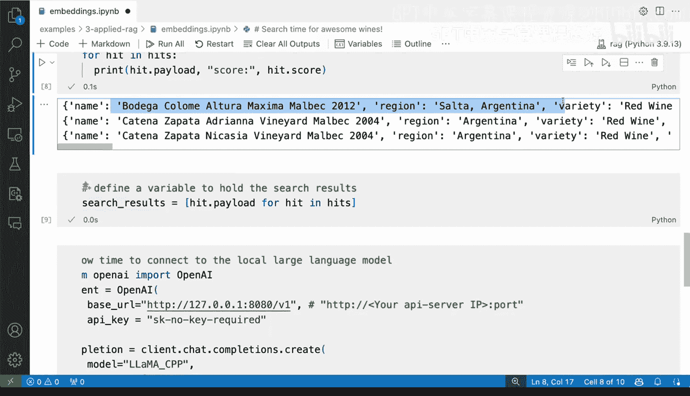

# 33：在LLM中使用RAG 🍷


在本节课中，我们将学习如何将外部数据（一个葡萄酒数据集）导入向量数据库，并利用检索增强生成技术，让大语言模型基于这些数据提供有意义的回答。整个过程涉及数据准备、向量化存储和最终的智能查询。

---

上一节我们介绍了向量数据库的基本概念，本节中我们来看看如何将具体的CSV数据导入数据库，并与大语言模型结合进行智能检索。

首先，我们需要将葡萄酒的CSV数据导入数据库。我们将再次使用pandas库来处理数据，并将记录存入数据库，以便后续与大语言模型协同工作。

为了加快处理速度，我们将数据条目限制为700条。运行以下代码来完成数据加载。

```python
import pandas as pd
# 假设数据加载和筛选的代码在此
```

接着，我们使用Quadrant客户端。需要重新运行一些必要的导入语句和编码器。

```python
# 导入所需模块并初始化编码器
```

然后，我们再次创建向量数据库客户端。这次我们不是存储书籍，而是创建一个名为“top_wines”的集合来存储葡萄酒信息。

```python
# 创建用于存储葡萄酒的集合
```

运行上述代码后，我们将把所有数据上传到新建的“top_wines”集合中。这个过程需要几秒钟，因为我们已将数据缩减至700条记录。

等待上传完成。完成后，我们将通过OpenAI API（或兼容API）来使用这些数据，从而获得有意义的查询结果。

上传已完成，耗时34秒。即使只处理700条记录，在我的机器上也花费了一些时间。现在，我们向下滚动，开始进行查询。

我将定义一个查询提示：“建议我一款来自阿根廷的优质马尔贝克葡萄酒”。我将此提示存储为一个变量。

现在，我将基于这个提示在数据库中进行搜索。以下是搜索并获取相关结果的步骤。

```python
# 在向量数据库中执行相似性搜索
```

为了简化流程，我将所有搜索结果应用到一个变量中。然后，我连接到OpenAI（实际上我本地运行的是LlamaFile模型，但原理相通）。关键点在于，你可以将其连接到ChatGPT、OpenAI API或任何兼容的API服务。

这里，我无需任何API密钥即可直接对话。我们定义了以下提示：

*   **系统提示**：你是一个聊天机器人，一名葡萄酒专家。你的首要任务是帮助引导用户选择出色的葡萄酒，并根据他们的请求提供指导。
*   **用户提示**：我们之前定义的查询变量。
*   **上下文**：从数据库检索到的结果将作为补充内容提供。

运行查询。让我们看看大语言模型返回了什么内容。

模型回复道：“我建议您尝试阿根廷Bodega Colomé Alta Maxima Albe葡萄酒。它的评分是96分。” 这非常出色！它有效地运用了之前提供的上下文信息。

回顾一下，在搜索结果顶部，第一条记录正是来自阿根廷Salta产区（一个非常美丽的地区）的这款葡萄酒。

由此可见，这就是如何将外部数据库与大型语言模型结合，通过扩展的上下文信息来获得有意义答案的全过程。

---



本节课中，我们一起学习了将CSV数据导入向量数据库、执行向量化搜索，并最终利用检索增强生成技术，使大语言模型能够基于特定数据源生成准确、相关的回答。