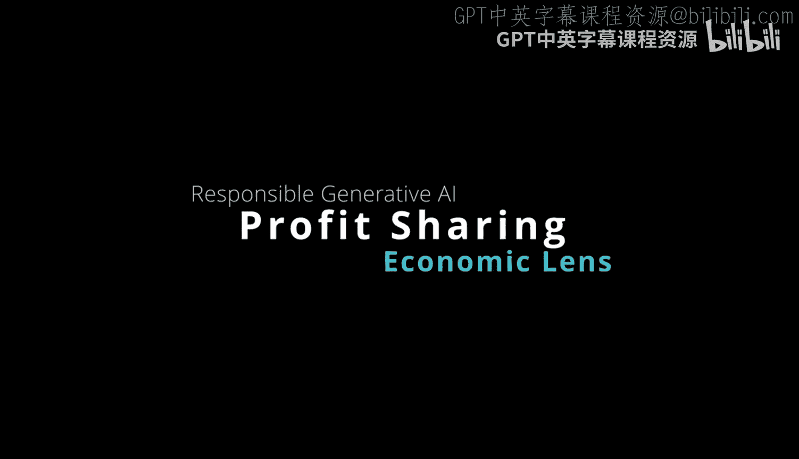
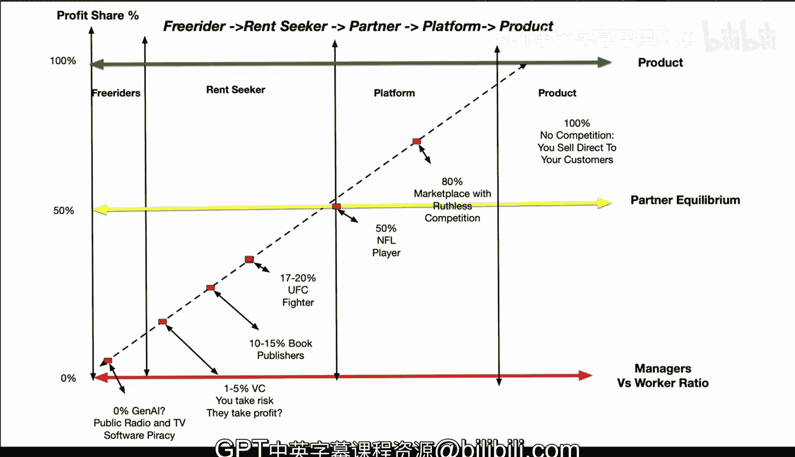

# 本地大语言模型的基础：P35：利润分享概念 💰

在本节课中，我们将学习利润分享的不同模式及其对社会的影响。我们将从微观经济学的角度，分析四种主要的利润分享场景：搭便车者、寻租者、平台和产品。理解这些概念有助于我们评估新技术或商业机会的利弊。

## 搭便车者场景 🆓

上一节我们介绍了课程概述，本节中我们来看看第一种利润分享模式：搭便车者。搭便车者指那些享受产品或服务带来的好处，却无需支付任何费用的个体或群体。

以下是搭便车者场景的具体例子：

*   **公共广播电视**：许多人每天收听公共广播，但从不支付订阅费，他们就是搭便车者。
*   **软件盗版**：如果软件包可以免费下载，用户就成为了搭便车者。
*   **生成式AI的潜在风险**：如果从报纸、电影到书籍和软件的所有内容都被消费，却没有利润分享，最终可能打击创作动力，导致创造性产出降为零。

搭便车者的问题在于，如果数量过多，提供产品或服务的动机就会消失。虽然少数搭便车者可能影响不大，但这仍是一个需要警惕的现象。

## 寻租者场景 🏦

了解了搭便车模式后，我们转向第二种模式：寻租者。寻租行为并非绝对，存在一个梯度。其核心概念是希望以尽可能少的工作，获取某种租金或报酬。

以下是寻租者场景的具体例子：

*   **风险投资**：风投公司可能投资100家公司，并预期其中95家会破产。那95家公司的员工承担了巨大风险，他们的**预期收益**（公式：`预期收益 = 利润 × 事件概率`）可能很低，因为成功概率（例如5%）很小。但风投通过投资组合分散了风险并获取利润。
*   **图书出版商**：在某些情况下，出版商为作者做了很多工作；在另一些情况下则做得很少。但他们通常能获得图书收入的10%到15%，这可被视为一种寻租形式。

在这些场景中，通常存在高度的管理，因为资金方获取了大部分利润，并可能将其再投资于组织。至于这是否为社会或产品增加了价值，需要具体情况具体分析。

## 平台与产品场景 ⚖️

在探讨了寻租行为后，我们接下来比较平台和产品这两种更直接的利润分享模式。

**平台模式**有其优势。例如，如果你能获得80%的利润，这对你非常有利。然而，经济学中有一个表述：在完全竞争下，所有利润最终趋于零。这意味着如果平台无法限制参与者加入，也无法区分优劣，利润就可能被消除。平台本身可能通过收取交易费赚取大量金钱，因为存在大量竞争。

**产品模式**则是一种对所有者而言近乎完美的场景。例如，一个农民在路边直接向顾客出售水果，他获得了100%的利润，没有交易费，没有中间商。当你直接将产品卖给客户时，就属于这种模式。

## 总结与思考 🤔

本节课中，我们一起学习了四种利润分享模式：搭便车者、寻租者、平台和产品。重要的是，每当你听到一个新的机会、新技术或思考新事物时，都需要考虑这些模式之间的权衡。每种模式对消费者和公司都存在利弊。

你需要睁大眼睛看清所处的情境，并从伦理角度思考：当你与采取其中某种行为的公司互动时，会对社会产生何种影响。理解这些概念，能帮助你在复杂的商业和技术环境中做出更明智的判断。