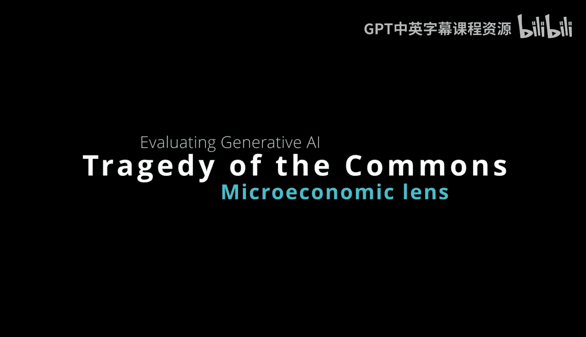
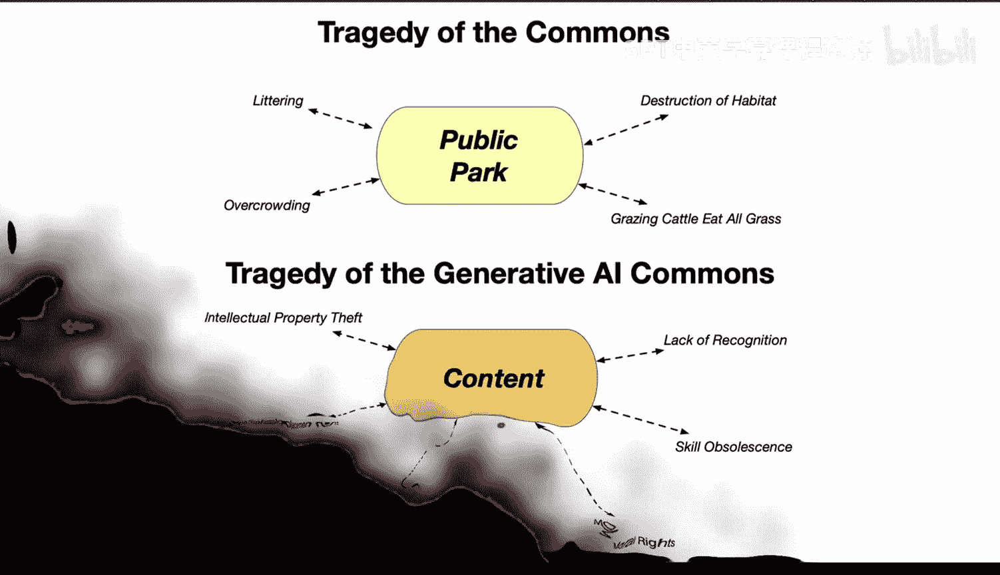

# 本地大语言模型的基础：P36：生成式AI的公共资源悲剧 🏞️

在本节课中，我们将要学习一个重要的经济学概念——“公共资源悲剧”，并探讨这个概念如何应用于生成式人工智能领域，帮助我们理解其发展可能带来的伦理与社会挑战。

## 什么是公共资源悲剧？

公共资源悲剧是一个经典的经济学概念，它描述了当一种资源被无限数量的人免费共享时可能发生的情况。由于缺乏监管，个体为了自身利益最大化而采取的行动，最终可能导致整个资源的枯竭或破坏，对所有人造成损害。

上一节我们介绍了生成式AI的基本概念，本节中我们来看看当我们将AI视为一种公共资源时，可能面临的困境。

## 公共资源悲剧的经典案例

以下是几个公共资源悲剧的典型例子：

*   **乱扔垃圾与破坏**：以一个公共公园为例，如果每个人都随意丢弃垃圾，最终公园会被垃圾毁掉。
*   **过度拥挤**：如果公园没有人数限制，大量人群不断涌入，最终公园会拥挤到无法正常游览。
*   **栖息地破坏**：例如在国家公园内，如果游客破坏自然景观或山地特征，公园将不再像以前那样美丽。
*   **过度放牧**：这是最经典的例子。多个牧场主在同一片公共草地上放牧，每个人都担心别人会更快地消耗牧草，于是竞相增加自己的牲畜数量，导致草地被迅速消耗殆尽。这本质上是一种 **“竞次”** 行为，最终结果是草地被完全破坏。

在全球范围内，包括美国，根据监管力度的不同，都可以在某些公共公园看到这种现象。

## 生成式AI领域的公共资源悲剧

生成式AI的公共资源悲剧具有一些相似的特征。让我们逐一分析。

### 知识产权侵权

生成式AI模型可能在未经同意的情况下，使用受版权保护的作品进行训练。这会贬低原作品的价值，并削弱创作者创作新内容的动力。用公式化的逻辑可以表示为：
**`如果（你的作品将被盗用）那么（你创作更多作品的动机降低）`**

### 职业替代

在生成式AI的案例中，存在人类创作者需求下降的风险，这可能导致职业替代，并产生负外部性。如果这些人无法再获得工作，社会将不得不承担职业替代带来的负担。

### 质量控制问题

生成式AI的输出作品可能质量低劣，但却在模仿某位艺术家的风格。这可能会贬低艺术家本人的价值，并导致整体质量控制问题。

### 缺乏认可或归属

创作者的作品可能在被盗用且未获补偿的情况下被使用，甚至他们作为原创者的身份都得不到承认。这会令人沮丧、有失公平，并严重影响艺术家未来获得工作的机会。

### 伦理与道德权利问题

作者可能不希望自己的形象与吸烟、饮酒或其他不良行为关联。如果未经其许可就进行此类关联，便侵犯了其道德权利。

## 权衡利弊与总结

传统的公共资源悲剧场景并非神奇地不存在于生成式AI中，这些问题确实存在。因此，我们需要同时审视其益处与负面影响。

生成式AI有显著的益处，例如**文本摘要**、**大纲生成**或**代码辅助生成**。但同时，我们也必须关注其负外部性——对社会造成的、社会并未从中受益的影响。

例如，如果一个商业模型利用了公共资源（如网络上的公开数据）获利，社会并未获得相应的报酬，却可能要求担其带来的成本（如职业替代、伦理冲突）。这类似于公园里的乱扔垃圾、过度拥挤或破坏行为：滥用资源的人获得了利益，但社会整体却要为此付出代价。

因此，在思考生成式AI的伦理问题时，考虑公共资源悲剧这一视角至关重要。

本节课中我们一起学习了“公共资源悲剧”的概念及其在生成式AI领域的体现。我们看到了不受约束地使用共享资源可能导致的多种问题，包括知识产权、就业、质量和伦理等方面的挑战。理解这一点，有助于我们在发展和应用AI技术时，更加审慎地平衡创新与责任。