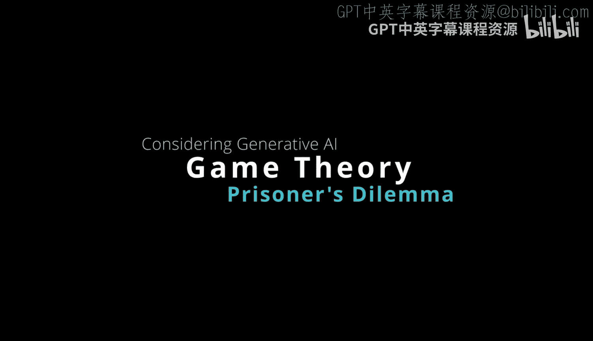
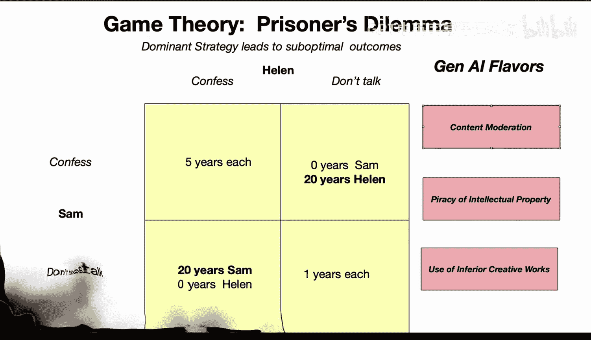

# 本地大语言模型的基础：P37：生成式AI的博弈论 🎲

在本节课中，我们将学习博弈论的基本概念，并探讨它如何应用于生成式人工智能领域，帮助我们理解在技术发展中可能出现的集体困境。

## 概述

博弈论是一个数学框架，用于研究互动行为。它将互动视为由玩家、策略和收益构成的游戏，旨在找出最优策略，或分析那些导致次优结果的“主导策略”。

## 博弈论基础：囚徒困境

上一节我们介绍了博弈论的基本概念，本节中我们来看看一个经典案例：囚徒困境。这是一个经典的博弈论问题，其中自私的主导策略将导致对所有人都不利的次优结果。

假设你是一名检察官，你逮捕了涉嫌犯罪的Sam和Helen，但缺乏定罪两人的证据。从他们那里获取所需信息的唯一方法是让他们互相猜忌。

以下是收益矩阵描述的情况：
*   **两人都不招供**：每人仅被判入狱1年。
*   **一人招供，另一人不招供**：招供者将获释（0年），而不招供者将入狱20年。
*   **两人都招供**：每人将入狱5年。

通过分别告诉每个人“如果你招供就能获释，而你的同伙将入狱20年”，你激励了每个人都选择招供。当两人都招供时，每人将获得5年刑期。由于不招供而对方招供的惩罚过于严重，保持沉默变得没有意义。

因此，即使双方若能沟通，最优策略是每人只入狱1年，但由于彼此不信任，最终导致了次优的主导策略：两人都招供，刑期比合作情况下长了五倍。

## 生成式AI中的博弈论应用

理解了经典囚徒困境后，我们可以将这种博弈论视角同样应用于生成式AI领域。

### 内容审核的“逐底竞争”

例如，假设我们进入一个所有内容审核都由某个AI系统完成的世界。我们可以发现，确保内容具有吸引力的激励非常强烈。如果参与度不足，公司就会亏损。

因此，尽管平台上出现了大量低质量的生成式AI内容，你实际上可能会**降低审核标准**，因为这会影响公司的利润底线。一旦你的竞争对手意识到他们也开始亏损，他们也会采取同样的策略。

以下是可能发生的连锁反应步骤：
1.  一家公司为保利润，降低AI生成内容的审核标准。
2.  竞争对手为保持竞争力，效仿此策略。
3.  审核标准越来越宽松。
4.  最终，平台可能充斥质量低劣甚至含有有害内容的生成式AI信息。

这可以被称为一场“**逐底竞争**”（race to the bottom）。

### 知识产权领域的困境

同样，在生成式AI领域，你可能陷入这样一种假设：竞争对手或其他国家政府会窃取知识产权。因此，你感到自己也不得不窃取相同的知识产权。

结果就是，没有人尊重知识产权，最终导致知识产权概念不复存在。这同样是一场“逐底竞争”，因为你预判了对方会做坏事。

### 劣质创意作品的困境

另一个与囚徒困境对应的情况是使用劣质创意作品。如果你认为竞争对手可能会开始使用通过简单提示生成的劣质AI作品，那么你也会做同样的事情。

最终，你们各自开始生产越来越差的艺术作品，直到所有产出的艺术品质量都很低下。结果是**所有人都是输家**：客户得不到好作品，创作艺术的人也因此失业，最终可能再也没有优秀的艺术作品出现。

## 总结与启示

本节课中我们一起学习了博弈论在生成式AI中的应用。可以看到，如果只从追求“主导策略”的角度思考问题，并且不进行迭代合作，只考虑单次博弈，就可能导致一个对游戏中所有玩家都不利的结果。

因此，在考虑像生成式AI这样的新技术时，一个非常重要的问题是：它的影响是什么？以及我们如何能创建一个**迭代的合作策略**，以避免陷入“逐底竞争”的困境？这需要开发者、企业和政策制定者共同思考，建立促进良性竞争和长期合作的机制。