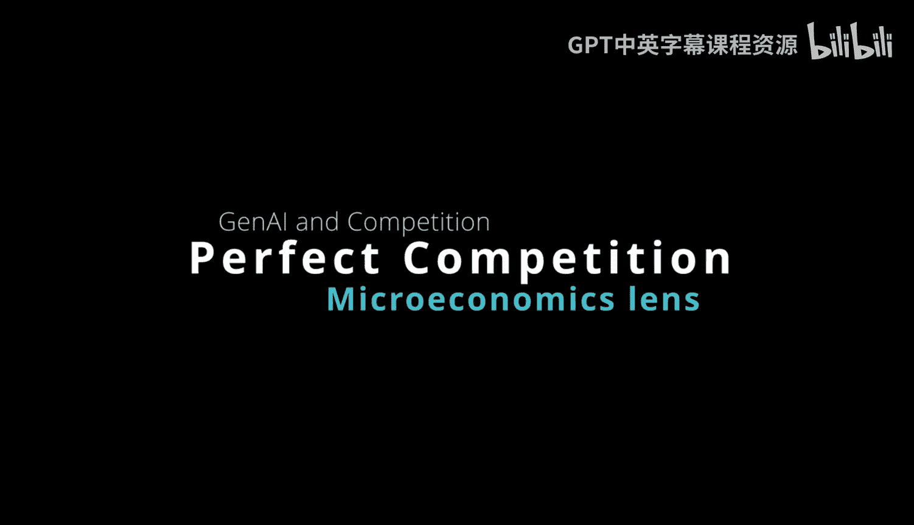
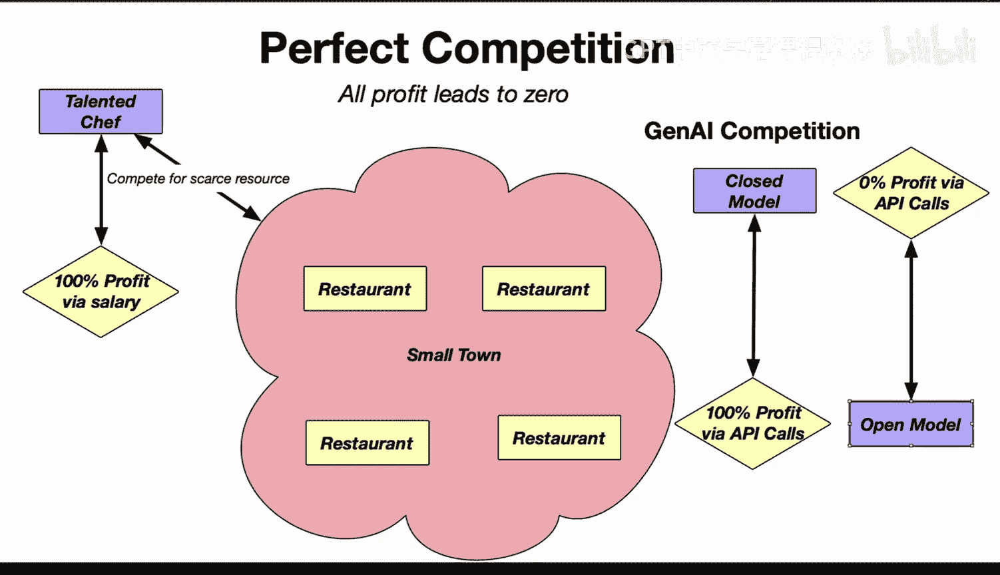
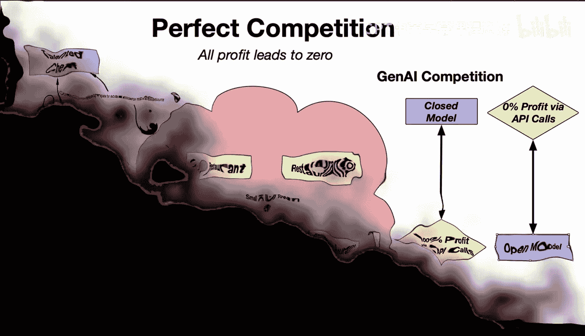

# 38：完全竞争

## 📖 课程概述

在本节课中，我们将要学习经济学中的“完全竞争”概念，并探讨它如何类比到人工智能领域，特别是大语言模型的商业模式。我们将通过餐馆竞争厨师和AI公司竞争模型的例子，来理解在完全竞争市场中利润如何趋于零，以及这对制定AI战略的启示。

---

## 🏙️ 完全竞争的含义

在完全竞争市场中，所有经济利润最终会趋于零。这意味着什么？

我们可以通过一个小镇餐馆的例子来理解。假设镇上有四家餐馆。在一位才华横溢的厨师来到镇上之前，餐馆之间没有真正的竞争方式。

---

## 👨‍🍳 稀缺资源的竞争

现在，每家餐馆都必须竞争这位稀缺的厨师资源，因为他才华出众，能为餐馆带来所有顾客。

以下是餐馆们的行为逻辑：
*   他们持续相互竞争，并支付越来越高的薪水。
*   最终，厨师拿走了所有的利润，因为厨师是一种有限或稀缺的资源。

这位厨师拥有稀有且需求旺盛的技能。许多餐馆竞标他的服务。最终，厨师将谈判获得非常高的薪水，并攫取所有的经济利润。

---

## 💰 经济利润的定义

那么，什么是经济利润？它指的是**总收益减去总经济成本**。这是超出正常利润的部分。

*   **正常利润**是吸引投资所需的成本。
*   **经济利润**是高于正常利润的部分。

本质上，这种完全竞争可能导致最终的破产，因为实际雇佣厨师的雇主必须将所有利润都给厨师，并且无法通过其他方式竞争。

---

## 🤖 AI领域的类比

同样，我们可以看一个可能发生类似情况的AI例子。假设存在一个闭源模型，并且由于其卓越的性能，每个人都必须使用这个闭源模型。

那么，就像厨师例子一样，现在不存在竞争优势，因为每个人都必须使用同一个闭源模型。这些公司的所有利润都将流向API调用费用，就像餐馆例子中的厨师薪酬一样。

另一方面，我们可能看到另一种情景：如果所有模型都是开源的，那么也无法盈利，因为你可以平等地使用任何模型。因此，训练模型的公司最终将倒闭，因为无法赚钱。

---

## 💡 战略思考与总结

这是一个假设性的情境，但从经济学角度思考这一点非常重要，尤其是在评估你的AI战略时。

你需要思考：
*   全力投入闭源模型是否会给你带来竞争优势？
*   或者，你认为未来如果模型数量本质上无限，模型最终是否会变得像Linux一样，成为一种免费的商品？届时你将不得不在其他形式的技术上进行竞争。

---

## 📝 本节总结

本节课中，我们一起学习了“完全竞争”的经济学原理。我们通过小镇餐馆争夺厨师的例子，理解了稀缺资源如何吸收所有经济利润。接着，我们将这一概念类比到AI领域，探讨了在闭源模型垄断和开源模型普及两种极端情况下，企业可能面临的利润挑战。这提醒我们，在制定AI战略时，必须从经济学角度深思熟虑未来的竞争格局。