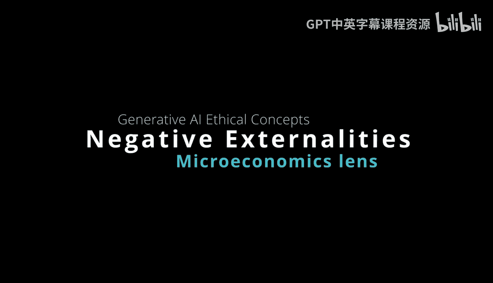
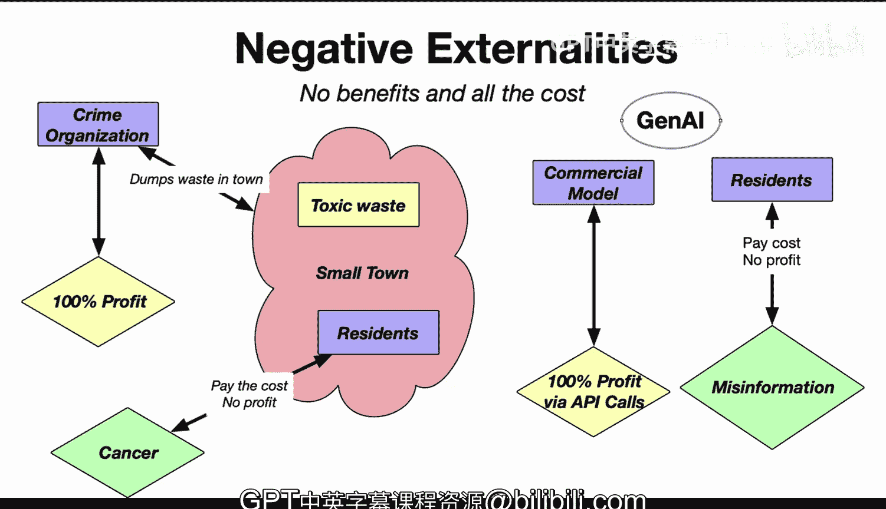

# 本地大语言模型的基础：P39：负外部性

在本节课中，我们将要学习一个重要的经济学概念——**负外部性**，并探讨其在技术领域，特别是生成式人工智能中的应用与影响。我们将通过具体例子来理解这个概念，并思考如何在技术开发中负责任地评估潜在影响。

## 什么是负外部性？🤔

负外部性是指某些行为或产品在产生效益的同时，给未直接参与交易或活动的第三方带来了成本或损害，而这些第三方并未从中获得任何收益。

用公式可以表示为：
**社会总成本 = 私人成本 + 外部成本**
其中，**外部成本**就是由负外部性带来的，且未被行为发起者承担的部分。

## 一个极端的现实案例 🏭

为了更好地理解这个概念，我们可以看一个基于现实世界的极端例子。

假设有一个犯罪组织，他们受雇于某公司，非法地将有毒废物（例如核废料或农药）倾倒在某个小镇上。以下是这个事件中各方的得失分析：

*   **犯罪组织**：获得了处理废物的全部报酬（**100%的利润**）。
*   **雇佣公司**：以较低成本处理了废物。
*   **小镇居民**：没有从倾倒行为中获得任何利润，但却要承担全部后果。这些后果可能包括：
    *   居民健康受损，如罹患癌症或其他疾病。
    *   当地环境被污染，影响农业生产和生活质量。

在这个案例中，倾倒有毒废物的行为产生了巨大的**负外部性**，全部由无辜的小镇居民承担。

## 生成式AI中的潜在负外部性 🤖

上一节我们通过极端案例理解了负外部性的核心。现在，让我们将这一框架应用到生成式人工智能领域。

设想一家商业公司发布了一个生成式AI模型，并通过API调用获利。该公司获得了**100%的利润**。然而，其产品可能在不经意间对社会其他成员造成成本。以下是一些潜在的负外部性场景：

*   **虚假信息与政治干预**：AI生成的、模仿著名政治人物声音的内容，可能被用来散布虚假信息，影响选举结果。
*   **声誉损害**：针对特定个人或公司的AI生成不实信息，可能对其声誉或业务造成严重伤害。
*   **公共健康风险**：关于医疗健康的AI生成误导性内容，可能导致人们采取有害的行动，危及健康。

在这些情况下，商业公司获得了利润，但社会上的其他人（用户、相关个体、公众）却可能被迫承担这些行为带来的**负面成本**，即负外部性。

## 如何负责任地思考与应对？⚖️

认识到潜在负外部性的存在，是迈向负责任技术开发的第一步。这并不意味着所有技术方案都会产生极端的负面影响，但主动评估是必要的。

在提出技术解决方案时，一个负责任的思考框架应该包含以下两个关键视角：

1.  **审视利润**：评估方案能带来的商业价值与私人收益。
2.  **审视负外部性**：评估方案可能对第三方、社会或环境产生的**非意图的、真实的影响**。即使影响是无意造成的，其后果依然存在。

将负外部性纳入考量，是负责任地部署人工智能解决方案的重要方式。它要求开发者和企业超越单纯的利润计算，思考其技术可能产生的更广泛的社会涟漪效应。

---

本节课中我们一起学习了**负外部性**的概念。我们了解到，它描述的是某些活动让未参与者承担成本的现象。我们通过非法倾倒废物的例子直观理解了其含义，并探讨了生成式AI可能带来的类似风险，如虚假信息和声誉损害。最后，我们强调了在技术开发中，除了追求利润，还必须主动评估和尽量减少潜在的负外部性，这是构建负责任AI的关键一步。