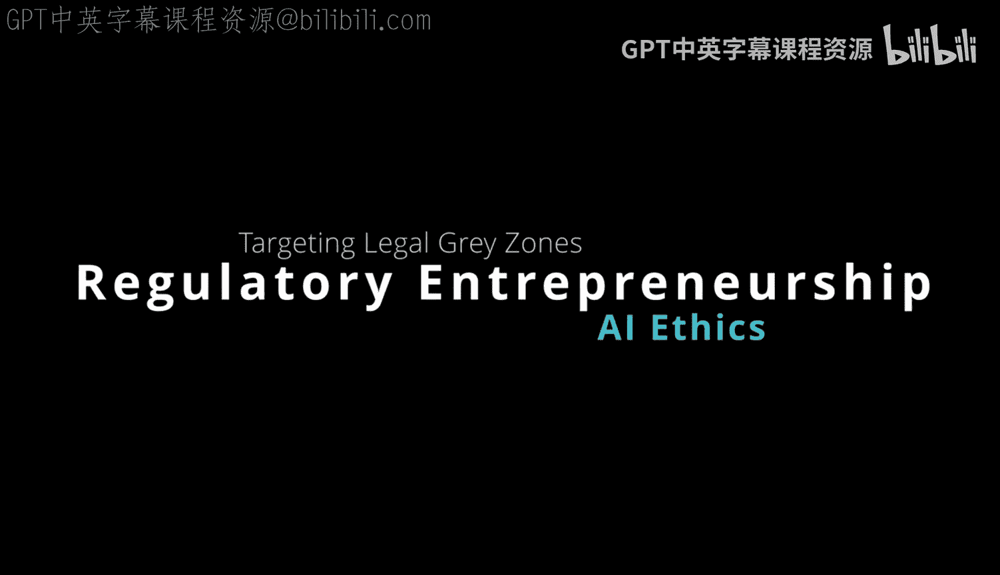
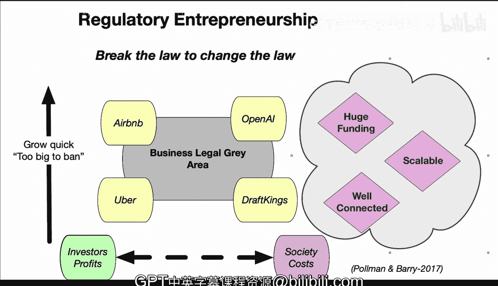

# 杜克大学《本地大语言模型的基础》：P40：监管创业

## 概述
在本节课中，我们将要学习“监管创业”这一概念。我们将了解其定义、核心策略、促成因素、社会影响，并通过具体案例进行分析。

---

## 什么是监管创业？
监管创业是由Paulllman和Barry在2017年提出的一个术语。其核心含义是：通过**在法律的灰色地带创立公司或违反现有法律**，从而在后期推动法律本身的改变。

上一节我们介绍了监管创业的基本定义，本节中我们来看看涉及这一模式的具体公司。

## 涉及监管创业的公司案例
以下是几个典型的监管创业公司例子：
*   **Airbnb**：模糊了酒店与私人短租的界限。
*   **Uber**：改变了交通出行领域的法规。
*   **Tesla**：在汽车直销等领域挑战传统法规。
*   **Draftkings**：推动了在线体育博彩的合法化。

这些公司的共同点是，它们都游走在商业与改变法律法规的边界线上。

## 监管创业的核心策略
为了实现改变法律的目标，这些公司通常会采用一些关键策略。以下是其主要策略：
1.  **识别法律灰色地带**：寻找现有法规未明确覆盖或存在解释空间的领域。
2.  **快速扩张**：迅速扩大规模，使得政府难以简单禁止，即达到“**太大而不能禁**”的状态。
3.  **动员用户获取政治支持**：利用社交媒体等渠道，让公众支持其产品，形成政治压力。

## 监管创业的促成因素
监管创业模式的成功，依赖于一些特定的条件。以下是几个关键促成因素：
*   资金充足、可快速扩张的初创公司。
*   产品或服务对公众有吸引力。
*   倾向于挑战州或地方法律，而非国家法律，因为对抗国家法律更为困难。
*   诉讼过程本身带有政治性，而不仅仅是法律性。

## 监管创业的社会影响
这种模式带来了一系列社会影响。主要影响包括：
*   降低了这些公司进入市场的参与成本。
*   可能导致政策被迅速改变。
*   改变后的政策**可能偏离公共利益**。

了解了策略和影响后，一个核心问题是：这些因素如何在具体公司中发挥作用？

## 案例分析：成本与收益
如果我们观察Airbnb、OpenAI、Uber和Draftkings这四家公司，可以看到相同的模式。这些模式也适用于生成式AI等领域。

*   **Airbnb**
    *   **收益**：公司获得利润和数百亿美元的估值，为创始人和投资者带来了回报。
    *   **社会成本**：社会需要承担**可负担租赁住房单元全球性减少**的损失。这是一种负外部性。

*   **Uber**
    *   **收益**：公司获得500亿美元估值，风险投资者得以获利退出。
    *   **社会成本**：以旧金山为例，社会需要承担**交通拥堵加剧和排放增加**的代价。这不仅加剧了全球变暖，当地居民也需要吸入更多污染物，拥堵本身也是一种社会需要承担且无人补偿的负外部性。

*   **Draftkings**
    *   **收益**：创造了一个价值数十亿美元的梦幻体育产业。
    *   **社会成本**：导致更多人赌博成瘾、个人破产案例增加。社会需要为此承担费用。例如，若有人将钱用于赌博而无力支付房贷，其家庭可能流落街头，这就是一种极端的负外部性，社会需要承担其负担。

*   **OpenAI与生成式AI**
    *   **收益**：推动了生成式AI技术的显著进步，并创造了利润。
    *   **潜在社会成本**：AI可能被用于破坏性用途。此外，艺术家的作品在未经明确许可的情况下被用于训练模型，引发了版权方面的担忧。**基于受版权保护的数据进行训练的成本**，也是一种需要社会承担（或消化）的损失。

## 总结
本节课中我们一起学习了“监管创业”的概念。监管创业模式实际上已存在相当长的时间，它与风险投资密切相关，并呈现出清晰的模式：快速成长至规模巨大、要求巨额资金、由人脉广泛并能游说国会的人士推动。至于未来会有更多还是更少的监管，目前尚无定论，但这些模式在监管创业中普遍存在。

---