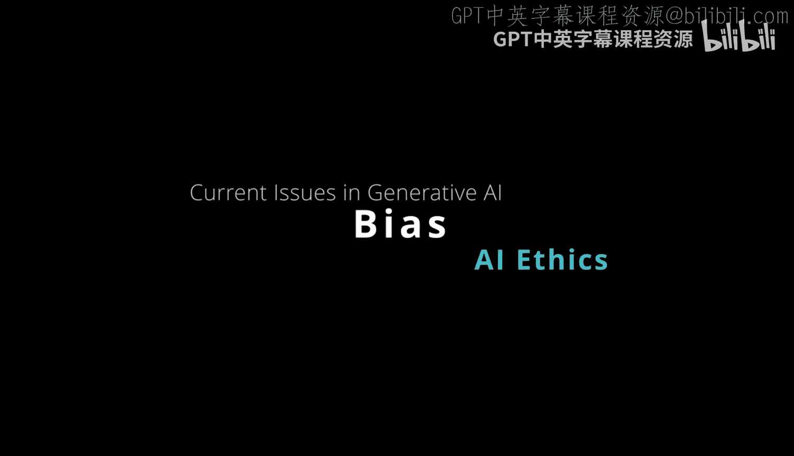
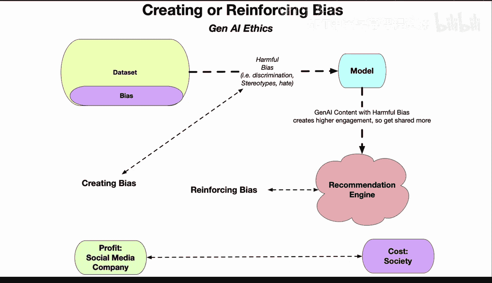

# 本地大语言模型的基础：P41：创建或强化偏见 🧠



在本节课中，我们将要学习生成式人工智能中一个关键的伦理问题：偏见是如何被创建或强化的。我们将探讨偏见数据如何影响模型训练，以及这种影响如何通过推荐系统等机制被放大，最终对社会造成深远危害。

---

## 偏见的来源与强化机制

上一节我们介绍了生成式AI的基本概念，本节中我们来看看偏见是如何在系统中产生并加剧的。问题的核心在于训练数据本身可能包含偏见。

如果模型在不加处理的情况下，使用包含**刻板印象**、**歧视**或**仇恨**信息的数据集进行训练，那么模型本身就会学习并内化这些偏见。当这个模型被部署到一个能够生成内容的系统（如推荐引擎）中时，它可能会产生更多带有偏见的内容，从而**强化**了原有的偏见。

一个典型的例子是，基于偏见数据训练的生成式AI内容被放入推荐引擎后，那些带有**有害偏见**的内容可能因为引发更多互动（如点击、分享）而获得更高的曝光度。这使得从偏见数据中获利的模式被进一步放大。

**公式表示**：
`系统输出偏见 ∝ 训练数据偏见 × 推荐算法对互动的优化`

---

## 偏见的恶性循环与商业驱动

以下是偏见在商业系统中被创建和强化的典型流程：

1.  **数据收集**：收集与过去用户互动相关的数据，这些数据可能本身就记录了有害的行为或偏见。
2.  **优化目标**：算法被优化以追求**点击量**、**分享量**和**煽动性互动**（如愤怒），这常常涉及推广有害内容。
3.  **形成“信息茧房”**：这会导致“过滤气泡”和**有毒的个性化推荐**，使用户不断被吸引到同类偏激内容中。
4.  **商业获利**：公司通过煽动性内容和错误信息获得了更高的整体参与度，从而增加了收入和利润。用户在平台上花费的时间越长，广告收入和定价能力也可能在短期内提升。

**代码逻辑示意**：
```python
# 简化的推荐算法逻辑（凸显问题）
def recommend_content(user, contents):
    # 传统算法可能只优化短期互动指标
    engagement_score = calculate_engagement_score(contents)
    # 忽略了内容本身的伦理和社会影响评估
    # ethical_score = assess_ethical_impact(contents) # 通常缺失
    recommended = sort_by_score(contents, engagement_score)
    return recommended
```

---

## 社会成本与长期危害

虽然公司可能在短期内获得增长和利润，但社会却要为此付出高昂的代价。这种由数据传播带来的**歧视**和对边缘化群体的**刻板印象**，会产生深远的社会成本。

长期来看，这种偏见的强化可能导致：
*   社会理解的**侵蚀**与**分裂**，尤其在复杂议题上。
*   **极端主义**和**暴力**事件增加。
*   社会**稳定性**下降。

因此，这并非一个理论问题，而是必须处理的现实挑战。

---

## 解决方案与伦理考量

要应对这一问题，需要多管齐下，超越单纯的利润追求，全面思考系统对社会的影响。

可以采取的措施包括：
*   **加强监督**：对优化用户参与度的算法进行伦理审查和监管。
*   **改变优化目标**：在算法设计中纳入**伦理考量**，而不仅仅是互动指标。
*   **推动政策改革**：通过立法、税收等手段，应对这种有毒的商业模式。
*   **开展伦理培训**：提升开发者和决策者的伦理意识。

仅仅因为能带来利润，并不意味着商业模式总是好的。其背后可能催生有害的刻板印象，而社会必须承担后果。综合运用以上方法，是开始认真构建以人为本、对社会负责的AI系统的起点。

---



本节课中我们一起学习了偏见在AI系统中被创建和强化的过程。我们看到了有偏见的训练数据如何通过追求商业利润的推荐算法被放大，形成恶性循环，并最终让社会承担歧视、分裂与不稳定的成本。解决这一问题需要技术、伦理与政策层面的共同努力。