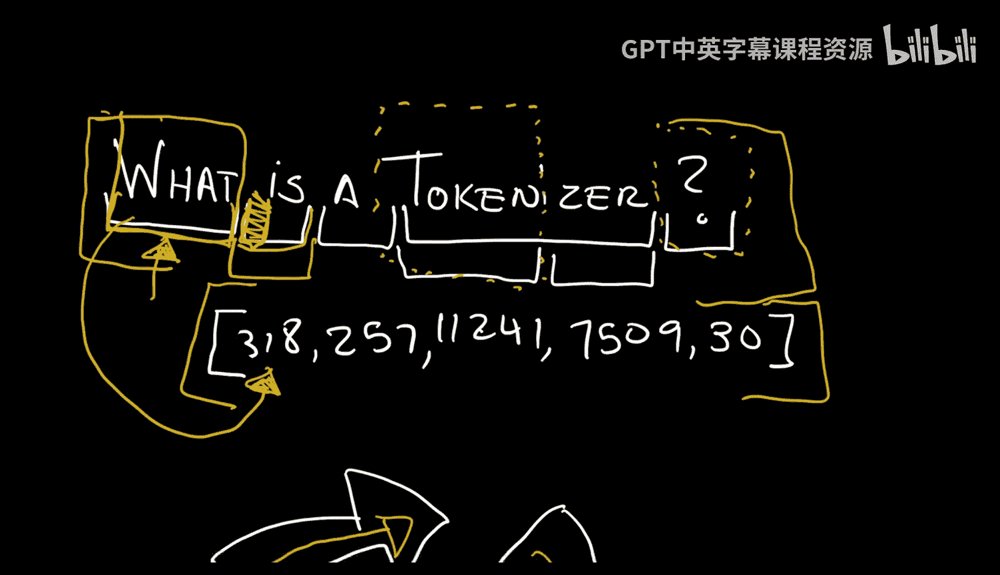
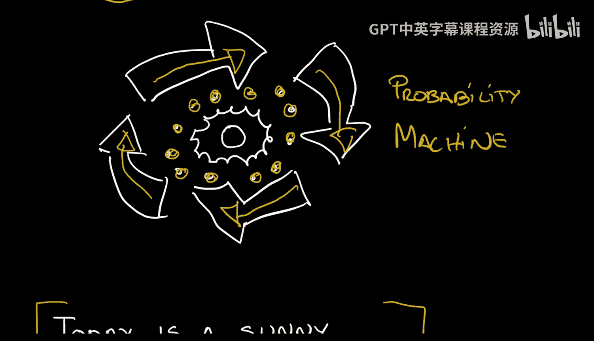
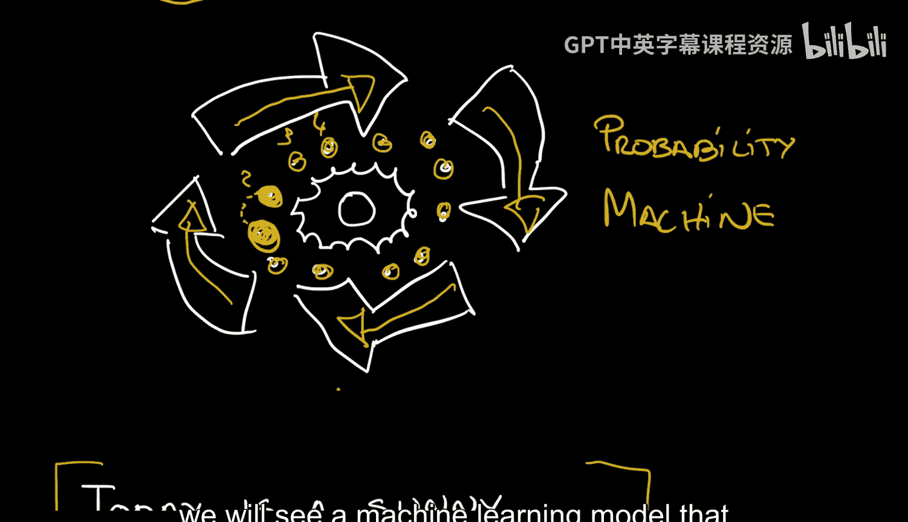
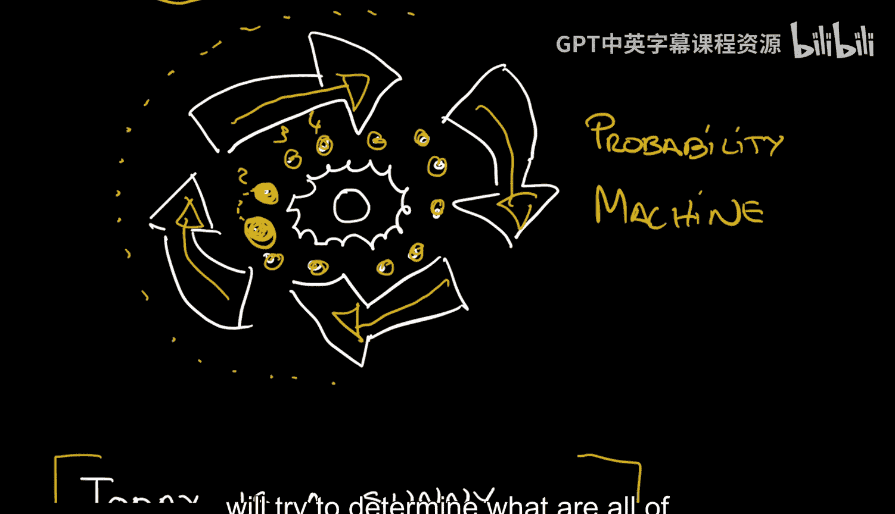
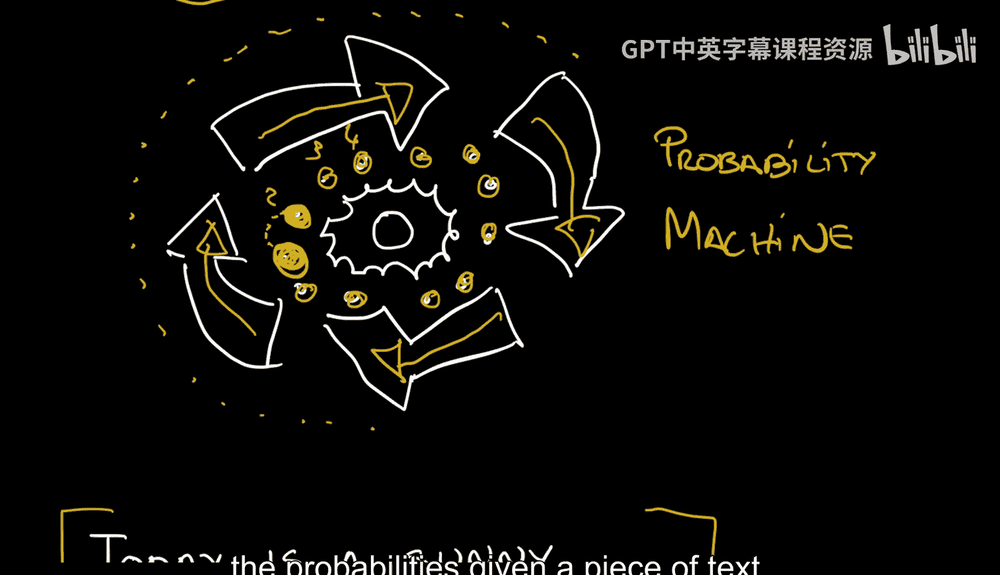
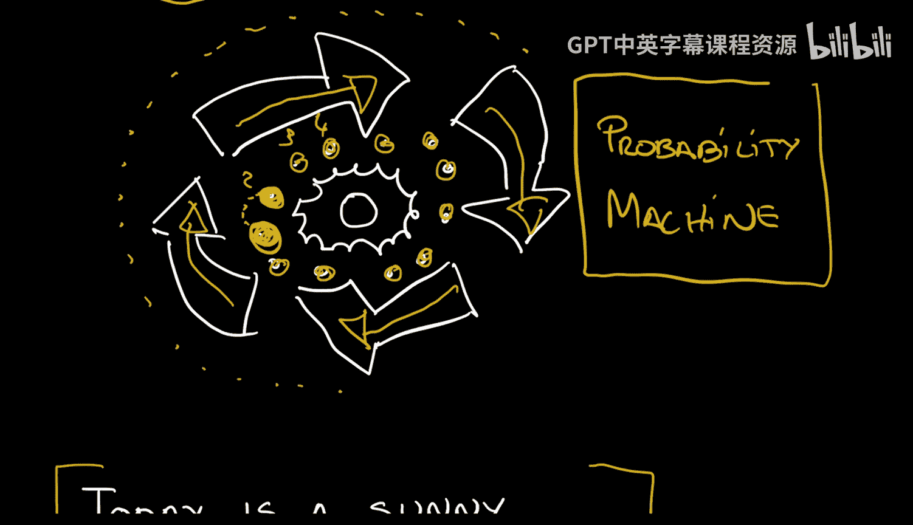
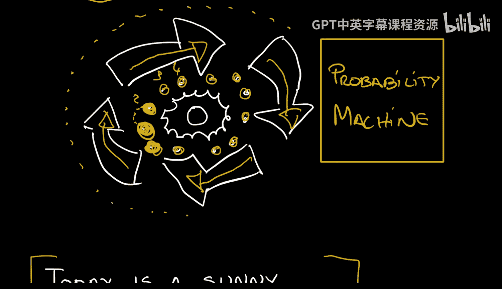

#  004：什么是LLM及其工作原理 🧠

在本节课中，我们将要学习大语言模型（LLM）的基本概念及其核心工作原理。我们将从理解文本如何被模型处理开始，逐步揭示LLM如何通过概率计算来生成文本。

## 从文本到数字：理解分词器

要理解LLM及其确切的工作原理，我们首先需要从“词元”开始，并理解什么是分词器。

我们有一段文本，它提出了一个问题：“what is a tokenizer”。分词器的确切含义是：它是一个将文本（例如这里的这个短语）转换为数字的过程。

大语言模型以文本作为输入，并生成文本作为输出。但这个过程具体是如何发生的呢？它通过处理一个短语（例如本例中的短语），并将其分割成更小的块来实现。

以下是分词过程的一个示例：

例如，其中一个块可能是“what”，它会被转换成一个数值，比如 **318**。所有这些块最终都会被转换成数字，并被放入一个数组中。这是机器能够处理它们并尝试更好地识别这些由数值表示的片段的方式。

我们正在创建一种索引。这个索引是原始文本块的编码。我们之所以称它们为“块”或“片段”，是因为它们不一定是完整的单词。

在本例中，我们可以说“what is a”是一个块，但它也可能包含一些空格，这些空格也可能作为一个整体块被表示。有时，分词器甚至会将一个单词拆分成两部分，例如“tokenizer”可能被拆成“token”和“izer”。像“？”这样的标点符号也可能构成一个独立的块。

所有这些表示方法都使机器学习模型更容易理解文本。否则，对于机器来说，理解文本将非常困难。这是目前我们让机器理解文本的最佳方法。

## 概率机器：LLM的核心

上一节我们介绍了文本如何被分割并转换为数值。本节中，我们来看看这些数值背后，LLM究竟在处理什么。我喜欢将其称为“概率机器”。

为什么是概率机器？因为它试图理解所有这些较小的文本块（词元），并尝试预测从一个词元到下一个词元的概率。

模型会计算：从这个词元开始，下一个词元是第二个词元的概率是多少？然后是第三个、第四个，依此类推。因此，用一个过度简化的方式解释，它本质上就是一个基于海量文本训练得出的概率计算器。

我们将看到一个机器学习模型，它试图根据给定的文本片段来确定所有可能的后续词元的概率。这就是为什么我想强调，这本质上就是一台概率机器。

这样思考这些模型也很容易，因为它们有时表现得非常出色，就像一个能输出事实的机器。但即使某些生成的文本看起来准确、正确且符合现实，我们也不应将其视为事实输出机。因为它所做的一切都只是基于给定特定输入的概率计算。

## 工作原理示例

基于大量的训练文本，以及将这些文本分解为词元并生成所有索引，模型能够理解概率。

例如，有一个短语：“今天是个晴朗的……”。这个短语是理解“……”部分可能是哪个特定词的完美例子。

在本例中，“今天是个晴朗的”后面很可能跟着“天”这个词。模型甚至可能预测在“天”之前有一些空格，以便在文本生成时能正确表示。

所以，从本质上讲，具有大语言生成能力的机器学习模型，即大语言模型，其文本生成的工作原理是：首先通过分解文本来创建索引，然后作为一台概率机器运行。

## 总结

本节课中，我们一起学习了大语言模型（LLM）的核心概念。我们了解到，LLM首先通过分词器将输入文本分割并编码为数字序列（词元）。然后，模型作为一个“概率机器”运行，基于从海量文本中学到的模式，计算并预测最可能的下一个词元，从而逐步生成连贯的文本。理解LLM的概率本质至关重要，它提醒我们，模型的输出是基于统计可能性，而非对事实的绝对认知。